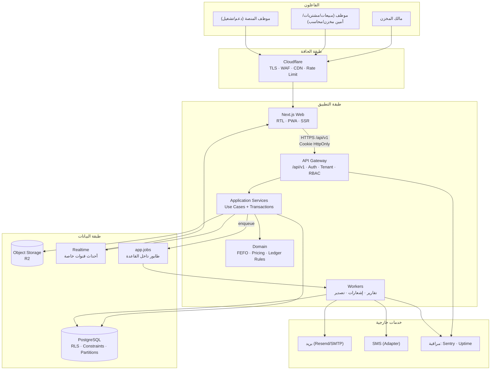
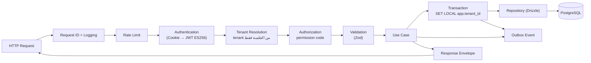

# 01 — هندسة النظام والطبقات وتدفّق الطلب

> **يقابل:** البند «ثانيًا: تصميم بنية النظام» كاملًا + البند 1 و3 و5 من شروط الاعتماد.
> **المرجع المصاحب:** `docs/architecture/01-system-architecture.md`, `02-high-level-architecture.md`, `03-low-level-architecture.md`, `04-c4-model.md`.

---

## 1. المتطلبات غير الوظيفية (هي التي تحدّد البنية، لا الشعارات)

| # | المتطلب | القيمة الملزمة | كيف تُقاس |
|---|---|---|---|
| NFR-1 | عزل بيانات المخازن | **صفر تسريب** مقبول | مصفوفة اختبارات عزل (11 §7) + RLS-forced |
| NFR-2 | سلامة الرصيد | لا رصيد سالب ولا حركة بلا أثر | قيد `CHECK` + اختبار تزامن 50 طلبًا متوازيًا |
| NFR-3 | زمن استجابة API | p95 ≤ 300ms، p99 ≤ 800ms (قراءة)، ≤ 1.2s (كتابة مركّبة) | k6 + ميزانية أداء في CI |
| NFR-4 | توفّر | 99.5% شهريًا (المرحلة 1)، 99.9% هدف عند التوسع | UptimeRobot + تقرير شهري |
| NFR-5 | RPO / RTO | RPO ≤ 24 ساعة (مجاني) / RTO ≤ 4 ساعات | تمرين استعادة موثّق (`12` §5) |
| NFR-6 | قابلية التوسع | 1 → 100 → 1000 مخزن، 10M حركة/سنة | خطة `11` مع نقاط التحوّل |
| NFR-7 | التكلفة | 0 جنيه حتى أول عميل مدفوع | فاتورة شهرية = 0 |
| NFR-8 | قابلية التدقيق | كل تغيير مالي/مخزني له فاعل ووقت وسبب | `audit_logs` + append-only |
| NFR-9 | إتاحة عربية RTL كاملة | كل شاشة تعمل على 360px عرضًا | Playwright + axe |
| NFR-10 | قابلية الصيانة | حدّ وحدة واحد لا يتجاوز 25 ملفًا عامًا | dependency-cruiser في CI |

---

## 2. مقارنة البدائل المعمارية

| المعيار | Modular Monolith | Microservices | Multi-Tenant SaaS | DDD (كتصميم تكتيكي) |
|---|---|---|---|---|
| زمن الوصول للسوق | **ممتاز** | ضعيف (شهور بنية تحتية) | جيد | جيد |
| التكلفة في المرحلة 1 | **صفر تقريبًا** | عالية (شبكة، مراقبة، نشر) | متوسطة | منخفضة |
| عزل البيانات | جيد (بحدود + RLS) | **ممتاز** (عزل فيزيائي ممكن) | **ممتاز إن نُفِّذ صحيحًا** | لا يقرره |
| قابلية التوسع | جيدة (نسخ أفقية) | **ممتازة** | **ممتازة** | لا يقررها |
| تعقيد التشغيل | **منخفض** | مرتفع جدًا | متوسط | منخفض |
| ملاءمة فريق صغير | **ممتاز** | سيئة | جيدة | جيدة |
| تكلفة التغيير لاحقًا | متوسطة (حدود واضحة تسهّل الفصل) | — | — | — |
| الخطر الرئيسي | تضخّم الوحدة وتسرّب الحدود | فشل موزّع + تكلفة | خطأ عزل واحد = كارثة | إفراط في التجريد |

### القرار: **Modular Monolith + Multi-Tenant SaaS + DDD تكتيكي محدود**

- **لماذا Monolith؟** فريق صغير (1–4 مطورين)، نطاق معروف، وقيد تكلفة صفري. الشبكة بين الخدمات ليست ميزة بل مصدر فشل وتأخير. الحدود الوحدية تعطي ~80% من فائدة الفصل بتكلفة ~20%.
- **لماذا Multi-Tenant SaaS؟** 1000 قاعدة منفصلة = 1000 نسخة احتياطية و1000 هجرة = استحالة تشغيلية بفريق صغير. العزل في القاعدة عبر RLS + قيود مركبة هو الحل المُثبت صناعيًا لهذا الحجم.
- **لماذا DDD محدود؟** نأخذ **اللغة الموحّدة، والوحدات الحدودية، وجذر التجميع لكل معاملة** (`Sale`, `Purchase`, `StockTransfer`)، ونترك الأحداث المعقّدة وCQRS الكامل حتى تظهر حاجة حقيقية.
- **لماذا ليس Microservices الآن؟** لأن قرار «متى نفصل» يجب أن يُتخذ بالقياس (حمل وحدة > 40% من المعالجة، أو فريق مستقل يملكها)، لا بالرغبة. البنية أدناه تجعل الفصل **نقل مجلد + عقد HTTP موجود**، لا إعادة كتابة.

**مسار الفصل المستقبلي (Strangler):** `modules/inventory` → خدمة مستقلة عند تجاوز 3 ملايين حركة/شهر أو حاجة تضخيم مستقل؛ `modules/reporting` → خدمة تقارير/مستودع تحليلي عند تجاوز 20 ثانية لتقارير الذروة؛ `modules/notifications` → عامل مستقل عند تجاوز 50 ألف حدث/يوم.

---

## 3. الطبقات ومسؤولياتها (Dependency Rule: اتجاه واحد للداخل)

| # | الطبقة | المسؤولية | **يُمنع فيها** | تعتمد على |
|---|---|---|---|---|
| L1 | Presentation (Next.js) | عرض، تفاعل، تحقق شكلي فوري، حالة واجهة | أي قاعدة عمل، أي وصول للقاعدة | L2 عبر HTTP فقط |
| L2 | Edge/Gateway | TLS، CORS، تحديد المعدل، التحقق من الجلسة، استخراج `tenant_id`، Correlation ID، توجيه | قواعد عمل | L3 |
| L3 | Application (Use Cases) | تنسيق العملية، المعاملات، Idempotency، الصلاحيات، الأحداث | SQL خام، تفاصيل HTTP | L4 |
| L4 | Domain | الكيانات، القواعد، الحسابات (تسعير، FEFO، أرصدة)، أخطاء النطاق | Prisma/Drizzle، fetch، Date.now | لا شيء |
| L5 | Infrastructure | المستودعات، ORM، التخزين، البريد، الطوابير، المزودون الخارجيون | قواعد عمل | L4 (تنفيذ واجهاته) |
| L6 | Platform/Data | PostgreSQL، RLS، القيود، الفهارس، النسخ، المراقبة | منطق أعمال | — |

**قاعدة الاعتماد الآلية:** `domain` لا يستورد من `infrastructure`؛ `modules/x` لا يستورد من `modules/y` إلا عبر `modules/y/public.ts` (عقد صريح) — يُفرض بـ `dependency-cruiser` في CI.

---

## 4. الوحدات (Modules) — القائمة المعتمدة

| الوحدة | المسؤولية | جداولها الأساسية | تعتمد على |
|---|---|---|---|
| `identity` | مستخدمون، جلسات، MFA، كلمات مرور، أجهزة | `users`, `sessions`, `refresh_tokens`, `mfa_factors` | — |
| `tenancy` | المستأجرون، المخازن، التهيئة، دورة حياة الاشتراك | `tenants`, `warehouses`, `settings` | identity |
| `rbac` | أدوار، صلاحيات، إسنادات، فحص الصلاحية | `roles`, `permissions`, `role_permissions`, `user_roles` | tenancy |
| `catalog` | كتالوج الأدوية المستقل لكل مخزن، الباركود، التصنيفات، الربط المرجعي | `products`, `product_categories`, `product_barcodes`, `master_products` | tenancy |
| `inventory` | تشغيلات، أرصدة، دفتر حركات، تحويلات، جرد، تسويات | `batches`, `inventory_balances`, `stock_movements`, `stock_counts`, `stock_adjustments`, `transfers` | catalog |
| `procurement` | موردون، أوامر شراء، استلام، فواتير شراء | `suppliers`, `purchase_orders`, `purchase_invoices`, `purchase_items` | catalog, inventory |
| `sales` | عملاء، عروض، أوامر، فواتير، مرتجعات، تخصيص FEFO | `customers`, `sales_invoices`, `sales_items`, `returns` | catalog, inventory |
| `finance` | مدفوعات، مصروفات، ضرائب، ذمم، تقارير مالية | `payments`, `expenses`, `invoices`, `tax_rates` | sales, procurement |
| `reporting` | تقارير، تصدير، لوحات مؤشرات، عروض مادية | `mv_*`, `app.jobs` | قراءة من الكل |
| `notifications` | إشعارات داخلية، بريد، صلاحية قريبة، مخزون منخفض | `notifications`, `notification_outbox` | — |
| `audit` | سجل تدقيق غير قابل للتعديل + مقارنة قبل/بعد | `audit_logs` | — |
| `files` | رفعات، فواتير ممسوحة، مستندات، تصدير | `files` + R2 | — |
| `platform` | مهام مجدولة، Idempotency، أعلام ميزات، صحة النظام | `app.jobs`, `idempotency_keys`, `feature_flags` | — |

> **قاعدة:** كل وحدة تملك مخططها المنطقي (`modules/<name>/{domain,application,infrastructure,api,public.ts,tests}`) ولا تُصدّر إلا `public.ts`.

---

## 5. المخطط الشامل (C4 — Level 1 & 2)



### 5.1 المكوّنات داخل الـ API (C4 Level 3)



---

## 6. كيف تتصل الطبقات وكيف تنتقل البيانات

| المسار | الوسيلة | الضمان |
|---|---|---|
| Frontend → API | HTTPS، JSON، كوكي `HttpOnly` للجلسة، رأس `X-CSRF-Token` للطلبات المتغيّرة | TLS 1.3، Origin check، Cookie `SameSite=Lax` |
| API → Application | استدعاء دالة داخل العملية (In-process) | حدود وحدات مفروضة آليًا |
| Application → Domain | كائنات نطاق نقية | لا I/O داخل النطاق |
| Application → DB | Repository + معاملة قاعدة واحدة | `SET LOCAL app.tenant_id` + `statement_timeout` |
| Application → Storage | مسار مفتاح مُشتق: `tenant/<tenant_id>/<entity>/<uuid>` | لا وصول لملفات مستأجر آخر |
| Application → Jobs | كتابة صف في `app.jobs` داخل نفس المعاملة (Transactional Outbox) | لا حدث بلا بيانات، ولا بيانات بلا حدث |
| Jobs → External | Adapter + إعادة محاولة أسّية + `dead_letter` | لا فقدان إشعار |
| API → Frontend (لحظي) | Realtime بقناة `tenant:<id>` خاصة + اشتراك موقّع | الحمولة حدث بلا بيانات حساسة، والحقيقة تُجلب عبر API |
| التصدير/الاستيراد | مهمة خلفية → ملف في R2 → رابط موقّع 15 دقيقة | لا تنفيذ متزامن لملفات كبيرة |

**قاعدة البيانات لا تُرى من المتصفح أبدًا:** لا `anon key`، لا PostgREST، لا وصول مباشر. `REVOKE` على `anon/authenticated` في المخطط `public`، والاتصال من الـ API بدور واحد محدود الصلاحيات + RLS إجباري.

---

## 7. إدارة الأخطاء

### 7.1 التصنيف والاستجابة

| النوع | مثال | استجابة HTTP | إعادة المحاولة | تسجيل |
|---|---|---|---|---|
| خطأ مدخلات | كمية غير رقمية، باركود مكرر | 400 / 422 | لا | info |
| خطأ مصادقة | جلسة منتهية، توقيع خاطئ | 401 | لا (تحديث جلسة) | warn + عدّاد |
| خطأ صلاحية | موظف يحاول تسوية مخزون | 403 | لا | **warn + تدقيق** |
| اختلاف مستأجر | `tenant_id` في الطلب ≠ الجلسة | **403 `TENANT_MISMATCH`** | لا | **error + تنبيه أمني** |
| غير موجود | منتج محذوف/غير تابع للمخزن | 404 (لا 403) | لا | info |
| تضارب حالة | تعديل بعد تغيّر النسخة (ETag) | 409 | لا | info |
| تعارض Idempotency | نفس المفتاح بجسم مختلف | 409 | لا | warn |
| رصيد غير كافٍ | صرف أكبر من المتاح | 422 `STOCK_INSUFFICIENT` | لا | info |
| تغيّر سعر معتمد | سعر البيع تغيّر أثناء الفاتورة | 409 `PRICE_CHANGED` | لا (يُعاد العرض) | warn |
| تعارض تزامن | `serialization_failure` / deadlock | 503/409 | **نعم، 3 محاولات** | warn |
| خطأ داخلي | استثناء غير متوقع | 500 | حسب العملية | **error + Sentry** |
| حد معدل | تجاوز 60 طلب/دقيقة | 429 + `Retry-After` | نعم بعد المهلة | warn |

### 7.2 غلاف الخطأ الموحّد (RFC 9457)

```json
{
  "type": "https://api.example.com/errors/stock-insufficient",
  "title": "الرصيد غير كافٍ",
  "status": 422,
  "code": "STOCK_INSUFFICIENT",
  "detail": "المطلوب 12 عبوة، المتاح 7 في التشغيلة المطابقة لسياسة FEFO.",
  "instance": "/api/v1/sales",
  "correlationId": "01J9Z8K3T7X2Q4W6",
  "errors": [{ "field": "items[0].quantity", "message": "الحد الأقصى 7" }]
}
```

**قواعد:**
1. لا تُعاد تفاصيل داخلية (SQL، أسماء جداول، stack) أبدًا.
2. كل خطأ يحمل `correlationId` يظهر في السجل وفي الواجهة (`رقم للمتابعة`).
3. أخطاء النطاق تُرمِّز (`DomainError` → `code`) وتُترجم في طبقة الـ API؛ الواجهة تعرض نصًا عربيًا من خريطة رموز، لا نص الخادم الخام.
4. كل عملية مالية/مخزنية تُسجّل محاولة الفشل في `audit_logs` إذا كانت محاولة تجاوز صلاحية أو مستأجر.
5. **Circuit Breaker** لمكالمات الخدمات الخارجية (بريد/SMS) مع fallback: تُصفّ الطلبات في `app.jobs` ولا تُفشل العملية الأصلية.

---

## 8. تدفّق طلب كامل (من المستخدم إلى القاعدة والعودة)

```mermaid
sequenceDiagram
    autonumber
    participant U as المستخدم (Next.js)
    participant CF as Cloudflare
    participant API as API Gateway
    participant UC as Use Case
    participant DB as PostgreSQL (RLS)
    participant Q as app.jobs
    U->>CF: POST /api/v1/sales + Cookie + CSRF + Idempotency-Key
    CF->>API: تمرير بعد TLS/WAF
    API->>API: تحقق Origin + توقيع الجلسة (ES256)
    API->>API: استخراج tenant_id/user_id من الجلسة
    API->>API: فحص الصلاحية sales.create
    API->>API: تحقق Zod للمخطط
    API->>UC: createSale(dto, ctx)
    UC->>DB: BEGIN; SET LOCAL app.tenant_id
    UC->>DB: SELECT ... FOR UPDATE (تشغيلات FEFO)
    UC->>DB: INSERT sales_invoices/items/stock_movements
    UC->>Q: INSERT job (إشعار + تقرير) داخل نفس المعاملة
    UC->>DB: COMMIT
    DB-->>UC: النتيجة
    UC-->>API: 201 + المورد
    API-->>U: 201 + Location + ETag
    Q-->>Q: worker ينفّذ الإشعار لاحقًا
```

---

## 9. قابلية التوسع — مسار مُقاس لا نوايا

| المستوى | الحمل المتوقع | ما يُفعَّل | ما لا يُفعَّل بعد |
|---|---|---|---|
| T1: مخزن واحد | 20 مستخدمًا، 50 ألف حركة/سنة | نسخة API + قاعدة واحدة + فهارس + كاش صفحات | لا تخزين مؤقت موزّع، لا نسخ قراءة |
| T2: 100 مخزن | 2 ألف مستخدم، 5M حركة/سنة | نسخ API أفقية، PgBouncer، تقسيم شهري، Materialized Views | لا خدمات منفصلة |
| T3: 1000 مخزن | 20 ألف مستخدم، 50M حركة/سنة | نسخ قراءة، استخراج `reporting` و`notifications`، تقسيم بـ hash للتقارير، CDN كامل | لا Kubernetes قبل قياس حاجة |
| T4: multi-country | — | فصل بيانات إقليمي، مخطط لكل منطقة، امتثال محلي | — |

**قاعدة عدم الإغلاق:** كل جدول عالي النمو يحمل `tenant_id` أولًا في الفهرس، وكل تقرير قابل للتحويل إلى View مادي، وكل عملية كتابة قابلة للطابور — هذه الثلاث تجعل T3 ممكنًا بلا هجرة مؤلمة.

---

## 10. معايير قبول هذه الوثيقة

- [ ] كل وحدة في §4 لها مالك وحدود مكتوبة و`public.ts` مخطط.
- [ ] لا استدعاء مباشر من `domain` إلى ORM (مراجعة كود لاحقًا: dependency-cruiser يفشل البناء).
- [ ] كل خطأ في §7.1 له رمز ونص عربي في خريطة الواجهة.
- [ ] مخطط §5 مُراجع من: معماري، أمن، قاعدة بيانات، DevOps (أربع توقيعات).
- [ ] قرار D-1 محسوم.
