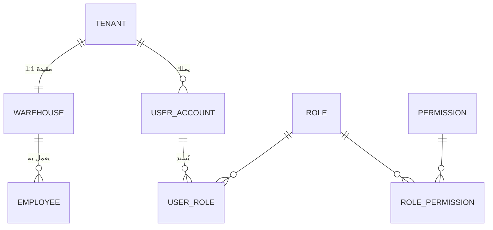

# 03 — تعدد المخازن وعزل البيانات والكتالوج

> **يقابل:** البند «رابعًا: هندسة تعدد المخازن» + «خامسًا: الكتالوج المستقل» + البند 7 و8 من شروط الاعتماد.
> **المرجع المصاحب:** `11-multi-tenant-isolation.md`, `12-auth-and-authorization.md`, `22-rls-and-isolation-tests.md`.

---

## 1. مقارنة استراتيجيات العزل

| المعيار | **Shared Database / Shared Schema** | Separate Schema | Separate Database |
|---|---|---|---|
| العزل المنطقي | RLS + قيود مركبة | `search_path` + صلاحيات مخطط | عزل فيزيائي كامل |
| خطر تسريب مستأجر | **موجود لكنه قابل للإثبات والاختبار** | متوسط | شبه معدوم |
| تكلفة 1000 مخزن | **0 إضافية** | 1000 مخطط (تدهور كتالوج PG، هجرات ×1000) | مستحيل ماليًا/تشغيليًا |
| الهجرات | هجرة واحدة للجميع | حلقة على 1000 مخطط | 1000 قاعدة |
| النسخ الاحتياطي | نسخة واحدة | نسخة واحدة (أصعب استعادة انتقائية) | 1000 نسخة |
| «استعادة مخزن واحد» | استخراج منطقي (pg_dump مُفلتر) | استخراج مخطط | سهل |
| الأداء عند 1000 مستأجر | جيد مع فهرسة تبدأ بـ `tenant_id` | جيد | جيد لكن باهظ |
| امتثال «بيانات معزولة فيزيائيًا» | لا يلبّي | جزئيًا | يلبّي |
| **الحكم للمرحلة 1** | **✅ المعتمد** | ❌ | ❌ (يُترك كخيار Enterprise) |

**القرار: Shared Database / Shared Schema + RLS إجباري + قيود مركبة.**

**لماذا؟** 1000 قاعدة تعني 1000 نسخة احتياطية و1000 هجرة ومراقبة موزّعة — استحالة لفريق صغير. RLS في PostgreSQL ليس «إخفاء في الواجهة»: هو منع على مستوى محرك القاعدة، ويُختبر آليًا بمصفوفة هجمات (القسم 9). المخاطر المتبقية (خطأ في سياسة) تُعالَج بأربع طبقات دفاع لا بطبقة واحدة.

**مسار الخروج (Enterprise):** عميل يطلب عزلًا فيزيائيًا → قاعدة منفصلة بنفس المخطط والهجرات، مع `tenant_id` ثابت واحد. الكود لا يتغيّر (نفس RLS والعقود)؛ يتغيّر فقط اتصال المستودع. هذا مذكور كـ ADR-002 مع شرط: لا يُنفَّذ قبل وجود عقد يدفع تكلفته.

---

## 2. نموذج المستأجر (Tenant Model)



| المفهوم | التعريف الدقيق | القيد الحاسم |
|---|---|---|
| `tenant` | الحساب/المستأجر: الوحدة القانونية والتجارية والفوترة | جذر كل شيء؛ لا أب له |
| `warehouse` | المخزن الفعلي (موقع واحد) | `UNIQUE (tenant_id)` = **مخزن واحد لكل حساب** |
| `user` | هوية دخول (بريد/هاتف + كلمة مرور + MFA) | ينتمي لمستأجر واحد فقط `tenant_id NOT NULL` |
| `employee` | سجل تشغيلي (وظيفة، راتب، وردية) مرتبط بمستخدم | `UNIQUE (tenant_id, user_id)` |
| `role` | مجموعة صلاحيات داخل المستأجر | أدوار النظام `is_system=true` غير قابلة للحذف |
| `membership` | ربط المستخدم بالمخزن ودوره وحالته | لا يمكن أن يشير لمخزن آخر (قيد مركب) |

**قواعد إلزامية:**
1. `MUST` إنشاء `tenant` + `warehouse` + مالك في معاملة واحدة عند التسجيل.
2. `MUST NOT` وجود مستخدم بلا `tenant_id`، ولا مستخدم في مستأجرين (لا سياق متعدد).
3. `MUST NOT` لأي حساب أن يرى قائمة مخازن أخرى، ولا تعدادها، ولا وجودها (404 لا 403 عند محاولة معرّف أجنبي).
4. موظف المنصة (دعم) ليس مستخدمًا عاديًا: هوية منفصلة، وصول بموافقة العميل، وتدقيق إلزامي لكل دخول.

---

## 3. مسار تحديد المستأجر في كل طلب (Tenant Resolution)

```mermaid
sequenceDiagram
    participant C as Client
    participant G as Gateway
    participant DB as PostgreSQL
    C->>G: طلب + Cookie (access JWT ES256)
    G->>G: تحقق التوقيع + exp + aud + kid
    G->>G: استخراج sub, tid, whid, roles من التوكن
    G->>G: مقارنة tid مع حالة الجلسة في القاعدة (sessions)
    G->>DB: BEGIN; SET LOCAL app.tenant_id = tid
    G->>DB: SELECT ... (RLS يفلتر تلقائيًا)
    DB-->>G: صفوف المستأجر فقط
    G-->>C: نتيجة
```

| القاعدة | التفصيل |
|---|---|
| مصدر `tenant_id` | **التوكن الموقّع من الخادم فقط**. لا يُقرأ من `X-Tenant-Id`، ولا من body، ولا من query، ولا من subdomain. |
| `warehouse_id` | يُشتق من `tid` عبر `UNIQUE (tenant_id)`؛ لا يُقبل من العميل إلا كتحقق إضافي مطابق. |
| تغيير المستأجر | **مستحيل** للمستخدم: لا endpoint لتبديل المستأجر؛ التوكن الجديد يُصدر بعد إعادة مصادقة فقط. |
| الطلبات غير المصادقة | 401 قبل الوصول لأي معالج (ما عدا `/health`, `/auth/*`). |
| الوظائف الخلفية | `tenant_id` جزء من حمولة المهمة، ويُعاد ضبط `SET LOCAL` داخل معاملة العامل. |
| الطلبات المتزامنة | `SET LOCAL` داخل المعاملة فقط (لا `SET` دائم) — شرط العمل مع مجمّع اتصالات. |

---

## 4. تنفيذ RLS + القيود (أربع طبقات دفاع)

**الطبقة 1 — التوكن والوسيطات (Application):** `tenant_id` من `sub/tid`، و`permission` مطلوب لكل مسار. لا استعلام بلا سياق.

**الطبقة 2 — المستودع (Repository):** كل استعلام يُبنى بواسطة `TenantScopedRepository` الذي يُضيف `WHERE tenant_id = $current` تلقائيًا، ويُرفض أي استعلام `raw` غير موقّع بمراجعة (lint rule).

**الطبقة 3 — RLS في القاعدة:**

```sql
ALTER TABLE products ENABLE ROW LEVEL SECURITY;
ALTER TABLE products FORCE ROW LEVEL SECURITY;   -- يُطبَّق حتى على مالك الجدول

CREATE POLICY p_products_select ON products
  FOR SELECT USING (tenant_id = current_setting('app.tenant_id', true)::uuid);

CREATE POLICY p_products_write ON products
  FOR ALL
  USING      (tenant_id = current_setting('app.tenant_id', true)::uuid)
  WITH CHECK (tenant_id = current_setting('app.tenant_id', true)::uuid);
```

- `FORCE` إلزامي: يمنع مالك الجدول من تجاوز السياسة.
- الدور الذي يتصل به التطبيق: `app_rw` — **لا** `BYPASSRLS`، **لا** `SUPERUSER`، ولا يملك `TRUNCATE`.
- `anon` و`authenticated` (PostgREST): `REVOKE ALL` على `public` — لا وصول مباشر.

**الطبقة 4 — القيود المركبة (Composite FKs):** تمنع الإشارة إلى صف من مستأجر آخر حتى لو أخطأ الكود والـ RLS معًا:

```sql
ALTER TABLE products ADD CONSTRAINT uq_products_tenant_id UNIQUE (tenant_id, id);

ALTER TABLE batches
  ADD CONSTRAINT fk_batches_product
  FOREIGN KEY (tenant_id, product_id)
  REFERENCES products (tenant_id, id);
```

> هذا هو **الضمان الرياضي** لعدم اختلاط الكتالوجات والأرصدة: مستحيل أن يشير تشغيلة مستأجر A إلى منتج مستأجر B، لأن القيد المركب لا يجد الصف.

**منع تغيير `tenant_id`:**

```sql
CREATE OR REPLACE FUNCTION app.forbid_tenant_change() RETURNS trigger LANGUAGE plpgsql AS $$
BEGIN
  IF NEW.tenant_id IS DISTINCT FROM OLD.tenant_id THEN
    RAISE EXCEPTION 'TENANT_IMMUTABLE' USING ERRCODE = '42501';
  END IF;
  RETURN NEW;
END $$;
-- يُركَّب على كل جدول تشغيلي (BEFORE UPDATE)
```

بالإضافة إلى: `REVOKE UPDATE (tenant_id) ON ... FROM app_rw` — طبقة ثالثة.

---

## 5. الكتالوج المستقل لكل مخزن

**الخصائص الإلزامية:**
1. `products.tenant_id NOT NULL` + `UNIQUE (tenant_id, id)` — لا كتالوج مشترك.
2. الباركود فريد **داخل المستأجر** فقط: `UNIQUE (tenant_id, barcode)` — نفس الدواء في مخزنين = صفّان مستقلان، وهو المطلوب.
3. الكود الداخلي لكل مخزن: `UNIQUE (tenant_id, sku)`.
4. التصنيفات والشركات المصنعة والشكل الدوائي **داخل المستأجر** (`product_categories.tenant_id`)، مع إمكانية بذر قيم مقترحة عند التسجيل (نسخة، لا مرجع مشترك).
5. لا استعلام واحد يعبر المستأجرين في أي مسار مستخدم؛ تقارير المنصة (عدد المخازن) تعمل بدور منفصل `platform_ro` مع صلاحية تجميعية فقط.

**حقول المنتج المعتمدة:** `trade_name, scientific_name, active_ingredient, manufacturer_id, strength, dosage_form, pack_size, pack_unit, unit_of_measure, barcode(s), category_id, status(active|inactive|discontinued|blocked), storage_conditions, prescription_required, min/max/reorder levels, shelf_life_months, tax_code, notes`.

**تعدد الباركود:** جدول `product_barcodes` (باركود أساسي + بدائل/وحدات) مع `UNIQUE (tenant_id, barcode)` — لأن بعض العبوات تحمل أكثر من باركود (علبة/شريط).

---

## 6. الربط المرجعي الاختياري (Reference Drug) بلا كشف بيانات

**المشكلة:** نريد لاحقًا تجميع «أموكسيسيلين 500mg كبسولات» عبر المخازن لتحليلات السوق، دون دمج الكتالوجات أو كشف بيانات أي مخزن.

**التصميم:**
1. جدول `master_products` (مرجعي، تديره المنصة): `id, canonical_name, active_ingredient_id, strength, dosage_form, pack_unit, atc_code?, is_verified`.
2. جدول `product_master_links`: `(tenant_id, product_id) → master_product_id`، `UNIQUE (tenant_id, product_id)`, `confidence`, `linked_by`, `linked_at`.
3. الربط **اختياري وصريح**: يقترح النظام مرشحين (تطابق اسم علمي/تركيز/شكل بعد تطبيع عربي)، والمالك يوافق. لا ربط تلقائي صامت.
4. **حدود الكشف:** `master_products` جدول مرجعي عام للقراءة فقط، لا يحتوي أي بيانات تشغيلية (لا سعر، لا رصيد، لا مخزن). ولا توجد أي واجهة تعرض «من يبيع هذا الدواء» أو أسعاره.
5. التحليلات عبر المخازن (إن فُعّلت تجاريًا) تعمل على تجميعات مجهولة الهوية فقط (`k ≥ 5` مخازن) وبقرار مكتوب من المالك.
6. إلغاء الربط متاح دائمًا؛ الربط لا يغيّر `product_id` ولا الأسعار ولا الأرصدة.

---

## 7. عزل بقية الأسطح (ليس الجداول فقط)

| السطح | آلية العزل | الفحص |
|---|---|---|
| البحث | كل استعلام يبدأ بـ `tenant_id` + فهرس `(tenant_id, ...)`؛ `pg_trgm` على عمود داخل المستأجر | اختبار: بحث بكلمة موجودة في مخزن آخر لا يعيد شيئًا |
| التقارير | Views تعتمد RLS؛ `SECURITY INVOKER` لا `DEFINER` (إلا بعد مراجعة)؛ التقارير المجمّعة بدور منفصل | تشغيل كل تقرير بمستأجرين ومقارنة النتائج |
| التصدير | التصدير مهمة خلفية تُنشأ بمعاملة تحمل `app.tenant_id`؛ الملف في `tenant/<id>/exports/...`؛ رابط موقّع 15 دقيقة بمفتاح المستأجر | محاولة الوصول لملف مستأجر آخر → 403 |
| الاستيراد | تحقق من كل صف: `tenant_id` يُعاد كتابته من السياق، ويُرفض أي صف يحمل معرّفًا أجنبيًا؛ حدود حجم وتقرير أخطاء | ملف يحتوي `product_id` لمستأجر آخر → رفض كامل |
| المهام الخلفية | حمولة المهمة تحمل `tenant_id`، والعامل يعيد ضبط السياق؛ لا مهمة تعمل على «كل المستأجرين» إلا تقارير المنصة | إدخال مهمة بمعرّف أجنبي → فشل |
| الإشعارات | `notifications.tenant_id` + قناة realtime خاصة `tenant:<uuid>` بتوقيع خادم | اشتراك بقناة مستأجر آخر → رفض |
| الملفات | مسار مُشتق من السياق + سياسة وصول على R2 + تحقق قبل التوقيع | تخمين مسار → 403 |
| السجلات | السجلات تحمل `tenant_id`؛ لا تُعاد لأي مستخدم إلا سجل مخزنه | تسريب سجل في رسالة خطأ → فحص آلي |
| النسخ الاحتياطي | نسخة كاملة مشفّرة؛ الاستعادة الانتقائية تُفلتر بالمعرّف | تمرين استعادة مخزن واحد |

---

## 8. دورة حياة المستأجر

| الحدث | الأثر | الضمانات |
|---|---|---|
| تسجيل مخزن جديد | إنشاء `tenant` + `warehouse` + مالك + أدوار نظام + إعدادات في معاملة واحدة | لا حساب ناقص، بريد ترحيب مهمة خلفية |
| تعطيل حساب | `tenants.is_active=false` + إبطال كل الجلسات | لا قراءة ولا كتابة، البيانات محفوظة |
| حذف حساب (طلب) | «حذف ناعم» 30 يومًا ثم تصدير كامل ثم حذف نهائي مُدقّق | لا حذف فوري؛ فواتير/حركات تبقى للمدة القانونية |
| نقل ملكية | مالك جديد + إبطال جلسات الجميع | يتطلب تحققًا ثانيًا (MFA) |
| تجاوز الحدود | تحذير عند 80% من حدود الخطة | لا قطع خدمة مفاجئ |

---

## 9. مصفوفة الهجمات الواجب اختبارها (Adversarial Tests)

| # | المحاولة | النتيجة المطلوبة |
|---|---|---|
| A1 | `GET /products/{id}` لمعرّف مخزن آخر | 404 (لا 403) بلا أي بيانات |
| A2 | تعديل `tenant_id` في body | تجاهُل تام / رفض 422 `TENANT_IMMUTABLE` |
| A3 | إرسال `X-Tenant-Id` لمخزن آخر | يُتجاهل؛ النتيجة من التوكن |
| A4 | استعلام RPC بمعامل `tenant_id` أجنبي | RLS يعيد صفرًا / منع |
| A5 | إنشاء فاتورة بمنتج أجنبي | فشل القيد المركب `23503` |
| A6 | صرف من تشغيلة أجنبية | فشل القيد المركب |
| A7 | ربط موظف بمخزن آخر | فشل `UNIQUE (tenant_id,user_id)` + FK مركب |
| A8 | تصدير ثم تغيير المسار | 403 |
| A9 | اشتراك في قناة realtime أجنبية | رفض الاشتراك |
| A10 | مهمة خلفية بمعرّف أجنبي | تتوقف وتُسجّل |
| A11 | حقن SQL في نص بحث | معاملات مُهيّأة، لا تنفيذ |
| A12 | استعادة نسخة لمخزن واحد | بيانات مخزن واحد فقط |

كل بند = اختبار آلي (Vitest + pgTAP) يفشل البناء عند كسره. المرجع: `supabase/tests/*` و`tests/security/*`.

---

## 10. معايير القبول

- [ ] `UNIQUE (tenant_id)` على `warehouses` موجود ومُختبر (منع مخزنين لحساب).
- [ ] `FORCE ROW LEVEL SECURITY` على كل جدول تشغيلي (فحص آلي يمر على `information_schema`).
- [ ] قيود مركبة `(tenant_id, id)` على كل كيان يُشار إليه من جدول تشغيلي.
- [ ] Trigger منع تغيير `tenant_id` مُثبّت ومُختبر.
- [ ] اختبارات A1–A12 خضراء، وتفشل عمدًا عند تعطيل RLS (اختبار «الحارس يعمل»).
- [ ] لا وصول لـ PostgREST/anon في أي بيئة.
