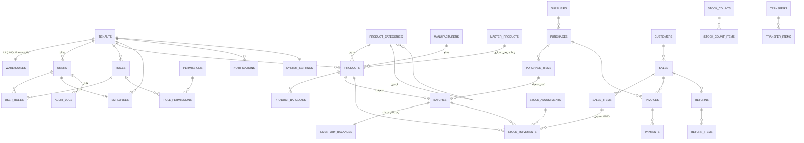

# 04 — قاعدة البيانات: ERD والجداول الأساسية (Tenancy · Identity · RBAC · Catalog · Inventory)

> **يقابل:** «سادسًا: تصميم قاعدة البيانات» (الجزء الأول) + البند 4 من شروط الاعتماد.
> **المرجع المصاحب:** `08-database-architecture.md`, `09-erd.md`, `21-reference-schema.md`.

---

## 1. ERD — المخطط العلائقي الكامل

> **ملاحظة تنفيذية:** في القاعدة الحالية توجد مسميات قائمة (156 جدولًا). الجدول التالي يوضح المطابقة قبل أي هجرة:

| الاسم الهدف | الاسم الحالي | ملاحظة |
|---|---|---|
| `tenants` | `tenants` | ✅ موجود |
| `warehouses` | `warehouses` | ✅ + قيد `UNIQUE (tenant_id)` |
| `users` | `users` + `warehouse_password_hashes` | يُوحَّد في `users` |
| `employees` | `employees` + `warehouse_employees` | يُوحَّد |
| `products` | `products` | ✅ |
| `product_categories` | `product_categories` / `categories` | يُوحَّد |
| `product_barcodes` | `products.barcode` (عمود) | **يُستخرج لجدول** |
| `batches` | — **غير موجود** | **فجوة يجب سدّها أولًا** |
| `inventory_balances` | `inventory` | إعادة تسمية + أعمدة حجز |
| `stock_movements` | `inventory_movements` (مقسّم شهريًا) | يُبقى التقسيم |
| `purchases` | `purchase_invoices` + `purchase_orders` | تفكيك واضح |
| `sales` | `sales_invoices` | ✅ |
| `returns` | `returns` + `return_items` | ✅ |
| `stock_adjustments` | — **غير موجود** | فجوة |
| `stock_counts` | — **غير موجود** | فجوة |
| `transfers` | `stock_transfers` | ✅ |
| `payments` | `payments` | ✅ |
| `expenses` | `expenses` | ✅ |
| `notifications` | `notifications` | ✅ |
| `audit_logs` | `audit_logs` | ✅ |
| `system_settings` | `settings` | ✅ |

---

## 2. الاصطلاحات والقالب القياسي (يُطبَّق على كل جدول)

| القاعدة | التفصيل |
|---|---|
| المفتاح الأساسي | `id uuid PRIMARY KEY DEFAULT uuid_generate_v7()` — v7 = ترتيب زمني مع عشوائية |
| عزل | `tenant_id uuid NOT NULL REFERENCES tenants(id) ON DELETE RESTRICT` |
| توقيت | `created_at timestamptz NOT NULL DEFAULT now()`, `updated_at timestamptz NOT NULL DEFAULT now()` |
| فاعل | `created_by uuid`, `updated_by uuid` (FK إلى `users` مع `ON DELETE SET NULL`) |
| حذف | `deleted_at timestamptz` **للبيانات المرجعية فقط** (منتج/عميل/مورد) |
| **ممنوع الحذف** | `stock_movements`, `audit_logs`, `payments`, `invoices`, `sales`, `purchases` → لا `DELETE`، ولا `deleted_at` |
| المال | `numeric(14,2)` — ممنوع `float/double` نهائيًا |
| الكمية | `numeric(14,3)` — يدعم أجزاء العبوة والوحدات الصغيرة |
| التكلفة | `numeric(14,4)` — دقة أعلى لمتوسط التكلفة |
| المفاتيح المركبة | كل كيان يُشار إليه من جدول تشغيلي يحصل على `UNIQUE (tenant_id, id)` |
| الفهرس الأول | يبدأ بـ `tenant_id` دائمًا في الجداول التشغيلية |
| التحقق | `CHECK` للقيم المنطقية، `NOT NULL` افتراضيًا، `text` بلا طول إلا لسبب |
| التدقيق | `audit_logs` append-only عبر صلاحيات + Trigger يمنع UPDATE/DELETE |

**قالب مشترك (`+ ق`):** `id`, `tenant_id`, `created_at`, `updated_at`, `created_by`, `updated_by`.

---

## 3. Tenancy & Identity

### 3.1 `tenants`
| العمود | النوع | القيود |
|---|---|---|
| `id` | uuid | PK |
| `code` | text | `UNIQUE`, `CHECK (code ~ '^[a-z0-9-]{3,32}$')` — يُستخدم في مسارات/تقارير |
| `name`, `name_ar` | text | `NOT NULL` |
| `email` | citext | `NOT NULL`, `UNIQUE` |
| `phone` | text | `NOT NULL` |
| `tax_id` | text | `NULL`, `UNIQUE` عند وجوده |
| `address`, `city`, `governorate`, `country` | text | `country DEFAULT 'EG'` |
| `status` | text | `CHECK IN ('trial','active','suspended','closed')` |
| `trial_ends_at` | timestamptz | `NULL` |
| `plan_code` | text | `DEFAULT 'free'` |
| `settings` | jsonb | `DEFAULT '{}'` — إعدادات غير علائقية فقط |
| `deleted_at` | timestamptz | حذف ناعم 30 يومًا |

**فهارس:** `UNIQUE(code)`, `UNIQUE(email)`, `idx_tenants_status(status)`.

### 3.2 `warehouses` — **قلب قاعدة «حساب واحد = مخزن واحد»**
| العمود | النوع | القيود |
|---|---|---|
| `id` | uuid | PK |
| `tenant_id` | uuid | `NOT NULL`, **`UNIQUE`** ← القيد الحاسم |
| `name`, `code` | text | `NOT NULL`; `UNIQUE (tenant_id, code)` |
| `license_no` | text | ترخيص وزارة الصحة، `NULL` مؤقتًا |
| `address`, `city`, `governorate`, `phone` | text | `phone NOT NULL` |
| `timezone` | text | `DEFAULT 'Africa/Cairo'` |
| `fiscal_year_start` | smallint | `DEFAULT 1` |
| `is_active` | boolean | `DEFAULT true` |

**فهارس:** `UNIQUE(tenant_id)`, `idx_warehouses_governorate(governorate)`.
**Triggers:** منع تغيير `tenant_id`؛ منع حذف مخزن له حركات (`RESTRICT`).

### 3.3 `users`
| العمود | النوع | القيود |
|---|---|---|
| `id` | uuid | PK (= `auth.uid` المستقبلي) |
| `tenant_id` | uuid | `NOT NULL FK RESTRICT` |
| `email` | citext | `NOT NULL`, `UNIQUE` |
| `phone` | text | `UNIQUE (tenant_id, phone)` |
| `password_hash` | text | `NOT NULL` — Argon2id (m=19456,t=2,p=1) |
| `full_name` | text | `NOT NULL` |
| `status` | text | `CHECK IN ('invited','active','suspended','locked')` |
| `is_owner` | boolean | `DEFAULT false` — مالك واحد نشط لكل مستأجر (قيد جزئي) |
| `email_verified_at`, `last_login_at` | timestamptz | `NULL` |
| `mfa_enabled` | boolean | `DEFAULT false` — إلزامي للمالك والمدير |
| `failed_attempts` | smallint | `DEFAULT 0` |
| `locked_until` | timestamptz | `NULL` |
| `must_change_password` | boolean | `DEFAULT true` عند الإنشاء بكلمة مرور مؤقتة |

**قيود:** `CREATE UNIQUE INDEX uq_owner_per_tenant ON users(tenant_id) WHERE is_owner AND deleted_at IS NULL;`
**فهارس:** `UNIQUE(email)`, `idx_users_tenant_status(tenant_id,status)`.
**ممنوع:** تخزين كلمة مرور بنص، أو تسجيلها في أي سجل.

### 3.4 `employees`
| العمود | النوع | القيود |
|---|---|---|
| `id` | uuid | PK |
| `tenant_id`, `user_id` | uuid | `UNIQUE (tenant_id, user_id)` + FK مركب |
| `employee_no` | text | `UNIQUE (tenant_id, employee_no)` |
| `job_title` | text | `NOT NULL` |
| `hire_date` | date | `NOT NULL DEFAULT current_date` |
| `national_id` | text | **مشفّر على مستوى التطبيق** (`pgcrypto` أو AES-GCM في الخدمة) |
| `status` | text | `CHECK IN ('active','on_leave','terminated')` |
| `salary` | numeric(14,2) | `NULL` — بيانات حساسة، صلاحية منفصلة |

### 3.5 `roles` / `permissions` / `role_permissions` / `user_roles`
| الجدول | الأعمدة الأساسية | القيود |
|---|---|---|
| `roles` | `id, tenant_id, code, name_ar, name_en, is_system, description` | `UNIQUE (tenant_id, code)`; `is_system` يمنع الحذف/تعديل الصلاحيات |
| `permissions` | `id, code, module, action, name_ar, is_sensitive` | `UNIQUE (code)` — مرجعي عام للقراءة فقط |
| `role_permissions` | `role_id, permission_id, granted_by, granted_at` | `PK (role_id, permission_id)`; FK `ON DELETE CASCADE` للدور |
| `user_roles` | `id, tenant_id, user_id, role_id, assigned_by, assigned_at` | `UNIQUE (tenant_id, user_id, role_id)`; FK مركب يمنع دورًا أجنبيًا |

**قاعدة:** لا تُخزَّن الصلاحيات في `users` كنص/JSON — تُشتق دائمًا من `user_roles → role_permissions`، وتُحسب في التوكن عند الدخول مع إبطال عند التغيير (`token_version`).

---

## 4. الكتالوج (Catalog)

### 4.1 `manufacturers` (داخل المستأجر)
`id, tenant_id, name, name_ar, country, is_active` · `UNIQUE (tenant_id, name)`.

### 4.2 `product_categories`
| العمود | النوع | القيود |
|---|---|---|
| `id`, `tenant_id` | uuid | `+ ق` |
| `parent_id` | uuid | `NULL`; `FOREIGN KEY (tenant_id, parent_id) REFERENCES product_categories (tenant_id, id)` |
| `name`, `name_ar` | text | `NOT NULL`; `UNIQUE (tenant_id, name)` |
| `code` | text | `UNIQUE (tenant_id, code)` |
| `path` | ltree/text | مسار مُشتق للتقارير الهرمية (اختياري) |
| `sort_order` | int | `DEFAULT 0` |
| `is_active` | boolean | `DEFAULT true` |

### 4.3 `products` — الكتالوج المستقل
| العمود | النوع | القيود / ملاحظات |
|---|---|---|
| `id`, `tenant_id` | uuid | `+ ق`; `UNIQUE (tenant_id, id)` |
| `sku` | text | `UNIQUE (tenant_id, sku)` |
| `trade_name` | text | `NOT NULL` |
| `trade_name_ar` | text | `NOT NULL` |
| `scientific_name` | text | `NULL` |
| `active_ingredient` | text | `NULL` |
| `manufacturer_id` | uuid | FK مركب `(tenant_id, manufacturer_id)` |
| `category_id` | uuid | FK مركب `(tenant_id, category_id)` |
| `strength` | text | مثال `500 mg` |
| `dosage_form` | text | `CHECK IN ('tablet','capsule','syrup','injection','cream','drops','suppository','inhaler','sachet','other')` |
| `pack_size` | numeric(10,2) | عدد الوحدات في العبوة |
| `pack_unit` | text | `CHECK IN ('box','strip','bottle','vial','tube','sachet','ampoule')` |
| `unit_of_measure` | text | `CHECK IN ('piece','ml','mg','g','dose')` |
| `units_per_pack` | numeric(10,2) | للتحويل بين العبوة والوحدة |
| `barcode` | text | عمود قديم للتوافق (المصدر الحقيقي `product_barcodes`) |
| `status` | text | `CHECK IN ('active','inactive','discontinued','blocked')` |
| `prescription_required` | boolean | `DEFAULT false` |
| `storage_conditions` | text | حرارة/رطوبة |
| `shelf_life_months` | smallint | `CHECK (> 0)` |
| `min_stock_level`, `max_stock_level`, `reorder_point` | numeric(14,3) | تحذيرات |
| `default_cost`, `default_price` | numeric(14,2) | مرجعي فقط؛ السعر الفعلي في التشغيلة/قائمة الأسعار |
| `tax_rate_id` | uuid | FK |
| `master_product_id` | uuid | `NULL` — ربط مرجعي اختياري (`master_products`) |
| `notes` | text | |
| `deleted_at` | timestamptz | حذف ناعم (يُمنع إن كان له رصيد ≠ 0 أو حركات) |

**فهارس:** `UNIQUE (tenant_id, sku)`; `idx_products_tenant_name (tenant_id, trade_name_ar)`; `idx_products_tenant_scientific (tenant_id, scientific_name)`; `GIN` على `to_tsvector` عربي + `pg_trgm` على الاسمين للبحث التقريبي.

### 4.4 `product_barcodes`
| العمود | النوع | القيود |
|---|---|---|
| `id`, `tenant_id`, `product_id` | uuid | FK مركب |
| `barcode` | text | **`UNIQUE (tenant_id, barcode)`** — فريد داخل المخزن فقط |
| `pack_level` | text | `CHECK IN ('unit','strip','box','case')` |
| `units_count` | numeric(10,2) | عدد الوحدات الممثلة |
| `is_primary` | boolean | `DEFAULT false` + فهرس جزئي فريد أساسي واحد |

### 4.5 `master_products` (مرجعي، تديره المنصة)
`id, canonical_name, active_ingredient, strength, dosage_form, pack_unit, atc_code, is_verified` — **قراءة فقط للمستأجرين، بلا أي بيانات تشغيلية**. الربط عبر `products.master_product_id` بعد موافقة صريحة (انظر `03` §6).

---

## 5. المخزون

### 5.1 `batches`
| العمود | النوع | القيود |
|---|---|---|
| `id`, `tenant_id` | uuid | `+ ق`; `UNIQUE (tenant_id, id)` |
| `product_id` | uuid | `NOT NULL`; FK مركب `(tenant_id, product_id)` |
| `batch_no` | text | `NOT NULL`; **`UNIQUE (tenant_id, product_id, batch_no)`** |
| `production_date` | date | `NULL` |
| `expiry_date` | date | **`NOT NULL`**; `CHECK (expiry_date > production_date)` |
| `supplier_id` | uuid | `NULL`; FK مركب |
| `purchase_item_id` | uuid | `NULL` — أصل التشغيلة |
| `received_qty` | numeric(14,3) | `CHECK (>= 0)` — للتوثيق التاريخي |
| `unit_cost` | numeric(14,4) | `CHECK (>= 0)` |
| `selling_price` | numeric(14,2) | `CHECK (>= 0)` |
| `discount_percent` | numeric(5,2) | `CHECK (BETWEEN 0 AND 100)` |
| `status` | text | `CHECK IN ('active','quarantined','expired','depleted','recalled')` |
| `recall_reason` | text | `NULL` |

**فهارس:** `idx_batches_fefo (tenant_id, product_id, expiry_date) WHERE status='active'` — يخدم FEFO مباشرة؛ `idx_batches_expiry (tenant_id, expiry_date)` لتقرير الصلاحيات.
**قيود:** `selling_price >= unit_cost` غير مفروض كقيد (قد يُبيع بخسارة بقرار)، لكنه **تحذير** في الواجهة وسبب مسجّل.

### 5.2 `inventory_balances` — رصيد لكل (منتج، تشغيلة)
| العمود | النوع | القيود |
|---|---|---|
| `id`, `tenant_id` | uuid | `+ ق` |
| `product_id`, `batch_id` | uuid | FK مركبان |
| `qty_on_hand` | numeric(14,3) | `NOT NULL DEFAULT 0`, **`CHECK (qty_on_hand >= 0)`** |
| `qty_reserved` | numeric(14,3) | `NOT NULL DEFAULT 0`, `CHECK (qty_reserved >= 0)` |
| `qty_available` | numeric(14,3) | `GENERATED ALWAYS AS (qty_on_hand - qty_reserved) STORED` |
| `qty_dispensed` | numeric(14,3) | تراكمي للتقارير |
| `avg_cost` | numeric(14,4) | متوسط التكلفة المرجّح |
| `version` | bigint | `DEFAULT 0` — تحكم تفاؤلي |
| `last_movement_at` | timestamptz | |

**قيود:** `UNIQUE (tenant_id, batch_id)`; `CHECK (qty_reserved <= qty_on_hand)`.
**فهارس:** `idx_bal_tenant_product (tenant_id, product_id)` جزئي `WHERE qty_on_hand > 0`؛ `idx_bal_low (tenant_id, product_id)` لحسابات الحد الأدنى عبر View.

> **قاعدة:** لا يوجد «عمود رصيد» قابل للتعديل اليدوي في أي شاشة. `qty_on_hand` يتغيّر **فقط** عبر Trigger يطبّق حركة من `stock_movements` (انظر `06`).

### 5.3 `stock_movements` — دفتر الحركات (Append-only, مُقسَّم)
| العمود | النوع | القيود |
|---|---|---|
| `id` | uuid | PK (v7) |
| `tenant_id` | uuid | `NOT NULL` |
| `warehouse_id` | uuid | `NOT NULL` — يُشتق من المستأجر ويُتحقق |
| `product_id`, `batch_id` | uuid | `NOT NULL`; FK مركبان |
| `movement_type` | text | `CHECK IN ('purchase_in','sale_out','return_in','return_out','adjust_in','adjust_out','transfer_out','transfer_in','count_gain','count_loss','reserve','release','expiry_writeoff','damage_out','opening_in')` |
| `direction` | smallint | `CHECK (direction IN (1,-1))` — مشتق من النوع، للتحقق |
| `qty` | numeric(14,3) | **`CHECK (qty > 0)`** — الإشارة من `direction` |
| `qty_before`, `qty_after` | numeric(14,3) | `NOT NULL` — للتدقيق والاستعادة |
| `unit_cost`, `unit_price` | numeric | لقطة تاريخية |
| `reference_type` | text | `CHECK IN ('sale','purchase','return','adjustment','count','transfer','opening','expiry','manual')` |
| `reference_id` | uuid | `NULL` |
| `reason` | text | إلزامي في التسويات والإتلاف |
| `idempotency_key` | text | **`UNIQUE (tenant_id, idempotency_key)`** |
| `performed_by` | uuid | `NOT NULL` |
| `performed_at` | timestamptz | `DEFAULT now()` (وقت الحدوث) |
| `correlation_id` | text | ربط بطلب API |
| `created_at` | timestamptz | مفتاح التقسيم |

**التقسيم:** `PARTITION BY RANGE (created_at)` شهريًا (النمط الموجود فعليًا: `inventory_movements_YYYY_MM` + `_default`)، مع `pg_cron` لإنشاء الأقسام قبل 3 أشهر.
**الفهارس:** `(tenant_id, performed_at DESC)`, `(tenant_id, product_id, performed_at)`, `(tenant_id, batch_id)`, `(tenant_id, reference_type, reference_id)`.
**الحماية:** `REVOKE UPDATE, DELETE` من دور التطبيق + Trigger يرفض UPDATE/DELETE (append-only حقيقي).

### 5.4 جداول المخزون المساندة (تُفصّل في `06`)
| الجدول | الدور | أعمدة مفتاحية |
|---|---|---|
| `stock_adjustments` + `stock_adjustment_items` | تسوية موثّقة بموافقة | `reason_code, approved_by, status, movement_id` |
| `stock_counts` + `stock_count_items` | جرد فعلي | `count_no, counted_by, counted_qty, system_qty, variance` |
| `transfers` + `transfer_items` | تحويل بين مواقع (نادرًا: المخزن واحد) | `status, requested_by, approved_by` |
| `opening_balances` | جرد افتتاحي موقّع (بديل الترحيل) | `product_id, batch_id, qty, unit_cost, signed_by` |

---

## 6. قواعد التكامل الإلزامية

| # | القاعدة | آلية التنفيذ |
|---|---|---|
| I1 | كل صف تشغيلي له `tenant_id` مطابق لسياق الجلسة | RLS + `DEFAULT current_setting('app.tenant_id')::uuid` في الأعمدة |
| I2 | لا إشارة لكيان من مستأجر آخر | FK مركبة `(tenant_id, id)` |
| I3 | لا كمية سالبة | `CHECK (qty_on_hand >= 0)` + `CHECK (qty_reserved <= qty_on_hand)` |
| I4 | كل تغيير رصيد له حركة | Trigger على `inventory_balances` يرفض التغيير بلا `stock_movements` في نفس المعاملة |
| I5 | لا حركة مكرّرة | `UNIQUE (tenant_id, idempotency_key)` أينما وُجد المفتاح |
| I6 | لا حذف تاريخي | `REVOKE DELETE` + Trigger + سياسة نسخ احتياطي |
| I7 | المال `numeric` والكمية `numeric(14,3)` | فحص `information_schema` في CI |
| I8 | كل جدول تشغيلي له فهرس يبدأ بـ `tenant_id` | فحص آلي |
| I9 | `updated_at` يتغيّر تلقائيًا | Trigger موحّد |
| I10 | لا `CASCADE` على بيانات مالية | `ON DELETE RESTRICT` إلزامي |

---

## 7. معايير القبول

- [ ] ERD مُراجع من معماري القاعدة ومسؤول المخزون (توقيعان).
- [ ] كل جدول من الـ30 موجود بمخططه، أو موثّق كفجوة بخطة (`batches`, `stock_adjustments`, `stock_counts`).
- [ ] قيد `UNIQUE (tenant_id)` على `warehouses` موجود.
- [ ] `UNIQUE (tenant_id, product_id, batch_no)` و`UNIQUE (tenant_id, barcode)` موجودان.
- [ ] `inventory_balances` بلا أي مسار كتابة مباشر من التطبيق (Trigger فقط).
- [ ] فحص CI يفشل عند وجود `float` أو جدول تشغيلي بلا `tenant_id`.
