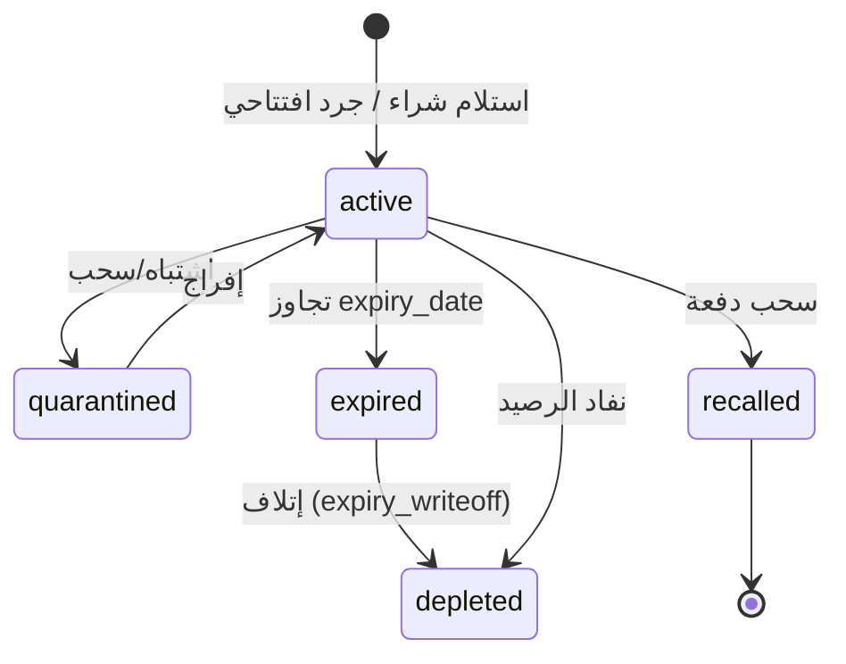
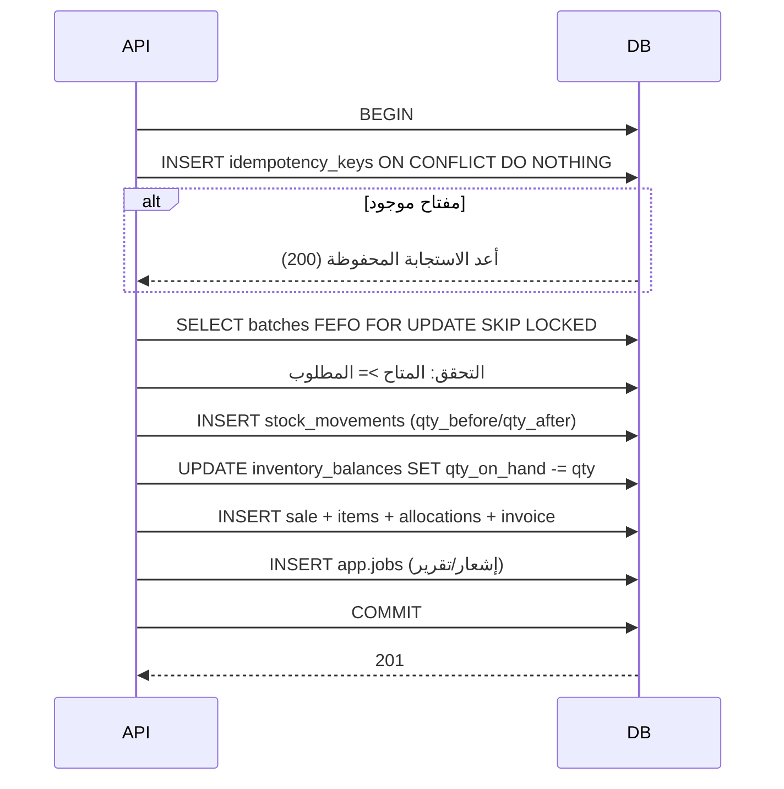

# 06 — هندسة المخزون والتشغيلات ودفتر الحركات

> **يقابل:** «سابعًا: هندسة المخزون والتشغيلات» كاملًا.
> **المرجع المصاحب:** `24-business-flows.md`, `08-database-architecture.md` §5.

---

## 1. المبدأ الحاكم: الرصيد نتيجة، لا حقيقة مستقلة

**الحقيقة الوحيدة** هي `stock_movements` (دفتر append-only). `inventory_balances` هو **مشتق** يُحدَّث بنفس المعاملة، ويُستخدم للسرعة فقط. أي تعارض بينهما يُحسم لصالح الدفتر.

```text
الرصيد الحالي = Σ (direction × qty) على كل الحركات لنفس (tenant, batch)
```

فحص تكامل يومي (مهمة خلفية) يقارن المجموع بالرصيد المخزّن، وأي فرق = تنبيه حرج + تجميد الشاشة المالية لذلك المنتج حتى المراجعة.

---

## 2. أنواع الحركات واتجاهاتها

| النوع | الاتجاه | يُنشأ من | يتطلب مرجعًا |
|---|---|---|---|
| `purchase_in` | +1 | استلام شراء | `purchase_item` |
| `sale_out` | −1 | فاتورة بيع مؤكدة | `sale_item` |
| `return_in` (بيع) | +1 | مرتجع بيع `restock=true` | `return_item` |
| `return_out` (شراء) | −1 | مرتجع لمورد | `return_item` |
| `adjust_in/out` | ±1 | تسوية معتمدة | `stock_adjustment` |
| `count_gain/loss` | ±1 | جرد مُرحَّل | `stock_count` |
| `transfer_out/in` | ±1 | تحويل | `transfer` |
| `reserve` | 0 (حجز) | أمر بيع/حجز | `sale_order` |
| `release` | 0 (فك حجز) | إلغاء/انتهاء | `sale_order` |
| `expiry_writeoff` | −1 | إتلاف منتهي | `expiry_report` |
| `damage_out` | −1 | تلف | `adjustment` |
| `opening_in` | +1 | الجرد الافتتاحي الموقّع | `opening_balance` |

**قواعد:** `qty > 0` دائمًا؛ الاتجاه عمود مستقل (`direction`)؛ `qty_before/qty_after` لقطة إلزامية؛ `reason` إلزامي في كل حركة سالبة غير بيع.

---

## 3. دورة حياة التشغيلة (Batch Lifecycle)



| القاعدة | التفصيل |
|---|---|
| `expiry_date NOT NULL` | لا تشغيلة بلا صلاحية في الأدوية |
| الحالة تُحسب آليًا | مهمة ليلية تحوّل `active → expired` عند `expiry_date < current_date` |
| لا صرف من `expired/quarantined/recalled` | القيد في Trigger + الخدمة، والواجهة تعرض سبب المنع |
| السحب (Recall) | يجمّد التشغيلة ويمنع صرفها ويولّد تقرير من صُرف له منها |
| تكلفة التشغيلة | `unit_cost` ثابت لها، ومتوسط التكلفة يُحسب على مستوى المنتج |

---

## 4. FEFO — First Expired, First Out (إلزامي)

**الخوارزمية عند الصرف:**

```sql
SELECT b.id, b.batch_no, b.expiry_date, ib.qty_available, b.unit_cost
FROM batches b
JOIN inventory_balances ib ON ib.batch_id = b.id AND ib.tenant_id = b.tenant_id
WHERE b.tenant_id = :tenant
  AND b.product_id = :product
  AND b.status = 'active'
  AND b.expiry_date > current_date
  AND ib.qty_available > 0
ORDER BY b.expiry_date ASC, b.created_at ASC
FOR UPDATE OF ib SKIP LOCKED;
```

| القاعدة | التفصيل |
|---|---|
| الترتيب | `expiry_date ASC` ثم الأقدم استلامًا (`created_at`) كفاصل |
| التخصيص المتعدد | طلب 10 وحدات قد يُوزَّع على تشغيلتين (تخصيص كامل داخل معاملة واحدة) |
| عند نقص الإجمالي | **رفض كامل** للعملية (لا صرف جزئي صامت) — أو موافقة صريحة على صرف جزئي إن سمحت السياسة |
| تجاوز FEFO | ممكن فقط بصلاحية `inventory.fefo.override` + سبب مكتوب + تدقيق |
| الصلاحية | لا صرف لتشغيلة تنتهي قبل تاريخ انتهاء الوصفة/الاستخدام المتوقع إذا فُعّل الحارس |

---

## 5. الحجز (Reservation) — منع البيع المزدوج

| الحالة | `qty_on_hand` | `qty_reserved` | `qty_available` |
|---|---|---|---|
| رصيد حر | 100 | 0 | 100 |
| حجز طلب 30 | 100 | 30 | 70 |
| بيع 70 | 30 | 0 | 30 (بعد `release` + `sale_out`) |

**القواعد:**
1. الحجز ينشئ حركة `reserve` بقيمة 0 مع تحديث `qty_reserved` — أثر قابل للتتبع.
2. `CHECK (qty_reserved <= qty_on_hand)` يمنع الحجز الزائد.
3. الحجز ينتهي تلقائيًا بعد مدة (`app.jobs`) ويُفك بحركة `release`.
4. البيع المباشر لا يحجز مسبقًا؛ يخصم من `qty_available` مباشرة داخل معاملة بقفل صفوف.

---

## 6. منع أخطاء الأرصدة عند التزامن

### 6.1 الطبقات الخمس

| # | الطبقة | الآلية |
|---|---|---|
| 1 | قفل صفوف | `SELECT ... FOR UPDATE` على صفوف `inventory_balances` المرشّحة، بترتيب ثابت (`batch_id ASC`) لمنع الجمود |
| 2 | قيد القاعدة | `CHECK (qty_on_hand >= 0)` + `CHECK (qty_reserved <= qty_on_hand)` — خط الدفاع الأخير |
| 3 | مستوى العزل | `READ COMMITTED` + أقفال صريحة للبيع؛ `SERIALIZABLE` للجرد الكامل |
| 4 | إعادة المحاولة | `serialization_failure`/`deadlock_detected` → 3 محاولات بتراجع أسّي (50/150/400ms) بنفس Idempotency key |
| 5 | Idempotency | `UNIQUE (tenant_id, idempotency_key)` يمنع ازدواج الحركة عند إعادة الطلب |

### 6.2 مثال تدفق البيع (Transactional)



**قاعدة صارمة:** لا استدعاء خارجي (بريد/دفع) داخل المعاملة. كل تأثير خارجي عبر Outbox بعد الـ commit.

### 6.3 اختبار التزامن (إلزامي)
50 طلبًا متوازيًا لبيع آخر 10 وحدات → **10 نجاح + 40 رفض `STOCK_INSUFFICIENT`**، والمجموع النهائي لا يقل عن صفر ولا يزيد عن 10. الاختبار متاح كنمط في `supabase/tests/run-inventory-lock-test.mjs`.

---

## 7. وحدات القياس والتحويل

| المفهوم | الحقل | مثال |
|---|---|---|
| العبوة | `pack_unit` + `pack_size` | علبة 20 قرصًا |
| الوحدة الصغرى | `unit_of_measure` | قرص |
| معامل التحويل | `units_per_pack = 20` | — |
| الشراء | يُخزَّن بالعبوة، ويُحوَّل للوحدة عند الحاجة | 5 علب = 100 قرص |
| البيع | بالوحدة أو العبوة حسب `product_barcodes.pack_level` | شريط = 10 أقراص |

**القواعد:**
1. كل الكميات تُخزَّن بالوحدة الصغرى (أصغر وحدة قابلة للصرف) — قرار واحد لا يُخالَف.
2. التحويل يُعرض في الواجهة فقط، ولا يُكتب في القاعدة.
3. الكسور مسموحة (`numeric(14,3)`) للسوائل، وممنوعة للمنتجات الصلبة عبر `allows_fraction` في المنتج.
4. الباركود يحدّد مستوى العبوة عند المسح → يحدّد المعامل تلقائيًا.
5. تحويل غير صحيح = رفض، لا تقريب صامت.

---

## 8. التقييم والتكلفة

| الطريقة | الاستخدام | لماذا |
|---|---|---|
| تكلفة التشغيلة الفعلية | تكلفة البيع (COGS) وتقييم المخزون | دقة التقييم وتتبع السعر |
| متوسط التكلفة المرجّح | مؤشرات إدارية سريعة | تقارير بدون مسح كامل للحركات |
| FEFO للصرف | إلزامي | متطلب تنظيمي/دوائي |

**قيمة المخزون** = `Σ (qty_on_hand × unit_cost)` لكل التشغيلات النشطة — View مادي يتحدث كل ساعة.

---

## 9. الصلاحية وتقاريرها

| التنبيه | الشرط | الوجهة |
|---|---|---|
| تنبيه مسبق | `expiry_date` خلال 90 يومًا (قابل للضبط) | إشعار + لوحة تحكم |
| حرج | خلال 30 يومًا | إشعار `critical` + تقرير أسبوعي |
| منتهٍ | `< current_date` ومازال له رصيد | منع الصرف + قائمة إتلاف |
| إتلاف | تسوية `expiry_writeoff` بموافقة | حركة + أثر مالي + محضر |

**لا يُسمح** بحذف تشغيلة منتهية لها رصيد: تُصفَّر بحركة إتلاف موثّقة فقط.

---

## 10. فحوص السلامة الدورية (Integrity Jobs)

| الفحص | التكرار | عند الفشل |
|---|---|---|
| مجموع الحركات = الرصيد | يوميًا 02:00 | تنبيه حرج + تجميد تسعير المنتج |
| تشغيلات بلا رصيد مقابل تشغيلات لها حركات | يوميًا | تقرير مراجعة |
| حركات بلا `reference` صحيح | يوميًا | تنبيه |
| أرصدة سالبة (يجب ألا توجد) | كل ساعة | تنبيه فوري + Sentry |
| تشغيلات منتهية مازالت `active` | يوميًا | تحويل تلقائي + إشعار |
| تكرار `idempotency_key` | أسبوعيًا | فحص القيد الفريد |
| تقادم الأقسام | أسبوعيًا | إنشاء أقسام +3 أشهر |

---

## 11. معايير القبول

- [ ] `batches` موجودة بقيود `UNIQUE (tenant_id, product_id, batch_no)` و`expiry_date NOT NULL`.
- [ ] FEFO مُنفّذ في استعلام واحد قابل للاختبار، مع اختبار تخصيص عبر تشغيلتين.
- [ ] اختبار التزامن 50×10 ناجح ومُوثّق النتيجة.
- [ ] Trigger يمنع أي تغيير رصيد بلا حركة.
- [ ] `allow_negative_stock = false` مفروض بقيد قاعدة.
- [ ] كل حركة تحمل `performed_by`, `performed_at`, `reason` (عند اللزوم), `qty_before`, `qty_after`.
- [ ] اختبار: صرف منتهي/محجور/مسحوب = رفض.
