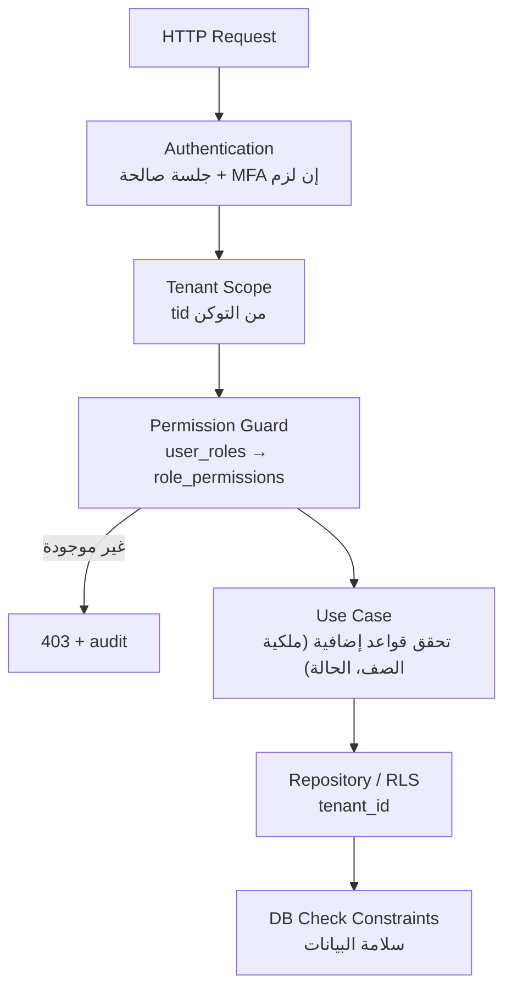

# 08 — المستخدمون والأدوار والصلاحيات (RBAC)

> **يقابل:** «تاسعًا: إدارة المستخدمين والصلاحيات» كاملًا.
> **المرجع المصاحب:** `12-auth-and-authorization.md`, `rbac_enterprise_test.sql`, `rbac_enforcement_test.sql`.

---

## 1. المبادئ

1. **Deny by default** — لا صلاحية بلا إسناد صريح.
2. **الصلاحية تُفحص في الخادم وفي القاعدة**، والواجهة تُخفي فقط.
3. **فصل المهام (SoD)** — من ينشئ التسوية لا يعتمدها، ومن يستلم لا يدفع لنفس المورد في نفس اليوم إن فُعّل الحارس.
4. **الحد الأدنى من الصلاحية** — الدور الافتراضي لا يرى الأسعار إن لم يحتجها.
5. **كل تغيير صلاحية مُدقّق** — من منح من، ماذا، ومتى.

---

## 2. الأدوار المعتمدة

| الدور | الكود | الغرض | ملاحظات |
|---|---|---|---|
| مالك المخزن | `owner` | كل الصلاحيات داخل مستأجره | **واحد نشط** لكل مستأجر (فهرس فريد جزئي)؛ لا يمكن حذفه |
| مدير المخزن | `manager` | إدارة التشغيل والموظفين والاعتمادات | لا يملك نقل الملكية أو حذف الحساب |
| موظف مبيعات | `sales` | بيع، عملاء، مرتجعات بسيطة | لا يرى تكلفة الشراء ولا الأرباح |
| موظف مشتريات | `purchasing` | موردون، أوامر، استلام | لا يعتمد الدفع |
| أمين مخزن | `warehouse_keeper` | استلام، صرف، جرد، تسويات (إنشاء) | لا يعتمد التسوية ولا يرى المالية |
| محاسب | `accountant` | مدفوعات، مصروفات، تقارير مالية | لا يعدّل مخزونًا |
| مخصّص | `custom_<n>` | أي مجموعة صلاحيات | يُنشأ بنسخ دور ثم تعديل |

**قيود:**
- `role.code` فريد داخل المستأجر؛ أدوار النظام `is_system=true` (owner, manager) لا تُحذف.
- لا يمكن للمستخدم منح صلاحية لا يملكها (`grant ⊆ own`) إلا للمالك.
- لا يمكن إزالة دور `owner` من آخر مالك.

---

## 3. كتالوج الصلاحيات (Permission Codes)

الصيغة: `<module>.<resource>.<action>` — `action ∈ {read, create, update, delete, approve, export, void}`.

| الوحدة | الصلاحيات |
|---|---|
| `catalog` | `catalog.product.read/create/update/delete`, `catalog.category.*`, `catalog.barcode.*`, `catalog.price.read`, `catalog.cost.read` |
| `inventory` | `inventory.batch.read/create/update`, `inventory.balance.read`, `inventory.movement.read`, `inventory.adjustment.create/approve`, `inventory.count.create/post`, `inventory.transfer.create/receive`, `inventory.fefo.override`, `inventory.expiry.writeoff` |
| `purchasing` | `purchasing.supplier.*`, `purchasing.order.create/approve`, `purchasing.receipt.create`, `purchasing.invoice.read/create`, `purchasing.return.create` |
| `sales` | `sales.invoice.read/create/void`, `sales.customer.*`, `sales.return.create/approve`, `sales.discount.apply`, `sales.discount.override`, `sales.credit.sell` |
| `finance` | `finance.payment.read/create/reverse`, `finance.expense.create/approve`, `finance.report.read`, `finance.profit.read` |
| `reports` | `reports.read`, `reports.export` |
| `team` | `team.member.read/invite/update/disable`, `team.role.read/create/update/delete`, `team.activity.read` |
| `settings` | `settings.warehouse.read/update`, `settings.alerts.update`, `settings.printing.update`, `settings.security.update` |
| `platform` | `platform.tenant.impersonate` (موظف منصة فقط، بتدقيق) |

**صلاحيات حساسة (`is_sensitive=true`)** تتطلب **Step-up authentication** (إعادة إدخال كلمة المرور أو رمز TOTP قبل 5 دقائق): `inventory.adjustment.approve`, `sales.invoice.void`, `finance.payment.reverse`, `team.role.update`, `settings.security.update`, `platform.tenant.impersonate`.

---

## 4. مصفوفة الأدوار × الصلاحيات (مختصرة)

| الصلاحية | owner | manager | sales | purchasing | keeper | accountant |
|---|:--:|:--:|:--:|:--:|:--:|:--:|
| `catalog.product.read` | ✅ | ✅ | ✅ | ✅ | ✅ | ✅ |
| `catalog.product.create/update` | ✅ | ✅ | — | ✅ | — | — |
| `catalog.cost.read` | ✅ | ✅ | — | ✅ | ✅ | ✅ |
| `catalog.price.read` | ✅ | ✅ | ✅ | ✅ | ✅ | ✅ |
| `inventory.batch.read` | ✅ | ✅ | ✅ | ✅ | ✅ | ✅ |
| `inventory.adjustment.create` | ✅ | ✅ | — | — | ✅ | — |
| `inventory.adjustment.approve` | ✅ | ✅ | — | — | — | — |
| `inventory.count.post` | ✅ | ✅ | — | — | ✅ | — |
| `purchasing.order.create` | ✅ | ✅ | — | ✅ | — | — |
| `purchasing.order.approve` | ✅ | ✅ | — | — | — | — |
| `purchasing.receipt.create` | ✅ | ✅ | — | ✅ | ✅ | — |
| `sales.invoice.create` | ✅ | ✅ | ✅ | — | — | — |
| `sales.invoice.void` | ✅ | ✅ | — | — | — | — |
| `sales.discount.override` | ✅ | ✅ | — | — | — | — |
| `sales.credit.sell` | ✅ | ✅ | — | — | — | — |
| `finance.payment.create` | ✅ | ✅ | — | — | — | ✅ |
| `finance.expense.approve` | ✅ | ✅ | — | — | — | — |
| `reports.export` | ✅ | ✅ | — | — | — | ✅ |
| `team.member.invite` | ✅ | ✅ | — | — | — | — |
| `team.role.update` | ✅ | — | — | — | — | — |
| `settings.security.update` | ✅ | — | — | — | — | — |

> المصفوفة **بيانات قابلة للبذر** (`seed`) لا كود؛ تعديلها لا يحتاج نشرًا.

---

## 5. سلسلة التنفيذ (Enforcement Chain)

**نقاط إلزامية:**
1. `@RequirePermission('sales.invoice.void')` على كل مسار — لا مسار بلا تعريف صلاحية (فحص CI: كل route له decorator/meta).
2. الصلاحيات تُحمَّل عند الدخول من القاعدة وتُخزَّن في التوكن؛ أي تغيير يزيد `users.token_version` فيُبطل كل الجلسات القديمة عند الوصول التالي (≤ 60s).
3. فحص «ملكية الصف» إضافي للصلاحية: تعديل منتج يتطلب أن المنتج من نفس المستأجر (RLS يحمي).
4. **RLS خط دفاع مستقل:** حتى لو أخطأ الـ Guard، لا تُقرأ صفوف مستأجر آخر.
5. لا قرار صلاحية مبني على `role` نصي في الواجهة أو الـ API — دائمًا `permission code`.

---

## 6. إدارة الموظفين (Lifecycle)

| الخطوة | التفاصيل | الصلاحية |
|---|---|---|
| دعوة | المدير يُدخل الاسم/الجوال/البريد + الدور → مستخدم `invited` + رمز دعوة صالح 72 ساعة | `team.member.invite` |
| تنشيط | الموظف يضع كلمة مرور (Argon2id) + TOTP اختياري/إلزامي حسب السياسة | — |
| تعديل | تغيير الدور/البيانات يُبطل الجلسات ويُسجَّل قبل/بعد | `team.member.update` |
| تعطيل | `status='suspended'` + إبطال الجلسات فورًا + إبقاء السجلات | `team.member.disable` |
| إنهاء خدمة | تعطيل + إعادة إسناد العمل المفتوح + تقرير نشاط | `team.member.disable` |
| مراجعة النشاط | صفحة `/team/activity`: من فعل ماذا ومتى، مع فلترة بالفاعل والنوع والتاريخ | `team.activity.read` |

**قيود أمنية:** لا يمكن للموظف تعديل دوره؛ لا يمكن تعطيل آخر مالك؛ لا يمكن لدور مخصّص منح `team.*` أو `settings.security.*` إلا للمالك.

---

## 7. العمليات الحساسة (Approval Workflow)

| العملية | المسار | الضوابط |
|---|---|---|
| تسوية مخزون | إنشاء (keeper) → اعتماد (manager) → ترحيل | لا اعتماد من المُنشئ؛ سبب إلزامي؛ مبلغ/كمية فوق حد → مالك |
| إتلاف منتهي | مسودة → اعتماد → حركة `expiry_writeoff` | محضر + شاهد اختياري |
| إلغاء فاتورة | طلب + سبب + Step-up | لا حذف؛ حركات عكسية؛ إشعار للمالك |
| تعديل سعر البيع | تسجيل قبل/بعد + سبب + صلاحية `sales.discount.override` | تقرير أسعار شاذة |
| منح صلاحية | Step-up + تدقيق + إشعار بريدي للمالك | سجل تغييرات الصلاحيات |
| دخول الدعم للمنصة | موافقة العميل + مدة محددة + تصوير كل إجراء | `platform.tenant.impersonate` + تدقيق كامل |

---

## 8. اختبارات الصلاحيات (إلزامية)

| # | الاختبار | المتوقع |
|---|---|---|
| P1 | `sales` يحاول `POST /inventory/adjustments` | 403 + سجل تدقيق |
| P2 | `keeper` يعتمد تسويته الخاصة | 403 `SOD_VIOLATION` |
| P3 | `manager` يمنح دورًا بصلاحية أعلى من صلاحياته | 403 |
| P4 | تعطيل موظف ثم استخدام جلسته القديمة | 401 فورًا (token_version) |
| P5 | حذف الزر من الواجهة ثم استدعاء الـ API | 403 (الخادم يمنع) |
| P6 | `accountant` يحاول تعديل منتج | 403 |
| P7 | طلب بلا صلاحية محددة في المسار | فشل بناء CI (route بلا permission) |
| P8 | موظف مخزن A يستدعي صلاحية على مخزن B | 404/403 + تنبيه أمني |
| P9 | إسناد دور من مستأجر آخر | فشل FK مركب |
| P10 | ترقية صلاحية أثناء جلسة نشطة | تُطبَّق خلال ≤ 60 ثانية |

---

## 9. معايير القبول

- [ ] مصفوفة الأدوار مبذورة في القاعدة، وقابلة للتعديل بلا نشر.
- [ ] كل مسار API يُعلن صلاحية، وفحص CI يفشل عند الغياب.
- [ ] `token_version` يُبطل الجلسات عند أي تغيير صلاحية/دور.
- [ ] Step-up مطبّق على العمليات الحساسة الست.
- [ ] SoD مفروض في القاعدة (`CHECK approved_by <> requested_by`) والخدمة.
- [ ] اختبارات P1–P10 خضراء.
- [ ] صفحة نشاط الموظفين تعرض آخر 90 يومًا على الأقل مع تصدير.
