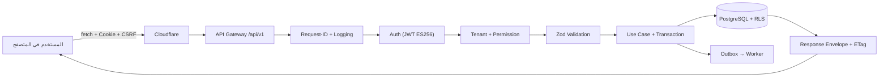

# 10 — هندسة الـ API والاتصال بين المكونات

> **يقابل:** «حادي عشر: هندسة API» + البند 3 من شروط الاعتماد.
> **المرجع المصاحب:** `10-api-architecture.md`, `api/openapi.yaml`, `23-openapi-contract.md`.

---

## 1. المبادئ

1. **REST موثّق بعقد OpenAPI 3.1 مولّد من Zod** — العقد مصدر الحقيقة، والواجهة تُولّد أنواعها منه.
2. **موردات لا أفعال** (`/products`, `/sales`)، والأفعال الخاصة تحت `:action` (`/sales/{id}/void`).
3. **السياق من الخادم** — `tenant_id` من الجلسة، لا يُقبل من العميل أبدًا.
4. **استجابات موحّدة** — غلاف واحد، أخطاء RFC 9457، ترقيم صفحات واحد.
5. **كل كتابة حرجة قابلة للتكرار بأمان** — Idempotency-Key.
6. **إصدار في المسار** `/api/v1` — وتغييرات متوافقة فقط داخل الإصدار.

---

## 2. مسار الطلب (من المستخدم إلى القاعدة وعودة)



---

## 3. خريطة الموارد

| المورد | المسارات |
|---|---|
| Auth | `POST /auth/login`, `/auth/refresh`, `/auth/logout`, `/auth/mfa/enroll`, `/auth/mfa/verify`, `/auth/password/forgot`, `/auth/password/reset` |
| Me | `GET /me` (مستخدم + مخزن + صلاحيات + إعدادات) |
| Products | `GET/POST /products`, `GET/PATCH/DELETE /products/{id}`, `GET /products/barcode/{code}` |
| Categories | `GET/POST /categories`, `PATCH/DELETE /categories/{id}` |
| Batches | `GET /batches`, `GET /batches/{id}`, `POST /batches/{id}/quarantine`, `/release` |
| Balances | `GET /inventory/balances`, `GET /inventory/balances/{productId}` |
| Movements | `GET /inventory/movements` (مُفلتر دائمًا) |
| Adjustments | `GET/POST /inventory/adjustments`, `POST /inventory/adjustments/{id}/approve\|reject` |
| Counts | `GET/POST /inventory/counts`, `POST /inventory/counts/{id}/post` |
| Purchases | `GET/POST /purchases`, `POST /purchases/{id}/receive`, `POST /purchases/{id}/cancel` |
| Suppliers | `GET/POST /suppliers`, `PATCH /suppliers/{id}` |
| Sales | `GET/POST /sales`, `GET /sales/{id}`, `POST /sales/{id}/void`, `POST /sales/{id}/payments` |
| Returns | `GET/POST /returns`, `POST /returns/{id}/approve` |
| Customers | `GET/POST /customers`, `PATCH /customers/{id}` |
| Payments | `GET/POST /payments`, `POST /payments/{id}/reverse` |
| Expenses | `GET/POST /expenses` |
| Reports | `GET /reports/{report}`, `POST /reports/{report}/export` |
| Team | `GET/POST /team/members`, `PATCH /team/members/{id}`, `GET/PUT /team/roles/{id}`, `GET /team/activity` |
| Settings | `GET/PATCH /settings` |
| Files | `POST /files`, `GET /files/{id}/url` |
| Jobs | `GET /jobs/{id}` (حالة تصدير/استيراد) |
| System | `GET /health`, `GET /version` (بلا مصادقة) |

**قاعدة:** لا مورد «كل المستأجرين» للمستخدم العادي؛ مسارات المنصة تحت `/api/platform/*` بهوية منفصلة.

---

## 4. غلاف الاستجابة

**نجاح (كائن):**
```json
{ "data": { "id": "…", "tradeName": "أوجمنتين 1جم" }, "meta": { "requestId": "01J9Z…" } }
```
**نجاح (قائمة):**
```json
{
  "data": [ … ],
  "meta": { "requestId": "…", "pagination": { "nextCursor": "eyJ…", "hasMore": true, "limit": 50 } }
}
```
**خطأ:** RFC 9457 (انظر `01` §7.2) — نفس البنية دائمًا.

**قواعد:** `data` دائمًا (لا `null` جذري — استخدم `404`)؛ أسماء الحقول `camelCase` في JSON، و`snake_case` في القاعدة (تحويل في طبقة الربط).

---

## 5. رموز الحالة

| الرمز | الاستخدام |
|---|---|
| 200 | قراءة/تحديث ناجح |
| 201 | إنشاء + `Location` |
| 204 | حذف/إجراء بلا محتوى |
| 304 | `If-None-Match` مطابق |
| 400 | جسم غير صالح/JSON خاطئ |
| 401 | جلسة غير صالحة/منتهية |
| 403 | صلاحية مفقودة / `TENANT_MISMATCH` / SoD |
| 404 | غير موجود أو غير تابع للمستأجر |
| 409 | تضارب حالة / Idempotency / نسخة (ETag) |
| 412 | `If-Match` غير مطابق |
| 422 | تحقق منطقي (`STOCK_INSUFFICIENT`, `EXPIRED_BATCH`) |
| 429 | تجاوز المعدل + `Retry-After` |
| 500 | خطأ داخلي (بلا تفاصيل) |
| 503 | صيانة/ضغط مؤقت + `Retry-After` |

---

## 6. الترقيم والتصفية والفرز

| البند | المعيار |
|---|---|
| الترقيم | **Cursor** افتراضيًا (`?limit=50&cursor=…`) للجداول الكبيرة؛ `page/pageSize` مسموح للتقارير الصغيرة |
| الحد | `limit ≤ 100` (افتراضي 25) |
| التصفية | معاملات صريحة: `?status=active&categoryId=…&dateFrom=2026-01-01&q=…` |
| البحث | `q` بحث نصي مقيّد بالمستأجر |
| الفرز | `?sort=-createdAt,tradeNameAr` (بادئة `-` للتنازلي) — حقول مسموحة بقائمة بيضاء |
| الحقول | `?fields=id,tradeNameAr` (Sparse fieldsets) للتقارير والموبايل |
| التصدير | `POST /reports/{report}/export` → `202` + `jobId`، ثم `GET /jobs/{id}` |

**قاعدة:** أي معامل غير معروف → 400 (لا تجاهل صامت) — يمنع أخطاء التصفية الخطيرة.

---

## 7. Idempotency والتحكم في التزامن

**Idempotency (إلزامي لكل POST مالي/مخزني):**

```http
POST /api/v1/sales
Idempotency-Key: 9f2c1a7e-...
Content-Type: application/json
```
| الحالة | السلوك |
|---|---|
| مفتاح جديد | تُنفَّذ العملية، ويُخزَّن `request_hash` + الاستجابة |
| مفتاح مكرر بنفس الجسم | تُعاد نفس الاستجابة (200/201) بلا تنفيذ |
| مفتاح مكرر بجسم مختلف | 409 `IDEMPOTENCY_CONFLICT` |
| صلاحية المفتاح | 24 ساعة (تنظيف بـ `pg_cron`) |

**التزامن التفاؤلي:** كل مورد قابل للتعديل يُرجع `ETag`؛ التحديث يتطلب `If-Match` وإلا 428/412. **منع Lost Update** في الأسعار والأرصدة.

---

## 8. المصادقة في الـ API

| البند | التفصيل |
|---|---|
| الجلسة | كوكي `__Host-session` (HttpOnly) — لا `Authorization` من JS |
| CSRF | رأس `X-CSRF-Token` مطابق لكوكي `csrf` على كل `POST/PATCH/PUT/DELETE` |
| التوكن | JWT ES256: `sub, tid, whid, ver, perms_hash, exp, iat, aud, iss` — لا بيانات شخصية |
| التحديث | `POST /auth/refresh` مع تدوير وإبطال العائلة عند إعادة الاستخدام |
| انتهاء | 401 `SESSION_EXPIRED` → الواجهة تحاول refresh مرة واحدة ثم تحوّل للدخول |
| الخدمات الداخلية | مفتاح خدمة + توقيع HMAC + قائمة IP (للـ Workers فقط) |

---

## 9. الإصدارات والتوافق

| القاعدة | التفصيل |
|---|---|
| الإصدار | `/api/v1` ثابت؛ الإصدار الجديد فقط عند تغيير كاسر |
| التغييرات المتوافقة | إضافة حقل اختياري، إضافة enum بقيمة جديدة (بعد إشعار)، إضافة endpoint |
| التغييرات الكاسرة | حذف/إعادة تسمية حقل، تغيير نوع، تغيير دلالة — **ممنوع** داخل v1 |
| الإهمال | `Deprecation` + `Sunset` headers + دعم 6 أشهر على الأقل |
| العقد | `openapi.yaml` يُولَّد في CI ويُقارن مع السابق؛ تغيير كاسر يفشل البناء بلا `major` |
| الواجهة | أنواع TypeScript مولّدة من العقد، لا كتابة يدوية |

---

## 10. أمثلة مرجعية

**إنشاء فاتورة بيع:**
```http
POST /api/v1/sales
Idempotency-Key: 8b1d…
Content-Type: application/json

{
  "customerId": null,
  "paymentMethod": "cash",
  "items": [
    { "productId": "…", "qty": 2, "unitPrice": 45.50, "discountPercent": 0 }
  ]
}
```
```json
201 Created
Location: /api/v1/sales/01J9ZA…
ETag: "7"
{
  "data": {
    "id": "01J9ZA…",
    "invoiceNo": "S-2026-000142",
    "total": "91.00",
    "status": "confirmed",
    "allocations": [{ "batchNo": "B24A", "qty": "2", "expiryDate": "2027-03-31" }]
  },
  "meta": { "requestId": "…" }
}
```
> المبالغ تُنقل **نصًا** (string) في JSON لتفادي أخطاء الفاصلة العائمة.

**خطأ رصيد:**
```json
422 Unprocessable Entity
{
  "type": "https://api.example.com/errors/stock-insufficient",
  "title": "الرصيد غير كافٍ",
  "status": 422,
  "code": "STOCK_INSUFFICIENT",
  "detail": "المطلوب 2، المتاح 0 في التشغيلات الصالحة.",
  "correlationId": "01J9Z…"
}
```

---

## 11. العمليات غير المتزامنة والإشعارات

| النوع | الآلية |
|---|---|
| تصدير/استيراد | `202` + `jobId` → متابعة `GET /jobs/{id}` أو إشعار داخلي عند الانتهاء |
| تقارير ثقيلة | View مادي + مهمة مجدولة؛ القراءة من الـ View |
| إشعارات لحظية | Realtime قناة `tenant:<id>`، الحمولة `{type, entityId, version}` فقط؛ البيانات تُجلب بـ API |
| بريد/SMS | Outbox → `app.jobs` → Adapter مع إعادة محاولة و`dead_letter` |
| فشل Worker | `attempts ≤ 5` بتراجع أسّي، ثم `dead_letter` + تنبيه |

---

## 12. معايير قبول هذه الوثيقة

- [ ] `openapi.yaml` يغطي 100% من المسارات، ويُولَّد آليًا في CI.
- [ ] كل POST مالي/مخزني يقبل `Idempotency-Key` ويُختبر بازدواج.
- [ ] كل قائمة تدعم cursor، والحد الأقصى 100.
- [ ] كل مورد قابل للتعديل يدعم `ETag`/`If-Match`.
- [ ] كل خطأ يحمل `code` و`correlationId`.
- [ ] لا مسار يقرأ `tenant_id` من العميل (فحص grep/مراجعة).
- [ ] اختبار عقد (contract test) يفشل عند تغيير استجابة بلا تحديث العقد.
