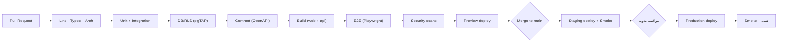

# 12 — DevOps · النسخ الاحتياطي والتعافي · خطة المراحل والاعتماد

> **يقابل:** «ثالث عشر: النسخ الاحتياطي» + «خامس عشر: النشر والتشغيل» + «سابع عشر: خطة المراحل» + البند 12 و13 من شروط الاعتماد.
> **المرجع المصاحب:** `14-infrastructure-architecture.md`, `15-deployment-architecture.md`, `19-development-roadmap.md`, `26-production-readiness.md`.

---

## الجزء الأول — DevOps والنشر

## 1. المستودع والاستراتيجية

| البند | القرار |
|---|---|
| المستودع | GitHub أحادي (Monorepo) — انظر `02` §7 |
| الاستراتيجية | **Trunk-based**: `main` دائم + فروع قصيرة (≤ 3 أيام) + ميزات غير مكتملة خلف flag |
| حماية `main` | مراجعة إلزامية، فحوص خضراء، لا force-push، commits موقّعة (موصى به) |
| التسمية | `feat/…`, `fix/…`, `chore/…`, `docs/…` |
| الإصدارات | `vMAJOR.MINOR.PATCH` + `CHANGELOG` آلي |
| الإصدارات الدقيقة | lockfile + Renovate أسبوعيًا بمراجعة يدوية |

---

## 2. البيئات

| البيئة | الغرض | البيانات | الوصول | النطاق |
|---|---|---|---|---|
| Local | تطوير | بيانات وهمية (seed) | المطور | `localhost` |
| Preview | كل PR | بيانات وهمية | الفريق | رابط مؤقت |
| Staging | اختبار قبول وإصدار | بيانات مُقنّعة بحجم واقعي | الفريق + المالك | محمي بكلمة مرور |
| Production | العمل الحقيقي | بيانات العملاء | المالك + المناوب | عام |

**قاعدة:** Staging مطابق للمخطط والهجرات، ويُعاد بناؤه من الصفر أسبوعيًا للتأكد أن الهجرات قابلة لإعادة الإنتاج. **لا نسخ بيانات إنتاج إلى Staging بلا تقنيع.**

---

## 3. Docker (محليًا في الملف A، وللنشر في الملف B)

```yaml
# infra/docker/compose.dev.yml (مختصر)
services:
  db:      { image: postgres:17, ports: ["5432:5432"], volumes: ["pgdata:/var/lib/postgresql/data"] }
  api:     { build: { context: ., dockerfile: infra/docker/Dockerfile.api }, ports: ["8787:8787"], depends_on: [db] }
  web:     { image: node:22, working_dir: /app, command: "pnpm dev", ports: ["3000:3000"] }
  mailhog: { image: mailhog/mailhog, ports: ["8025:8025"] }
```
- مطوّر واحد يبدأ بـ `docker compose up` بلا تثبيت Postgres محلي.
- صور الإنتاج: multi-stage، مستخدم غير root، `distroless`/`alpine`، بلا أدوات بناء، فحص Trivy.
- `.dockerignore` يمنع `.env`, `node_modules`, `docs`, `tests`.

---

## 4. خط الأنابيب (CI/CD)



| المرحلة | الزمن المستهدف | الفشل يعني |
|---|---|---|
| Lint/Types | ≤ 2 د | لا merge |
| Unit+Integration | ≤ 6 د | لا merge |
| DB/RLS | ≤ 3 د | لا merge |
| E2E | ≤ 8 د | لا merge |
| Build | ≤ 5 د | لا merge |
| Deploy staging | ≤ 4 د | لا إنتاج |
| Deploy prod | ≤ 5 د | تراجع تلقائي للواجهة |

**الأسرار:** GitHub Secrets/Environment، لا تُطبع أبدًا، وبيئة `production` تتطلب موافقة بشرية.

**استخدام Convex/Edge:** نشر دوال الـ API بأمر واحد بعد نجاح البوابات، وترحيل القاعدة كخطوة منفصلة قابلة للتتبع.

---

## 5. الهجرات في النشر

1. الهجرة تُشغَّل **قبل** نشر الكود الذي يحتاجها (Expand).
2. الكود الجديد يعمل مع المخطط القديم والجديد (توافق مزدوج) حتى اكتمال النشر.
3. الحذف (Contract) في إصدار لاحق بعد التأكد من عدم وجود استخدام.
4. كل هجرة: نسخة احتياطية فورية قبلها + مدة تنفيذ مقاسة + `lock_timeout` قصير.
5. هجرة فاشلة = إيقاف النشر؛ **لا rollback تلقائي للبيانات** — خطة تعويض مكتوبة مسبقًا.

---

## 6. الاستراتيجية والتراجع

| البند | التفصيل |
|---|---|
| نوع النشر | Rolling (بلا توقف) للواجهة والدوال؛ migration-first للقاعدة |
| التحقق بعد النشر | Smoke: `/health`, تسجيل دخول, قائمة منتجات, بيع تجريبي على حساب اختبار |
| التراجع (App) | إعادة النشر للإصدار السابق (دقيقة واحدة) |
| التراجع (DB) | هجرة عكسية مُعدّة مسبقًا فقط للعمليات الآمنة؛ الحذف لا يُعكس — استعادة من نسخة عند الضرورة |
| أعلام الميزات | كل ميزة كبيرة خلف flag، إيقافها فوري بلا نشر |
| النشر الكناري | 10% من المستخدمين (عند تعدد المخازن) ثم 100% |

---

## 7. المراقبة والسجلات وتتبع الأخطاء

| النوع | الأداة | ماذا نراقبه | التنبيه |
|---|---|---|---|
| توفّر | UptimeRobot | `/health` كل دقيقة | بريد فوري |
| أخطاء | Sentry | استثناءات، Release، `correlationId` | > 5 أخطاء/دقيقة |
| أداء | سجلات p95 لكل مسار | بطء مفاجئ | p95 > 800ms لـ 10 د |
| قاعدة | استعلامات بطيئة (`pg_stat_statements`) | > 1s | تقرير يومي |
| طابور | `app.jobs` | مهام معلقة/فاشلة | > 100 أو dead_letter |
| أمن | `audit_logs` | `TENANT_MISMATCH`, فشل دخول | فوري للحالة الحرجة |
| نسخ | مهمة النسخ | نجاح/حجم/مدة | فشل = فوري |

**السجلات:** JSON منظّم (`pino`)، حقول: `ts, level, requestId, tenantId, userId, route, status, durationMs, code`. لا بيانات شخصية/أسرار. احتفاظ 30 يومًا (90 للأمن).

---

## الجزء الثاني — النسخ الاحتياطي والتعافي

## 8. خطة النسخ

| النوع | التكرار | الاحتفاظ | المكان | التشفير | التحقق |
|---|---|---|---|---|---|
| لقطة قاعدة كاملة (logical) | يوميًا 02:00 | 7 يومية + 4 أسبوعية + 12 شهرية | R2 (حساب منفصل) | AES-256 + مفتاح منفصل | `pg_restore --list` + checksum |
| WAL/PITR | مستمر | 7 أيام | مزود القاعدة | عند المزود | مراجعة أسبوعية |
| ملفات (فواتير/مستندات) | يوميًا (تزايدي) | 90 يومًا | R2 | SSE | مقارنة عدد/حجم |
| أسرار/إعدادات | عند التغيير | دائم | مدير أسرار + نسخة ورقية مُقفلة | — | مراجعة ربع سنوية |
| تصدير شهري لمستأجر | شهريًا | 12 شهرًا | R2 منفصل | مشفّر | استعادة تجريبية |

**قواعد إلزامية:**
1. النسخة تُكتب إلى **حساب/مساحة مختلفة** عن قاعدة الإنتاج (حماية من حذف الحساب).
2. صلاحية الحذف غير موجودة لدور النسخ الآلي (append-only bucket + Object Lock إن توفر).
3. مفتاح التشفير **منفصل** عن النسخة، ومحفوظ في مدير أسرار آخر.
4. النسخ تُسجَّل في جدول `backup_runs` ويُنبه على أي فشل فورًا.
5. لا يتم اختبار استعادة على قاعدة الإنتاج أبدًا.

## 9. RPO / RTO المعتمدة

| السيناريو | RPO | RTO | ملاحظة |
|---|---|---|---|
| الخطة المجانية (المرحلة 1) | ≤ 24 ساعة | ≤ 4 ساعات | القيد المعلن للمالك |
| الخطة المدفوعة (Pro) | ≤ 5 دقائق | ≤ 1 ساعة | PITR + نسخ مستمرة |
| فقدان جدول/خطأ بشري | ≤ 24 ساعة | ≤ 2 ساعات | استعادة انتقائية |
| حذف حساب مستأجر بالخطأ | 0 (حذف ناعم 30 يومًا) | ≤ 24 ساعة | استعادة من نسخة/منطقة حذف |
| فقدان ملفات | ≤ 24 ساعة | ≤ 2 ساعات | R2 نسخ متعددة |

## 10. تمرين الاستعادة (Restore Drill) — إلزامي قبل أول عميل

| الخطوة | معيار النجاح |
|---|---|
| 1. سحب النسخة الأحدث من R2 وفك التشفير | نجاح بلا أخطاء |
| 2. استعادة إلى قاعدة جديدة معزولة | `pg_restore` بلا أخطاء |
| 3. تشغيل الهجرات المتبقية | صفر اختلافات مخطط |
| 4. مقارنة checksums للجداول الحرجة | تطابق 100% (`tenants, warehouses, products, batches, inventory_balances, stock_movements, sales, payments`) |
| 5. اختبار تطبيق فعلي على القاعدة المستعادة | دخول + تقرير + بيع تجريبي |
| 6. توثيق الزمن الفعلي | ≤ RTO المعلن |
| 7. تسجيل النتيجة | ملف في `docs/operations/restore-drill-<date>.md` |

**التكرار:** شهريًا آليًا + بعد كل تغيير كبير في المخطط. **بدون تمرين ناجح، لا إطلاق.**

## 11. سيناريوهات الكوارث

| الحادث | الإجراء | المسؤول | الزمن |
|---|---|---|---|
| تعطّل القاعدة | تحويل للنسخة/إعادة إنشاء + استعادة + تحقق | Backend | ≤ 4 س |
| تعطّل مزود الاستضافة | تحويل DNS إلى خطة بديلة + نشر من المصدر | DevOps | ≤ 2 س |
| تلف بيانات (خطأ تطبيق) | تجميد الكتابة + تحديد النطاق + استعادة انتقائية | Backend + DB | ≤ 3 س |
| تسريب أسرار | إبطال/تدوير + إبطال جلسات + تدقيق | أمن | ≤ 1 س |
| فقدان حساب سحابي | استعادة من نسخة الحساب المنفصل | المالك + DevOps | ≤ 8 س |
| انقطاع إنترنت الموقع | العمل مستمر (سحابي) | — | 0 |

---

## الجزء الثالث — خطة المراحل والاعتماد

## 12. المراحل (16 أسبوعًا للأساس، 12 شهرًا للاكتمال)

| المرحلة | المدة | المخرجات | بوابة الخروج |
|---|---|---|---|
| Phase 0 — الهندسة | أسبوعان | هذا الدوسيه + ADRs + Baseline | **Gate A** (اعتمادك) |
| Phase 1 — الأساس | 4 أسابيع | Auth+MFA، Tenancy 1:1، RBAC، Audit، هيكل Monorepo، CI/CD، RLS، اختبارات عزل | Gate B: كل اختبارات العزل والصلاحيات خضراء |
| Phase 2 — الكتالوج والمخزون | 6 أسابيع | منتجات/باركود/تصنيفات، تشغيلات، أرصدة، دفتر حركات، جرد افتتاحي، FEFO | إدخال مخزنك الحقيقي ممكن |
| Phase 3 — المشتريات | 4 أسابيع | موردون، أوامر، استلام، فواتير، مرتجعات شراء | دورة شراء كاملة مُختبرة |
| Phase 4 — المبيعات | 5 أسابيع | POS، فواتير، عملاء، مرتجعات، تخصيص FEFO، طباعة | دورة بيع كاملة + تدقيق أرصدة |
| Phase 5 — المالية والتقارير | 5 أسابيع | مدفوعات، مصروفات، تقارير، تصدير، لوحات | مطابقة مالية شهرية = 0 فرق |
| Phase 6 — التوسع التشغيلي | 6 أسابيع | فروع/مناطق، إشعارات متقدمة، PWA، أداء T2 | 10 مخازن تجريبية |
| Phase 7 — الجاهزية التجارية | 4 أسابيع | امتثال، فاتورة إلكترونية (إن لزم)، دعم، SLA | **Gate C** |

**قاعدة:** لا تبدأ مرحلة قبل خروج السابقة. الميزات المؤجلة مذكورة صراحة (تطبيق أصلي، ذكاء اصطناعي، دفع إلكتروني كامل).

## 13. المخاطر وخطة معالجتها

| # | الخطر | الاحتمال | الأثر | المعالجة |
|---|---|---|---|---|
| R1 | تسريب بين مستأجرين | منخفض | **كارثي** | RLS forced + FK مركبة + اختبارات A1–A12 + mutation test |
| R2 | فساد أرصدة بسبب خطأ منطقي | متوسط | مرتفع | دفتر حركات + حارس trigger + فحوص يومية |
| R3 | تجاوز حدود Edge (2s/500K) | متوسط | متوسط | قياس شهري + خطة انتقال الملف B |
| R4 | فشل النسخ الاحتياطي | منخفض | مرتفع | تنبيه فوري + تمرين شهري + نسخة حساب منفصل |
| R5 | مقاومة المستخدمين | مرتفع | متوسط | تدريب على شاشاتهم فقط + إدخال تدريجي |
| R6 | اعتماد على شخص واحد | مرتفع | مرتفع | توثيق + ADRs + مراجعة مشتركة |
| R7 | تضخّم الوحدة (Big Ball of Mud) | متوسط | متوسط | dependency-cruiser + مراجعة حدود |
| R8 | إخفاق اختبار الاختراق | متوسط | مرتفع | ZAP دوري + مراجعة ربع سنوية (D-3) |
| R9 | التزامن في الذروة | متوسط | مرتفع | اختبار حمل قبل الإصدار + حدود معدل |
| R10 | تكلفة غير متوقعة | منخفض | متوسط | تنبيه فوترة + سقف استخدام |

## 14. بوابة الاعتماد النهائية (Gate A)

**يُعتمد التسليم عندما:**
1. تُراجع الوثائق `01`–`13` ويُوقَّع على كل بند من قائمة §6 في `README`.
2. يُحسم D-1 (ملف التشغيل) وD-2 (FEFO في الفاتورة) وD-3 (اختبار الاختراق) وD-4 (المناوب).
3. يُعتمد قرار «لا ترحيل بيانات» (جرد افتتاحي موقّع بدلًا منه).
4. تُعتمد مصفوفة الأدوار والصلاحيات.
5. يُعتمد ERD والمخطط + الفجوات (`batches`, `stock_adjustments`, `stock_counts`).
6. تُعتمد أهداف RPO/RTO وخطة النسخ.
7. يُقرّ المالك بأن أي تغيير لاحق في هذه القرارات يمرّ بـ ADR جديد لا بتعديل صامت.

**التوقيعات:** المالك · المعماري · Backend · DB · DevOps · أمن · QA · خبير مخازن الأدوية.

---

## 15. معايير قبول هذه الوثيقة

- [ ] خط CI/CD موثّق ببوابات لا يمكن تجاوزها.
- [ ] ثلاث بيئات منفصلة + Staging يُعاد بناؤه أسبوعيًا.
- [ ] خطة نسخ بأربع نسخ و3 مواقع ومفاتيح منفصلة.
- [ ] تمرين استعادة منفّذ وموثّق قبل Gate C.
- [ ] RPO/RTO معلنة ومقاسة.
- [ ] مراحل ببوابات خروج واضحة، ولا مرحلة بلا معيار.
- [ ] سجل مخاطر مُراجع ربع سنويًا.
