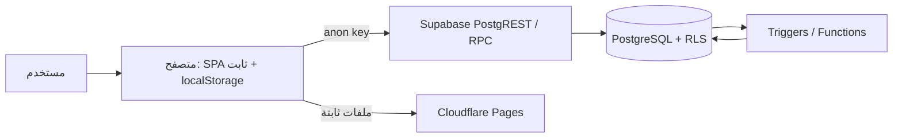
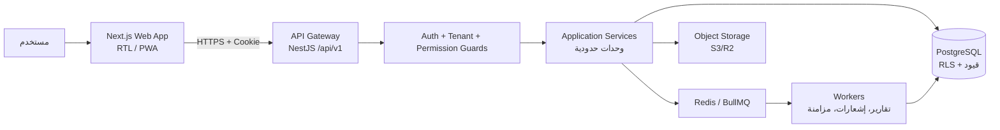
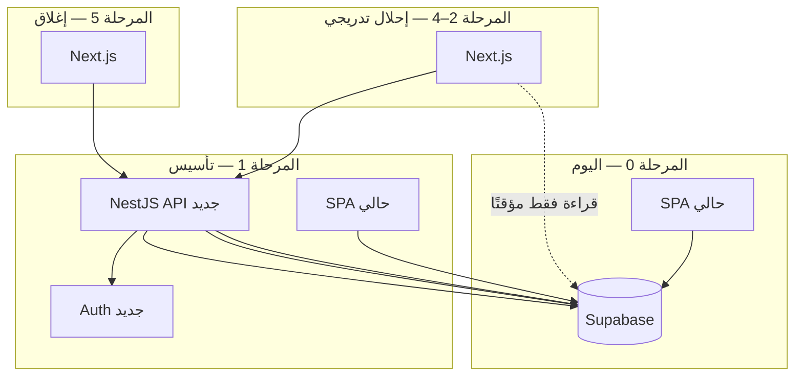

# 00 — الوضع الحالي مقابل الهدف (As-Is / To-Be Gap Analysis)
> **تحديث التنفيذ (2026-11-06):** الطبقة الخدمية لم تعد NestJS في حاوية — البوابة هي Supabase Edge Functions. التفاصيل والحدود الحسابية في [`28`](28-supabase-edge-runtime.md)؛ ما يلي يبقى صحيحًا في المنطق والعقد.

> **تحديث قيد التكلفة الصفرية (2026-11-06):** ما يظهر لاحقًا من Redis/BullMQ أو VPS أو تكلفة شهرية مُستبدَل بما في [`27`](27-free-tier-architecture.md) §5. المرجع الحاكم هو `27`.

> هذا المستند إضافة ضرورية: المستودع يحتوي نظامًا عاملًا بالفعل، وأي معمارية لا تبدأ من حالة واقعية ستُنتج إعادة بناء مكلفة. الهدف هنا **الانتقال المنضبط**، لا الرفض أو البدء من الصفر.

---

## 1. ما هو موجود فعليًا (أدلة من المستودع)

| المكوّن | الواقع الحالي | الدليل |
|---|---|---|
| الواجهة | SPA ثابت (Vanilla JS) بحجم ~1.5MB في `public/`، 39 ملفًا، RTL عربي | `public/index.html`, `public/app.js` |
| الوصول للبيانات | **المتصفح → Supabase PostgREST مباشرة** بمفتاح anon + RLS | `public/supabase-config.js`, `public/supabase.js` |
| الجلسة | مخزّنة في `localStorage` تحت مفتاح `session` | `public/tenant-context.js` |
| منطق الأعمال | جزء كبير في المتصفح، وجزء في دوال/Trigger داخل PostgreSQL | `public/*.js`, `supabase/migrations/202610290336_server_side_hardening.sql` |
| العزل | `warehouse_id` كحدّ عزل على جداول الأعمال + Trigger يمنع تغييره + سياسات RLS | `supabase/migrations/202611020001_multi_tenant_hardening.sql` |
| الهوية | Supabase Auth + `profiles` + تحقق ثانٍ (`two_step_verify`) + ربط مستخدم/مخزن | `202611030001…008_*.sql` |
| الصلاحيات | RBAC في القاعدة: `enterprise_roles`, `user_permissions`, `hrm_permissions` + دالة `rbac_enforce_via_parent` | `202610290325…336_*.sql` |
| النطاقات المغطاة | مشتريات، استلام، مبيعات، مرتجعات، حسابات، ضرائب مصرية، رواتب، توصيل، CRM، أتمتة، عروض أسعار | أسماء الهجرات |
| الحجم | ~4,765 سطر SQL في 100+ هجرة | `wc -l supabase/migrations/*` |
| الاختبارات | اختبار عزل متعدد المخازن، تزامن، RBAC، كشف رواتب، E2E تسجيل دخول | `tests/security/multi_tenant_isolation.test.js`, `supabase/tests/*` |
| النشر | Cloudflare Pages/Worker + الأصول الثابتة | `worker.js`, `deploy-manifest.json` |
| React/Next | ملفات `src/*.tsx` موجودة لكن **لا يوجد** Next.js أو أداة بناء لها في `package.json` | `package.json` |

**خلاصة:** النظام الحالي ليس نموذجًا أوليًا فارغًا؛ فيه أصول قيمة (سياسات RLS، سجلات تدقيق، هجرات متراكمة، اختبارات عزل). المشكلة ليست الفكرة بل **حدود الثقة**: المنطق الحساس والجلسة في المتصفح.

---

## 2. المعمارية الحالية (As-Is)

**نقاط القوة:** عزل مبني على القاعدة لا على الواجهة؛ تتبع حركات المخزون؛ تدقيق؛ قيود مالية؛ اختبارات عزل موجودة.
**نقاط الضعف البنيوية:** عقد API غير موجود (الواجهة تعرف شكل الجداول)؛ لا صلاحية لإخفاء الأسعار أو القواعد التجارية؛ الجلسة قابلة للسرقة بـ XSS؛ مفتاح anon يمنح سطح هجوم واسعًا؛ منطق مبعثر بين JS وSQL وTrigger؛ لا Idempotency على مستوى الـ API؛ لا تنسيق إصدارات ولا بيئات مستقلة.

---

## 3. المعمارية الهدف (To-Be)

الفرق الجوهري: **حد ثقة واحد** عند الـ API، والمتصفح لا يرى قاعدة البيانات ولا مفاتيحها.

---

## 4. جدول الفجوات (Gap Register)

| # | الفجوة | الخطورة | الأثر | المعالجة في التصميم | المرحلة |
|---|---|---|---|---|---|
| G1 | المنطق التجاري في المتصفح (أسعار، خصومات، حدود ائتمان) | **حرجة** | تلاعب بالأسعار والمخزون | نقل كل القواعد إلى `apps/api` — `07` | Phase 2–4 |
| G2 | الجلسة في `localStorage` | **حرجة** | سرقة جلسة عبر XSS | كوكيز `HttpOnly; Secure; SameSite` + تدوير Refresh — `12` | Phase 1 |
| G3 | وصول مباشر لـ PostgREST بمفتاح anon | **حرجة** | سطح هجوم واسع، تجاوز حدود الـ API | إغلاق PostgREST، الوصول عبر API فقط — ADR-004 | Phase 1 |
| G4 | `localStorage.session` يُستخدم في قرارات الواجهة | عالية | تجاوز واجهة فقط (RLS يحمي البيانات) | مصدر حقيقة واحد من `/me` — `12` | Phase 1 |
| G5 | `warehouse_id` يخلط بين الحساب والموقع | عالية | استحالة دعم فروع/مخازن متعددة نظيفًا | **مُغلق بقرار المالك (ADR-025):** `tenant → warehouse` بـ1:1 وقيد `UNIQUE (tenant_id)`؛ لا فروع — `11` | مُنفَّذ في التصميم |
| G6 | منطق أعمال داخل Triggers/Dوال | عالية | صعوبة الاختبار والتطور والتتبع | القاعدة تُبقي القيود فقط، والمنطق في الخدمات — ADR-010 | Phase 2 |
| G7 | لا Idempotency على العمليات المالية | عالية | فواتير مكررة عند إعادة المحاولة | مفتاح Idempotency + قيد فريد — `10` §9 | Phase 1 |
| G8 | لا بيئات ولا هجرات منضبطة (100+ هجرة تراكمية) | عالية | نشر غير قابل للتكرار | هجرات مسببة + بيئات dev/staging/prod — `15` | Phase 1 |
| G9 | لا عقد API (الواجهة تعرف أسماء الجداول) | متوسطة | كل تغيير في القاعدة يكسر الواجهة | OpenAPI + Zod مشترك — `10` | Phase 1 |
| G10 | لا موافقة/توقيع على العمليات الحساسة (تعديل سعر، تسوية مخزون) | متعالية | احتيال داخلي | Step-up Auth + Approval Workflow — `12` §7 | Phase 3 |
| G11 | لا مراقبة/تتبع موحد | متوسطة | أعطال صامتة | OTel + Sentry + pino — `14` | Phase 1 |
| G12 | التقارير تُحسب في المتصفح | متوسطة | بطء واستهلاك | تقارير في الخادم + Materialized Views — `17` | Phase 3 |
| G13 | لا اختبار حمل أو أداء مرجعي | متوسطة | انهيار في الذروة | k6 + ميزانية أداء — `16` | Phase 1 |
| G14 | ترقيم إصدارات مكتبات غير مثبت | منخفضة | سلوك غير حتمي | pnpm lockfile + تثبيت دقيق — `05` | Phase 1 |

---

## 5. استراتيجية الانتقال (Strangler Fig)

**قواعد الانتقال:**

1. **لا إيقاف للنظام الحالي.** كل وحدة تُنقل خلف الـ API ثم تُحوَّل الواجهة إليها.
2. **قاعدة بيانات واحدة خلال الانتقال.** لا مزامنة بين قاعدتين (تجنّب مصدر حقيقتين).
3. **إضافة الأعمدة أولًا (Expand)**: `tenant_id` (و`warehouse_id` حيث يلزم) تُضاف وتُملأ وتُقيَّد قبل حذف أي عمود قديم.
4. **إغلاق PostgREST تدريجيًا**: تقليل الجداول المكشوفة → إيقاف الكتابة → إيقاف القراءة.
5. **بوابة خروج لكل وحدة**: وحدة تُعتبر منقولة فقط عند نجاح اختبارات العزل والصلاحيات والأداء عبر الـ API (وليس عند ظهور شاشتها).

---

## 6. ما نُبقيه / ما نستبدله / ما نضيفه

| العنصر | القرار | السبب |
|---|---|---|
| PostgreSQL + سياسات RLS | **نُبقي ونقوّي** | أفضل خط دفاع أخير؛ يُثبت العزل حتى لو أخطأ الكود |
| سجل التدقيق الحالي | **نُبقي ونوحّد** | أصل تنظيمي؛ يُنقل إلى مخطط موحد append-only |
| هجرات SQL الحالية | **نُبقي كتاريخ** ثم نُثبّت مخططًا أساسيًا (Baseline) | 100+ هجرة تراكمية غير قابلة لإعادة الإنتاج |
| Supabase Auth | **نستبدل** بمصادقة NestJS | يحتاج MFA، تحقق ثانٍ، وربط جهاز وسياسات كلمة مرور |
| الواجهة الثابتة | **نستبدل تدريجيًا** بـ Next.js | عقد API، مكونات، PWA، صيانة |
| Cloudflare Pages | **يُبقى** كطبقة CDN/WAF أمام الأصل الجديد | تكلفة صفرية تقريبًا وقيمة أمنية عالية |
| جداول `enterprise_roles`/`user_permissions` | **تُدمج** في نموذج RBAC موحد | مصدرا صلاحيات متوازيان = ثغرة منطقية |
| Trigger منطق الأعمال | **يُنقل** للخدمات، ويُبقى Trigger القيود فقط | اختبارية وتتبعية أعلى |
| اختبارات العزل الحالية | **تُوسَّع** إلى مصفوفة كاملة | أساس ممتاز لبوابة الأمان |

---

## 7. المخاطر التي يجب معالجتها قبل أي ميزة جديدة

| الخطر | لماذا الآن | الإجراء |
|---|---|---|
| XSS يستهدف `localStorage` | أي ثغرة في أي ملف JS من 39 ملفًا = سرقة جلسة كاملة | نقل الجلسة إلى كوكيز HttpOnly في Phase 1 |
| تعديل سعر/خصم من المتصفح | خسارة مالية مباشرة وغير قابلة للاكتشاف | تسعير مرجعي على الخادم + تدقيق قبل/بعد |
| إعادة إرسال فاتورة | ازدواج مخزون ومبيعات | Idempotency + قيد فريد |
| سباق على نفس التشغيلة | رصيد سالب | قفل صفوف + قيد `CHECK (qty >= 0)` |
| تراكم هجرات بلا Baseline | استحالة إنشاء بيئة staging مطابقة | Baseline + هجرات مسببة |

> **قاعدة الاعتماد:** لا تُبنى أي ميزة جديدة على المسار القديم (المتصفح → PostgREST). كل ميزة جديدة تُبنى عبر الـ API.
