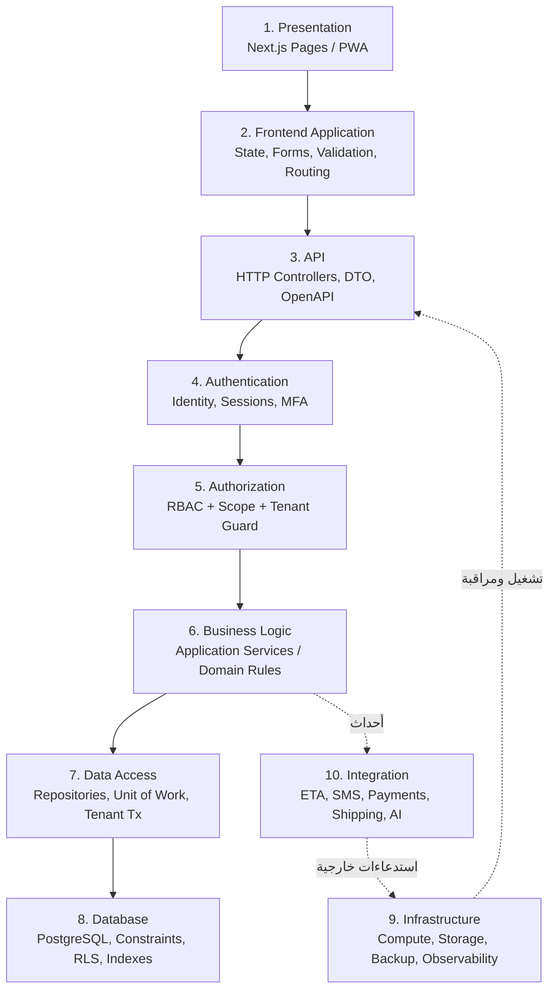
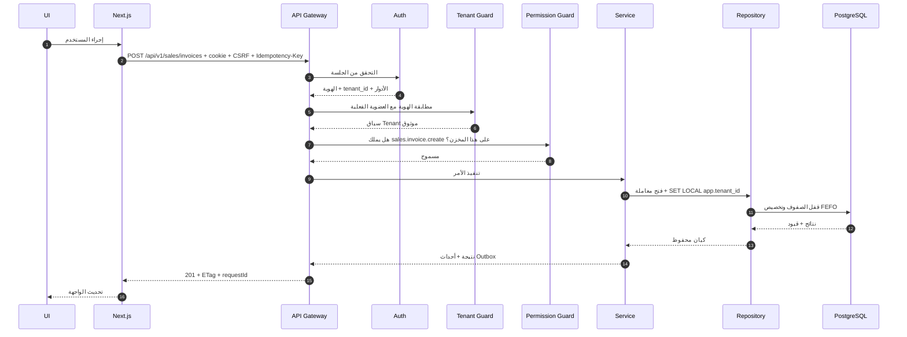

# 01 — System Architecture Document
> **تحديث التنفيذ (2026-11-06):** الطبقة الخدمية لم تعد NestJS في حاوية — البوابة هي Supabase Edge Functions. التفاصيل والحدود الحسابية في [`28`](28-supabase-edge-runtime.md)؛ ما يلي يبقى صحيحًا في المنطق والعقد.

> **تحديث قيد التكلفة الصفرية (2026-11-06):** ما يظهر لاحقًا من Redis/BullMQ أو VPS أو تكلفة شهرية مُستبدَل بما في [`27`](27-free-tier-architecture.md) §5. المرجع الحاكم هو `27`.

## 1. السياق والأهداف

### 1.1 المشكلة
مخازن الأدوية في مصر تُدار غالبًا بمزيج من Excel وبرامج محاسبية عامة. النتيجة: أرصدة غير موثوقة، صرف لا يتبع FEFO فتتكدس تشغيلات منتهية، مرتجعات غير محسوبة، خسائر غير مكتشفة، وتقارير متأخرة. في التوزيع الدوائي تحديدًا، **التشغيلة وتاريخ الانتهاء ليسا حقلاً إضافيًا بل هما جوهر المخزون**.

### 1.2 أهداف المنتج (قابلة للقياس)
| الهدف | المؤشر |
|---|---|
| دقة الرصيد | 99.5% مطابقة بين الرصيد الدفتري والجرد الفعلي على مستوى (مخزن/تشغيلة) |
| تقليل التالف | خفض قيمة التالف الناتج عن انتهاء الصلاحية بنسبة 50% في أول 6 أشهر |
| سرعة العملية | إنشاء فاتورة بيع من 12 سطرًا في < 60 ثانية |
| الامتثال | 100% عمليات صرف قابلة للتتبع إلى مستخدم + تشغيلة + فاتورة |
| العزل | صفر حادث تسريب بيانات بين مخزنين في كل الاختبارات الآلية |
| التوسع | إضافة مخزن جديد (Tenant) في < 5 دقائق دون نشر كود |

### 1.3 خارج النطاق (المرحلة الأولى)
التصنيع الدوائي، إدارة العيادات، التأمين الطبي، التوصيل الخارجي المتقدم، تطبيق موبايل أصلي.

---

## 2. القيود المعمارية

| النوع | القيد | أثره على التصميم |
|---|---|---|
| تنظيمي (مصر) | EDA لتسجيل الأصناف، ضريبة قيمة مضافة، فاتورة إلكترونية، سجلات الأدوية المخدرة | حقول تسجيل EDA، محرك ضريبة، سجل مخدرات مستقل، واجهة تكامل ETA |
| تنظيمي | مبدأ التسعيرة الجبرية لبعض الأصناف | سعر الجمهور لا يجوز أن يتجاوز السعر المُقرر — قيد على مستوى القاعدة |
| تشغيلي | المخزن يعمل 12–16 ساعة، وأحيانًا 24 | نوافذ نشر خارج ساعات العمل + Zero-downtime |
| بشري | فريق صغير (4–6 مطورين) | Modular Monolith، لا Microservices |
| مالي | ميزانية محدودة | خدمات مُدارة أرخص، VPS واحد، Cloudflare أمامه |
| تقني | النظام الحالي عامل ومستخدم | انتقال تدريجي لا Big Bang |
| بيانات | **بدء نظيف: لا ترحيل بيانات تاريخية** (قرار المالك، ADR-026) | جرد افتتاحي موقّع يُدخل كحركات `opening` فقط |

---

## 3. الأنماط المعمارية — ماذا تعني عمليًا

| النمط | الترجمة المعمارية | ما لا تعنيه |
|---|---|---|
| **Multi-Tenant SaaS** | حساب واحد = Tenant، عزل منطقي بـ `tenant_id` + RLS، إعدادات لكل Tenant، دورة حياة (تجربة/نشط/موقوف) | ليس نسخة قاعدة لكل عميل في البداية |
| **Modular Monolith** | تطبيق NestJS واحد، مجلدات وحدات بحدود، منع الاستيراد العابر، أحداث داخلية | ليس ملفًا واحدًا ولا حزمة واحدة بلا حدود |
| **API-First** | العقد (OpenAPI/Zod) قبل الواجهة، كل شيء عبر `/api/v1` | ليس REST لكل شيء بالضرورة (SSE/WebSocket للتحديثات) |
| **Cloud-Native** | حاويات، إعدادات من البيئة، بلا حالة، سجلات إلى stdout، فحص صحة | ليس Kubernetes بالضرورة |
| **Layered** | 10 طبقات بتبعية اتجاه واحد | ليس تمرير كيانات القاعدة إلى الواجهة |
| **Event-Driven (انتقائي)** | Outbox + BullMQ للأحداث الجانبية (إشعار، تدقيق، تقارير، تكامل) | ليس Saga موزعة ولا Kafka الآن |
| **Scalable** | توسع أفقي للـ API/Workers، قراءة من نسخة احتياطية عند العتبة | ليس توزيعًا مبكرًا |
| **Security-First** | Deny by default، تحقق مزدوج (API + RLS)، تشفير، تدقيق | ليس "JWT يكفي" |

---

## 4. الطبقات العشر (System Layers)

### 4.1 مسؤوليات الطبقات وعقودها

| # | الطبقة | المسؤولية | المُدخل | المُخرج | ممنوع |
|---|---|---|---|---|---|
| 1 | Presentation | عرض، تفاعل، إتاحة (a11y)، RTL | بيانات من الطبقة 2 | أحداث المستخدم | أي منطق أعمال أو وصول مباشر للشبكة |
| 2 | Frontend Application | حالة الخادم (TanStack Query)، نماذج (RHF+Zod)، تحقق فوري، تنقّل | استجابة API | طلبات API | تخزين أسرار أو قرارات صلاحية نهائية |
| 3 | API | تحويل HTTP ↔ أوامر، تحقق شكل المدخل، OpenAPI، حدود المعدل | طلب HTTP موثّق | استجابة موحدة | منطق أعمال أو SQL مباشر |
| 4 | Authentication | إثبات الهوية، جلسات، MFA، تدوير رموز، قفل الحساب | بيانات اعتماد | هوية موثقة + سياق | تفويض (صلاحيات) |
| 5 | Authorization | هل هذا المستخدم يملك هذا الإجراء على هذا النطاق؟ | هوية + مسار + مورد | سماح/رفض + إخفاء | قراءة بيانات لعرضها |
| 6 | Business Logic | قواعد العمل، حالات المستندات، التسعير، التخصيص | أوامر/استعلامات | نتائج + أحداث | SQL مباشر، HTTP خارجي متزامن |
| 7 | Data Access | استعلامات، معاملات، تعيين، قفل متفائل، سياق Tenant | أوامر من 6 | كيانات/إسقاطات | قرارات أعمال |
| 8 | Database | سلامة البيانات، العلاقات، القيود، RLS، الفهارس، التقسيم | SQL | بيانات + أخطاء قيود | منطق سير عمل |
| 9 | Infrastructure | حوسبة، تخزين، شبكة، نسخ احتياطي، مراقبة، أسرار | إعدادات | منصة تعمل | معرفة بقواعد العمل |
| 10 | Integration | ETA، SMS/WhatsApp، دفع، شحن، AI، Webhooks | أحداث + طلبات | نتائج + حالات مزامنة | الوصول المباشر لبيانات Tenant بلا وسيط |

### 4.2 قاعدة التبعية (Dependency Rule)
التبعية تتجه للأسفل فقط. الطبقة 3 لا تستورد من 8؛ الطبقة 6 لا تعرف HTTP؛ الطبقة 8 لا تعرف NestJS. أي استثناء يُسجَّل كـ ADR.

---

## 5. الخريطة الوحدية (Modules → Bounded Contexts)

الوحدات السبع والعشرون المطلوبة تُجمَّع في **9 سياقات** لتقليل التشابك. كل سياق = مجلد NestJS مستقل + مخطط/جداول خاصة + واجهة عامة.

| السياق | الوحدات | يعتمد على (اتجاه واحد) |
|---|---|---|
| **Identity & Access** | 1 Authentication & User Management، 15 Employee Permissions | — (الأساس) |
| **Tenancy & Platform** | 2 Warehouse (واحد لكل حساب)، 26 System Settings، 27 Subscription | Identity |
| **Catalog** | 4 Medicine، الوحدات، الباركود، التصنيفات | Tenancy |
| **Inventory** | 5 Inventory، 6 Batch & Expiry، الجرد، التحويلات | Catalog |
| **Procurement** | 7 Purchasing، 8 Suppliers، مرتجعات الموردين | Inventory، Catalog |
| **Sales & Distribution** | 9 Sales، 10 Customers & Pharmacies، 11 Returns، 16 TeleSales، 17 Delivery | Inventory، Catalog، Finance (قراءة حد ائتمان) |
| **Finance** | 12 Accounting، 13 Cash & Bank، 23 Electronic Payments | Sales/Procurement (أحداث) |
| **Workforce** | 14 HR | Identity |
| **Growth & Intelligence** | 18 Reports، 19 Notifications، 20 Automation، 21 AI Assistant، 22 Voice، 24 Advertising، 25 Audit Logs | قراءة من الكل عبر إسقاطات/أحداث |

**قواعد الحدود:**
- لا يستورد سياق من `repository` سياق آخر؛ التواصل عبر **Application Service Interface** أو **حدث**.
- الأحداث تُكتب في `outbox_events` داخل نفس معاملة العمل، وتُنشر عبر عامل Outbox.
- التقارير لا تقرأ جداول تشغيلية مباشرة في وقت الذروة؛ تقرأ من Views/إسقاطات (→ `17`).
- `Audit Logs` مستمع عام لا يعتمد عليه أحد (Dead-end module).

---

## 6. دورة حياة الطلب (Request Lifecycle)

النموذج المختصر هنا؛ التفصيل الكامل (بما فيه الأخطاء، Idempotency، والتدقيق) في `10-api-architecture.md` §7.

---

## 7. المتطلبات غير الوظيفية (NFR)

| الفئة | الهدف | كيف يُقاس |
|---|---|---|
| زمن الاستجابة | قراءة p95 < 300ms، كتابة p95 < 800ms (12 سطر فاتورة) | k6 + APM |
| الإتاحة | 99.5% شهريًا (≈ 3.6 ساعة توقف) | Uptime monitor |
| الاستعادة | RPO ≤ 5 دقائق، RTO ≤ 60 دقيقة | تمرين استعادة ربع سنوي |
| الأمان | صفر ثغرات حرجة مفتوحة > 7 أيام | Dependabot + Trivy + ZAP |
| العزل | 0 تسريب في مصفوفة اختبار كاملة | CI gate |
| التوسع | 50 مخزنًا، 2,000 مستخدم، 10M حركة مخزون/سنة على بنية واحدة | اختبار حمل تدريجي |
| إمكانية التدقيق | كل عملية حساسة لها أثر لا يُحذف | مراجعة عينة شهرية |
| قابلية الصيانة | تغطية اختبار للوحدات الحرجة ≥ 80% | تقرير التغطية |
| التوطين | عربي RTL كامل، أرقام وتواريخ عربية/لاتينية قابلة للتبديل | مراجعة واجهة |

---

## 8. الاهتمامات العرضية (Cross-Cutting)

| الاهتمام | التنفيذ |
|---|---|
| التتبع | `requestId` في كل طلب، يمر في السجلات والأحداث والتدقيق (OTel trace-id) |
| التدقيق | اعتراض عام على كل أمر يكتب `audit_logs` قبل/بعد |
| الأخطاء | `Problem Details` (RFC 9457) + أكواد داخلية قابلة للبحث |
| التهيئة | `@nestjs/config` + تحقق Zod للمتغيرات عند الإقلاع |
| الوقت والمنطقة | كل التخزين UTC، العرض `Africa/Cairo`، تواريخ الانتهاء `date` بلا منطقة |
| العملة | `EGP` مع `numeric(14,2)`، لا `float` أبدًا |
| الكميات | `numeric(14,3)` لدعم الوحدات الجزئية (شريط/قرص) |
| الحذف | حذف منطقي (`deleted_at`) للمراجع، ومنع الحذف الفعلي لسجلات مالية/مخزنية |
| التزامن | `version` + `If-Match`، وقفل صفوف للمخزون |

---

## 9. المخاطر المعمارية الكبرى

| # | الخطر | الاحتمال | الأثر | التخفيف |
|---|---|---|---|---|
| R1 | تفشي منطق أعمال في الواجهة مرة أخرى | متوسط | عالٍ | مراجعة كود + قاعدة "لا قرار في المتصفح" + عقد API |
| R2 | تشابك الوحدات داخل Monolith | متوسط | متوسط | قواعد استيراد آلية (dependency-cruiser) في CI |
| R3 | بطء تقارير كبيرة على القاعدة التشغيلية | مرتفع | متوسط | إسقاطات + Materialized Views + Replica عند العتبة |
| R4 | خطأ في الجرد الافتتاحي | متوسط | عالٍ | عدّ مزدوج + توقيع المالك + فحص اتساق قبل أول بيع (لا ترحيل — ADR-026) |
| R5 | اعتماد مفرط على Supabase كمزوّد | منخفض | متوسط | SQL قياسي، S3 API، لا استخدام لميزات حصرية |
| R6 | ثغرة عزل واحدة تُسقط الثقة | منخفض | حرج | RLS + اختبار عزل إلزامي في CI + مراجعة أمنية |
| R7 | تكلفة نمو غير متوقعة | متوسط | متوسط | حدود استهلاك + مراقبة تكلفة شهرية + خطة `17` |

---

## 10. معايير قبول هذه الوثيقة
- [ ] كل طبقة من العشر لها مسؤولية وحدود مكتوبة.
- [ ] خريطة الوحدات تغطي 27 وحدة بلا تكرار وظيفي.
- [ ] قواعد التبعية بين السياقات واضحة وقابلة للفحص الآلي.
- [ ] NFR قابلة للقياس ولها أداة قياس.
- [ ] المخاطر المعمارية لها تخفيف مالك ومرحلة.
