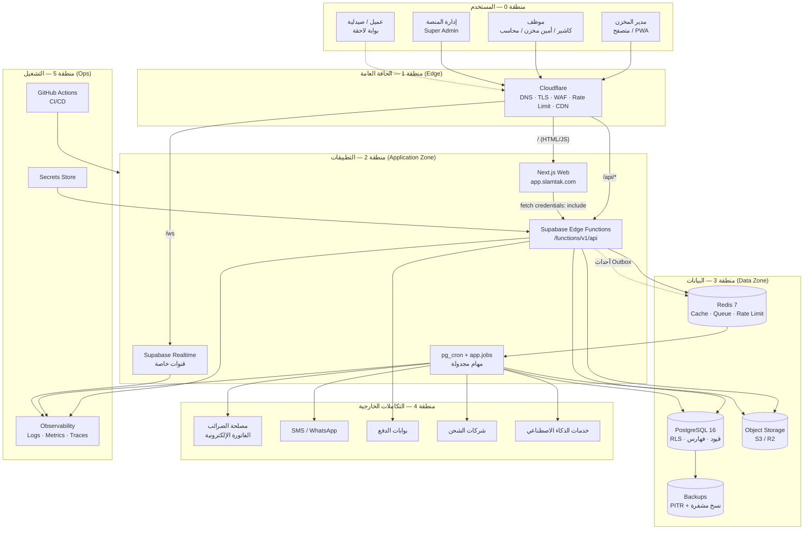
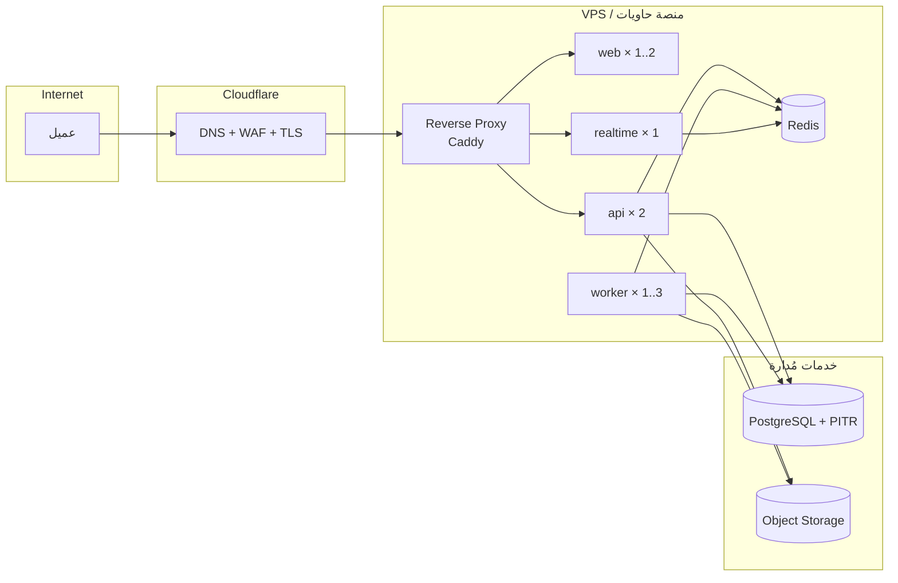

# 02 — High-Level Architecture Diagram

> **تحديث قيد التكلفة الصفرية (2026-11-06):** ما يظهر لاحقًا من Redis/BullMQ أو VPS أو تكلفة شهرية مُستبدَل بما في [`27`](27-free-tier-architecture.md) §5. المرجع الحاكم هو `27`.

## 1. المستوى الأعلى: المناطق وحدود الثقة

**حدود الثقة (Trust Boundaries):**

| الحد | العبور | الضابط |
|---|---|---|
| B1: متصفح → Edge | HTTPS عام | TLS 1.3، WAF، تحديد معدل، رؤوس أمان |
| B2: Edge → Next.js | HTTP داخلي | شبكة خاصة، رأس `X-Forwarded-*` موثوق فقط |
| B3: Next.js/المتصفح → API | HTTPS | كوكي `HttpOnly` + CSRF + Origin check |
| B4: API → PostgreSQL | TCP داخلي | دور قاعدة `NOBYPASSRLS` + `SET LOCAL app.tenant_id` |
| B5: API → Redis | TCP داخلي | كلمة مرور + شبكة خاصة + بلا تعرض عام |
| B6: Workers → خدمات خارجية | HTTPS صادر | مفاتيح في Secret Store، مهلات، Circuit Breaker |
| B7: إدارة المنصة → بيانات Tenant | **ممنوع** | دور منفصل، مخطط منفصل، إجراءات كسر زجاج مُدققة |

---

## 2. المكوّنات الرئيسية ومسؤولياتها

| المكوّن | المسؤولية | الحالة | يتوسع بـ |
|---|---|---|---|
| Cloudflare | TLS، WAF، حماية DDoS، تخزين مؤقت للأصول الثابتة | Stateless | تلقائي |
| Next.js Web | واجهة RTL/PWA، SSR للصفحات الثقيلة، لا منطق أعمال | Stateless | نسخ أفقية |
| Edge Functions | كل منطق الأعمال، المصادقة، التفويض، العقد | Stateless | عزلات تلقائية (بلا موازن) |
| Realtime Gateway | إشعارات فورية، تحديث لوحات، حالة طلب | Stateful خفيف | Redis Pub/Sub adapter |
| Workers | تقارير، PDF، مزامنة ETA، إشعارات، مهام دورية | Stateless | نسخ حسب الطابور |
| PostgreSQL | مصدر الحقيقة الوحيد | Stateful | قراءة من Replica عند العتبة |
| Object Storage | مرفقات، صور، PDF، نسخ احتياطي | مُدار | تلقائي |

---

## 3. مصفوفة الاتصال

| من | إلى | البروتوكول | المصادقة | نمط | ملاحظات |
|---|---|---|---|---|---|
| المتصفح | Cloudflare | HTTPS | — | متزامن | كل الحركة العامة |
| Cloudflare | Next.js | HTTP | شبكة خاصة | متزامن | تمرير رؤوس موثوقة |
| المتصفح | API | HTTPS/JSON | كوكي جلسة + CSRF | متزامن | نفس الأصل، لا CORS |
| Next.js (SSR) | API | HTTP داخلي | رمز خدمة قصير العمر | متزامن | لعرض بيانات الصفحة الأولى |
| API | PostgreSQL | TCP | كلمة مرور + TLS | متزامن | معاملة لكل أمر كتابة |
| API | Object Storage | S3 API | توقيع مؤقت | متزامن | روابط موقعة قصيرة العمر |
| Workers | PostgreSQL | TCP | دور مستقل | متزامن | نفس قواعد العزل |
| pg_cron → API | pg_net (HTTPS) | مفتاح داخلي | غير متزامن | تنفيذ دفعة مهام |
| Worker | ETA / SMS / Shipping | HTTPS | مفتاح/توقيع | غير متزامن | إعادة محاولة أسّية |
| المتصفح | Realtime | WSS | توكن ES256 (scope: realtime) | متزامن | حدث بلا بيانات؛ الحقيقة من `/api` |
| Realtime | PostgreSQL | WAL / RLS | داخلي | غير متزامن | سياسة `realtime.messages` |

---

## 4. خريطة النشر (Topology)

**لماذا هذا الشكل؟** نشر بسيط (3 خدمات + قاعدة مُدارة) يغطي حتى ~50 مخزنًا، بتكلفة منخفضة، وقابل للترقية إلى Kubernetes أو منصة حاويات دون تغيير كود (كل خدمة صورة Docker مستقلة تصفِح الإعدادات من البيئة).

---

## 5. تدفق البيانات الرئيسي (Data Flow)

| # | المسار | طبيعة البيانات | حساسية |
|---|---|---|---|
| F1 | فاتورة بيع: UI → API → PG (فواتير + حركة مخزون + قيد محاسبي) | مالية ومخزنية | عالية |
| F2 | استلام: UI → API → PG (تشغيلات + أرصدة) + Outbox | مخزنية | عالية |
| F3 | Outbox → Worker → إشعار/تكامل | أحداث | متوسطة |
| F4 | تقرير: API → View/MV → JSON/PDF | مجمّعة | متوسطة |
| F5 | مرفق (صورة دواء/فاتورة): UI → API → S3 (رابط موقّع) | ملفات | متوسطة |
| F6 | تحليلات: PG → Replica → Worker → جدول إسقاط | مجمّعة | منخفضة (مُعرَّفة) |
| F7 | ذكاء اصطناعي: API → AI Provider (بيانات ملخّصة فقط) | مشتقة | **مراجعة إلزامية** — لا تُرسل بيانات شخصية |

---

## 6. اعتبارات عزل وتوفر

| الاعتبار | القرار |
|---|---|
| هل تُعزل قواعد البيانات فيزيائيًا؟ | لا في البداية. العزل المنطقي + RLS + مفاتيح مركبة. خيار Schema-per-tenant أو DB-per-tenant للعملاء المؤسسيين موثق في `11` §9 |
| ماذا لو سقطت القاعدة؟ | Fail closed: التطبيق يعيد 503 ولا يعمل بوضع مخفّض على بيانات قديمة |
| ماذا لو سقط Redis؟ | التطبيق يعمل (كاش = تحسين)، والمهام تتأخر وتُستأنف عند العودة |
| ماذا لو سقط Worker؟ | لا يفقد شيء: الطوابير دائمة، والأحداث في Outbox |
| صيانة القاعدة | نافذة محددة، إعلان مسبق، وضع قراءة فقط اختياري |
| حدود الحوسبة | API: 1 vCPU / 1GB لكل نسخة، Worker: 1 vCPU / 1.5GB (PDF)، Web: 0.5 vCPU / 512MB |

---

## 7. معايير قبول هذه الوثيقة
- [ ] كل مكوّن له مسؤولية واحدة واضحة وحدود ثقة محددة.
- [ ] كل اتصال له بروتوكول ومصادقة ونمط (متزامن/غير متزامن).
- [ ] لا يوجد مسار يصل فيه المتصفح إلى القاعدة مباشرة.
- [ ] لا يوجد مسار يمنح إدارة المنصة قراءة تجارية غير مُقنَّنة.
- [ ] السقوط الجزئي لأي مكوّن غير حرج لا يُسقط النظام كله.
