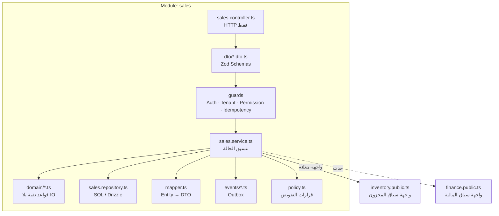
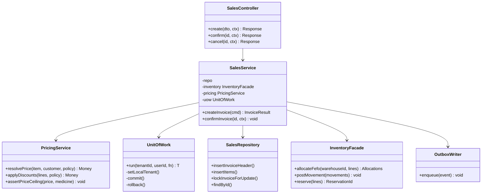

# 03 — Low-Level Architecture Diagram
> **تحديث التنفيذ (2026-11-06):** الطبقة الخدمية لم تعد NestJS في حاوية — البوابة هي Supabase Edge Functions. التفاصيل والحدود الحسابية في [`28`](28-supabase-edge-runtime.md)؛ ما يلي يبقى صحيحًا في المنطق والعقد.

## 1. البنية الداخلية للوحدة (Module Anatomy)

كل وحدة NestJS تتبع نفس الشكل، بلا استثناء. هذا يجعل المراجعة والسبر آليًا ممكنين.



| الملف/المكوّن | مسؤوليته | ما لا يفعله |
|---|---|---|
| `*.controller.ts` | تحويل HTTP، استدعاء خدمة واحدة | لا SQL، لا شروط أعمال |
| `dto/*.dto.ts` | عقد المدخل + OpenAPI | لا قواعد أعمال |
| `guards` | هوية، Tenant، صلاحية، Idempotency | لا قراءة بيانات لعرضها |
| `*.service.ts` | تنسيق المعاملة والحالة | لا تفاصيل SQL |
| `domain/*` | حسابات وقواعد نقية (تسعير، FEFO، خصومات) | لا IO، قابلة لاختبار وحدي 100% |
| `*.repository.ts` | استعلامات وقيود | لا قرارات أعمال |
| `mapper.ts` | تحويل صريح | لا تمرير مباشر لكيان القاعدة |
| `events/*` | كتابة Outbox داخل المعاملة | لا نشر خارجي مباشر |

---

## 2. مخطط الأصناف لتدفق "فاتورة بيع" (Class Diagram)



**ملاحظة تصميمية:** `InventoryFacade` هي الواجهة الوحيدة المسموح استدعاؤها من سياق المبيعات. لا يجوز لـ `sales` الوصول لجدول `stock_batches` مباشرة — هذا ما يمنع التشابك.

---

## 3. حدود المعاملة (Transaction Boundaries)

| العملية | نطاق المعاملة | ما يجب أن يكون ذريًا | خارج المعاملة |
|---|---|---|---|
| إنشاء فاتورة بيع | واحدة | رأس + أسطر + تخصيص مخزون + حركات + قيد + Outbox | إرسال إشعار، PDF |
| استلام بضاعة (GRN) | واحدة لكل مستند | رأس + أسطر + إنشاء تشغيلات + أرصدة + حركات + Outbox | مزامنة ETA |
| تحويل بين مخازن | واحدة | خروج + دخول + حركتان + ربط | إشعار |
| جرد | معاملة لكل مجموعة أصناف | فرق + حركة تسوية | تقرير |
| ترحيل قيد يدوي | واحدة | رأس + أسطر + تحقق التوازن | — |
| تعديل سعر | واحدة | سجل سعر جديد (لا تعديل القديم) + تدقيق | تحديث كاش |

**قاعدة صارمة:** أي استدعاء شبكة خارجي **لا** يحدث داخل معاملة قاعدة بيانات. يُسجَّل الحدث ويُنفَّذ في Worker.

---

## 4. التزامن والأقفال (Concurrency)

| السيناريو | التقنية | التفصيل |
|---|---|---|
| صرف من نفس التشغيلة من مستخدمين | `SELECT … FOR UPDATE` على صفوف `stock_batches` مرتبة بـ `id` | ترتيب ثابت يمنع الجمود (deadlock) |
| تعديل مستند من تابين | قفل متفائل `version` + `If-Match` | 409 عند التعارض |
| إعادة إرسال طلب | `idempotency_keys` فريد `(tenant_id, key)` | نفس الاستجابة تُعاد |
| ترقيم مستندات (SEQ) | جدول `document_sequences` بـ `UPDATE … RETURNING` | لا اعتماد على `max()+1` |
| منع الرصيد السالب | `CHECK (qty_on_hand >= 0)` + تحقق قبل الإدراج | القاعدة خط الدفاع الأخير |
| وظيفة دورية تعمل مرتين | قفل Redis (`SET NX PX`) + قيد فريد للمهمة | تنفيذ واحد |

```sql
-- ترتيب القفل الموحد: يمنع الجمود بين عمليتي صرف متزامنتين
SELECT id, qty_on_hand, expiry_date
FROM stock_batches
WHERE tenant_id = app.current_tenant_id()
  AND warehouse_id = $1
  AND medicine_id = ANY($2)
  AND qty_on_hand > 0
  AND status = 'available'
ORDER BY expiry_date ASC, id ASC
FOR UPDATE;
```

---

## 5. خط أنابيب الطلب داخل الـ API (Pipeline)

```mermaid
flowchart LR
    A["طلب"] --> B["RequestId + Logging"]
    B --> C["Helmet + CORS/Origin"]
    C --> D["Rate Limit"]
    D --> E["Auth Guard<br/>JWT/Cookie"]
    E --> F["Tenant Guard"]
    F --> G["Permission Guard"]
    G --> H["Zod Validation"]
    H --> I["Idempotency Interceptor"]
    I --> J["Controller"]
    J --> K["Service + UoW"]
    K --> L["Repository"]
    L --> M["PostgreSQL"]
    K --> N["Audit Interceptor"]
    M --> O["Response Mapper"]
    N --> O
    O --> P["Error Filter"]
    P --> Q["استجابة موحدة"]
```



**ترتيب إلزامي:** التحقق من الهوية قبل تحديد المعدل الخاص بالمستخدم، وتحديد المعدل قبل التحقق من الصلاحية (لتقليل تكلفة الطلبات المسيئة). الاستثناء: `login` له حد معدل خاص بالـ IP قبل أي شيء.

---

## 6. طبقة الوصول للبيانات (Data Access)

```ts
// packages/db/src/uow.ts — تصميم مرجعي
export async function withTenantTx<T>(
  pool: Pool,
  ctx: { tenantId: string; userId: string; requestId: string },
  fn: (tx: Tx) => Promise<T>,
): Promise<T> {
  const client = await pool.connect();
  try {
    await client.query('BEGIN');
    // إلزامي: يُقرأ منه داخل سياسات RLS فقط
    await client.query(`SELECT set_config('app.tenant_id', $1, true)`, [ctx.tenantId]);
    await client.query(`SELECT set_config('app.user_id',  $1, true)`, [ctx.userId]);
    const result = await fn(createTx(client));
    await client.query('COMMIT');
    return result;
  } catch (e) {
    await client.query('ROLLBACK');
    throw e;
  } finally {
    client.release();
  }
}
```

| القاعدة | السبب |
|---|---|
| `set_config(..., true)` أي `SET LOCAL` | يعمل بأمان مع Connection Pooler في وضع المعاملة |
| لا `SET` على مستوى الجلسة | يتسرب بين طلبات تستخدم نفس الاتصال |
| كل كتابة داخل معاملة | ضمان الذرية و RLS |
| لا استعلام بلا `tenant_id` | RLS ترفض، لكن الفهرسة تحتاجه أيضًا |
| لا `SELECT *` في الإنتاج | عقود صريحة وأداء متوقع |

---

## 7. المهام الخلفية (Background Processing)

| الطابور | المهام | التزامن | إعادة المحاولة |
|---|---|---|---|
| `reports` | تقارير ثقيلة، تصدير Excel، PDF | 2 | 3 بمهلة متزايدة |
| `notifications` | بريد/SMS/WhatsApp/داخلي | 10 | 5 |
| `integration-eta` | إرسال فواتير، استلام حالة | 3 | 8 مع Backoff أسّي |
| `inventory-jobs` | تنبيه انتهاء، FEFO recalc، تحقق أرصدة | 2 | 2 |
| `maintenance` | تنظيف، أرشفة، تجميع | 1 | 1 |

**قواعد:**
- كل مهمة تحمل `tenantId` في بياناتها وتفتح معاملة Tenant صريحة.
- كل مهمة **Idempotent** (قابلة للتكرار بلا أثر مزدوج).
- المهام الطويلة تُبلّغ تقدمها عبر Redis ويقرأها العميل من `/jobs/:id`.
- فشل نهائي → جدول `dead_letters` + تنبيه.

---

## 8. التخزين المؤقت (Caching)

| البيانات | TTL | مفتاح | الإبطال |
|---|---|---|---|
| إعدادات Tenant | 10 دقائق | `t:{tenant}:settings` | عند تعديل الإعدادات |
| شجرة الصلاحيات | 15 دقيقة | `t:{tenant}:perms:{userId}` | عند تغيير الدور |
| قوائم مرجعية (وحدات/تصنيفات) | 60 دقيقة | `t:{tenant}:ref:{type}` | عند الكتابة |
| أسعار أصناف | 5 دقائق | `t:{tenant}:price:{medicineId}` | عند تعديل السعر |
| **أرصدة المخزون** | **لا تُخزَّن** | — | الرصيد يُقرأ من القاعدة دائمًا (حقيقة حرجة) |

**قاعدة:** لا كاش للبيانات القابلة للتغيير السريع أو التي يُبنى عليها قرار مالي.

---

## 9. معالجة الأخطاء الداخلية

| الحالة | الاستثناء | HTTP | كود داخلي |
|---|---|---|---|
| مدخل غير صالح | `ZodError` | 422 | `VALIDATION_FAILED` |
| غير مصادق | `UnauthenticatedError` | 401 | `AUTH_REQUIRED` |
| صلاحية ناقصة | `ForbiddenError` | 403 | `PERMISSION_DENIED` |
| مورد غير موجود **أو** تابع لمخزن آخر | `NotFoundError` | 404 | `RESOURCE_NOT_FOUND` |
| تعارض إصدار | `ConflictError` | 409 | `VERSION_CONFLICT` |
| رصيد غير كافٍ | `InsufficientStockError` | 409 | `INSUFFICIENT_STOCK` |
| تشغيلة منتهية/محجوزة | `BatchNotSellableError` | 409 | `BATCH_NOT_SELLABLE` |
| مفتاح Idempotency مستخدم بجسم مختلف | `IdempotencyMismatchError` | 409 | `IDEMPOTENCY_MISMATCH` |
| تجاوز حد معدل | `ThrottlerError` | 429 | `RATE_LIMITED` |
| خطأ غير متوقع | `UnknownError` | 500 | `INTERNAL_ERROR` |

**قاعدة أمنية:** المورد التابع لمخزن آخر يُعاد كـ 404 لا 403 — لا نكشف وجود بيانات مخزن آخر.

---

## 10. معايير قبول هذه الوثيقة
- [ ] كل وحدة تتبع الشكل الموحد (Controller → Service → Repository).
- [ ] كل عملية كتابة لها حد معاملة محدد.
- [ ] كل سيناريو تزامن له آلية قفل مذكورة.
- [ ] لا استدعاء خارجي داخل معاملة.
- [ ] لا كاش لبيانات حرجة (أرصدة).
