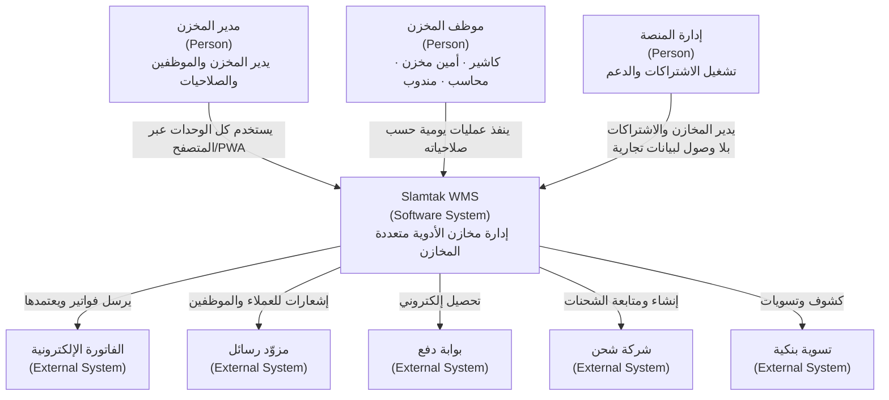
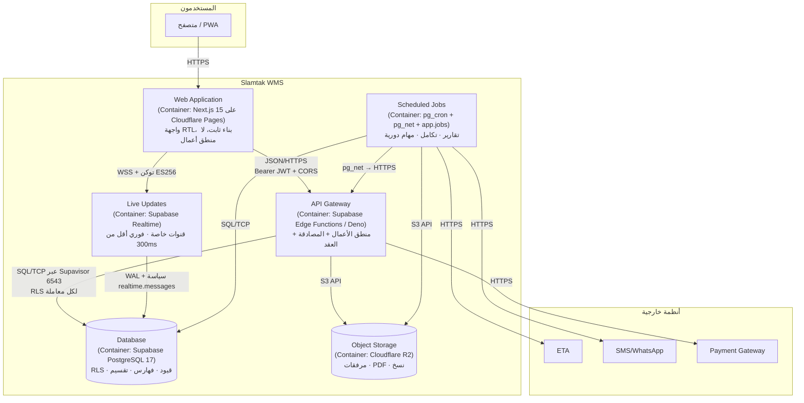
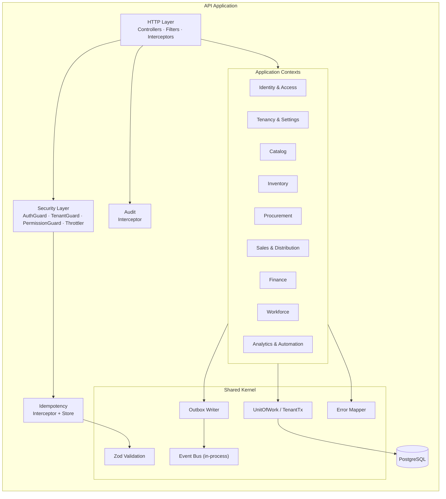
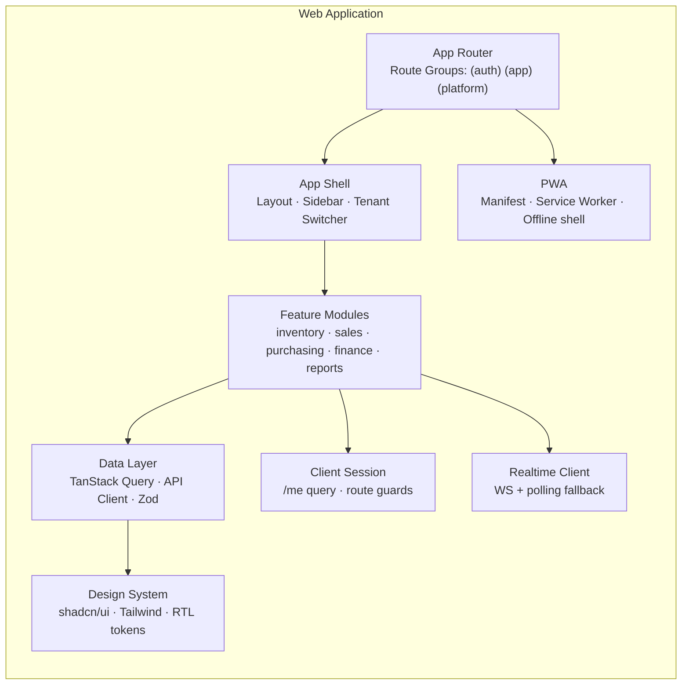
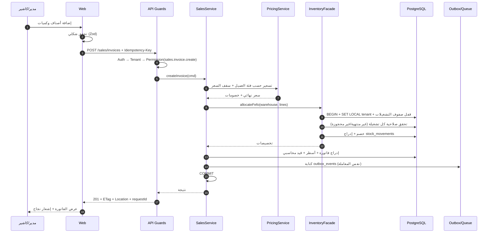
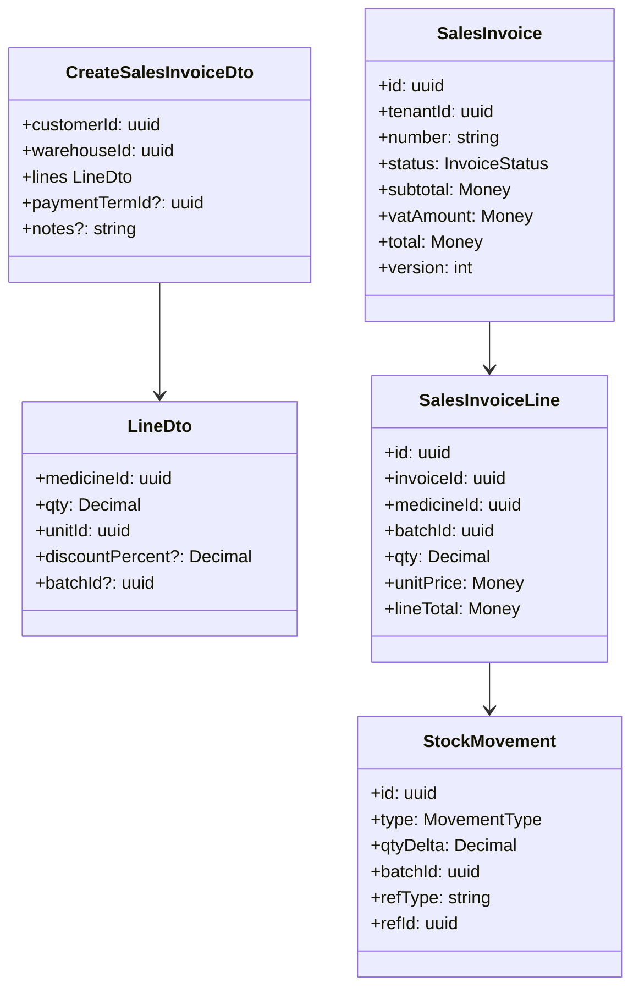

# 04 — C4 Architecture Diagrams

> **تحديث قيد التكلفة الصفرية (2026-11-06):** ما يظهر لاحقًا من Redis/BullMQ أو VPS أو تكلفة شهرية مُستبدَل بما في [`27`](27-free-tier-architecture.md) §5. المرجع الحاكم هو `27`.

> استُخدمت مخططات `flowchart` بأسلوب C4 لضمان العرض في GitHub وVS Code وبلا اعتماد على دعم C4 التجريبي.

---

## C4 Level 1 — System Context

| العنصر | النوع | الوصف |
|---|---|---|
| مدير المخزن | شخص | مالك الحساب (Tenant Owner)، أعلى صلاحية داخل مخزنه |
| موظف المخزن | شخص | صلاحيات محدودة بنطاق المخزن |
| إدارة المنصة | شخص | تشغيل الـ SaaS: إنشاء مخازن، خطط، دعم — **بلا** قراءة تجارية |
| Slamtak WMS | نظام | النظام قيد التصميم |
| ETA | خارجي | مصلحة الضرائب المصرية — فاتورة إلكترونية |
| SMS / Payment / Shipping | خارجي | عبر محوّل (Adapter) قابل للاستبدال |

---

## C4 Level 2 — Container

| Container | التقنية | المسؤولية | لماذا منفصل |
|---|---|---|---|
| Web | Next.js على Pages | عرض وPWA | نشر مستقل عن الـ API، كاش حافة أفضل |
| API | Edge Functions | كل القواعد والعقود | حد الثقة الوحيد للبيانات ([`28`](28-supabase-edge-runtime.md)) |
| Live Updates | Supabase Realtime | حدث «تغيّر» داخل Tenant (بلا بيانات) | WebSocket حقيقي بلا خدمة إضافية؛ SSE احتياطي ([`28`](28-supabase-edge-runtime.md) §7.1) |
| Scheduled Jobs | pg_cron + pg_net | مهام مجدولة ومعزولة الفشل | منع المهام الثقيلة من تعطيل الطلبات |
| Database | PostgreSQL | الحقيقة الواحدة | — |
| ~~Cache/Queue~~ | ~~Redis~~ | لا وجود له | كل الحالة في القاعدة |
| Object Storage | S3/R2 | ملفات | لا نضع ملفات في القاعدة |

---

## C4 Level 3 — Component (API Application)

| المكوّن | المسؤولية | الاعتماديات المسموحة |
|---|---|---|
| HTTP Layer | تحويل الطلبات، تنسيق الاستجابات | Security، Contexts |
| Security Layer | هوية، Tenant، صلاحية، حدود معدل | Identity (قراءة)، Cache |
| Idempotency | منع التكرار | Redis/DB |
| Audit | تسجيل الأثر | DB (append-only) |
| Identity & Access | مستخدمون، جلسات، أدوار | Shared Kernel |
| Tenancy & Settings | Tenant، مخزن واحد، إعدادات، اشتراك | Identity |
| Catalog | أصناف، باركود، وحدات، تصنيفات، أسعار | Tenancy |
| Inventory | أرصدة، تشغيلات، حركات، جرد، تحويلات | Catalog |
| Procurement | موردون، أوامر شراء، استلام، مرتجعات مورد | Inventory |
| Sales & Distribution | عملاء، عروض، فواتير، مرتجعات، مندوبون، توصيل | Inventory، Finance |
| Finance | حسابات، قيود، خزائن، بنوك، ضرائب | Sales/Procurement (أحداث) |
| Workforce | موظفون، حضور، رواتب | Identity |
| Analytics & Automation | تقارير، إشعارات، قواعد أتمتة، AI | قراءة إسقاطات |
| Shared Kernel | معاملات، Outbox، تحقق، أخطاء | لا شيء |

---

## C4 Level 3 — Component (Web Application)

| المكوّن | المسؤولية | ممنوع |
|---|---|---|
| App Router | تقسيم المسارات حسب الدور | منطق أعمال |
| App Shell | تنقّل، هوية بصرية، RTL | قرارات صلاحية نهائية |
| Feature Modules | شاشات كل وحدة | استدعاء قاعدة البيانات |
| Data Layer | جلب، كاش، إبطال، تحقق | تخزين أسرار |
| Design System | مكونات موحدة | أنماط مبعثرة |
| Realtime Client | تحديث حي | الاعتماد الكلي على WS (يوجد fallback) |

---

## C4 Level 3 — Dynamic: إنشاء فاتورة بيع

---

## C4 Level 4 — Code (نموذج توضيحي)

---

## معايير قبول هذه الوثيقة
- [ ] كل مستوى C4 موجود ويجيب على سؤال مختلف (من، ماذا، كيف، بأي كود).
- [ ] كل حاوية لها تقنية ومسؤولية وسبب فصل.
- [ ] سيناريو ديناميكي واحد على الأقل يوضح المسار الكامل للبيانات.
- [ ] لا يوجد مكوّن بلا مالك واضح في خريطة الوحدات.
