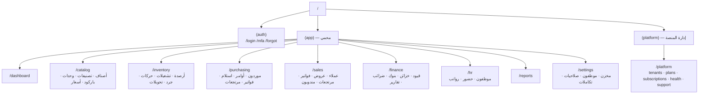
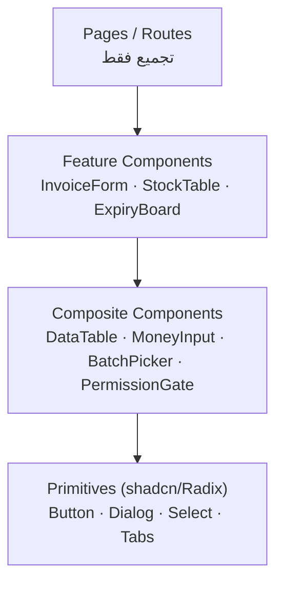

# 06 — Frontend Architecture

## 1. المبادئ الحاكمة

| # | المبدأ | التطبيق | الفحص |
|---|---|---|---|
| 1 | **الواجهة لا تقرر** | لا حساب سعر/خصم/رصيد/صلاحية نهائية في المتصفح | مراجعة كود + قاعدة ESLint مخصصة |
| 2 | **عقد واحد** | أنواع من OpenAPI + مخططات Zod مشتركة | `pnpm typecheck` يفشل عند الانحراف |
| 3 | **الحالة تُصنَّف** | حالة خادم ≠ حالة واجهة ≠ نموذج ≠ URL | مراجعة معمارية |
| 4 | **RTL أولًا** | خصائص منطقية، بلا `left/right` | `stylelint` قاعدة مخصصة |
| 5 | **الوصول للجميع** | لوحة مفاتيح، تباين AA، تسميات ARIA | `axe` في E2E |
| 6 | **لا أسرار** | لا مفاتيح، لا رموز، لا بيانات حساسة في التخزين المحلي | `gitleaks` + مراجعة CSP |

---

## 2. خريطة التوجيه (Route Map)



**قواعد:**
- مجموعات المسارات (`route groups`) تفصل تخطيط كل دور وتحميل كوده فقط.
- كل صفحة محمية تتحقق من الجلسة على الخادم (`layout` server-side) قبل العرض، لا في المتصفح فقط.
- عناصر التنقل تُبنى من `/me` (صلاحيات فعالة) — الإخفاء تجميلي، والحماية الحقيقية في الـ API وRLS.

---

## 3. طبقات الحالة

| النوع | الأداة | مثال | قاعدة |
|---|---|---|---|
| **حالة الخادم** | TanStack Query | قائمة فواتير، رصيد صنف | المصدر الوحيد للبيانات |
| **حالة الواجهة العامة** | Zustand (نادر) | الشريط الجانبي، الثيم، المخزن النشط العرضي | لا تُخزَّن بيانات أعمال |
| **حالة النموذج** | react-hook-form | نموذج فاتورة | لا تنسخ حالة الخادم |
| **حالة المسار** | `searchParams` | فلاتر، صفحة، ترتيب | قابلة للمشاركة والرجوع |
| **حالة الجلسة** | استعلام `/me` | المستخدم، المخزن، الصلاحيات | تُقرأ من الكوكي عبر الخادم |

**نمط Disciplined:** إذا كانت القيمة تأتي من الخادم فلا تُنسخ إلى `useState`. هذا يمنع أشهر أخطاء الواجهات الإدارية (بيانات قديمة بعد تعديل).

```ts
// اتفاقية مفاتيح الاستعلام — تُستخدم للإبطال الدقيق
export const qk = {
  me: ['me'] as const,
  medicines: (f: MedicineFilter) => ['medicines', f] as const,
  medicine: (id: string) => ['medicines', 'detail', id] as const,
  stock: (wh: string, f: StockFilter) => ['stock', wh, f] as const,
  invoices: (f: InvoiceFilter) => ['sales', 'invoices', f] as const,
};
```

---

## 4. طبقة العميل (API Client)

```ts
// تصميم مرجعي — apps/web/src/lib/api-client.ts
type ApiError = { status: number; code: string; title: string; detail?: string; fields?: Record<string,string> };

async function request<T>(path: string, init: RequestInit & { idempotencyKey?: string } = {}): Promise<T> {
  const res = await fetch(`/api/v1${path}`, {
    ...init,
    credentials: 'include',                    // كوكي HttpOnly
    headers: {
      'Content-Type': 'application/json',
      'X-CSRF-Token': readCsrfCookie(),
      ...(init.idempotencyKey ? { 'Idempotency-Key': init.idempotencyKey } : {}),
      ...init.headers,
    },
  });
  if (res.status === 401) { await refreshOnce(); return request<T>(path, init); }
  if (!res.ok) throw toApiError(await res.json());
  return res.status === 204 ? (undefined as T) : res.json();
}
```

| السلوك | القرار |
|---|---|
| تجديد الجلسة | `refreshOnce()` بـ single-flight (طلب واحد فقط عند 401 متعدد) |
| إعادة المحاولة | مرة واحدة للشبكة/502–504 فقط، لا لـ 4xx |
| Idempotency | مفتاح يُولَّد عند بدء نموذج مالي ويُثبَّت حتى النجاح |
| الأخطاء | تُعرض حسب `code` برسالة عربية مفهومة، والتفاصيل التقنية في السجل فقط |
| الإلغاء | `AbortController` عند تغيير الفلتر |

---

## 5. بنية المكوّنات



| المستوى | يُسمح له | ممنوع |
|---|---|---|
| Pages | استدعاء feature + تمرير معاملات المسار | منطق أعمال |
| Feature | استعلامات، نماذج، تفاعل مع الـ API | أنماط CSS مخصصة معزولة |
| Composite | سلوك عام قابل لإعادة الاستخدام | معرفة بوحدة أعمال محددة |
| Primitive | عرض فقط | استدعاء شبكة |

**مكونات مشتركة إلزامية** (تُبنى مرة واحدة): `DataTable` (ترقيم/فرز/تحديد/تصدير)، `MoneyInput` (EGP، منزلتان)، `QtyInput` (3 منازل)، `BatchPicker` (FEFO مرتّب)، `PermissionGate`، `ConfirmDialog`، `EmptyState`، `ErrorState`، `AuditTrailPanel`.

---

## 6. شاشات أساسية لكل وحدة (Screen Inventory)

| الوحدة | الشاشات الحرجة | ملاحظة تصميمية |
|---|---|---|
| المصادقة | دخول، تحقق ثانٍ، نسيت كلمة المرور، تغيير إجباري | لا تكشف إن كان البريد مسجلًا |
| لوحة التحكم | مؤشرات اليوم، تنبيهات انتهاء، مهام معلقة | تحميل هيكلي (skeleton) لا دوّارة |
| الأصناف | قائمة/تفاصيل/تعديل/استيراد Excel، طباعة باركود | بحث trigram فوري |
| المخزون | أرصدة، تشغيلات، حركات، لوحة انتهاء | عرض FEFO افتراضي |
| الجرد | جلسة جديدة، إدخال، فروق، اعتماد | منع الاعتماد بلا سبب للفروق |
| المشتريات | أمر شراء، استلام بتشغيلات، فاتورة مورد، مرتجع | إدخال تشغيلة إجباري عند الاستلام |
| المبيعات | فاتورة سريعة (باركود)، عروض، مرتجعات | اختصار لوحة مفاتيح للكاشير |
| المالية | قيود، خزائن، تحصيل، تقارير ضريبة | قيد غير متوازن = زر معطّل + سبب |
| الموظفون | قائمة، صلاحيات، حضور، رواتب | مصفوفة صلاحيات قابلة للنسخ |
| الإعدادات | بيانات المخزن (اسم/عنوان/ترخيص)، التكاملات | تحذير قبل تغيير يؤثر محاسبيًا — **بلا شاشة فروع أو إضافة مخزن** |
| إدارة المنصة | مخازن، اشتراكات، صحة النظام | بلا أي عمود تجاري حساس |

---

## 7. RTL والتوطين

| الجانب | القرار |
|---|---|
| الاتجاه | `<html lang="ar" dir="rtl">`، تبديل `dir` عند الإنجليزية |
| الخط | IBM Plex Sans Arabic (أوزان 400/500/700) بتحميل `next/font` محلي |
| الأرقام | عرض لاتيني افتراضيًا للحقول المالية (أقل خطأ إدخال)، عربي اختياري |
| التواريخ | `Africa/Cairo`، تنسيق `dd/MM/yyyy`، تواريخ الانتهاء بلا منطقة زمنية |
| العملة | `EGP` مع فاصل آلاف، وخانة عشرية دائمًا |
| النصوص | بلا نصوص مكتوبة داخل المكونات — كل شيء من ملفات الترجمة |
| الجداول | محاذاة الأرقام يسارًا داخل خلية RTL (اتجاه ثابت للأرقام) |
| الطباعة | ورقة A4، هوامش RTL، رأس/تذييل مخزن، ترقيم صفحات |

---

## 8. PWA واستراتيجية العمل دون اتصال

| القدرة | المرحلة 1 | المرحلة 3 |
|---|---|---|
| تثبيت على الهاتف | ✅ | ✅ |
| قشرة التطبيق دون اتصال | ✅ | ✅ |
| قراءة كاش لقوائم مرجعية (أصناف/أسعار) | ✅ بصلاحية زمنية | ✅ |
| مسح باركود بالكاميرا | ✅ عبر `BarcodeDetector` مع بديل WASM | ✅ |
| **كتابة دون اتصال** | ❌ | تُقيَّم لاحقًا مع طابور محلي وتعريف تعارض صريح |

**السبب:** الكتابة دون اتصال على مخزون الأدوية تُنتج تعارضًا في FEFO والأرصدة؛ لا نُقدّمها قبل تصميم حل تعارض مُختبَر. الواجهة تبدو كاملة دون اتصال لكن أي عملية كتابة تُظهر حالة "يجب الاتصال".

**سياسة الكاش:** `stale-while-revalidate` للأصول، `no-store` لكل `/api`، وفشل صريح عند غياب الشبكة (لا بيانات قديمة تُعرض كأنها حقيقية في العمليات المالية).

---

## 9. الأداء (Performance Budget)

| المقياس | السقف | الأداة |
|---|---|---|
| JS أولي (gzip) | ≤ 200KB | `next build` + `size-limit` |
| LCP على 4G | ≤ 2.5s | Lighthouse CI |
| INP | ≤ 200ms | Lighthouse CI |
| CLS | ≤ 0.1 | Lighthouse CI |
| زمن فتح شاشة الفاتورة | ≤ 1.2s (بيانات مخزّنة) | قياس في staging |
| جدول 1,000 صف | ≤ 150ms تفاعل | Playwright trace |

**تقنيات مطبقة:** تقسيم حسب المسار، `dynamic()` للنماذج الثقيلة، افتراضية الصفوف، تحميل مسبق للصفحة التالية، بلا مكتبات تاريخ ثقيلة.

---

## 10. الأمان في الواجهة

| الخطر | الضابط |
|---|---|
| XSS | بلا `dangerouslySetInnerHTML` (قاعدة ESLint)، تعقيم أي محتوى من المستخدم، CSP صارمة |
| CSRF | SameSite=Lax + رأس CSRF + تحقق Origin في الـ API |
| سرقة جلسة | لا رموز في JS — كوكي `HttpOnly` فقط |
| تخزين محلي حساس | ممنوع: أسعار تكلفة، بيانات عملاء كاملة، أي رمز |
| Clickjacking | `frame-ancestors 'none'` |
| تسريب معلومات | رسائل خطأ عامة، بلا Stack traces |
| صلاحيات في الواجهة | `PermissionGate` تجميلي فقط — القرار في الـ API |

---

## 11. الاختبار

| النوع | النطاق | الأداة |
|---|---|---|
| وحدي | دوال تنسيق/حساب/تحقق | Vitest |
| مكوّن | نماذج، جداول، حالات خطأ | Testing Library |
| E2E | دخول → فاتورة → طباعة، عزل مخزنين، صلاحية مرفوضة | Playwright |
| إتاحة | الشاشات الحرجة | axe-core |
| بصري | RTL/LTR snapshots | Playwright screenshots |

**مسارات E2E إلزامية قبل النشر:** تسجيل دخول + تحقق ثانٍ، إنشاء فاتورة بيع كاملة، استلام بضاعة بتشغيلة، رفض صلاحية، انتهاء الجلسة وتجديدها، فتح تقرير وتصديره.

---

## 12. معايير قبول هذه الوثيقة
- [ ] لا شاشة تعتمد على بيانات محسوبة في المتصفح.
- [ ] كل شاشة لها حالات: تحميل، فراغ، خطأ، صلاحية مرفوضة.
- [ ] RTL مطبق بخصائص منطقية ومختبَر بصريًا.
- [ ] كل نموذج مالي يستخدم Idempotency-Key.
- [ ] ميزانية الأداء محددة وتُقاس في CI.
