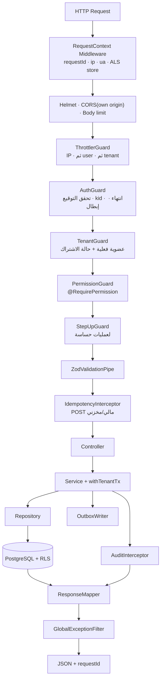
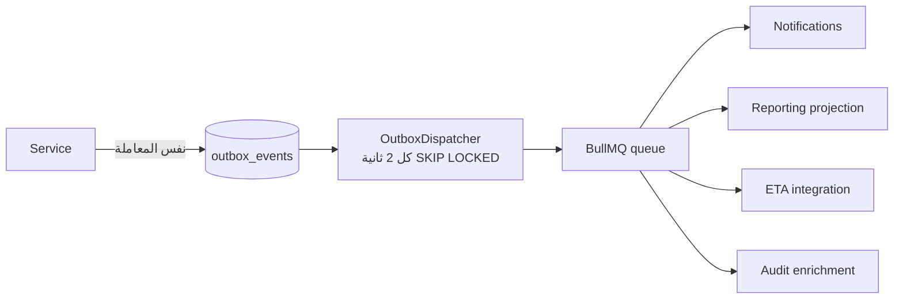

# 07 — Backend Architecture
> **تحديث التنفيذ (2026-11-06):** الطبقة الخدمية لم تعد NestJS في حاوية — البوابة هي Supabase Edge Functions. التفاصيل والحدود الحسابية في [`28`](28-supabase-edge-runtime.md)؛ ما يلي يبقى صحيحًا في المنطق والعقد.

> **تحديث قيد التكلفة الصفرية (2026-11-06):** ما يظهر لاحقًا من Redis/BullMQ أو VPS أو تكلفة شهرية مُستبدَل بما في [`27`](27-free-tier-architecture.md) §5. المرجع الحاكم هو `27`.

## 1. بنية التطبيق

```
apps/api/src/
├── main.ts                    # Bootstrap: Fastify, Helmet, versioning, validation, Swagger
├── app.module.ts              # تجميع الوحدات فقط
├── common/                    # Shared Kernel: guards, interceptors, filters, pipes, uow, outbox
├── modules/
│   ├── identity/              # auth, users, sessions, roles, permissions, mfa
│   ├── tenancy/               # tenants, warehouse (1:1), settings, subscription
│   ├── catalog/               # medicines, categories, units, barcodes, price lists
│   ├── inventory/             # stock, batches, movements, counts
│   ├── procurement/           # suppliers, purchase orders, GRN, supplier invoices, returns
│   ├── sales/                 # customers, quotes, orders, invoices, returns, reps
│   ├── finance/               # accounts, journals, cash, banks, taxes, payments
│   ├── workforce/             # employees, attendance, payroll
│   ├── analytics/             # reports, dashboards, exports
│   ├── automation/            # rules, schedulers, notifications
│   ├── integration/           # eta, sms, payments, shipping, ai (adapters)
│   ├── audit/                 # append-only audit log
│   └── platform/              # إدارة المنصة (مخطط مختلف تمامًا)
└── jobs/                      # processors للطوابير
```

**قواعد تُفرض آليًا** (`dependency-cruiser`):
1. `modules/*` لا يُستورد من `modules/*` مباشرة إلا من ملف `*.public.ts` المعلن.
2. `common/*` لا يستورد أي `modules/*`.
3. `platform` لا يستورد `modules` التجارية.
4. لا استيراد لـ `drizzle` خارج `packages/db` (إلا في repositories المعتمدة).

---

## 2. خط أنابيب الطلب — تفصيل تنفيذي



### 2.1 Guards — تسلسل وحالات الرفض

| Guard | يقرأ من | يرفض بـ | ملاحظة |
|---|---|---|---|
| Throttler | IP، ثم `sub`، ثم `tenantId` | 429 `RATE_LIMITED` | حد أقسى لـ `/auth/*` |
| Auth | كوكي/رأس Authorization | 401 `AUTH_REQUIRED` | لا يكشف سببًا تفصيليًا |
| Tenant | `tenant_memberships` | 403 `TENANT_ACCESS_DENIED` | **لا يثق** بـ `tenantId` القادم من العميل |
| Permission | جدول الصلاحيات المeffective + الكاش | 403 `PERMISSION_DENIED` | يُسجّل المحاولة في التدقيق |
| StepUp | `session.step_up_at` | 403 `STEP_UP_REQUIRED` | نافذة 10 دقائق |

> **قاعدة ذهبية:** `tenantId` في المسار أو الجسم يُستخدم فقط **للتحقق**، وليس للتفويض. المصدر الموثوق الوحيد: العضوية المخزنة في القاعدة مرتبطة بهوية الجلسة.

### 2.2 سياق الطلب (AsyncLocalStorage)

```ts
export interface RequestCtx {
  requestId: string; userId: string; tenantId: string;
  warehouseId: string;   // من العضوية، لا من الطلب
  permissions: Set<string>;
  ip?: string; userAgent?: string; steppedUpAt?: Date;
}
```
يُحقن في كل خدمة وRepository وAuditWriter — لا يُمرَّر كوسيط يدوي في كل دالة (يقلل الأخطاء).

---

## 3. التفويض (Authorization) — التنفيذ

### 3.1 نموذج الصلاحية
`module.action` مع نطاق (`scope`): `tenant` | `warehouse` | `own` — لا نطاق فرعي.

```ts
// packages/permissions/src/catalog.ts — مرجع واحد
export const PERMISSIONS = {
  'sales.invoice.create':  { scope: 'warehouse', sensitive: false },
  'sales.invoice.cancel':  { scope: 'warehouse', sensitive: true  },
  'sales.discount.override':{ scope: 'warehouse', sensitive: true  },
  'inventory.adjust':      { scope: 'warehouse', sensitive: true  },
  'catalog.price.update':  { scope: 'tenant',    sensitive: true  },
  'finance.journal.create':{ scope: 'tenant',    sensitive: false },
  'hr.payroll.approve':    { scope: 'tenant',    sensitive: true  },
  'tenant.user.manage':    { scope: 'tenant',    sensitive: true  },
} as const;
```

### 3.2 قرار التفويض
```ts
function can(ctx: RequestCtx, perm: Permission, scope?: ScopeRef): boolean {
  if (!ctx.permissions.has(perm)) return false;
  if (!scope) return true;                       // صلاحية على مستوى الحساب
  if (scope.warehouseId && scope.warehouseId !== ctx.warehouseId) return false;
  return true;
}
```

### 3.3 الأدوار الافتراضية
| الدور | أمثلة صلاحيات | قيود |
|---|---|---|
| Owner | كل شيء داخل الـ Tenant | لا يرى بيانات Tenant آخر أبدًا |
| Manager | تشغيل + موظفون + تقارير | لا يعدّل صلاحيات المالك |
| Pharmacist | صرف، مرتجعات، فواتير | بلا تعديل أسعار |
| Cashier | فواتير بيع وتحصيل | بلا مرتجعات بلا موافقة |
| Keeper | استلام، تحويل، جرد | بلا أسعار بيع |
| Purchasing | أوامر شراء وموردون | بلا صرف |
| Accountant | قيود، خزائن، تقارير مالية | لا يعدّل مخزونًا |
| Sales Rep | عملاء، عروض، طلبات | يرى عملاءه فقط (`own`) |
| Driver | مهام توصيل وتحصيل | بلا بيانات مالية للعملاء |
| Auditor | قراءة كل شيء + سجل التدقيق | بلا كتابة |

تفاصيل المصفوفة الكاملة والـ MFA في `12`.

---

## 4. المعاملات والوحدة (Unit of Work)

```ts
@Injectable()
export class SalesService {
  constructor(
    private readonly uow: UnitOfWork,
    private readonly repo: SalesRepository,
    private readonly inventory: InventoryFacade,
    private readonly pricing: PricingService,
    private readonly outbox: OutboxWriter,
  ) {}

  async create(cmd: CreateInvoiceCmd, ctx: RequestCtx) {
    return this.uow.run(ctx, async (tx) => {
      const lines = await this.pricing.priceLines(cmd.lines, cmd.customerId, ctx, tx);
      const alloc = await this.inventory.allocateFefo(tx, ctx, cmd.warehouseId, lines);
      const invoice = this.repo.buildInvoice(cmd, lines, alloc, ctx);
      await this.repo.insert(tx, invoice);
      await this.outbox.emit(tx, 'sales.invoice.created', invoice.id, ctx);
      return invoice;
    });
  }
}
```

| القاعدة | السبب |
|---|---|
| كل كتابة داخل `uow.run` | ذرية + `SET LOCAL` + RLS |
| لا استدعاء شبكة داخل `uow.run` | يمنع معاملات طويلة وأقفالًا معلقة |
| `outbox.emit` داخل نفس المعاملة | لا فقد حدث ولا حدث لمعاملة فاشلة |
| حماية من المعاملات المتداخلة | `uow.run` يرفض التداخل صراحة |
| مهلة قصوى للمعاملة | `statement_timeout = 15s`, `lock_timeout = 3s` |

---

## 5. الأحداث (Event-Driven داخلي)



| الخاصية | القرار |
|---|---|
| الضمان | At-least-once + مستهلكون Idempotent (مفتاح `eventId` + `processed_events`) |
| الترتيب | لكل كيان (بـ `entity_id` كـ job group) لا ترتيب عالمي |
| الحجم | حمولة صغيرة (معرّفات + تغييرات)، والبيانات تُقرأ عند المعالجة |
| الفشل | إعادة محاولة أسّية حتى 8، ثم `dead_letters` + تنبيه |
| التطور | حقول جديدة اختيارية فقط؛ `event_version` |

**الأحداث المعتمدة (أمثلة):** `sales.invoice.created`, `sales.invoice.cancelled`, `purchase.grn.posted`, `inventory.batch.expiring`, `inventory.stock.adjusted`, `finance.journal.posted`, `tenant.subscription.suspended`.

---

## 6. Idempotency

```sql
CREATE TABLE idempotency_keys (
  tenant_id     uuid NOT NULL,
  key           text NOT NULL,
  endpoint      text NOT NULL,
  request_hash  text NOT NULL,
  status_code   int,
  response_body jsonb,
  created_at    timestamptz NOT NULL DEFAULT now(),
  expires_at    timestamptz NOT NULL,
  PRIMARY KEY (tenant_id, key)
);
```

| الحالة | السلوك |
|---|---|
| مفتاح جديد | تنفيذ ثم تخزين الاستجابة |
| مفتاح موجود بنفس `request_hash` | إعادة نفس الاستجابة (200/201) بلا إعادة تنفيذ |
| مفتاح موجود بجسم مختلف | 409 `IDEMPOTENCY_MISMATCH` |
| مفتاح موجود والتنفيذ جارٍ | 409 `REQUEST_IN_PROGRESS` (أو 202 مع `Retry-After`) |
| انتهاء | 24 ساعة ثم يُحذف بمهمة تنظيف |

---

## 7. التدقيق (Audit)

| الحقل | المحتوى |
|---|---|
| `tenant_id`, `actor_user_id`, `actor_role` | من فعلها وفي أي مخزن |
| `action` | `sales.invoice.create` |
| `entity_type`, `entity_id` | ما الذي تغيّر |
| `before`, `after` | JSONB (مع تنقية الحقول الحساسة) |
| `request_id`, `ip`, `user_agent` | التتبع |
| `created_at` | UTC |

**ضوابط:** جدول append-only (`REVOKE UPDATE, DELETE` من دور التطبيق + Trigger يمنع)، تقسيم شهري، بلا حذف من الواجهة، وتصدير للجهات الرقابية عند الطلب.

---

## 8. عقود الوحدات (Module Contracts)

كل وحدة تُصدِر ملفًا واحدًا `*.public.ts`:

```ts
// modules/inventory/inventory.public.ts
export interface InventoryFacade {
  allocateFefo(tx: Tx, ctx: RequestCtx, warehouseId: string, lines: PriceLine[]): Promise<Allocation[]>;
  releaseReservation(tx: Tx, ctx: RequestCtx, reservationId: string): Promise<void>;
  postAdjustment(tx: Tx, ctx: RequestCtx, cmd: AdjustmentCmd): Promise<MovementId>;
  getAvailability(tx: Tx, ctx: RequestCtx, medicineIds: string[]): Promise<Availability[]>;
}
```

| القاعدة | التفصيل |
|---|---|
| لا كيانات قاعدة في العقود | DTO/أنواع ملك الوحدة فقط |
| لا استعلامات متزامنة عميقة | 3 مستويات كحد أقصى بين الوحدات |
| الأحداث أفضل من الاستدعاء عند عدم الحاجة للنتيجة | مثل إشعار أو تقرير |
| الاستدعاء المتزامن فقط عند الحاجة لنتيجة داخل نفس المعاملة | مثل تخصيص مخزون |

---

## 9. قواعد الأعمال الحرجة (Domain Rules)

### 9.1 تخصيص FEFO
```ts
export function allocateFefo(batches: Batch[], need: Decimal, today: Date): Allocation[] {
  const eligible = batches
    .filter(b => b.status === 'available')
    .filter(b => b.qtyOnHand.gt(0))
    .filter(b => b.expiryDate > addDays(today, b.minShelfLifeDays))   // قابل للضبط لكل صنف/عميل
    .sort((a, b) => a.expiryDate.getTime() - b.expiryDate.getTime() || a.id.localeCompare(b.id));
  const out: Allocation[] = [];
  let remaining = need;
  for (const b of eligible) {
    if (remaining.lte(0)) break;
    const take = Decimal.min(b.qtyOnHand, remaining);
    out.push({ batchId: b.id, qty: take, expiryDate: b.expiryDate });
    remaining = remaining.minus(take);
  }
  if (remaining.gt(0)) throw new InsufficientStockError(remaining.toString());
  return out;
}
```
**حالات الرفض:** تشغيلة منتهية، تشغيلة محجوزة (Quarantine)، تشغيلة مسحوبة (Recall)، عمر متبقٍ أقل من الحد الأدنى، كمية غير كافية.

### 9.2 التسعير
`sale_price = f(price_list, customer_class, quantity_break, promotion)` ثم `assert price ≤ max_price` للأصناف ذات التسعيرة الجبرية. لا يقبل الخادم سعرًا من العميل إلا إذا كان المستخدم يملك `sales.price.override` **و** تم تسجيل السبب في التدقيق.

### 9.3 حدود الائتمان
`available_credit = credit_limit − outstanding − open_orders`. تجاوزها يتطلب `sales.credit.override` (Step-Up) وإلا 409 `CREDIT_LIMIT_EXCEEDED`.

### 9.4 المرتجعات
مرتجع بيع يُنشئ حركة دخول للتشغيلة **الأصلية** فقط، ويُقيَّد بسعر الفاتورة الأصلية، ويُرفض إذا كانت التشغيلة منتهية (يُحوَّل إلى "تالف" بموافقة).

### 9.5 تعديل المخزون
كل تسوية تتطلب: سببًا من قائمة، مرفقًا اختياريًا، وموافقة ثانية إذا تجاوزت قيمة العتبة.

---

## 10. التهيئة وفحوص الصحة

```ts
// تحقق إلزامي عند الإقلاع — يفشل التطبيق لا يعمل بإعداد ناقص
const EnvSchema = z.object({
  NODE_ENV: z.enum(['development', 'test', 'production']),
  DATABASE_URL: z.string().url(),
  REDIS_URL: z.string().url(),
  JWT_PRIVATE_KEY: z.string().min(64),
  JWT_PUBLIC_KEY: z.string().min(64),
  COOKIE_DOMAIN: z.string(),
  APP_ORIGIN: z.string().url(),
  S3_ENDPOINT: z.string().url(),
  S3_BUCKET: z.string(),
  SENTRY_DSN: z.string().url().optional(),
});
```

| الفحص | المسار | المحتوى |
|---|---|---|
| Liveness | `/health/live` | العملية تعمل |
| Readiness | `/health/ready` | القاعدة + Redis + المهاجرات مطبقة |
| Deep | `/health/deep` (داخلي) | نسخة المهاجرة، زمن القاعدة، حجم الطوابير |

---

## 11. الإيقاف الرشيق (Graceful Shutdown)

1. استقبال `SIGTERM` → التوقف عن قبول اتصالات جديدة.
2. إكمال الطلبات الجارية (مهلة 20 ثانية).
3. إغلاق معالجات الطوابير بعد إنهاء المهمة الحالية.
4. نشر الأحداث المتبقية من Outbox.
5. إغلاق Pool والاتصالات.

---

## 12. معايير قبول هذه الوثيقة
- [ ] كل طلب يمر بتسلسل Guards معلن ومرتب.
- [ ] `tenantId` لا يُشتق أبدًا من مدخلات العميل للتفويض.
- [ ] كل عملية مالية/مخزنية لها Idempotency وOutbox وتدقيق.
- [ ] عقود الوحدات معلنة ولا تُسرّب كيانات القاعدة.
- [ ] قواعد FEFO والتسعير والائتمان مكتوبة كاختبارات قبل التنفيذ.
