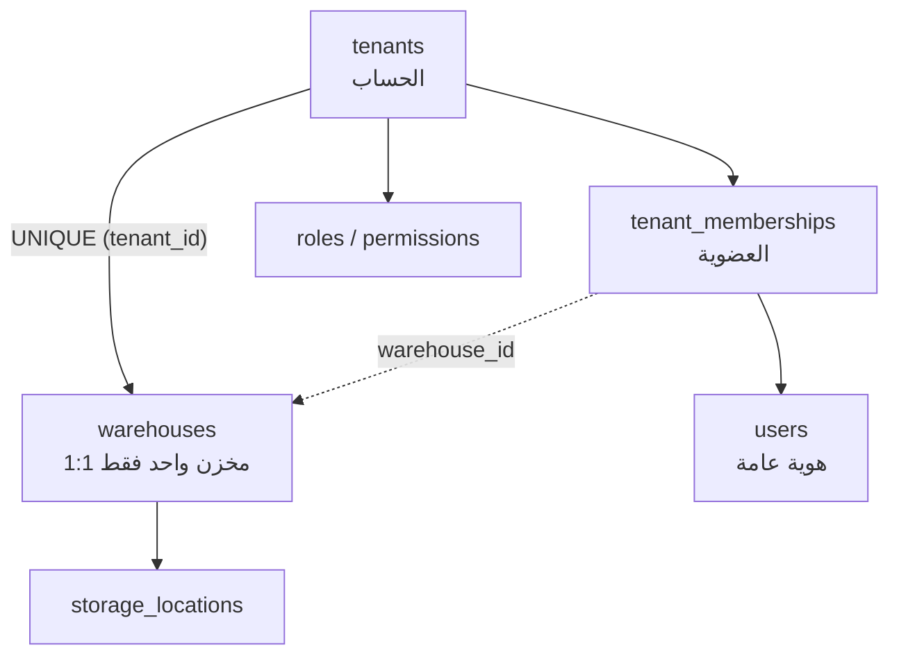

# 08 — Database Architecture

## 1. المبادئ والاصطلاحات

| القرار | التفصيل | السبب |
|---|---|---|
| التسمية | `snake_case`، جداول جمع، مفاتيح `<table>_id` | اتساق وتوليد آلي |
| المفتاح الأساسي | `id uuid DEFAULT gen_random_uuid()` **+** `tenant_id` في مفتاح مركب | يمنع بنيويًا الربط بين مخزنين |
| الوقت | `created_at`, `updated_at` (`timestamptz`, UTC) | عرض بتوقيت القاهرة فقط |
| الحذف | `deleted_at` للكيانات المرجعية؛ **منع الحذف** للمالية والمخزون | قابلية التتبع |
| المال | `numeric(14,2)` عملة EGP | لا `float` ماليًا أبدًا |
| الكميات | `numeric(14,3)` | دعم شريط/قرص/جزء |
| النسب | `numeric(5,4)` (0.0000–1.0000) | دقة الضريبة والخصم |
| الحالات | `text` + `CHECK (col IN (...))` أو `enum` لنطاقات ثابتة | مرونة الهجرة مع سلامة |
| الترقيم | جدول `document_sequences` بزيادة ذرية | لا `max()+1` |
| التزامن | `version int NOT NULL DEFAULT 1` + Trigger زيادة | قفل متفائل |
| التقسيم | `stock_movements`, `audit_logs`, `notifications` شهريًا | أداء وأرشفة |

---

## 2. نموذج العزل في القاعدة (Tenant Scoping)



**قواعد إلزامية:**

1. كل جدول أعمال يحمل `tenant_id NOT NULL`.
2. المفتاح الأساسي `(tenant_id, id)` — **حتى لو كان `id` فريدًا عالميًا**.
3. كل مفتاح خارجي إلى جدول أعمال مركّب: `(tenant_id, parent_id) REFERENCES parent (tenant_id, id)`.
4. `UNIQUE` دائمًا مقيّد بـ `tenant_id` (مثل `UNIQUE (tenant_id, sku)`).
5. `warehouse_id` يُقيَّد بـ FK مركب مع `tenant_id` أيضًا، و`tenant_memberships.warehouse_id` لا يقبل إلا مخزن الحساب نفسه.
6. `warehouses` يحمل `UNIQUE (tenant_id)` — **حساب واحد = مخزن واحد** (ADR-025)؛ لا يُنشأ مخزن ثانٍ ولو من مسار إداري.

```sql
-- النمط الأساسي لكل جدول أعمال
CREATE TABLE medicines (
  tenant_id    uuid NOT NULL REFERENCES tenants(id) ON DELETE RESTRICT,
  id           uuid NOT NULL DEFAULT gen_random_uuid(),
  sku          text NOT NULL,
  name_ar      text NOT NULL,
  name_en      text,
  barcode      text,
  category_id  uuid,
  base_unit_id uuid NOT NULL,
  is_controlled boolean NOT NULL DEFAULT false,
  controlled_schedule smallint CHECK (controlled_schedule BETWEEN 1 AND 3),
  max_public_price numeric(14,2),          -- التسعيرة الجبرية إن وُجدت
  vat_rate     numeric(5,4) NOT NULL DEFAULT 0,
  is_active    boolean NOT NULL DEFAULT true,
  version      int NOT NULL DEFAULT 1,
  created_at   timestamptz NOT NULL DEFAULT now(),
  updated_at   timestamptz NOT NULL DEFAULT now(),
  deleted_at   timestamptz,
  PRIMARY KEY (tenant_id, id),
  UNIQUE (tenant_id, sku),
  FOREIGN KEY (tenant_id, category_id)
    REFERENCES medicine_categories (tenant_id, id),
  FOREIGN KEY (tenant_id, base_unit_id)
    REFERENCES units (tenant_id, id)
);
```

> **لماذا المفتاح المركب؟** لأنه يجعل الربط بين مخزنين **مستحيلًا على مستوى المخطط**، لا مجرد "ممنوع في الكود". حتى لو أخطأ المطور أو تجاوز الـ RLS لأي سبب، يفشل الإدراج بقيد مفتاح خارجي.

---

## 3. حصر الجداول حسب النطاق

### 3.1 الهوية والصلاحيات (Identity & Access)
| الجدول | الغرض | ملاحظات |
|---|---|---|
| `users` | هوية عالمية (بريد، اسم، كلمة مرور Argon2id، MFA) | **بلا `tenant_id`**: الشخص قد ينتمي لأكثر من حساب، ولكل حساب مخزنه الواحد |
| `user_mfa` | TOTP secret مشفّر، أكواد احتياطية | سرّ مشفّر بمفتاح تطبيق |
| `sessions` | جلسات نشطة، refresh token hash، جهاز، إبطال | `revoked_at` |
| `login_attempts` | محاولات فاشلة وقفل | تقييد معدل منطقي |
| `tenant_memberships` | ربط المستخدم بالحساب + `warehouse_id` المشتق + الحالة | **مصدر الحقيقة للتفويض ولمعرّف المخزن** |
| `roles` | أدوار لكل Tenant (+ أدوار نظام ثابتة) | `is_system` |
| `permissions` | كتالوج الصلاحيات (مرآة للكود) | للتدقيق والعرض |
| `role_permissions` | صلاحيات الدور | — |
| `user_roles` | إسناد دور لمستخدم داخل الحساب | لا نطاق فرعي — الحساب هو النطاق |
| `user_permission_overrides` | استثناءات فردية (منح/منع) | منع يتغلب على منح |

### 3.2 الحساب والتنظيم (Tenancy)
| الجدول | الغرض |
|---|---|
| `tenants` | الحساب: الاسم، الحالة (trial/active/suspended/closed)، الخطة |
| `tenant_settings` | إعدادات مرنة `jsonb` + إعدادات صريحة للأعمدة الحرجة |
| `tenant_features` | تشغيل/إيقاف وحدات لكل حساب |
| `warehouses` | **المخزن الوحيد للحساب**: الاسم، العنوان، الترخيص، الحالة؛ `UNIQUE (tenant_id)` |
| `storage_locations` | مناطق/رفوف داخل المخزن |
| `document_sequences` | ترقيم المستندات لكل Tenant/نوع/سنة |

### 3.3 كتالوج الأصناف (Catalog)
| الجدول | الغرض |
|---|---|
| `medicine_categories` | تصنيف هرمي (`parent_id`) |
| `medicines` | الصنف: أسماء، SKU، EDA registration، مادة فعالة، شكل دوائي، شركة |
| `medicine_alternatives` | بدائل علاجية/تجارية |
| `units` | وحدة (علبة/شريط/قرص) + معامل تحويل للوحدة الأساسية |
| `medicine_units` | وحدات الصنف وأسعارها |
| `barcodes` | باركودات متعددة لكل صنف/وحدة (EAN/GS1) |
| `price_lists` | قوائم أسعار (جمهور/صيدلي/جملة/عقد) |
| `price_list_items` | سعر الصنف في القائمة |
| `prices_history` | تاريخ تغيّر الأسعار (append-only) |
| `promotions` | عروض (خصم/هدية/حد أدنى) بشروط `jsonb` ونطاق زمني |

### 3.4 المخزون (Inventory) — القلب
| الجدول | الغرض | قواعد |
|---|---|---|
| `batches` | التشغيلة: رقم، انتهاء، إنتاج، مورّد، تكلفة | `UNIQUE (tenant_id, medicine_id, batch_no, expiry_date)` |
| `stock_batches` | **الرصيد** لكل (مخزن، صنف، تشغيلة، موقع) | `CHECK (qty_on_hand >= 0)`، `CHECK (qty_reserved >= 0)` |
| `stock_movements` | دفتر الحركات append-only | `CHECK (qty_delta <> 0)`، مُقسَّم شهريًا |
| `stock_reservations` | حجز مؤقت (فاتورة غير مؤكدة) | ينتهي تلقائيًا |
| `stock_counts` + `stock_count_items` | جلسات الجرد وفروقها | لا اعتماد بلا سبب |
| `batch_status_history` | حجز/إفراج/سحب تشغيلة | سبب إلزامي |
| `stock_snapshots` | لقطة يومية مجمّعة للتقارير | تُبنى بمهمة ليلية |

```sql
CREATE TABLE stock_batches (
  tenant_id    uuid NOT NULL,
  id           uuid NOT NULL DEFAULT gen_random_uuid(),
  warehouse_id uuid NOT NULL,
  location_id  uuid,
  medicine_id  uuid NOT NULL,
  batch_id     uuid NOT NULL,
  qty_on_hand  numeric(14,3) NOT NULL DEFAULT 0 CHECK (qty_on_hand >= 0),
  qty_reserved numeric(14,3) NOT NULL DEFAULT 0 CHECK (qty_reserved >= 0),
  unit_cost    numeric(14,4) NOT NULL DEFAULT 0,
  status       text NOT NULL DEFAULT 'available'
               CHECK (status IN ('available','quarantine','blocked','recalled','damaged')),
  version      int NOT NULL DEFAULT 1,
  updated_at   timestamptz NOT NULL DEFAULT now(),
  PRIMARY KEY (tenant_id, id),
  UNIQUE (tenant_id, warehouse_id, batch_id, location_id),
  FOREIGN KEY (tenant_id, batch_id)   REFERENCES batches (tenant_id, id),
  FOREIGN KEY (tenant_id, medicine_id) REFERENCES medicines (tenant_id, id),
  FOREIGN KEY (tenant_id, warehouse_id) REFERENCES warehouses (tenant_id, id),
  CHECK (qty_reserved <= qty_on_hand)
);

-- فهرس الصرف FEFO: يخدم الاستعلام الأكثر حرارة في النظام
CREATE INDEX idx_stock_fefo
  ON stock_batches (tenant_id, warehouse_id, medicine_id, status)
  INCLUDE (qty_on_hand, qty_reserved)
  WHERE qty_on_hand > 0 AND status = 'available';
```

### 3.5 المشتريات والتوريد
`suppliers`, `supplier_contacts`, `purchase_orders`, `purchase_order_items`, `goods_receipts`, `goods_receipt_items`, `supplier_invoices`, `supplier_invoice_items`, `supplier_payments`, `supplier_returns`, `supplier_return_items`, `supplier_ledger`.

### 3.6 المبيعات والتوزيع
`customers` (صيدليات/مستشفيات/عملاء نقديون)، `customer_contacts`, `customer_licenses`, `sales_quotes`, `sales_orders`, `sales_order_items`, `sales_invoices`, `sales_invoice_items`, `sales_returns`, `sales_return_items`, `customer_payments`, `customer_ledger`, `sales_reps`, `rep_targets`, `rep_commissions`, `delivery_tasks`, `delivery_routes`, `delivery_proofs`.

### 3.7 المالية
`accounts` (شجرة حسابات)، `journal_entries`, `journal_entry_lines`, `fiscal_periods`, `cash_accounts`, `bank_accounts`, `cash_transactions`, `expenses`, `tax_rates`, `tax_reports`, `ar_ap_opening_balances`.

### 3.8 القوى العاملة والتشغيل
`employees`, `employee_contracts`, `attendance_records`, `payroll_runs`, `payroll_items`, `payroll_settlements`, `vehicles`, `drivers`.

### 3.9 النظام (System)
`audit_logs`, `notifications`, `notification_preferences`, `outbox_events`, `processed_events`, `idempotency_keys`, `dead_letters`, `automation_rules`, `automation_runs`, `attachments`, `report_exports`, `feature_flags`, `api_keys` (تكاملات).

### 3.10 إدارة المنصة (Platform Schema)
مخطط منفصل `platform`: `platform_users`, `plans`, `plan_features`, `subscriptions`, `subscription_invoices`, `tenant_lifecycle_events`, `support_tickets`, `platform_audit_logs`, `usage_metrics`.
**لا يحتوي أي جدول بيانات تجارية**، ولا يملك دوره صلاحية قراءة جداول `public` التجارية.

---

## 4. RLS — التنفيذ المرجعي

```sql
-- 1) مخطط مساعد ودالة السياق
CREATE SCHEMA IF NOT EXISTS app;

CREATE OR REPLACE FUNCTION app.current_tenant_id() RETURNS uuid
LANGUAGE sql STABLE AS $$
  SELECT NULLIF(current_setting('app.tenant_id', true), '')::uuid
$$;

CREATE OR REPLACE FUNCTION app.current_user_id() RETURNS uuid
LANGUAGE sql STABLE AS $$
  SELECT NULLIF(current_setting('app.user_id', true), '')::uuid
$$;

-- 2) دور التطبيق: لا يتجاوز RLS ولا يملك الجداول
CREATE ROLE slamtak_app LOGIN PASSWORD :'app_password' NOBYPASSRLS NOINHERIT;
GRANT USAGE ON SCHEMA public, app TO slamtak_app;
GRANT SELECT, INSERT, UPDATE ON ALL TABLES IN SCHEMA public TO slamtak_app;
REVOKE DELETE ON audit_logs, stock_movements, journal_entries FROM slamtak_app;

-- 3) تفعيل إلزامي حتى للمالك
ALTER TABLE medicines ENABLE ROW LEVEL SECURITY;
ALTER TABLE medicines FORCE ROW LEVEL SECURITY;

CREATE POLICY tenant_isolation ON medicines
  FOR ALL TO slamtak_app
  USING (tenant_id = app.current_tenant_id())
  WITH CHECK (tenant_id = app.current_tenant_id());
```

| الضابط | لماذا |
|---|---|
| `FORCE ROW LEVEL SECURITY` | يمنع تجاوز السياسة من مالك الجدول (وهو خطأ شائع) |
| `NOBYPASSRLS` | لا يوجد مسار تطبيقي يتجاوز العزل |
| `FOR ALL` + `WITH CHECK` | يمنع الإدراج/التحديث بمخزن آخر، لا القراءة فقط |
| لا سياسة `USING (true)` | أي جدول بلا سياسة = ممنوع (Fail closed) |
| دور المهاجرة منفصل | DDL فقط، بلا استخدام في وقت التشغيل |

**سياسة إضافية للقراءة المقيّدة بالصلاحية** (للجداول الحساسة كالرواتب):
```sql
CREATE POLICY payroll_read ON payroll_runs
  FOR SELECT TO slamtak_app
  USING (
    tenant_id = app.current_tenant_id()
    AND app.has_permission('hr.payroll.read')
  );
```
`app.has_permission` تقرأ من `user_permissions_cache` داخل نفس الـ Tenant (SECURITY DEFINER بمسار بحث مقفل).

---

## 5. القيود (Constraints) — كتالوج إلزامي

| النوع | المثال | الغرض |
|---|---|---|
| `CHECK` كمية | `qty_on_hand >= 0` | منع رصيد سالب |
| `CHECK` مبلغ | `total = subtotal + vat_amount - discount` | اتساق الفاتورة |
| `CHECK` توازن | مجموع مدين = مجموع دائن في `journal_entries` (Trigger) | صحة محاسبية |
| `UNIQUE` مستند | `(tenant_id, doc_type, doc_number)` | لا تكرار أرقام |
| `EXCLUDE` تداخل فترات | منع تداخل `fiscal_periods` | صحة الفترات المحاسبية |
| `FK` مركّب | `(tenant_id, customer_id)` | منع ربط بين مخزنين |
| `NOT NULL` | `tenant_id`, `created_at` | لا سجلات يتيمة |
| Trigger ثابت | منع تغيير `tenant_id` بعد الإنشاء | حماية العزل |

```sql
CREATE OR REPLACE FUNCTION app.prevent_tenant_change() RETURNS trigger
LANGUAGE plpgsql AS $$
BEGIN
  IF NEW.tenant_id IS DISTINCT FROM OLD.tenant_id THEN
    RAISE EXCEPTION 'TENANT_IMMUTABLE: لا يمكن نقل سجل بين مخزنين'
      USING ERRCODE = '42501';
  END IF;
  RETURN NEW;
END $$;
```

---

## 6. دفتر المخزون (Ledger) — لماذا لا نعدّل الرصيد؟

| المسار المسموح | المسار الممنوع |
|---|---|
| `stock_movements` (إدراج) → Trigger يحدّث `stock_batches` | `UPDATE stock_batches SET qty_on_hand = …` من التطبيق |
| تسوية عبر `stock_adjustments` بحركة موثقة وسبب | تصحيح "سريع" من واجهة إدارية |
| إلغاء فاتورة يُنشئ حركة عكسية | حذف حركة |

```sql
-- الحركة هي المصدر؛ الرصيد إسقاط سريع يُحدَّث بنفس المعاملة
CREATE OR REPLACE FUNCTION app.apply_stock_movement() RETURNS trigger
LANGUAGE plpgsql AS $$
BEGIN
  UPDATE stock_batches
     SET qty_on_hand = qty_on_hand + NEW.qty_delta,
         version = version + 1,
         updated_at = now()
   WHERE tenant_id = NEW.tenant_id AND id = NEW.stock_batch_id;
  RETURN NEW;
END $$;
```

**الفوائد:** أي فرق قابل للتفسير، والتقارير تُبنى على الحركات لا على الأرصدة، والمراجعة الخارجية ممكنة.

---

## 7. الفهرسة

| النمط | المثال | السبب |
|---|---|---|
| يبدأ بـ `tenant_id` | `(tenant_id, created_at DESC)` | كل استعلام مقيّد بالمخزن |
| مركّب للبحث | `(tenant_id, warehouse_id, medicine_id, status)` | FEFO |
| جزئي | `WHERE deleted_at IS NULL` | تقليل الحجم |
| تغطية `INCLUDE` | `INCLUDE (qty_on_hand, qty_reserved)` | قراءة من الفهرس فقط |
| GIN trigram | `name_ar gin_trgm_ops` | بحث عربي تقريبي |
| BRIN | `stock_movements(created_at)` | جداول ضخمة مرتّبة زمنيًا |
| فريد وظيفي | `lower(email)` للمستخدمين | منع ازدواج بحالة مختلفة |

**ضوابط:** لا فهرس بلا استعلام يبرره؛ كل فهرس جديد يُقاس أثره على الكتابة؛ مراجعة `pg_stat_user_indexes` شهريًا لحذف غير المستخدم.

---

## 8. التقسيم والصيانة

| الجدول | التقسيم | الاحتفاظ |
|---|---|---|
| `stock_movements` | `RANGE (created_at)` شهري | نشط 24 شهرًا + أرشيف |
| `audit_logs` | `RANGE (created_at)` شهري | 5 سنوات (مالي/ضريبي حسب المحاسب) |
| `notifications` | `RANGE (created_at)` شهري | 12 شهرًا |
| `login_attempts` | `RANGE (created_at)` شهري | 90 يومًا |

```sql
CREATE TABLE stock_movements (
  tenant_id   uuid NOT NULL,
  id          uuid NOT NULL DEFAULT gen_random_uuid(),
  created_at  timestamptz NOT NULL DEFAULT now(),
  ...
  PRIMARY KEY (tenant_id, id, created_at)
) PARTITION BY RANGE (created_at);
```

**صيانة دورية:** `autovacuum` مضبوط للجداول عالية التحديث، `pg_stat_statements` لرصد الاستعلامات البطيئة، إعادة بناء الفهارس المنتفخة، وأرشفة الأقسام القديمة إلى تخزين رخيص.

---

## 9. الهجرات (Migrations)

| القاعدة | التفصيل |
|---|---|
| Baseline واحد | تُجمَّع الهجرات الحالية (100+) في مخطط أساسي واحد موثّق قبل الانطلاق |
| إضافة فقط (Expand) | أضف عمودًا → املأ → اقيد → استخدم → احذف القديم (Contract) في إصدار لاحق |
| بلا تراجع مدمر | التراجع = هجرة جديدة عكسية، لا `down` يحذف بيانات |
| كل هجرة في PR | مراجعة + تشغيل على نسخة `staging` من بيانات حقيقية مُقنَّعة |
| اختبار الهجرة | CI: قاعدة فارغة → كل الهجرات → مقارنة مخطط مع متوقع (`pg_dump --schema-only`) |
| أمان النشر | لا `ALTER TABLE` قافل طويلًا في ساعات العمل؛ استخدم `CREATE INDEX CONCURRENTLY` |

---

## 10. النسخ الاحتياطي والاستعادة

| الطبقة | التردد | الاحتفاظ | الاختبار |
|---|---|---|---|
| PITR (WAL) | مستمر | 7 أيام | استعادة إلى نقطة زمنية شهريًا |
| نسخة كاملة | يوميًا 02:00 | 30 يومًا | استعادة كاملة ربع سنوي |
| نسخة منطقية مشفرة | أسبوعيًا | 90 يومًا | فحص سلامة الملف + استعادة عينة |
| نسخ الملفات (S3) | يوميًا | 30 يومًا | استعادة ملف عشوائي |

```bash
# Runbook مختصر لتمرين الاستعادة
pg_restore --clean --if-exists -d slamtak_restore ./backup.dump
psql -d slamtak_restore -c "SELECT count(*) FROM tenants;"          # تحقق العدد
psql -d slamtak_restore -c "SELECT app.verify_ledger_consistency();" # تحقق الاتساق
```
**الهدف:** RPO ≤ 5 دقائق، RTO ≤ 60 دقيقة، وتوثيق نتيجة كل تمرين.

> `app.verify_ledger_consistency()` مُعرَّفة في [`21`](21-reference-schema.md) §9.3، ومُختبرة في `T14`–`T17` ([`22`](22-rls-and-isolation-tests.md))، وتُشغَّل بدور `slamtak_ops` لا بدور التطبيق. التمرين كاملًا في [`26`](26-production-readiness.md) §1.

---

## 11. أداء واستعلامات مرجعية

| الاستعلام | النمط |
|---|---|
| رصيد صنف في مخزن | تجميع على `stock_batches` بفهرس FEFO |
| كارت صنف (حركات) | `stock_movements` بمدى زمني + `BRIN` |
| تقادم المخزون | View تجمّع على `batches` + `stock_batches` |
| أرباح شهرية | Materialized View من `sales_invoice_items` + تكلفة التشغيلة |
| أعمار الديون | View على `customer_ledger` |

**قاعدة:** لا تقرير تشغيلي ثقيل على الجداول الحية أثناء ساعات العمل؛ استخدم MV/إسقاطات مع `REFRESH CONCURRENTLY`.

---

## 12. معايير قبول هذه الوثيقة
- [ ] كل جدول أعمال له `tenant_id` في PK وFK.
- [ ] RLS مفعّلة بـ `FORCE` على كل جدول أعمال وبلا سياسة مفتوحة.
- [ ] لا مسار لتعديل رصيد بلا حركة.
- [ ] كل قيد مالي/كمي موجود في القاعدة لا في الكود فقط.
- [ ] الهجرات قابلة لإعادة الإنتاج من الصفر.
- [ ] تمرين استعادة ناجح موثق.
