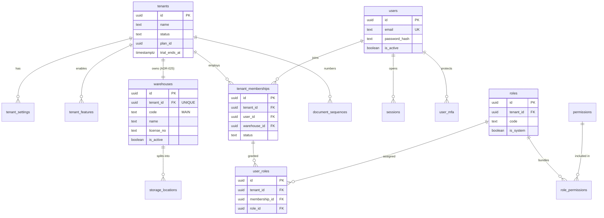
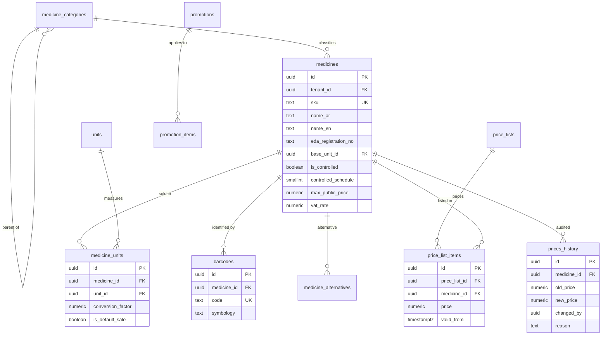
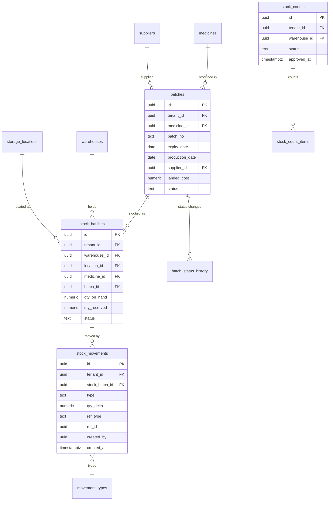
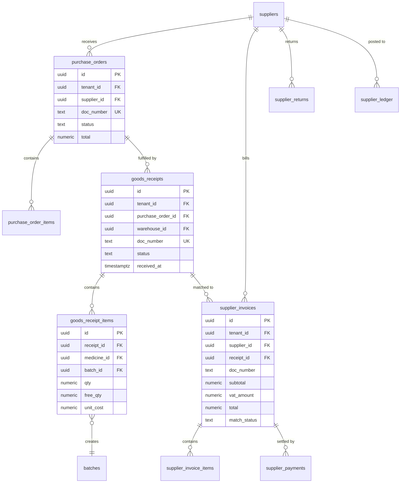
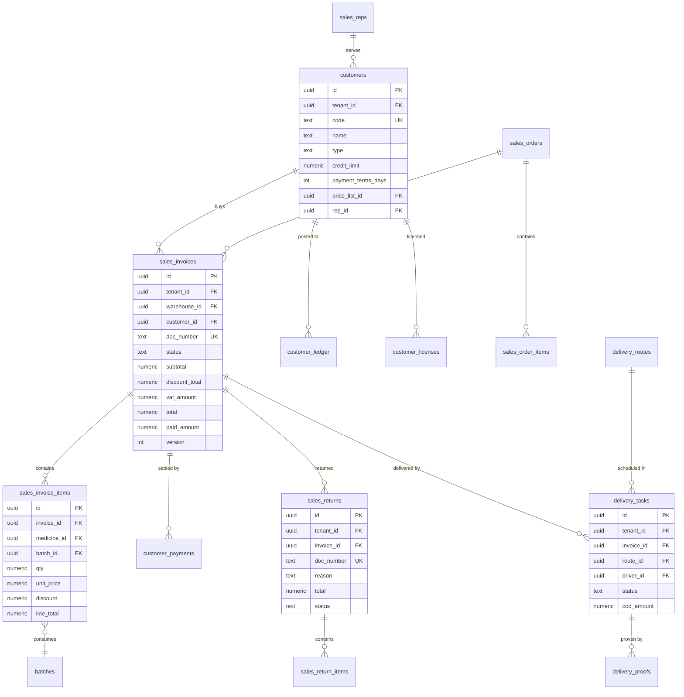
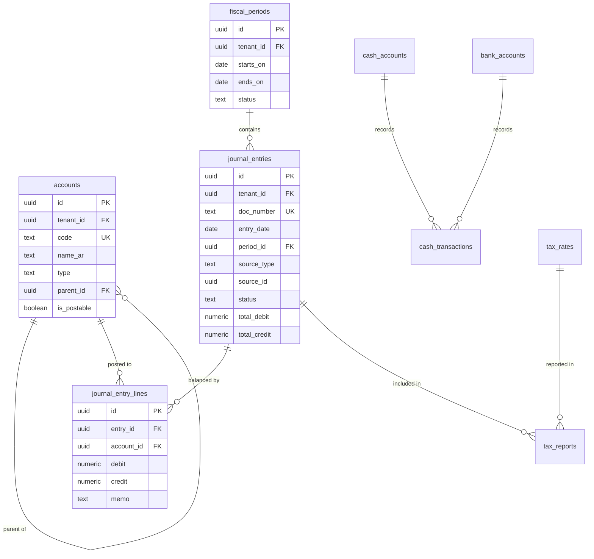
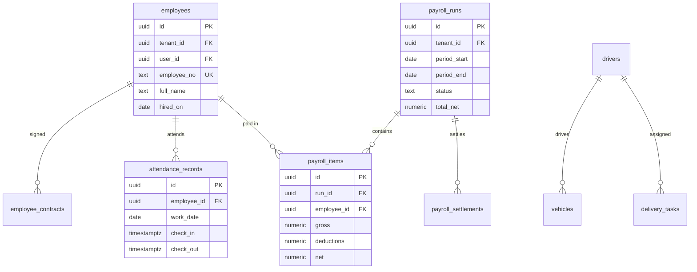
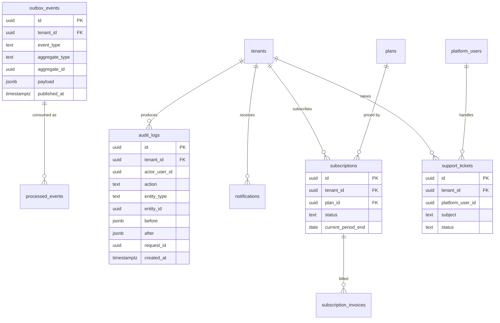

# 09 — ERD Diagram

> المخطط مقسّم حسب النطاق ليبقى قابلًا للقراءة. كل جدول أعمال يحمل `tenant_id` (مُخفَّض من الرسوم لتقليل الضجيج، ما عدا الحدّ الأساسي). الأنواع: `uuid` للمفاتيح، `numeric` للمبالغ والكميات، `timestamptz` للوقت.

---

## 1. العمود الفقري (Tenancy & Identity)

**قاعدة:** `users` بلا `tenant_id` (هوية عالمية)، و`tenant_memberships` هي مصدر الحقيقة للتفويض. لا يجوز أن تحمل الجلسة `tenant_id` دون عضوية نشطة مقابلة.

---

## 2. كتالوج الأصناف

---

## 3. المخزون والتشغيلات (القلب)

**قواعد سلامة:**
- `UNIQUE (tenant_id, medicine_id, batch_no, expiry_date)` على `batches`.
- `CHECK (qty_reserved <= qty_on_hand)` و`CHECK (qty_on_hand >= 0)`.
- `stock_movements` لا تُحدَّث ولا تُحذف (append-only).
- `ref_type/ref_id` يربط الحركة بمصدرها (فاتورة/استلام/تحويل/جرد/مرتجع) بلا FK صارم متعدد الجداول — يُتحقَّق في الخدمة ويُدقَّق بمهمة تحقق دورية.

---

## 4. المشتريات والتوريد

**قاعدة المطابقة الثلاثية:** فاتورة المورد تُعتمد فقط عند مطابقة (أمر شراء ↔ مستند استلام ↔ فاتورة) داخل حدود تفاوت مضبوطة؛ الفرق يُسجَّل كـ `match_variance`.

---

## 5. المبيعات والتوزيع

**قواعد:** لا فاتورة بلا `batch_id` في كل سطر (FEFO يحدده الخادم)؛ `paid_amount <= total`؛ المرتجع مرتبط بالفاتورة الأصلية والتشغيلة الأصلية.

---

## 6. المالية والمحاسبة

**قيود إلزامية:** `debit = 0 OR credit = 0` لكل سطر؛ التوازن يُفرض بـ Trigger مؤجل (`CONSTRAINT TRIGGER`)؛ لا ترحيل إلى فترة مغلقة؛ القيود الناتجة عن الفواتير لا تُحذف بل تُعكس بقيد عكسي.

---

## 7. القوى العاملة والتوصيل

---

## 8. النظام وإدارة المنصة

**قاعدة إدارة المنصة:** جداول `platform` في مخطط منفصل، ودور `slamtak_platform` لا يملك `SELECT` على جداول الأعمال. أي قراءة تجميعية تمر عبر دوال `SECURITY DEFINER` تُرجع مجاميع فقط (مثل عدد الأصناف، حجم البيانات) بلا محتوى تجاري.

---

## 9. العلاقات الحرجة وقواعد التكامل

| العلاقة | التعدد | قاعدة إلزامية |
|---|---|---|
| Tenant → Warehouse | 1:1 | **حساب واحد = مخزن واحد**؛ `UNIQUE (tenant_id)` يمنع الثاني (ADR-025) |
| Membership → Warehouse | N:1 | `warehouse_id` يُشتق من مخزن الحساب؛ FK مركّب يمنع مخزنًا آخر |
| Medicine → Batch | 1:N | تشغيلة لا تُنشأ بلا تاريخ انتهاء |
| Batch → StockBatch | 1:N | رصيد لكل (مخزن، موقع) |
| StockBatch → Movement | 1:N | كل تغيير رصيد له حركة |
| Customer → Invoice | 1:N | لا فاتورة لعميل موقوف |
| Invoice → Payment | 1:N | مجموع المدفوع ≤ الإجمالي |
| Invoice → JournalEntry | 1:1 (مصدر) | كل فاتورة معتمدة لها قيد |
| PurchaseOrder → Receipt | 1:N | لا استلام يتجاوز الكمية المتبقية |
| Receipt → SupplierInvoice | N:1 | مطابقة ثلاثية قبل الاعتماد |
| PayrollRun → Items | 1:N | مسودة → اعتماد → صرف (لا رجوع) |

### قواعد العزل في العلاقات
1. كل FK مركّب مع `tenant_id` — لا استثناء.
2. `ON DELETE RESTRICT` افتراضيًا؛ `CASCADE` مسموح فقط للجداول التابعة غير المالية (مثل `customer_contacts`).
3. حذف Tenant = أرشفة (Soft) لا حذف فيزيائي إلا بإجراء إداري موثق.
4. لا `REFERENCES` إلى جدول بلا `tenant_id` (باستثناء `units`/`permissions` العامة إن اعتمدناها كمرجع نظام).

---

## 10. قرارات مؤجلة (مقصودة)
- جداول **الإعلانات** و**الذكاء الاصطناعي** تُصمَّم في مرحلتها (تحتاج مراجعة نموذج البيانات مع حالات الاستخدام).
- **التكامل مع ETA** قد يحتاج جداول حالات إضافية (`einvoice_documents`, `einvoice_events`) — تُضاف كهجرة مستقلة في Phase 5.
- **الفوترة المتقدمة للاشتراكات** (Usage-based) تُصمَّم عند تحديد نموذج التسعير التجاري.

---

## 11. معايير قبول هذه الوثيقة
- [ ] كل نطاق له مخطط يوضح المفاتيح والعلاقات.
- [ ] كل علاقة حرجة لها قاعدة تكامل مكتوبة.
- [ ] لا علاقة ممكنة بين كيانين من مخزنين مختلفين.
- [ ] الجداول المؤجلة معلنة صراحة لا منسية.
