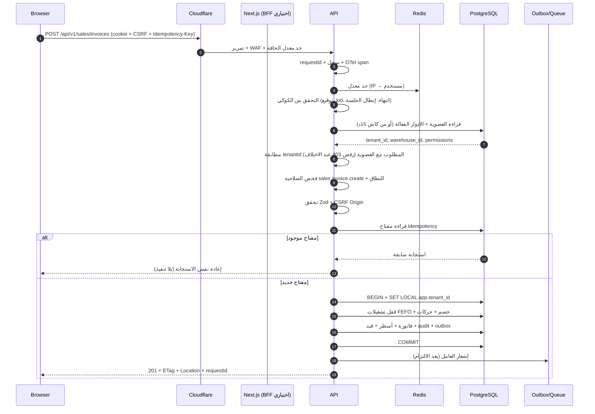

# 10 — API Architecture

## 1. المبادئ

| المبدأ | التطبيق |
|---|---|
| عقد قبل كود | OpenAPI 3.1 يُولَّد من مخططات Zod ويُراجع كملف |
| مورد واحد = مسار واضح | `/sales/invoices/{id}` لا `/getInvoice` |
| العميل لا يحدد هويته | لا `tenantId` ولا `warehouseId` في الجسم أو المسار للتفويض — كلاهما يُشتق من العضوية على الخادم |
| كل شيء قابل لإعادة الإرسال بأمان | Idempotency على كل POST مالي/مخزني |
| الأخطاء جزء من العقد | رموز ثابتة + رسائل قابلة للترجمة |
| التغيير المتوافق فقط | إضافة حقول اختيارية؛ الكسر = إصدار جديد |

**القاعدة العامة:** `https://app.slamtak.com/api/v1` — أصل واحد مع الواجهة (→ ADR-008)، فلا CORS ولا كوكيز طرف ثالث.

---

## 2. تسمية الموارد

| النمط | المثال |
|---|---|
| مجموعة | `GET /medicines?search=…&cursor=…` |
| عنصر | `GET /medicines/{id}` |
| إنشاء | `POST /medicines` |
| تعديل كامل | `PUT /medicines/{id}` (نادر) |
| تعديل جزئي | `PATCH /medicines/{id}` |
| إجراء حالة | `POST /sales/invoices/{id}/confirm` |
| مورد تابع | `GET /sales/invoices/{id}/items` |
| تقرير | `GET /reports/stock-valuation?asOf=…` |
| مهمة طويلة | `POST /exports` → `202` + `GET /jobs/{id}` |

**قواعد:** جمع دائمًا، `kebab-case`، لا أفعال في المسار إلا لإجراء حالة لا يُعبَّر عنه بـ `PATCH` (مثل `confirm`/`cancel`/`approve`).

---

## 3. غلاف الاستجابة والأخطاء

### النجاح
```json
{
  "data": { "id": "…", "docNumber": "INV-2026-000123" },
  "meta": { "requestId": "01J…", "version": 3 }
}
```
### القائمة
```json
{
  "data": [ … ],
  "meta": { "requestId": "01J…", "nextCursor": "eyJpZCI6…", "hasMore": true, "total": 1240 }
}
```
### الخطأ (RFC 9457 Problem Details)
```json
{
  "type": "https://docs.slamtak.com/errors/insufficient-stock",
  "title": "الرصيد غير كافٍ",
  "status": 409,
  "code": "INSUFFICIENT_STOCK",
  "detail": "المتوفر 12 علبة والمطلوب 15",
  "instance": "/api/v1/sales/invoices",
  "requestId": "01J…",
  "errors": [{ "field": "lines[2].qty", "code": "EXCEEDS_AVAILABLE", "message": "الكمية أكبر من المتاح" }]
}
```

| المجال | الرموز |
|---|---|
| 400 | `MALFORMED_REQUEST`, `WAREHOUSE_CONTEXT_NOT_ACCEPTED` (أُرسل `warehouseId` من العميل) |
| 401 | `AUTH_REQUIRED`, `TOKEN_EXPIRED` |
| 403 | `PERMISSION_DENIED`, `TENANT_ACCESS_DENIED`, `STEP_UP_REQUIRED`, `SUBSCRIPTION_SUSPENDED` |
| 404 | `RESOURCE_NOT_FOUND` (يشمل المورد التابع لمخزن آخر) |
| 409 | `VERSION_CONFLICT`, `INSUFFICIENT_STOCK`, `BATCH_NOT_SELLABLE`, `CREDIT_LIMIT_EXCEEDED`, `IDEMPOTENCY_MISMATCH`, `DOCUMENT_LOCKED` |
| 422 | `VALIDATION_FAILED` |
| 423 | `PERIOD_CLOSED` |
| 429 | `RATE_LIMITED` |
| 500/503 | `INTERNAL_ERROR`, `DEPENDENCY_UNAVAILABLE` |

**قاعدة أمنية:** المورد التابع لمخزن آخر يُعاد **404** لا 403 — عدم كشف الوجود.

---

## 4. الترقيم والتصفية والترتيب

| الجانب | القرار | السبب |
|---|---|---|
| الترقيم | Cursor (`cursor`, `limit` ≤ 100) | ثابت الأداء مع بيانات ضخمة |
| الإزاحة | مسموحة للتقارير الصغيرة فقط (`page`) | لا تُستخدم للجداول الحية |
| التصفية | معاملات صريحة (`status`, `from`, `to`, `medicineId`) — بلا `warehouseId`: المخزن من العضوية | لا لغة استعلام حر (خطر أمني وأداء) |
| الترتيب | `sort=-createdAt,docNumber` (قائمة بيضاء لكل مورد) | لا `ORDER BY` من العميل |
| البحث | `search` (trigram، ≥ 3 أحرف) | أداء متوقع |
| الحقول | `fields=` لتقليل الحمولة في القوائم | تحسين شبكة |

---

## 5. الإصدارات والتوافق

| القرار | التفصيل |
|---|---|
| الإصدار في المسار | `/api/v1` |
| إضافة حقل | متوافقة (العميل يتجاهل غير المعروف) |
| حذف/تغيير معنى حقل | كسر → `/api/v2` + فترة تشغيل متوازية ≥ 90 يومًا |
| إهمال | رأس `Deprecation` + `Sunset` + إشعار في السجل |
| العقد | `openapi.json` يُنشر مع كل إصدار، و`packages/contracts` يُولَّد منه في CI |

---

## 6. كتالوج المسارات (v1 — النطاق المعتمد)

| الوحدة | المسارات الأساسية |
|---|---|
| Auth | `POST /auth/login`, `POST /auth/mfa/verify`, `POST /auth/refresh`, `POST /auth/logout`, `GET /auth/me`, `POST /auth/step-up`, `POST /auth/password/change`, `POST /auth/realtime-token` |
| Tenancy | `GET /tenant`, `PATCH /tenant`, `GET/PATCH /warehouse` (المخزن الوحيد), `GET/PATCH /settings` — **لا `POST /warehouses` ولا `/branches` ولا تحويلات**: حساب واحد = مخزن واحد (ADR-025) |
| Users & Roles | `GET/POST /users`, `PATCH /users/{id}`, `POST /users/{id}/suspend`, `GET/POST /roles`, `PUT /roles/{id}/permissions`, `PUT /users/{id}/roles` |
| Catalog | `GET/POST/PATCH /medicines`, `GET /medicines/{id}`, `POST /medicines/import`, `GET/POST /categories`, `GET/POST /units`, `GET/POST /price-lists`, `PUT /price-lists/{id}/items` |
| Inventory | `GET /stock`, `GET /stock/batches`, `GET /stock/movements`, `POST /stock/adjustments`, `GET/POST /stock-counts`, `POST /stock-counts/{id}/approve` |
| Purchasing | `GET/POST /suppliers`, `GET/POST /purchase-orders`, `POST /purchase-orders/{id}/submit`, `POST /goods-receipts`, `POST /supplier-invoices`, `POST /supplier-returns` |
| Sales | `GET/POST /customers`, `GET/POST /sales/invoices`, `POST /sales/invoices/{id}/confirm`, `POST /sales/invoices/{id}/cancel`, `POST /sales/returns`, `POST /sales/payments` |
| Delivery | `GET/POST /delivery/routes`, `GET/POST /delivery/tasks`, `POST /delivery/tasks/{id}/proof` |
| Finance | `GET/POST /accounts`, `GET/POST /journal-entries`, `POST /journal-entries/{id}/post`, `GET/POST /cash-transactions`, `GET /tax/reports` |
| HR | `GET/POST /employees`, `POST /attendance/check-in`, `GET/POST /payroll-runs`, `POST /payroll-runs/{id}/approve` |
| Reports | `GET /reports/{report}`, `POST /exports`, `GET /jobs/{id}` |
| Notifications | `GET /notifications`, `POST /notifications/{id}/read`, `GET/PUT /notification-preferences` |
| Platform | `GET/POST /platform/tenants`, `POST /platform/tenants/{id}/suspend`, `GET /platform/plans`, `GET /platform/health`, `GET /platform/usage` |

**قاعدة:** كل مسار في هذه القائمة يجب أن يظهر في OpenAPI **وفي اختبار تكامل** واختبار صلاحية؛ المسار بلا اختبار لا يُعتبر منفذًا.

> **العقد الملزم:** هذا الكتالوج مُجسَّد آليًا في [`api/openapi.yaml`](api/openapi.yaml) — 65 مسارًا و89 عملية، يُفحص في CI ويُولَّد منه عميل TypeScript. التفاصيل في [`23-openapi-contract.md`](23-openapi-contract.md).

---

## 7. دورة حياة الطلب الكاملة (خطوة بخطوة)



| الخطوة | كيف تُنفَّذ | الفشل المتوقع |
|---|---|---|
| إرسال الطلب | `fetch` مع `credentials: include` و`X-CSRF-Token` | شبكة → إعادة محاولة واحدة |
| التحقق من المستخدم | توقيع JWT + `sessions.revoked_at IS NULL` + `token_version` | 401 → تجديد ثم 401 نهائي |
| تحديد المخزن | من `memberships` المرتبطة بالهوية، **لا** من الجسم | 403 `TENANT_ACCESS_DENIED` |
| فحص الصلاحية | كتالوج + نطاق (المخزن/الملك) | 403 `PERMISSION_DENIED` + تدقيق |
| تنفيذ العملية | خدمة + معاملة + قيود | 409/422 مع تفاصيل |
| إرجاع النتيجة | DTO صريح + `ETag` + `requestId` | — |
| معالجة الأخطاء | `GlobalExceptionFilter` يوحّد الشكل ويخفي التفاصيل | 500 بلا Stack |
| منع التكرار | `idempotency_keys` + قيد فريد | 409 `IDEMPOTENCY_MISMATCH` |
| التدقيق | `AuditInterceptor` يكتب قبل/بعد داخل المعاملة | فشل التدقيق = فشل العملية (للعمليات الحساسة) |

---

## 8. الأمان في العقد

| الضابط | التطبيق |
|---|---|
| المصادقة | كوكي `HttpOnly; Secure; SameSite=Lax; Path=/` للويب، `Authorization: Bearer` للموبايل |
| CSRF | تحقق `Origin`/`Referer` + Double-Submit token للطلبات المغيّرة |
| المدخلات | Zod بحدود طول ونوع ونطاق؛ رفض الحقول غير المعروفة |
| Mass assignment | لا تمرير جسم الطلب إلى الكيان؛ تحويل صريح |
| رؤوس الأمان | HSTS، `X-Content-Type-Options`، `Referrer-Policy`، CSP في الواجهة |
| حدود الحجم | جسم ≤ 1MB (JSON)، مرفقات عبر مسار منفصل ≤ 10MB |
| الملفات | تحقق نوع حقيقي (magic bytes) + فحص فيروسات غير متزامن + اسم عشوائي |
| SSRF | لا استدعاء URL يرسله المستخدم؛ Webhooks بقائمة نطاقات مسموحة |

---

## 9. منع التكرار والتزامن

```http
POST /api/v1/sales/invoices
Idempotency-Key: 9f2c1a7e-...
If-Match: "3"
Content-Type: application/json
```
| الحالة | الاستجابة |
|---|---|
| مفتاح جديد | تنفيذ + تخزين 24 ساعة |
| مفتاح مكرر بنفس الجسم | نفس الاستجابة والرمز |
| مفتاح مكرر بجسم مختلف | `409 IDEMPOTENCY_MISMATCH` |
| `If-Match` قديم | `409 VERSION_CONFLICT` + الحالة الحالية في الجسم |
| بلا `If-Match` على مورد ذي `version` | `428 PRECONDITION_REQUIRED` |

---

## 10. حدود المعدل

| المسار | الحد | المفتاح |
|---|---|---|
| `/auth/login` | 5/دقيقة، 20/ساعة | IP + بريد |
| `/auth/mfa/verify` | 5/10 دقائق | IP + مستخدم |
| `/auth/refresh` | 30/ساعة | جلسة |
| `/auth/realtime-token` | 6/ساعة (أقل من انتهاء التوكن) | مستخدم + جلسة |
| كتابة عامة | 120/دقيقة | مستخدم |
| قراءة عامة | 600/دقيقة | مستخدم |
| تصدير/تقرير | 10/ساعة | مستخدم + مخزن |
| API تكامل | حسب الاشتراك | مفتاح API |

الاستجابة `429` تحمل `Retry-After` و`RateLimit-*` headers.

---

## 11. المهام الطويلة والتصدير

```http
POST /api/v1/exports  {"type":"stock-valuation","format":"xlsx","filters":{...}}
→ 202 Accepted {"data":{"jobId":"…"},"meta":{"pollAfterMs":1500}}

GET /api/v1/jobs/{id}
→ {"data":{"status":"running","progress":42}}
→ {"data":{"status":"done","downloadUrl":"https://…/signed?exp=…"}}
```
- الروابط الموقعة صالحة 15 دقيقة.
- الملفات في Storage بمفتاح `tenant/{tenantId}/exports/{jobId}.xlsx` — لا مسار مشترك.

---

## 12. التكاملات الصادرة (Webhooks)

| الجانب | القرار |
|---|---|
| التوقيع | HMAC-SHA256 على الجسم + `X-Slamtak-Signature` + طابع زمني |
| إعادة المحاولة | 1م، 5م، 30م، 2س، 6س (5 محاولات) |
| الترتيب | غير مضمون؛ `eventId` لمنع التكرار عند المستهلك |
| الحمولة | معرّفات + ملخص، لا بيانات شخصية كاملة |
| السجل | `webhook_deliveries` بحالة كل محاولة |

---

## 13. معايير قبول هذه الوثيقة
- [x] كل مورد في الكتالوج له عقد OpenAPI ومخطط تحقق واختبار. → `api/openapi.yaml` (0 أخطاء فحص)
- [ ] كل خطأ له رمز ثابت ورسالة عربية.
- [ ] كل POST مالي/مخزني يقبل `Idempotency-Key`.
- [ ] كل مورد ذي `version` يفرض `If-Match`.
- [ ] لا مسار يسمح بتحديد `tenantId` كوسيلة تفويض.
- [ ] حدود المعدل مطبقة ومختبرة.
