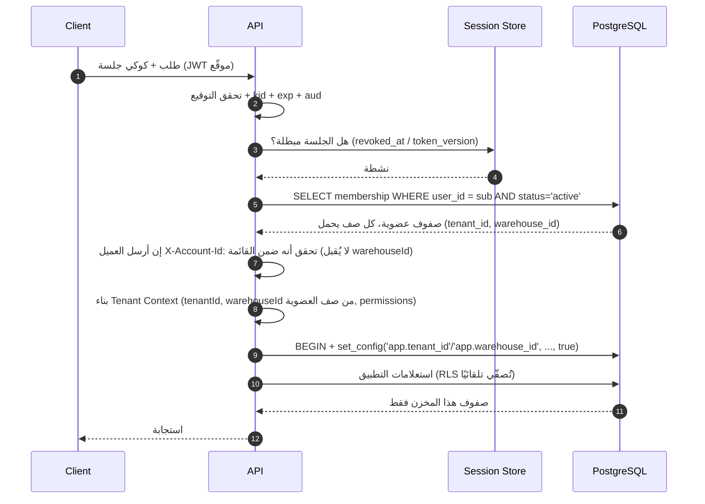
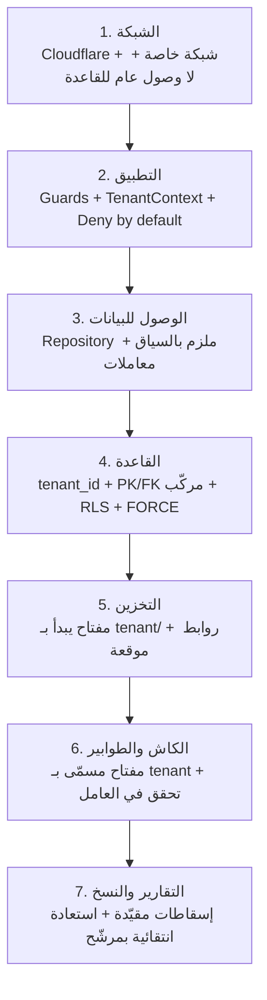
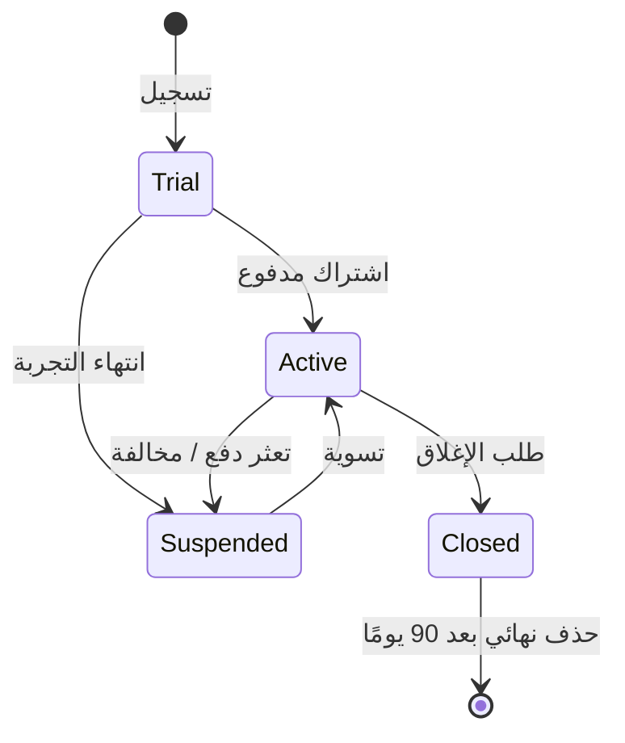

# 11 — Multi-Tenant Isolation Design

## 1. النموذج المعتمد

**Pooled Multi-Tenancy**: قاعدة بيانات واحدة، مخطط `public` واحد، عزل منطقي بـ `tenant_id` + RLS + مفاتيح مركبة. العزل الفيزيائي مؤجل لعملاء المؤسسات (→ §12).

| المصطلح | المعنى |
|---|---|
| Tenant | حساب مخزن أدوية = وحدة العزل والفواتير |
| Membership | ربط مستخدم بـ Tenant بحالة (active/suspended/invited) |
| Tenant Context | `{tenantId, warehouseId, userId, permissions}` يُشتق من الخادم فقط |
| Cross-tenant access | أي محاولة وصول لبيانات Tenant آخر — تُعتبر حادثًا أمنيًا |

---

## 2. سلسلة تحديد الهوية (Tenant Resolution)



**قواعد غير قابلة للتفاوض:**

1. لا يُقرأ `tenant_id` من الجسم أو الاستعلام أو رأس مخصص للتفويض.
2. لا تُستخدم قيمة `tenant_id` من الجلسة بلا تحقق من **العضوية الحالية** في القاعدة (الجلسة قد تكون أقدم من إيقاف العضوية).
3. `tenant_id` في الرموز (token) يُستخدم كتلميح اختياري فقط، ويُعاد التحقق دائمًا.
4. تغيير العضوية (إيقاف/حذف) يستدعي `bump token_version` فورًا.
5. `warehouse_id` **لا يُقبل من الجسم أو الاستعلام أو رأس مخصص**؛ يُشتق من `tenant_memberships.warehouse_id`، وهو مقيّد بـFK مركّب على مخزن الحساب الوحيد. طلب يحمل `warehouseId` يُرفض 400 `WAREHOUSE_CONTEXT_NOT_ACCEPTED`.

---

## 3. طبقات العزل السبع



| الطبقة | الضابط | الفشل المتوقع عند الاختراق |
|---|---|---|
| الشبكة | القاعدة بلا IP عام، Redis بلا تعرض، مصادقة قوية | لا مسار اتصال |
| التطبيق | Guard يرفض عدم تطابق Tenant | 403 + تدقيق |
| الوصول للبيانات | كل استعلام يمر بـ `withTenantTx` | استثناء برمجي |
| القاعدة | RLS + قيود مركبة | صفر صفوف أو خطأ قيد |
| التخزين | تحقق ملكية المسار قبل التوقيع | 404 |
| الكاش | مفتاح يحتوي `tenantId` | إبطال/فصل |
| التقارير | Views تمر عبر RLS أو `SECURITY DEFINER` مقيّدة | بيانات مجمّعة فقط |

**الفكرة الحاكمة:** لا نعتمد على طبقة واحدة. حتى لو أخطأ المطور في الاستعلام، RLS تُصفّر النتيجة. وحتى لو عُطّلت RLS بالخطأ، المفتاح المركب يمنع الربط. هذا هو **Defense in Depth** الحقيقي.

---

## 4. كتالوج سياسات RLS

| نمط الجدول | السياسة | مثال |
|---|---|---|
| أعمال قياسي | `tenant_id = app.current_tenant_id()` للقراءة والكتابة | `medicines`, `customers` |
| حساس بالصلاحية | Tenant **و** `app.has_permission(...)` | `payroll_runs`, `prices_history` |
| Append-only | `SELECT` + `INSERT` فقط، بلا `UPDATE/DELETE` | `audit_logs`, `stock_movements` |
| تابع (Child) | Tenant + وجود الأب في نفس Tenant (FK يضمن) | `sales_invoice_items` |
| مرجع نظام | قراءة للجميع، كتابة للـ Platform فقط | `permissions`, `plans` |
| منصة | مخطط `platform` بدور منفصل، بلا وصول لدور التطبيق | `subscriptions`, `support_tickets` |

```sql
-- نمط الحساسية بالصلاحية (رواتب)
CREATE POLICY payroll_runs_rw ON payroll_runs
  FOR ALL TO slamtak_app
  USING (tenant_id = app.current_tenant_id() AND app.has_permission('hr.payroll.read'))
  WITH CHECK (tenant_id = app.current_tenant_id() AND app.has_permission('hr.payroll.write'));

-- نمط Append-only
CREATE POLICY audit_read ON audit_logs FOR SELECT TO slamtak_app
  USING (tenant_id = app.current_tenant_id());
CREATE POLICY audit_insert ON audit_logs FOR INSERT TO slamtak_app
  WITH CHECK (tenant_id = app.current_tenant_id());
-- لا سياسة UPDATE/DELETE ⇒ مرفوضة تلقائيًا
```

**فحص آلي إلزامي في CI:** استعلام على `pg_tables` + `pg_policies` يفشل البناء إذا وُجد جدول في `public` بلا RLS أو بسياسة `USING (true)`.

---

## 5. مصفوفة الهجمات والضوابط (Attack Matrix)

هذه المصفوفة هي جوهر اختبار الأمان المطلوب. كل سطر يجب أن يقابله اختبار آلي.

| # | سيناريو الهجوم | الضابط | النتيجة المتوقعة | اختبار |
|---|---|---|---|---|
| A1 | تغيير `tenantId` في جسم الطلب | يُتجاهل؛ السياق من العضوية | بيانات المخزن الصحيح فقط | `ISO-A1` |
| A2 | إضافة `?tenantId=` في الاستعلام | معامل غير معروف يُرفض/يُهمل | 200 ببيانات المخزن الصحيح | `ISO-A2` |
| A3 | تعديل `tenant_id` داخل JWT | توقيع غير صالح | 401 | `ISO-A3` |
| A4 | إعادة استخدام جلسة مخزن آخر | الجلسة مرتبطة بمستخدم + `token_version` | 401 | `ISO-A4` |
| A5 | IDOR: معرّف مورد من مخزن آخر | RLS + FK مركب | 404 | `ISO-A5` |
| A6 | الوصول لـ PostgREST بمفتاح anon | المنفذ مغلق/محجوب | 403/404 | `ISO-A6` |
| A7 | حقن SQL في فلتر/ترتيب | قائمة بيضاء + استعلامات مُعاملة | 422 أو تجاهل | `ISO-A7` |
| A8 | تخمين معرّفات متتابعة | UUIDv4 عشوائي | 404 | `ISO-A8` |
| A9 | قراءة مرفق مخزن آخر بمسار مباشر | تحقق ملكية + رابط موقّع قصير | 404 | `ISO-A9` |
| A10 | إعادة استخدام رابط موقّع منتهٍ | `exp` قصير + توقيع | 403 | `ISO-A10` |
| A11 | تقرير/تصدير بمعرّف مهمة مخزن آخر | ملكية المهمة + مفتاح تخزين مسمّى | 404 | `ISO-A11` |
| A12 | Webhook أو تكامل يعبر المخازن | مفتاح API مرتبط بـ Tenant واحد | 403 | `ISO-A12` |
| A13 | مستخدم موقوف يواصل العمل برمز قديم | `token_version` + فحص عضوية | 401 | `ISO-A13` |
| A14 | تصعيد صلاحية داخل المخزن | الصلاحيات من الأدوار في القاعدة لا من العميل | 403 | `ISO-A14` |
| A15 | تعديل السعر/الخصم من العميل | تسعير على الخادم + تجاوز مسجل | السعر المرجعي | `ISO-A15` |
| A16 | تجاوز حد الائتمان | فحص على الخادم + Step-Up | 409 | `ISO-A16` |
| A17 | تقرير مجمّع يكشف مخزنًا آخر | كل View مقيّدة بالسياق | أرقام مخزنه فقط | `ISO-A17` |
| A18 | سجل التدقيق يكشف مخزنًا آخر | سياسة Tenant على `audit_logs` | صفر صفوف | `ISO-A18` |
| A19 | نسخة احتياطية مشتركة تُستعاد لمخزن | استعادة انتقائية بمرشّح + بيئة معزولة | لا خلط | `ISO-A19` |
| A20 | سباق طلبين على نفس الرصيد | قفل صفوف + `CHECK` | 409 لأحدهما | `ISO-A20` |
| A21 | تصادم مفاتيح الكاش | مفتاح يبدأ بـ `t:{tenantId}:` | لا تسريب | `ISO-A21` |
| A22 | SSRF عبر Webhook | قائمة نطاقات + حجب IP داخلي | 422 | `ISO-A22` |
| A23 | تعداد الموارد عبر فروق زمنية/رسائل | 404 موحّد + زمن ثابت نسبيًا | لا تمييز | `ISO-A23` |
| A24 | موظف نُقل لمخزن آخر يرى القديم | إبطال فوري + فحص عضوية لكل طلب | 403 | `ISO-A24` |
| A25 | اتصال مباشر للقاعدة ببيانات مسربة | لا IP عام + مفاتيح مُدارة + تدوير | لا اتصال | `ISO-A25` |
| A26 | إدارة المنصة تقرأ بيانات تجارية | دور منفصل بلا `GRANT` | 403 | `ISO-A26` |

---

## 6. تصميم اختبار العزل الآلي

```ts
// tests/isolation/matrix.spec.ts — تصميم مرجعي
const A = await seedTenant('A');   // مستخدم + مخزن + أصناف + فواتير
const B = await seedTenant('B');

describe('Tenant isolation', () => {
  it.each(ALL_TENANT_SCOPED_ENDPOINTS)('%s لا يسرّب بين مخزنين', async (ep) => {
    const asA = await login(A.owner);
    const asB = await login(B.owner);

    const createdByA = await asA.post(ep.create, ep.sample);
    // B يحاول قراءة مورد A
    expect((await asB.get(`${ep.base}/${createdByA.id}`)).status).toBe(404);
    // B يحاول تعديل مورد A
    expect((await asB.patch(`${ep.base}/${createdByA.id}`, {})).status).toBe(404);
    // B يحاول حقن tenantId مختلف
    expect((await asB.post(ep.create, { ...ep.sample, tenantId: A.id })).tenantId).not.toBe(A.id);
    // القراءة الجماعية لا تحتوي أي صفوف من A
    const list = await asB.get(ep.base);
    expect(list.data.every((r: any) => r.tenantId !== A.id)).toBe(true);
  });

  it('RLS تمنع الاستعلام المباشر بلا سياق', async () => {
    await expect(rawQuery('SELECT count(*) FROM medicines')).rejects.toThrow();
  });

  it('RLS تمنع سياق مخزن آخر بعد تعيينه', async () => {
    const rows = await withTenant(B.id, () => rawQuery('SELECT * FROM medicines'));
    expect(rows.every((r: any) => r.tenant_id === B.id)).toBe(true);
  });
});
```

| المستوى | ما يُختبر | متى |
|---|---|---|
| RLS مباشرة (SQL) | كل جدول: قراءة/كتابة بسياق مخزنين | كل PR |
| API (Black box) | كل endpoint: IDOR + حقن `tenantId` | كل PR |
| تخزين | مسارات ملفات وروابط موقعة | كل PR لمسارات الملفات |
| طوابير | مهمة تحمل Tenant A لا تصل بيانات B | أسبوعيًا |
| اختراق (ZAP) | فحص آلي على staging | أسبوعيًا |
| مراجعة بشرية | سيناريوهات إبداعية (A17, A23, A24) | كل إصدار رئيسي |

**بوابة CI:** أي فشل في `tests/isolation/*` يمنع الدمج بلا استثناء.

---

## 7. عزل الملفات والتخزين

```ts
// كل مفتاح يبدأ بالـ Tenant — لا مسار مشترك
const key = `tenant/${tenantId}/${entity}/${uuid}.${ext}`;

async function signDownload(ctx: RequestCtx, key: string) {
  if (!key.startsWith(`tenant/${ctx.tenantId}/`)) throw new NotFoundError();
  const row = await attachments.findByKey(ctx, key);   // RLS تتحقق أيضًا
  if (!row) throw new NotFoundError();
  return storage.presignGet(key, { expiresIn: 900 });
}
```
| القاعدة | السبب |
|---|---|
| لا Bucket عام | منع الوصول المباشر |
| تحقق البادئة قبل التوقيع | يمنع توقيع مسار مخزن آخر |
| صلاحية 15 دقيقة | يحدّ إعادة الاستخدام |
| اسم ملف عشوائي | يمنع التعداد والتخمين |
| فحص محتوى الملف | يمنع رفع ملفات ضارة |
| حذف = Soft + مهمة تنظيف | يمنع فقد أدلة التدقيق |

---

## 8. عزل الكاش والطوابير

| المكوّن | القاعدة |
|---|---|
| مفاتيح الكاش | `t:{tenantId}:...` إلزاميًا، وبناء المفتاح في دالة واحدة |
| إبطال | حدث `tenant.settings.updated` يُبطل كل مفاتيح المخزن |
| بيانات لا تُخزَّن | الأرصدة والصلاحيات النهائية (تُقرأ من القاعدة) |
| المهام | `job.data.tenantId` إلزامي + تحقق عند التنفيذ |
| القفل | `lock:${tenantId}:${operation}` لمنع تعارض عمليات نفس المخزن |
| Pub/Sub | قناة لكل Tenant: `tenant:{id}:events` — لا بث عام |
| Realtime | موضوع `tenant:<uuid>` مشتق من توكن `scope: realtime`، قنوات خاصة فقط، سياسة `SELECT` واحدة على `realtime.messages`، **ولا سياسة `INSERT`** للعملاء؛ والحمولة حدث بلا بيانات ([`28`](28-supabase-edge-runtime.md) §7.1 · ADR-024) |

---

## 9. وصول إدارة المنصة (Break Glass)

| المسار | التطبيق |
|---|---|
| الطبيعي | مجاميع فقط: عدد الأصناف، حجم البيانات، حالة الخدمة — بلا محتوى تجاري |
| الدعم الفني | لا وصول لمحتوى؛ الأدوات تعمل بأوامر محدودة (إعادة تشغيل مهمة، تصحيح إعداد) |
| كسر الزجاج | طلب موافَق عليه من مالك المخزن + مدة محددة (≤ 60 دقيقة) + تسجيل كل استعلام + إشعار للمالك |
| التنفيذ | دور مؤقت `support_readonly` بمنح انتقائي على Views محددة، لا جداول خام |
| المراجعة | تقرير شهري بكل عمليات كسر الزجاج |

**قاعدة:** إدارة المنصة **لا تُمنح** صلاحية قراءة الفواتير أو العملاء أو الرواتب، لا افتراضيًا ولا "للتشخيص".

---

## 10. دورة حياة المخزن (Tenant Lifecycle)



| المرحلة | الأثر التقني |
|---|---|
| إنشاء | صف `tenants` + **مخزن واحد** + إعدادات افتراضية + شجرة حسابات + عضوية المالك (بـ`warehouse_id`) + دور Owner + `document_sequences` — في معاملة واحدة |
| تجربة | حدود استخدام (مستخدمون، أصناف، فواتير/شهر) |
| إيقاف | منع الكتابة فورًا، السماح بالقراءة والتصدير، إشعارات |
| إغلاق | قراءة/تصدير فقط لمدة 90 يومًا |
| حذف | أرشفة + إخفاء هوية البيانات الشخصية + إبقاء المجاميع المالية حسب الالتزام |

**إنشاء مخزن جديد لا يتطلب نشر كود أو نسخة قاعدة** — هذا شرط قابلية التحول إلى SaaS.

---

## 11. الجار المزعج (Noisy Neighbor)

| المورد | الحماية |
|---|---|
| اتصالات القاعدة | حد اتصالات لكل Tenant عبر Pool مخصص + `statement_timeout` |
| استعلامات ثقيلة | تصدير/تقارير في طابور منفصل بحد تزامن لكل Tenant |
| حدود المعدل | مفتاح `tenantId` وليس IP فقط |
| مساحة التخزين | حد أقصى للخطة + تنبيه قبل التجاوز |
| المهام | وزن عادل (fair scheduling) بين المخازن في نفس الطابور |

---

## 12. العزل الفيزيائي للعملاء المؤسسيين (مستقبلاً)

| الخيار | العزل | التكلفة | متى نستخدمه |
|---|---|---|---|
| Pooled (الحالي) | منطقي | الأقل | الافتراضي لكل العملاء |
| Schema-per-tenant | مخطط مستقل، نفس القاعدة | +20% تشغيل | عميل يطلب عزلًا تعاقديًا بسيطًا |
| Database-per-tenant | قاعدة مستقلة | +3x تقريبًا | متطلبات تنظيمية/أمنية صريحة |
| Region-per-tenant | منطقة جغرافية | الأعلى | متطلبات إقامة بيانات |

**متى ننتقل؟** عند وجود عميل واحد على الأقل بمتطلب تعاقدي صريح **و** استعداد لدفع فرق التكلفة. لا ننتقل لأن "العزل الفيزيائي أفضل" نظريًا — Pooled + RLS المختبرة أكثر أمانًا من عزل فيزيائي مصحوب بأخطاء تشغيل.

---

## 13. معايير قبول هذه الوثيقة
- [ ] لا مسار يحدد `tenant_id` من العميل للتفويض.
- [ ] RLS مفعّلة `FORCE` على كل جدول أعمال، وبلا سياسة مفتوحة.
- [ ] المفاتيح المركبة تمنع الربط بين مخزنين بنيويًا.
- [ ] مصفوفة A1–A27 مغطاة باختبارات آلية في CI.
- [ ] الملفات والكاش والطوابير مسمّاة بـ `tenantId`.
- [ ] إدارة المنصة بلا وصول تجاري افتراضي.
- [ ] إنشاء Tenant جديد يتم في معاملة واحدة بلا نشر.
