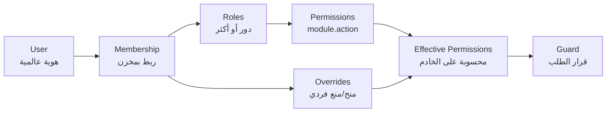
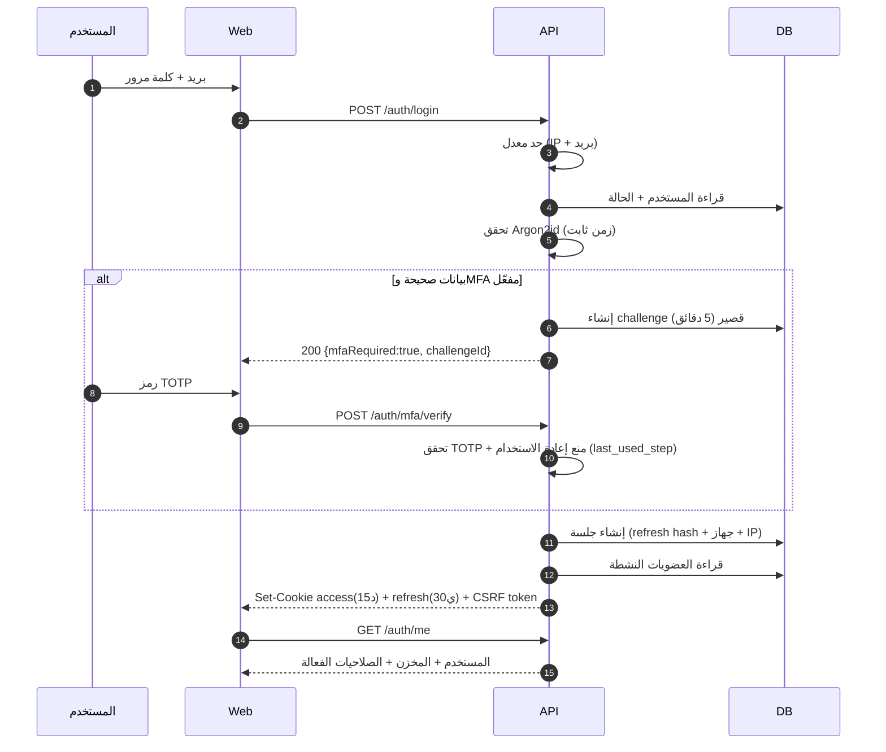

# 12 — Authentication & Authorization Design
> **تحديث التنفيذ (2026-11-06):** الطبقة الخدمية لم تعد NestJS في حاوية — البوابة هي Supabase Edge Functions. التفاصيل والحدود الحسابية في [`28`](28-supabase-edge-runtime.md)؛ ما يلي يبقى صحيحًا في المنطق والعقد.

## 1. نموذج الهوية



| الكيان | النطاق | ملاحظة |
|---|---|---|
| `users` | عالمي | بريد فريد، كلمة مرور، MFA، حالة |
| `tenant_memberships` | لكل حساب | `active` / `invited` / `suspended` + `warehouse_id` المشتق (مخزن واحد) |
| `roles` | لكل مخزن (+ أدوار نظام) | لا يمكن حذف دور نظام |
| `permissions` | عالمي (كتالوج) | مرآة للكود، للعرض والتدقيق |
| `user_roles` | لكل حساب | لا نطاق فرعي — المخزن واحد |
| `user_permission_overrides` | لكل مخزن | **المنع يتغلب على المنح دائمًا** |

---

## 2. بيانات الاعتماد (Credentials)

| الجانب | القرار | السبب |
|---|---|---|
| التجزئة | **Argon2id**: `memoryCost=19456 KiB, timeCost=2, parallelism=1` | مقاومة GPU/ASIC، توصية OWASP الحالية |
| الترقية | إعادة تجزئة تلقائية عند الدخول إن تغيّرت المعاملات | تطور بلا مقاطعة |
| سياسة كلمة المرور | ≥ 12 حرفًا، فحص ضد قوائم مسربة (k-anonymity)، بلا قيود تركيب معقدة | الطول أهم من الرموز |
| البريد | تحقق إلزامي قبل أول دخول | يمنع حسابات وهمية |
| القفل | 5 محاولات/15 دقيقة → قفل تدريجي (1، 5، 15، 60 دقيقة) | يمنع التخمين بلا تعطيل دائم |
| كشف التسجيل | رسالة موحدة "تم إرسال رابط إن وُجد الحساب" | يمنع التعداد |
| تغيير كلمة المرور | يتطلب كلمة المرور الحالية + إبطال كل الجلسات الأخرى | يمنع الاستيلاء الصامت |

---

## 3. تدفق تسجيل الدخول



| الخطوة | تفاصيل |
|---|---|
| اختيار المخزن | إن كان للمستخدم عضوية واحدة → تلقائي. أكثر من واحدة → شاشة اختيار، والاختيار يُخزَّن في الجلسة |
| التحقق الثاني (Two-Step) | للمالك/المدير: رمز إضافي عند الدخول من جهاز جديد (موجود حاليًا في النظام — يُعمَّم ويُنقل للخادم) |
| بعد الدخول | تسجيل `login_success` في التدقيق + إشعار "دخول جديد" |

---

## 4. الرموز والجلسات

| الرمز | النوع | العمر | التخزين | الاستخدام |
|---|---|---|---|---|
| Access | JWT (ES256) | 15 دقيقة | كوكي `HttpOnly` | كل طلب |
| Refresh | opaque 256-bit | 30 يومًا (متداول) | كوكي `HttpOnly` + تجزئة SHA-256 في القاعدة | `/auth/refresh` فقط |
| CSRF | عشوائي | الجلسة | كوكي قابل للقراءة + رأس | الطلبات المغيّرة |
| MFA Challenge | opaque | 5 دقائق | القاعدة | خطوة التحقق الثانية |
| Step-Up | علامة على الجلسة | 10 دقائق | `sessions.step_up_at` | العمليات الحساسة |
| Realtime | JWT (ES256) | 60 دقيقة | ذاكرة الصفحة فقط — لا كوكي ولا `localStorage` | اشتراك WebSocket فقط |

```json
{
  "sub": "9f1c…", "sid": "a72…", "tid": "3b8…",
  "roles": ["manager"], "ver": 7,
  "iat": 1770000000, "exp": 1770000900,
  "iss": "https://app.slamtak.com", "aud": "slamtak-api", "kid": "2026-11"
}
```

| القاعدة | التفصيل |
|---|---|
| `ver` (token_version) | يُزاد عند تغيير كلمة المرور/الأدوار/الإيقاف → يُبطل كل الرموز القديمة |
| `sid` | يسمح بإبطال جلسة واحدة (تسجيل خروج جهاز) |
| `tid` | تلميح فقط، ويُعاد التحقق من العضوية في كل طلب |
| لا بيانات حساسة في الرمز | لا صلاحيات مفصلة (تكبر وتتغير) — تُقرأ من كاش الخادم |
| المفاتيح | ES256، `kid`، تدوير كل 6 أشهر مع بقاء القديم للتحقق 30 يومًا |
| الإبطال | قائمة `sessions.revoked_at` + كاش إبطال قصير (≤ 60 ثانية) |
| توكن Realtime | يُصدره `POST /auth/realtime-token` بحمولة `sub`, `role: authenticated`, `tenant_id`, `scope: realtime` فقط — **لا يقبله `/api`** ولا يفتح بيانات؛ سياسة `realtime.messages` تطابق الموضوع بـ`tenant_id` ([`28`](28-supabase-edge-runtime.md) §7.1 · ADR-024) |

**تدوير Refresh مع كشف إعادة الاستخدام:** كل استخدام يُصدر رمزًا جديدًا ويُبطل القديم. استخدام رمز مُبطَل = مؤشر سرقة → إبطال **كل** جلسات المستخدم + إشعار أمني + تدقيق.

---

## 5. المصادقة متعددة العوامل (MFA)

| العامل | الحالة | ملاحظة |
|---|---|---|
| TOTP (Google/Microsoft Authenticator) | إلزامي | مجاني، بلا اعتماد على شبكة |
| أكواد احتياطية | 10 أكواد، تُعرض مرة واحدة | تجزئتها في القاعدة |
| البريد كعامل ثانٍ | اختياري | أضعف — لا يُستخدم وحده لحساب المالك |
| SMS | غير معتمد كعامل أساسي | تكلفة + SIM swap |

**سياسة الإلزام:** Owner/Manager/Accountant: إلزامي. موظفون آخرون: إلزامي عند منحهم صلاحية حساسة. جهاز جديد للمالك: تحقق إضافي حتى لو MFA مُهيأ (منع سرقة جهاز مُوثّق).

---

## 6. العمليات الحساسة (Step-Up + Approval)

| العملية | Step-Up | موافقة ثانية | سبب إلزامي |
|---|---|---|---|
| تعديل سعر بيع | ✅ | — | ✅ |
| تعديل سعر تكلفة يدويًا | ✅ | ✅ (مالك) | ✅ |
| تسوية مخزون > عتبة القيمة | ✅ | ✅ (مدير) | ✅ |
| إلغاء فاتورة معتمدة | ✅ | — | ✅ |
| تجاوز حد الائتمان | ✅ | — | ✅ |
| صرف دواء مخدر (جدول 1) | ✅ | ✅ | ✅ + رقم إقرار |
| اعتماد رواتب | ✅ | — | — |
| تعديل صلاحيات مستخدم | ✅ | — | ✅ |
| تصدير بيانات عملاء كامل | ✅ | — | ✅ |
| حذف/إغلاق Tenant | ✅ | ✅ (منصة) | ✅ |

التنفيذ: `@RequireStepUp()` + `@RequireApproval('inventory.adjust')` + `ApprovalRequest` حالة معلقة تُنفَّذ عند الموافقة.

---

## 7. كتالوج الصلاحيات

| المجموعة | الصلاحيات |
|---|---|
| `catalog` | `read`, `create`, `update`, `delete`, `price.read`, `price.update`, `import` |
| `inventory` | `read`, `movement.read`, `adjust`, `count.create`, `count.approve`, `batch.status` |
| `purchasing` | `read`, `order.create`, `order.approve`, `receipt.create`, `invoice.match`, `return.create`, `supplier.manage` |
| `sales` | `read`, `invoice.create`, `invoice.cancel`, `discount.apply`, `discount.override`, `price.override`, `credit.override`, `return.create`, `return.approve`, `customer.manage` |
| `finance` | `read`, `journal.create`, `journal.post`, `period.close`, `cash.manage`, `payment.record`, `tax.report` |
| `hr` | `employee.read`, `employee.manage`, `attendance.manage`, `payroll.read`, `payroll.write`, `payroll.approve` |
| `delivery` | `route.manage`, `task.assign`, `task.complete`, `cod.reconcile` |
| `reports` | `read`, `export`, `financial.read` |
| `settings` | `tenant.update`, `warehouse.update`, `integration.manage`, `document.sequence`, `tenant.owner.transfer` |
| `users` | `user.read`, `user.invite`, `user.suspend`, `role.manage`, `permission.grant` |
| `audit` | `read` |
| `system` | `audit.write` (كتابة سجل التدقيق من الخادم فقط) |
| `platform` | `tenant.manage`, `plan.manage`, `subscription.manage`, `support.access`, `health.read` |

**قاعدة:** أسماء الصلاحيات في الكود مرجعها `packages/permissions`، وتُزرع في جدول `permissions` في هجرة واحدة — النص التنفيذي وأرقامه في [`29`](29-reference-seed.md) §3 (67 رمزًا، منها 5 للمنصة لا تُمنح لدور مخزن)؛ اختلاف الكود عن البذور يُفشل اختبار CI.

**ملاحظة ADR-025:** لا صلاحيات `inventory.transfer.*` — فلا مسار تحويل بين مخازن أصلًا، والصلاحية التي لا مسار لها تُحذف من الكتالوج لا تُترك معطّلة.

---

## 8. مصفوفة الأدوار (مختصرة)

| الصلاحية | Owner | Manager | Pharmacist | Cashier | Keeper | Purchasing | Accountant | Rep | Driver | Auditor |
|---|---|---|---|---|---|---|---|---|---|---|
| `catalog.read` | ✅ | ✅ | ✅ | ✅ | ✅ | ✅ | ✅ | ✅ | — | ✅ |
| `catalog.price.update` | ✅ | — | — | — | — | — | — | — | — | — |
| `inventory.adjust` | ✅ | ✅ | — | — | ✅ | — | — | — | — | — |
| `inventory.count.approve` | ✅ | ✅ | — | — | — | — | — | — | — | — |
| `purchasing.order.create` | ✅ | ✅ | — | — | — | ✅ | — | — | — | — |
| `purchasing.receipt.create` | ✅ | ✅ | — | — | ✅ | ✅ | — | — | — | — |
| `sales.invoice.create` | ✅ | ✅ | ✅ | ✅ | — | — | — | ✅ | — | — |
| `sales.invoice.cancel` | ✅ | ✅ | — | — | — | — | — | — | — | — |
| `sales.discount.override` | ✅ | ✅ | — | — | — | — | — | — | — | — |
| `sales.return.approve` | ✅ | ✅ | ✅ | — | — | — | — | — | — | — |
| `finance.journal.post` | ✅ | — | — | — | — | — | ✅ | — | — | — |
| `finance.period.close` | ✅ | — | — | — | — | — | ✅ | — | — | — |
| `hr.payroll.approve` | ✅ | — | — | — | — | — | — | — | — | — |
| `users.role.manage` | ✅ | ✅ | — | — | — | — | — | — | — | — |
| `audit.read` | ✅ | ✅ | — | — | — | — | — | — | — | ✅ |
| `delivery.task.complete` | — | — | — | — | — | — | — | — | ✅ | — |

**ملاحظات:** المدير لا يمنح صلاحية أعلى من صلاحيته (منع تصعيد). المالك الوحيد الذي يملك `tenant.owner.transfer`. الحساب المحاسبي لا يعدّل مخزونًا (فصل مهام).

---

## 9. حساب الصلاحيات الفعالة

```ts
async function effectivePermissions(ctx: RequestCtx): Promise<Set<string>> {
  const key = `t:${ctx.tenantId}:perms:${ctx.userId}:${ctx.tokenVersion}`;
  const cached = await cache.get<Set<string>>(key);
  if (cached) return cached;

  const granted = await db.query(`
    SELECT DISTINCT rp.permission_code
    FROM user_roles ur
    JOIN role_permissions rp ON rp.role_id = ur.role_id AND rp.tenant_id = ur.tenant_id
    WHERE ur.tenant_id = $1 AND ur.membership_id = $2`, [ctx.tenantId, ctx.membershipId]);

  const overrides = await db.query(`
    SELECT permission_code, effect FROM user_permission_overrides
    WHERE tenant_id = $1 AND membership_id = $2`, [ctx.tenantId, ctx.membershipId]);

  const set = new Set(granted.rows.map(r => r.permission_code));
  for (const o of overrides.rows) o.effect === 'deny' ? set.delete(o.permission_code) : set.add(o.permission_code);

  await cache.set(key, set, { ttl: 900 });
  return set;
}
```
**الإبطال:** أي تغيير في الأدوار/العضوية يزيد `token_version` ويمسح مفتاح الكاش (`t:{tenant}:perms:*`).

---

## 10. مصادقة الخدمات والتكاملات

| الحالة | الآلية |
|---|---|
| Worker داخلي | اتصال قاعدة بدور مستقل + `tenantId` في حمولة المهمة (لا تمرير جلسة مستخدم) |
| Next.js SSR → API | رمز خدمة قصير العمر (≤ 60 ثانية) موقّع، بصلاحية قراءة محدودة |
| تكامل خارجي (API Key) | مفتاح + سر، مخزّن مجزّأ، مقيد بـ Tenant + نطاق + حدود معدل + انتهاء |
| Webhook وارد | تحقق توقيع HMAC + طابع زمني ≤ 5 دقائق + `eventId` فريد |

**ممنوع:** استخدام حساب مستخدم بشري (Service Account بشرية) للتكاملات — تُدقَّق وتُساء استخدامها.

---

## 11. الانتقال من النظام الحالي — بلا ترحيل بيانات (ADR-026)

| الحالة الحالية | الانتقال |
|---|---|
| Supabase Auth (GoTrue) | **لا يُستخدم ولا يُرحَّل:** الحسابات تُنشأ جديدة بـArgon2id؛ لا تحقق مزدوج ولا تعيين كلمة مرور جماعي |
| `two_step_verify` القديم | يُعاد بناؤه كـMFA TOTP في خدمتنا؛ لا نقل حالة |
| الجلسة في `localStorage` | كوكي `HttpOnly` من أول يوم — لا مسار انتقال |
| RBAC الموزّع القديم | يُبنى كتالوج جديد في `roles`/`role_permissions`/`user_roles`؛ لا استيراد أدوار |
| لا MFA | إلزامي للمالك/المدير من أول حساب |

---

## 12. معايير قبول هذه الوثيقة
- [ ] كل صلاحية في الكتالوج مستخدمة في مسار واحد على الأقل ومغطاة باختبار.
- [ ] تسلسل الدخول يشمل MFA والتحقق من العضوية وإبطال الجلسات.
- [ ] كل عملية حساسة لها Step-Up و/أو Approval.
- [ ] الصلاحيات الفعالة تُحسب على الخادم فقط.
- [ ] تدوير Refresh وكشف إعادة الاستخدام مطبق ومختبر.
- [ ] خطة انتقال المصادقة لا تُفقد أي مستخدم ولا تُخزّن كلمة مرور بنص صريح.
