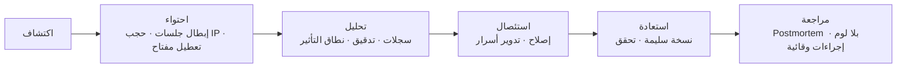

# 13 — Security Architecture

## 1. تصنيف البيانات

| التصنيف | أمثلة | الضوابط |
|---|---|---|
| **سري للغاية** | كلمات مرور، أسرار MFA، مفاتيح تشفير، مفاتيح API | تشفير + بلا سجلات + وصول نادر + تدقيق كل وصول |
| **سري** | أسعار التكلفة، الرواتب، بيانات العملاء، أرقام الهواتف | RLS + صلاحية صريحة + حجب في السجلات |
| **داخلي** | أرصدة المخزون، الفواتير، الموردون | RLS + أدوار |
| **عام** | كتالوج أصناف مُعلن، صفحات تسويقية | لا شيء |

**أساس التصنيف:** كل عمود في ERD يُصنَّف؛ الأعمدة السرية تُعلَّم في مخطط Drizzle بـ `sensitive: true` لتمنع ظهورها في السجلات والتصدير الافتراضي.

---

## 2. نموذج التهديد (STRIDE)

> **التعريف الكامل والملزم:** [`25-threat-model.md`](25-threat-model.md) — يحتوي حدود الثقة وأشجار الهجوم و**مصفوفة A1–A27** التي تشير إليها هذه الوثيقة. الجدول التالي ملخص تنفيذي.

| التهديد | السيناريو الواقعي | الضابط الأساسي | الضابط المساند |
|---|---|---|---|
| **Spoofing** | انتحال مستخدم بجلسة مسروقة | كوكي HttpOnly + تدوير Refresh | كشف إعادة الاستخدام + إشعار دخول |
| **Tampering** | تعديل سعر/كمية في الطلب | تسعير على الخادم + تدقيق قبل/بعد | توقيع الطلبات المالية الحساسة |
| **Repudiation** | موظف ينكر إجراء صرف | Audit log append-only + actor + requestId | فصل مهام + موافقة ثانية |
| **Information Disclosure** | قراءة فواتير مخزن آخر | RLS + FK مركب + 404 موحد | اختبار عزل في CI |
| **Denial of Service** | إغراق endpoint تسجيل الدخول | Rate limit على الحافة والـ API | طوابير منفصلة + حدود لكل Tenant |
| **Elevation of Privilege** | موظف يمنح نفسه صلاحية مدير | منع منح أعلى من المُناح + تدقيق | مراجعة دورية للصلاحيات |

### أصول عالية القيمة (Crown Jewels)
1. أرصدة المخزون والتشغيلات (سلامة دوائية + مالية).
2. أسعار التكلفة والأرباح.
3. بيانات العملاء (صيدليات/مستشفيات) — بيانات شخصية وتجارية.
4. الرواتب والبيانات البنكية.
5. سجل الأدوية المخدرة (التزام تنظيمي).
6. سجل التدقيق نفسه (لا يجوز التلاعب به).

---

## 3. الضوابط حسب الطبقة

### 3.1 الشبكة
| الضابط | التفصيل |
|---|---|
| حدود الشبكة | القاعدة وRedis على شبكة خاصة بلا IP عام |
| الوصول الإداري | عبر VPN/Bastion فقط، بلا SSH مفتوح للعالم |
| TLS | 1.2+ مع HSTS (سنة، preload)، شهادات آلية (Caddy/Cloudflare) |
| WAF | قواعد OWASP المُدارة + حجب User-Agents المسيئة + حماية DDoS |
| الفصل | بيئات dev/staging/prod بشبكات وأسرار منفصلة |
| الخروج | قائمة نطاقات مسموحة للمكالمات الصادرة (SSRF) |

### 3.2 التطبيق
| الضابط | التفصيل |
|---|---|
| Deny by default | كل مسار يحتاج صلاحية صريحة؛ المسار بلا تعريف = 403 |
| التحقق | Zod لكل مدخل، حدود طول/نوع/نطاق، رفض حقول غير معروفة |
| XSS | بلا `dangerouslySetInnerHTML`، CSP `default-src 'self'`، `script-src 'self' 'nonce-…'` |
| CSRF | `SameSite=Lax` + Origin check + Double-Submit |
| رؤوس | Helmet: `X-Frame-Options: DENY`, `nosniff`, `Referrer-Policy: strict-origin-when-cross-origin`, `Permissions-Policy` |
| الملفات | فحص magic bytes + حد حجم + اسم عشوائي + فحص فيروسات + تخزين خارج القاعدة |
| SSRF | لا استدعاء URL من المستخدم؛ Webhooks بقائمة نطاقات ورفض IP داخلي |
| الأخطاء | رسائل عامة، بلا Stack أو SQL، `requestId` للربط |
| الاعتماديات | lockfile + `pnpm audit` + Dependabot + Trivy في CI |

### 3.3 البيانات
| الضابط | التفصيل |
|---|---|
| RLS | مفعّلة `FORCE` على كل جدول أعمال (→ `11`) |
| القيود | `CHECK`/`FK` مركبة تمنع الفساد والتسريب البنيوي |
| التشفير أثناء النقل | TLS إلزامي لكل اتصال، بما فيه القاعدة |
| التشفير عند السكون | تشفير أقراص/خدمة مُدارة + تشفير النسخ بمفتاح منفصل |
| الحقول شديدة الحساسية | تشفير على مستوى العمود (MFA secrets، أرقام بنكية) بمفتاح تطبيق (AES-256-GCM) |
| إخفاء الهوية | تقنيع البيانات في staging واستعلامات الدعم |
| الاحتفاظ | سياسات موثقة لكل نوع بيانات (→ `08` §8) |

### 3.4 إدارة الأسرار
| القاعدة | التفصيل |
|---|---|
| لا أسرار في Git | `.env` مستثنى، `gitleaks` قبل الدفع، ومفتاح مكشوف = تدوير فوري |
| التخزين | Secret Store (GitHub Secrets / مدير أسرار المنصة / Vault عند التوسع) |
| التوزيع | متغيرات بيئة عند التشغيل، لا ملفات مُضمّنة في الصور |
| التدوير | كل 90 يومًا للأسرار العادية، فورًا عند أي شك |
| الوصول | أقل صلاحية، سجل وصول، بلا طباعة في السجلات |

---

## 4. خريطة OWASP Top 10

| # | الفئة | التطبيق في Slamtak |
|---|---|---|
| A01 | Broken Access Control | Guards + RLS + اختبار عزل إلزامي + 404 موحد |
| A02 | Cryptographic Failures | Argon2id، ES256، TLS، AES-GCM للحقول السرية |
| A03 | Injection | استعلامات مُعاملة (Drizzle)، بلا SQL نصي من المدخلات، قائمة بيضاء للترتيب |
| A04 | Insecure Design | حدود Tenant، فصل مهام، موافقات، اختبار هجمات A1–A27 |
| A05 | Security Misconfiguration | إعداد افتراضي مقفل، فحص إعدادات في CI، رؤوس أمان |
| A06 | Vulnerable Components | lockfile، Dependabot، Trivy، سياسة تحديث ≤ 30 يومًا للحرجة |
| A07 | Auth Failures | MFA، قفل تدريجي، تدوير رموز، إبطال جماعي عند الشك |
| A08 | Data Integrity Failures | توقيع Webhooks، تحقق تحديثات، بناء من مصدر موثوق |
| A09 | Logging Failures | سجلات منظمة + تنبيهات + تدقيق غير قابل للتعديل |
| A10 | SSRF | لا استدعاء لعناوين داخلية، قائمة نطاقات صادرة |

---

## 5. المراقبة والكشف

| ما نراقبه | العتبة/التنبيه |
|---|---|
| محاولات دخول فاشلة | > 20 لـ IP في 10 دقائق |
| رفض صلاحيات | > 50 لمستخدم في ساعة (احتمال استكشاف) |
| أخطاء 5xx | > 1% من الطلبات في 5 دقائق |
| طلبات 404 على معرّفات متتابعة | نمط تعداد → تنبيه أمني |
| تغيّر إعدادات حساسة | تنبيه فوري للمالك |
| وصول إدارة المنصة لبيانات | تدقيق + إشعار |
| شذوذ في حجم التصدير | > 10k صف في تصدير واحد |
| فشل نسخ احتياطي | تنبيه فوري |

**قاعدة:** كل تنبيه أمني له مالك ومدة استجابة محددة في Runbook.

---

## 6. الاستجابة للحوادث (Incident Response)

| السيناريو | أول 15 دقيقة |
|---|---|
| تسريب جلسة/أسرار | إبطال كل الجلسات + تدوير الأسرار + تحليل سجل الوصول |
| وصول غير مصرح لبيانات مخزن | تعطيل الحساب المعني + أخذ نسخة من الأدلة + إشعار المالك |
| فساد بيانات مخزون | تجميد الكتابة + تحديد الحركات المشبوهة + تسوية موثقة |
| هجوم حجب خدمة | تفعيل تحديات Cloudflare + تقليل الحدود + تصعيد للمزوّد |
| اختلاف نسخة احتياطية | استعادة إلى نسخة سابقة + مقارنة `verify_ledger_consistency` |

**التزام:** إشعار مالك المخزن خلال 72 ساعة من تأكيد أي حادث يمس بياناته.

---

## 7. برنامج الاختبار الأمني

| النوع | الأداة | التردد | البوابة |
|---|---|---|---|
| تحليل ثابت (SAST) | CodeQL / ESLint أمني | كل PR | تحذير → خطأ للحرج |
| أسرار | gitleaks | كل commit | يمنع الدفع |
| اعتماديات | `pnpm audit` + Trivy | كل بناء | يمنع النشر للحرج |
| عزل Tenant | مجموعة اختبارات مخصصة | كل PR | **يمنع الدمج** |
| صلاحيات | مصفوفة API × أدوار | كل PR | يمنع الدمج |
| DAST | OWASP ZAP baseline | أسبوعيًا على staging | تقرير + إصلاح |
| اختراق موجّه | مراجعة بشرية | قبل أول عميل + سنويًا | تقرير معتمد |
| إعدادات | Checkov/فحص يدوي | شهريًا | قائمة تحقق |

---

## 8. المتطلبات التنظيمية (مصر)

| المتطلب | الأثر التقني | ملاحظة |
|---|---|---|
| سجل الأدوية المخدرة | سجل مستقل، منع الحذف، توقيع/إقرار عند الصرف، صلاحية خاصة | يُراجع مع صيدلي مسؤول عن المخزن |
| الفاتورة الإلكترونية | تكامل ETA، حفظ المستند وحالته، توقيع رقمي | يحتاج بيانات اعتماد رسمية من العميل |
| ضريبة القيمة المضافة | نسب لكل صنف، تقرير ضريبي دوري | تُضبط مع المحاسب القانوني |
| حماية البيانات الشخصية | تقليل الجمع، تشفير، حق الوصول/التصحيح، حذف عند الطلب | قانون حماية البيانات المصري |
| الاحتفاظ بالمستندات | ≥ 5 سنوات للمالي، حسب التعليمات الضريبية | يُحسم مع المحاسب |

**ملاحظة صريحة:** هذه الوثيقة لا تُعد استشارة قانونية؛ تُعتمد المتطلبات النهائية من محاسب/مستشار قانوني قبل الإنتاج.

---

## 9. الفجوات الأمنية الحالية ومعالجتها

| الفجوة (من الوضع الحالي) | الأولوية | المعالجة | المرحلة |
|---|---|---|---|
| جلسة في `localStorage` | P0 | كوكي HttpOnly + إجبار دخول | Phase 1 |
| وصول PostgREST بمفتاح anon | P0 | إغلاق + API فقط | Phase 1 |
| منطق تسعير في المتصفح | P0 | تسعير على الخادم + تدقيق | Phase 2 |
| صلاحيات موزّعة على 3 أنظمة | P1 | توحيد RBAC | Phase 1 |
| لا MFA | P1 | TOTP إلزامي للأدوار الحساسة | Phase 1 |
| لا Idempotency | P1 | مفتاح + قيد فريد | Phase 1 |
| لا فحص أسرار آلي | P1 | gitleaks + pre-commit | Phase 1 |
| 100+ هجرة بلا Baseline | P1 | Baseline + بيئات | Phase 1 |
| لا تنبيهات أمنية | P2 | قواعد كشف + Runbook | Phase 2 |
| لا تمرين استعادة | P1 | تمرين ربع سنوي | Phase 1 |

---

## 10. قائمة تحقق أمنية قبل كل إصدار
- [ ] لا أسرار جديدة في الكود أو السجلات.
- [ ] كل مسار جديد له صلاحية + اختبار رفض.
- [ ] لا `SELECT *` ولا SQL نصي من مدخلات.
- [ ] كل جدول جديد له RLS + مفاتيح مركبة + سياسة.
- [ ] فحص اعتماديات بلا ثغرات حرجة.
- [ ] ZAP بلا نتائج عالية مفتوحة.
- [ ] اختبار عزل ناجح.
- [ ] سجلات لا تحتوي بيانات سرية (فحص عينة).
- [ ] نسخة احتياطية حديثة + تمرين استعادة موثق.
