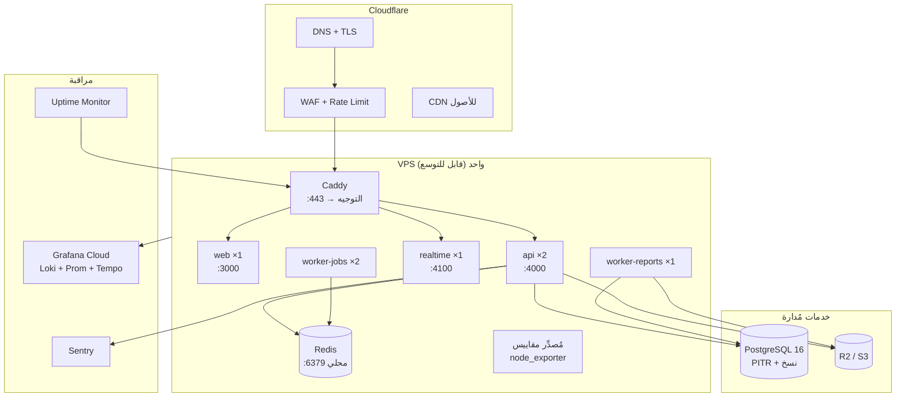

# 14 — Infrastructure Architecture
> **تحديث التنفيذ (2026-11-06):** الطبقة الخدمية لم تعد NestJS في حاوية — البوابة هي Supabase Edge Functions. التفاصيل والحدود الحسابية في [`28`](28-supabase-edge-runtime.md)؛ ما يلي يبقى صحيحًا في المنطق والعقد.

> **تحديث قيد التكلفة الصفرية (2026-11-06):** ما يظهر لاحقًا من Redis/BullMQ أو VPS أو تكلفة شهرية مُستبدَل بما في [`27`](27-free-tier-architecture.md) §5. المرجع الحاكم هو `27`.

## 1. البيئات

| البيئة | الغرض | البيانات | النطاق | الوصول |
|---|---|---|---|---|
| `local` | تطوير | بيانات وهمية (seed) | `localhost` | المطور |
| `preview` | مراجعة كل PR | وهمية | نطاق مؤقت لكل PR | الفريق |
| `staging` | اختبار قبول وحمل | نسخة مُقنَّعة من الإنتاج | نطاق داخلي محمي | الفريق + مالك المخزن |
| `production` | التشغيل | حقيقية | `app.slamtak.com` | الجمهور |

**قواعد:**
- لا تتشارك البيئات قاعدة بيانات أو Redis أو Bucket أو مفاتيح تشفير.
- `staging` تُستعاد من نسخة إنتاج (منقّحة) أسبوعيًا — لأن الأخطاء تظهر مع البيانات الحقيقية.
- لا وصول إنترنت عام إلى `staging`؛ حماية بكلمة مرور/شبكة.

---

## 2. الطوبولوجيا

| المكوّن | صورة | المنافذ | الصحة |
|---|---|---|---|
| Caddy | `caddy:2-alpine` | 80/443 | Marshmallow health عبر HTTP |
| web | `slamtak/web:<sha>` | 3000 داخلي | `/` يعيد 200 |
| api | `slamtak/api:<sha>` | 4000 داخلي ×2 | `/health/ready` |
| realtime | `slamtak/api:<sha>` (وضع WS) | 4100 داخلي | `/health/live` |
| worker | `slamtak/worker:<sha>` | بلا منافذ | نبضة Redis |
| redis | `redis:7-alpine` | 6379 داخلي | `PING` |
| postgres | مُدار | 5432 بشبكة خاصة | مزوّد |

**منافذ عامة مفتوحة: 80/443 فقط.** كل ما عدا ذلك داخلي أو عبر VPN.

---

## 3. الأحجام والتوسع (Sizing)

| الحمل | web | api | worker | DB | Redis | التكلفة الشهرية (تقديري) |
|---|---|---|---|---|---|---|
| 1–5 مخازن | 0.5 vCPU / 512MB | 1 vCPU / 1GB ×1 | 1 vCPU / 1GB | 2 vCPU / 4GB | مشترك | $40–60 |
| 6–25 مخزنًا | 0.5 / 512MB | 1 / 1GB ×2 | 1 / 1.5GB ×2 | 4 / 8GB | 1 / 1GB | $80–130 |
| 26–60 مخزنًا | 1 / 1GB | 2 / 2GB ×2 | 2 / 2GB ×3 | 8 / 16GB + Replica | 2 / 4GB | $200–320 |
| 60+ | فصل web/api | أفقية + CDN | طوابير مستقلة | Partitions + Replica | Cluster | يُقدَّر بقياس |

**عتبات التوسع (Triggers):**

| المؤشر | العتبة | الإجراء |
|---|---|---|
| CPU للـ API | > 65% لمدة 15 دقيقة | +نسخة |
| زمن الاستجابة p95 | > 500ms لمدة 30 دقيقة | تحليل استعلامات + نسخة |
| اتصالات القاعدة | > 70% من الحد | ضبط Pool / ترقية |
| طول الطابور | > 500 مهمة معلقة | +عامل |
| مساحة القرص | > 70% | تنظيف/ترقية أو نقل الأقسام |
| زمن النسخ الاحتياطي | > 60 دقيقة | مراجعة الاستراتيجية |

---

## 4. توفّر عالٍ (HA) وخطة الفشل

| المكوّن | مستوى التوفّر | سلوك الفشل | التعافي |
|---|---|---|---|
| Cloudflare | عالٍ (مُدار) | تنبيه | تلقائي |
| web | 1 نسخة الآن | صفحة خطأ | إعادة تشغيل تلقائي (Restart policy) |
| api | نسختان | الطلبات تنتقل للنسخة السليمة | تلقائي |
| worker | نسختان | تأخر مهام | إعادة تشغيل |
| Redis | نسخة واحدة + AOF | كاش يفقد، طوابير تُستأنف | إعادة تشغيل |
| PostgreSQL | مُدار بـ PITR | **توقف كامل (Fail closed)** | استعادة/تجديد تلقائي |

**قرار:** لا نُشغّل وضع "قراءة فقط ببيانات قديمة" عند سقوط القاعدة — بيانات مخزون قديمة أخطر من التوقف.

---

## 5. المراقبة (Observability)

| الإشارة | الأداة | ماذا نسجل |
|---|---|---|
| سجلات | pino → Loki | JSON، `requestId`, `tenantId`, `userId`, `route`, `latency`, بلا بيانات سرية |
| مقاييس | Prometheus → Grafana | RPS، p50/p95/p99، أخطاء، اتصالات DB، طول الطوابير، Cache hit |
| تتبع | OpenTelemetry → Tempo | span لكل طلب + استعلام DB + مهمة |
| أخطاء | Sentry | Stack + إصدار + `requestId`، بلا PII |
| توفر | UptimeRobot/BetterStack | فحص كل دقيقة من منطقتين |
| عمل تجاري | لوحة داخلية | فواتير/ساعة، نسبة فشل، مدة اعتماد فاتورة |

**مقاييس العمل (Business SLI):** عدد الفواتير المرفوضة بسبب رصيد، مدة اعتماد مستند، نسبة عمليات فاشلة، عدد تنبيهات انتهاء غير المعالجة.

**حدود التسجيل:** 30 يومًا سجلات ساخنة، 90 يومًا أرشيف، وبلا محتوى حساس؛ التتبع بعينات 10% (100% للأخطاء).

---

## 6. النسخ الاحتياطي والتعافي (DR)

| الطبقة | RPO | RTO | التفصيل |
|---|---|---|---|
| بيانات | ≤ 5 دقائق | ≤ 60 دقيقة | PITR + نسخة يومية |
| ملفات | ≤ 24 ساعة | ≤ 2 ساعة | نسخ R2 إلى Bucket ثانٍ |
| إعدادات/أسرار | عند كل تغيير | ≤ 30 دقيقة | مُدارة + مستندة في Runbook (بلا قيم) |
| كود | صفر | ≤ 15 دقيقة | صور Docker + إعادة نشر بأي وسم |

**تمرين التعافي (Quarterly):** استعادة في بيئة معزولة → تشغيل اختبارات اتساق (`verify_ledger_consistency`, عدد المستندات، مطابقة الأرصدة) → توثيق الزمن الفعلي.

---

## 7. الصيانة والنوافذ

| النوع | التوقيت | الأثر |
|---|---|---|
| نشر عادي | أي وقت (zero-downtime) | لا أثر |
| هجرة مخطط كبيرة | 02:00–04:00 بتوقيت القاهرة | قراءة فقط أو توقف قصير |
| ترقية PostgreSQL | نافذة معلنة قبل 7 أيام | توقف ≤ 15 دقيقة |
| تدوير أسرار | بلا توقف (تدوير مزدوج) | لا أثر |

**إعلان:** صفحة حالة + إشعار داخل التطبيق + بريد للمالك قبل أي نافذة.

---

## 8. التكلفة (صفر)

| البند | 1–5 مخازن | 25 مخزنًا | ملاحظة |
|---|---|---|---|
| Supabase | **$0** | $25–40 | 500 MB / 5 GB خروج مجانًا؛ الترقية عند التجاوز لا قبله |
| الحوسبة (API) | **$0** | $0–12 | Render Free للتجربة · Oracle Always Free للإنتاج |
| Cloudflare Pages | **$0** | $0 | طلبات ثابتة غير محدودة |
| R2 (نسخ + مرفقات) | **$0** | $0 | 10 GB، بلا رسوم خروج |
| النسخ الاحتياطي | **$0** | $0 | `pg_dump` يومي عبر GitHub Actions → R2 |
| المراقبة | **$0** | $0 | UptimeRobot + Sentry Free |
| CI/CD | **$0** | $0 | 2,000 دقيقة مجانية |
| **الإجمالي** | **$0** | **~$25–52** | لا نفقة تُلتزم قبل أول عميل يدفع |

**قاعدة مالية جديدة (2026-11-06):** التكلفة في التطوير والتجربة والتشغيل الأولي = **صفر**، بلا بطاقة ولا فوترة تلقائية. الحدود التفصيلية وبدائلها في [`27`](27-free-tier-architecture.md)؛ وحين تُتجاوَز حدود الخطة المجانية يكون القرار تعاقديًا مع العميل لا نفقة نتحملها مسبقًا.

## 9. Runbooks المطلوبة

| Runbook | المحتوى |
|---|---|
| نشر إصدار | خطوات، فحوص، تراجع |
| استعادة قاعدة | أوامر، تحقق، إبلاغ |
| تعطيل/إعادة تفعيل Tenant | الأثر، الإشعارات |
| تدوير مفتاح/سر | ترتيب، تحقق، تراجع |
| طابور متوقف | تشخيص، إعادة تشغيل، تحقق |
| حادث أمني | احتواء، أدلة، إشعار |
| نفاد مساحة القرص | تنظيف آمن، أرشفة أقسام |
| شهادة منتهية | تجديد، تحقق |

كل Runbook: مالك، مدة متوقعة، معايير نجاح، وما يجب **عدم** فعله.

**التفصيل التنفيذي:** الإجراء الكامل لتمرين الاستعادة والبوابة الآلية والتنبيهات في [`26`](26-production-readiness.md). الأرقام هنا ملزمة، والوثيقة `26` تشرح كيف تُثبت.

---

## 10. معايير قبول هذه الوثيقة
- [ ] كل بيئة معزولة بالكامل (بيانات، أسرار، شبكة).
- [ ] منافذ عامة محدودة بـ 80/443.
- [ ] كل مكوّن له سلوك فشل معلن وتعافٍ.
- [ ] عتبات التوسع رقمية لا انطباعية.
- [ ] تكلفة شهرية معروفة ومقبولة.
- [ ] Runbooks مكتوبة قبل أول عميل.
