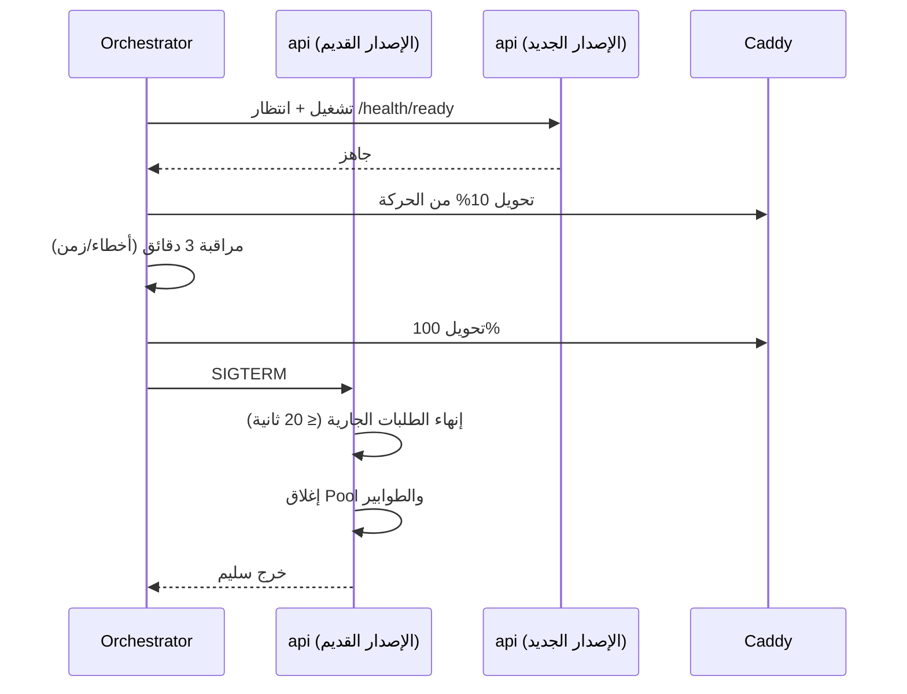

# 15 — Deployment Architecture
> **تحديث التنفيذ (2026-11-06):** الطبقة الخدمية لم تعد NestJS في حاوية — البوابة هي Supabase Edge Functions. التفاصيل والحدود الحسابية في [`28`](28-supabase-edge-runtime.md)؛ ما يلي يبقى صحيحًا في المنطق والعقد.

> **تحديث قيد التكلفة الصفرية (2026-11-06):** ما يظهر لاحقًا من Redis/BullMQ أو VPS أو تكلفة شهرية مُستبدَل بما في [`27`](27-free-tier-architecture.md) §5. المرجع الحاكم هو `27`.

## 1. المستودع والفروع

| العنصر | القرار |
|---|---|
| الاستراتيجية | Trunk-based: `main` دائم + فروع قصيرة العمر (≤ 3 أيام) |
| الحماية | `main` محمي: PR + مراجعة + CI أخضر + بلا force push |
| الدمج | Squash merge مع رسالة واضحة |
| الإصدارات | وسوم `vX.Y.Z` (SemVer) + `CHANGELOG.md` آلي |
| البيئات من الفروع | `main` → production، أي PR → preview |

**رسالة الالتزام:** `<type>(<scope>): <summary>` — `feat`, `fix`, `perf`, `refactor`, `docs`, `test`, `chore`, `security`.

---

## 2. خط الأنابيب (CI/CD)


```yaml
# .github/workflows/ci.yml (مختصر تصميمي)
name: ci
on: [pull_request]
jobs:
  verify:
    runs-on: ubuntu-latest
    services:
      postgres:
        image: postgres:16
        env: { POSTGRES_PASSWORD: test }
        options: >-
          --health-cmd pg_isready --health-interval 5s --health-retries 10
      redis:
        image: redis:7
    steps:
      - uses: actions/checkout@v4
      - uses: pnpm/action-setup@v4
      - run: pnpm install --frozen-lockfile
      - run: pnpm lint && pnpm typecheck
      - run: pnpm test:unit -- --coverage
      - run: pnpm test:integration
      - run: pnpm test:isolation        # يفشل البناء عند أي تسريب
      - run: pnpm db:migrate:from-zero && pnpm db:schema:diff
      - run: pnpm security:audit && pnpm security:secrets && pnpm security:trivy
      - run: pnpm build
```

| البوابة | شرط النجاح | مدة مستهدفة |
|---|---|---|
| Lint/Typecheck | صفر أخطاء | < 2 دقيقة |
| Unit | نجاح 100% وتغطية الوحدات الحرجة ≥ 80% | < 3 دقائق |
| Integration | نجاح على قاعدة حقيقية | < 6 دقائق |
| Isolation | نجاح كل A1–A27 | < 5 دقائق |
| Migrations | تطبيق من الصفر + لا فرق مخطط | < 3 دقائق |
| Security | لا حرج، لا أسرار | < 3 دقائق |
| E2E (preview) | مسارات الحرجة فقط | < 8 دقائق |

**زمن الدمج المستهدف: ≤ 20 دقيقة.** أطول من ذلك يعني تدهور جودة أو بنية اختبار ضعيفة.

---

## 3. الصور (Docker)

```dockerfile
# infra/docker/api.Dockerfile (تصميم مرجعي)
FROM node:22-alpine AS deps
WORKDIR /app
COPY pnpm-lock.yaml package.json ./
RUN corepack enable && pnpm fetch --prod=false
COPY . .
RUN pnpm install --frozen-lockfile --offline

FROM deps AS build
RUN pnpm --filter @slamtak/api build

FROM node:22-alpine AS runtime
RUN addgroup -S app && adduser -S app -G app
WORKDIR /app
ENV NODE_ENV=production
COPY --from=build /app/node_modules ./node_modules
COPY --from=build /app/apps/api/dist ./dist
COPY --from=build /app/apps/api/package.json ./
USER app
EXPOSE 4000
HEALTHCHECK --interval=15s --timeout=3s --retries=3 \
  CMD node -e "fetch('http://127.0.0.1:4000/health/live').then(r=>process.exit(r.ok?0:1)).catch(()=>process.exit(1))"
CMD ["node", "dist/main.js"]
```

| القاعدة | السبب |
|---|---|
| مستخدم غير جذر | تقليل أثر الاختراق |
| صورة `alpine` أو `distroless` | سطح هجوم أصغر |
| بناء متعدد المراحل | صورة نهائية بلا أدوات بناء |
| بلا أسرار في الصورة | تُمرر عند التشغيل فقط |
| HEALTHCHECK | إعادة تشغيل تلقائية عند التعليق |
| وسم بالـ SHA لا `latest` | تراجع دقيق |

---

## 4. الهجرات في النشر

```bash
# ترتيب إلزامي
1. نسخة احتياطية/تأكيد PITR
2. pg_dump --schema-only  (للمقارنة)
3. pnpm db:migrate        # هجرات متوافقة للخلف فقط
4. نشر التطبيق الجديد
5. تحقق: /health/ready + smoke tests
6. (لاحقًا في إصدار منفصل) حذف الأعمدة القديمة
```

| قاعدة | التفصيل |
|---|---|
| متوافقة للخلف | الإصدار القديم يجب أن يعمل على المخطط الجديد (Expand) |
| لا `down` مدمر | التراجع بهجرة جديدة |
| `CONCURRENTLY` للفهارس | لا قفل جدول |
| `lock_timeout` | فشل سريع بدل تعليق النشر |
| اختبار على نسخة production | `staging` قبل الإنتاج دائمًا |
| الكود الأقدم يعمل | إن تأخر نشر التطبيق عن الهجرة لا يتعطل |

---

## 5. النشر بدون توقف (Zero-downtime)



| الخطوة | الضابط |
|---|---|
| فحص الجاهزية | لا تحويل حركة قبل `ready` |
| يمكن التبديل | إصداران يعملان معًا (تطبيق متوافق مع المخطط) |
| التراجع | إعادة الوسم القديم + إعادة التوجيه (≤ 2 دقيقة) |
| المهام | العامل القديم ينهي مهمته الحالية قبل الخروج |

---

## 6. التراجع (Rollback)

| الحالة | الإجراء | الزمن المستهدف |
|---|---|---|
| خطأ في التطبيق | إعادة نشر الصورة السابقة | ≤ 3 دقائق |
| هجرة أحدثت مشكلة | هجرة عكسية جديدة + إعادة نشر | ≤ 30 دقيقة |
| فساد بيانات | استعادة PITR إلى نقطة قبل الحادث + إعادة تشغيل | ≤ 60 دقيقة |
| مشكلة في مزوّد | تحويل DNS/خدمة بديلة | ≤ 15 دقيقة |

**شرط مسبق:** كل إصدار يحتفظ بصورتين سابقتين على الأقل في السجل.

---

## 7. قائمة تحقق ما قبل النشر (Release Checklist)

- [ ] CI أخضر كاملًا (بما فيه عزل المخازن).
- [ ] مراجعة كود معتمدة.
- [ ] هجرات مختبرة على `staging` ومن نسخة إنتاج.
- [ ] `CHANGELOG` محدث.
- [ ] خطة تراجع مكتوبة لهذا الإصدار.
- [ ] متغيرات بيئة جديدة موثقة في `.env.example` ومضافة للبيئة.
- [ ] لا أسرار في المستودع.
- [ ] إشعار مسبق للعملاء لو هناك تغيير سلوك.
- [ ] نسخة احتياطية حديثة مؤكدة.
- [ ] Smoke tests جاهزة.

---

## 8. متغيرات البيئة

> **مُحدَّث لتشغيل Edge Functions (2026-11-06):** لا `REDIS_URL` ولا مفاتيح S3 ولا OTEL — الكاش في القاعدة والمهام في `pg_cron` والنسخ الاحتياطي يُرفع إلى R2 من GitHub Actions لا من الدوال ([`27`](27-free-tier-architecture.md) §5 · [`28`](28-supabase-edge-runtime.md) §3).

| المتغير | مثال | سري | أين يُضبط |
|---|---|---|---|
| `APP_ORIGIN` | `https://app.slamtak.com` | — | إعدادات الدالة |
| `SUPABASE_URL` | `https://xyz.supabase.co` | — | تلقائي في بيئة Supabase |
| `DATABASE_URL` | `postgresql://slamtak_app…@…:6543/postgres` | ✅ | سر الدالة — Supavisor بوضع المعاملات |
| `PLATFORM_DATABASE_URL` | دور `slamtak_platform` | ✅ | سر الدالة — لوحة المنصة فقط |
| `JWT_PRIVATE_KEY` / `JWT_PUBLIC_KEY` | PEM (ES256) | ✅ / — | أسرار الدالة |
| `JWT_KID` | `2026-11` | — | إعدادات الدالة |
| `COOKIE_DOMAIN` | `app.slamtak.com` | — | إعدادات الدالة |
| `REALTIME_PUBLIC_URL` | `wss://xyz.supabase.co/realtime/v1` | — | إعدادات الدالة (يُعاد للواجهة مع التوكن) |
| `SMTP_URL` / `SMS_API_KEY` | — | ✅ | اختياري — عند تفعيل الإشعارات |
| `SENTRY_DSN` | — | ✅ | اختياري |
| `LOG_LEVEL` | `info` | — | إعدادات الدالة |
| `R2_ACCOUNT_ID` / `R2_ACCESS_KEY_ID` / `R2_SECRET_ACCESS_KEY` / `R2_BUCKET` | — | ✅ | **أسرار GitHub Actions** فقط — لا تُوضع في الدوال |

**ما ليس متغير بيئة:** المفتاح العام الذي يستورده Realtime للتحقق من توكناتنا يُضبط في إعدادات المشروع (JWT secret / Third-Party Auth)، لا في متغيرات الدوال — ولا يُكتب في أي ملف في المستودع.

**قاعدة:** التطبيق يرفض الإقلاع إذا غاب متغير مطلوب أو كان بصيغة خاطئة (تحقق Zod عند التشغيل).

---

## 9. النطاق والشهادات

| العنصر | القرار |
|---|---|
| النطاق | `slamtak.com` (أساسي) + `app.slamtak.com` |
| الشهادات | آلية عبر Cloudflare/Caddy (تجديد تلقائي) + تنبيه قبل 14 يومًا |
| HSTS | مفعّل بعد التأكد من كل النطاقات الفرعية |
| البريد | `SPF` + `DKIM` + `DMARC` (p=quarantine) |
| إعادة التوجيه | `http → https` و`www → app` دائمًا |

---

## 10. اكتمال المستودع (GitHub Completeness)

المتطلب: **كل ما يلزم لإعادة بناء النظام ونشره موجود في GitHub**، وليس على جهاز أحد.

| المسار | الغرض | إلزامي |
|---|---|---|
| `apps/web`, `apps/api`, `apps/worker` | الكود | ✅ |
| `packages/*` | عقود، قاعدة، صلاحيات، UI | ✅ |
| `supabase/migrations` → `packages/db/migrations` | الهجرات | ✅ |
| `infra/docker/*.Dockerfile` | بناء الصور | ✅ |
| `infra/compose/*.yml` | تشغيل البيئات | ✅ |
| `infra/caddy/Caddyfile` | التوجيه وTLS | ✅ |
| `.github/workflows/*.yml` | CI/CD | ✅ |
| `.env.example` | كل المتغيرات بلا قيم | ✅ |
| `docs/architecture/*` | هذه الوثائق | ✅ |
| `docs/runbooks/*` | خطط التشغيل | ✅ |
| `scripts/*` | seed، backup، restore، verify | ✅ |
| `tests/*` | كل الاختبارات | ✅ |
| `CHANGELOG.md`, `README.md`, `LICENSE` | التوثيق الأساسي | ✅ |
| `.gitignore`, `.editorconfig`, `.nvmrc` | اتساق بيئة | ✅ |

**المستثنى عمدًا:** `.env` الحقيقي، مفاتيح، نسخ احتياطية، `node_modules`، صور محلية، ملفات `.wrangler`.

**فحص آلي:** سكربت `scripts/verify-repo-completeness.ts` يفشل CI إذا غاب أي مسار إلزامي أعلاه.

---

## 11. معايير قبول هذه الوثيقة
- [ ] النشر لا يقطع الخدمة ولا يفقد طلبًا.
- [ ] كل هجرة متوافقة للخلف ومختبرة من نسخة إنتاج.
- [ ] التراجع ممكن في ≤ 3 دقائق لتغيير كود.
- [ ] المستودع يحتوي كل ما يلزم لإعادة البناء.
- [ ] لا سر واحد في Git.
- [ ] قائمة تحقق الإصدار مطبقة فعليًا لا شكلية.
