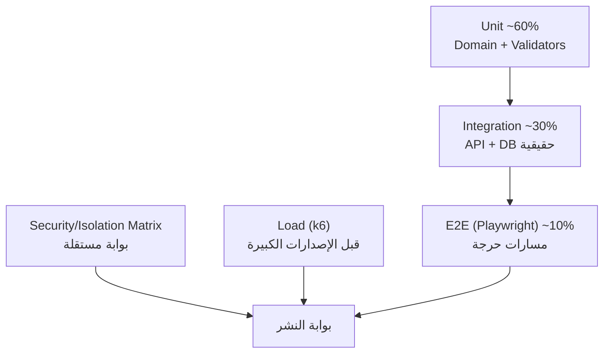

# 16 — Testing Strategy
> **تحديث التنفيذ (2026-11-06):** الطبقة الخدمية لم تعد NestJS في حاوية — البوابة هي Supabase Edge Functions. التفاصيل والحدود الحسابية في [`28`](28-supabase-edge-runtime.md)؛ ما يلي يبقى صحيحًا في المنطق والعقد.

## 1. فلسفة الاختبار

| المبدأ | التطبيق |
|---|---|
| اختبار ما يمكن كسره | التركيز على المخزون، المال، الصلاحيات، العزل |
| لا "مكتمل" بظهور شاشة | كل وحدة لها معايير قبول قابلة للتنفيذ |
| الاختبار جزء من العقد | المسار بلا اختبار = غير منفذ |
| بيانات واقعية | سيناريوهات من عمل مخزن أدوية فعلي (تشغيلات، مرتجعات، عجز) |
| الفشل يجب أن يفشل | لا `skip` ولا `only` ولا اختبار مُعطَّل في `main` |



---

## 2. مستويات الاختبار

| المستوى | النطاق | الأداة | البوابة | الزمن |
|---|---|---|---|---|
| Unit | دوال نطاق، تسعير، FEFO، تحقق | Vitest | كل PR | < 3د |
| Component | نماذج وجداول وحالات خطأ | Testing Library | كل PR | < 2د |
| Integration | Controller → Service → DB حقيقية | Vitest + Testcontainers + supertest | كل PR | < 6د |
| Contract | مطابقة الاستجابة لـ OpenAPI | مخططات Zod | كل PR | < 1د |
| Isolation | مصفوفة A1–A27 ([`25`](25-threat-model.md)) | مجموعة مخصصة | **إلزامية** | < 5د |
| Permissions | كل مسار × كل دور | مصفوفة مولدة | **إلزامية** | < 4د |
| E2E | مسارات حرجة في المتصفح | Playwright | قبل الدمج | < 8د |
| Load | سيناريو يوم عمل | k6 | قبل الإصدار الرئيسي | 30د |
| DB | RLS وقيود وTriggers | pgTAP | كل PR | < 3د |
| Recovery | استعادة نسخة | سكربت + تحقق | ربع سنوي | 60د |
| UAT | قبول من خبير مخزن | يدوي بسيناريو | قبل أول عميل | 2–3 أيام |

---

## 3. تصميم مجموعة اختبار العزل

| المكوّن | التفصيل |
|---|---|
| البيانات | Tenant A + Tenant B، كل منهما: 3 مستخدمين، **مخزن واحد**، 50 صنفًا، 100 تشغيلة، 200 فاتورة (ADR-025) |
| التوليد | Factory موحّدة (`seedTenant(name)`) بقيم حتمية (بذرة ثابتة) |
| المصفوفة | كل endpoint × {قراءة، إنشاء، تعديل، حذف} × {A→B, B→A} |
| التحقق | 404/403 متوقعة + لا صف من A في استجابة B + RLS مباشرة |
| التغطية | `ALL_TENANT_SCOPED_ENDPOINTS` تُبنى من OpenAPI — مسار جديد بلا تغطية يُفشل التست |

**الشرط:** أي جدول جديد بلا تغطية في مصفوفة RLS يُفشل CI (فحص `pg_policies`).

---

## 4. مصفوفة الصلاحيات

```ts
const MATRIX = {
  'sales.invoice.create': { owner: 201, manager: 201, cashier: 201, keeper: 403, driver: 403 },
  'catalog.price.update': { owner: 200, manager: 403, pharmacist: 403 },
  'hr.payroll.approve':   { owner: 200, manager: 403, accountant: 403 },
  // …
};
```
تُولَّد الاختبارات من المصفوفة، وتُقارن بأكواد الاستجابة الفعلية. أي اختلاف = فشل.

---

## 5. قائمة تحقق لكل وحدة (Definition of Done)

**الوحدة لا تُعتبر مكتملة إلا بتحقق كل ما يلي:** (1) مساراتها في OpenAPI، (2) اختبار وحدة للنطاق، (3) اختبار تكامل، (4) اختبار صلاحية، (5) اختبار عزل، (6) تدقيق مسجل، (7) معالجة أخطاء برموز، (8) وجود في الواجهة مع حالات تحميل/فراغ/خطأ.

| # | الوحدة | اختبارات قبول إلزامية |
|---|---|---|
| 1 | Authentication | دخول صحيح/خاطئ، MFA، قفل تدريجي، تدوير refresh، كشف إعادة استخدام، إبطال جلسات، كوكي غير مقروء من JS |
| 2 | User Management | دعوة، قبول، تعليق، منع بريد مكرر، منع حذف الذات، تدقيق كل تغيير |
| 3 | Warehouse | المخزن الوحيد: تعديل الاسم/العنوان/الترخيص، منع الحذف نهائيًا، عرض بيانات المخزن فقط |
| 4 | Tenancy guard | **رفض إنشاء مخزن ثانٍ** (`T19`)، رفض عضوية بمخزن آخر (`T20`)، رفض `warehouseId` من العميل (400) |
| 5 | Medicine | تفرّد SKU/باركود داخل المخزن، بحث عربي، استيراد بملف سيئ (رفض جزئي بتقرير) |
| 6 | Inventory | كل تغيير له حركة، منع رصيد سالب، منع تعديل رصيد مباشر، تجميع الأرصدة صحيح |
| 7 | Batch & Expiry | منع صرف منتهٍ/محجوز، FEFO يختار الأقرب انتهاءً، تنبيه قبل الانتهاء، سحب تشغيلة |
| 8 | Purchasing | أمر → استلام → فاتورة (مطابقة ثلاثية)، منع استلام يتجاوز المتبقي |
| 9 | Suppliers | رصيد المورد، كشف حساب، مرتجع مورد يؤثر على الرصيد والتكلفة |
| 10 | Sales | تسعير على الخادم، FEFO، خصم بحدود، منع تجاوز الائتمان، إلغاء يعيد المخزون بقيد عكسي |
| 11 | Customers & Pharmacies | حد ائتمان، قائمة أسعار، ترخيص منتهٍ يمنع البيع (قابل للضبط) |
| 12 | Returns | مرتجع مرتبط بالفاتورة الأصلية، منع تجاوز الكمية، منع إرجاع تشغيلة أخرى |
| 13 | Accounting | توازن كل قيد، منع ترحيل لفترة مغلقة، قيد عكسي بدل الحذف |
| 14 | Cash & Bank | رصيد الخزينة لا يصبح سالبًا، تسوية بنكية، نقل بين خزائن بقيدين |
| 15 | HR | عقد، حضور، راتب محسوب، منع تعديل مسير معتمد |
| 16 | Employee Permissions | منع منح صلاحية أعلى من المُناح، إبطال فوري، تدقيق |
| 17 | TeleSales | قائمة عملاء المندوب فقط، هدف، عمولة محسوبة، منع رؤية عملاء زملاء |
| 18 | Delivery | إسناد مهمة، إثبات تسليم، تسوية تحصيل COD، فرق يُسجَّل |
| 19 | Reports | كل تقرير مقيّد بالمخزن، نتائج مطابقة لحساب مرجعي، تصدير مطابق للعرض |
| 20 | Notifications | عدم تسريب محتوى مخزن آخر، تفضيلات، منع التكرار |
| 21 | Automation | قاعدة تُنفَّذ مرة واحدة، منع الحلقات، إيقاف فوري |
| 22 | AI Assistant | لا يجاوز صلاحيات السائل، بلا بيانات مخزن آخر، حدود استخدام، تسجيل الطلبات |
| 23 | Voice | تفريغ عربي مقبول، تأكيد قبل التنفيذ، بلا تنفيذ تلقائي لعمليات مالية |
| 24 | Electronic Payments | توقيع/تحقق Webhook، منع التكرار، مطابقة مبلغ، حالة غير مؤكدة |
| 25 | Advertising | لا يظهر إعلان مخزن لآخر، بلا أثر على البيانات |
| 26 | Audit Logs | append-only، كل عملية حساسة لها أثر، منع الحذف والتعديل، تصدير |
| 27 | Subscription | حدود الخطة مطبقة على الخادم، إيقاف يمنع الكتابة، تجديد صحيح |

**قاعدة إضافية:** أي وحدة لا تمر عبرها صلاحية مستخدم مرفوضة بنجاح = غير مكتملة، حتى لو كانت وظيفتها تعمل.

---

## 6. اختبار الأداء والحمل

| السيناريو | الحمل | الهدف |
|---|---|---|
| يوم عمل عادي | 40 مستخدمًا متزامنًا، 60 دقيقة | p95 قراءة < 300ms، كتابة < 800ms |
| ذروة فاتورة | 30 كاشير × 10 فواتير/دقيقة | صفر أخطاء 5xx، صفر رصيد سالب |
| بحث/كتالوج | 100 طلب/ثانية | p95 < 200ms |
| تقرير ثقيل | 10 تقارير متزامنة | لا تتجاوز 10 ثوانٍ، لا تعطّل الطلبات |
| تصدير 50k صف | 5 متزامنة | ينتهي ≤ 60 ثانية، بلا OOM |
| استيراد 10k صنف | ملف واحد | ≤ 90 ثانية مع تقرير أخطاء |
| صمود | 2× الحمل المتوقع 30 دقيقة | لا تسريب ذاكرة، لا تدهور تدريجي |

**معايير القبول:** صفر خطأ 5xx في سيناريو الذروة، وصفر انتهاك لقيود المخزون، وتقرير k6 مرفق بالإصدار.

---

## 7. اختبار قاعدة البيانات

| الاختبار | الأداة | المحتوى |
|---|---|---|
| RLS | pgTAP | كل جدول: بلا سياق = صفر صفوف؛ بسياق A = صفوف A فقط |
| القيود | pgTAP | إدراج كمية سالبة، مرجع مخزن آخر، تعديل `tenant_id` |
| التوازن المحاسبي | pgTAP | قيد غير متوازن يُرفض |
| الحركات | pgTAP | تعديل رصيد بلا حركة ممنوع |
| الهجرة | سكربت | من صفر → مطابقة مخطط متوقع |
| الأداء | `EXPLAIN ANALYZE` | لا Seq Scan على جدول كبير في مسار حرج |

---

## 8. إدارة بيانات الاختبار

| القاعدة | التفصيل |
|---|---|
| بذرة ثابتة | نتائج حتمية قابلة للتكرار |
| بلا بيانات حقيقية | staging تُنقّح: إخفاء أسماء/هواتف/بُعد مبالغ بمعامل ثابت |
| تنظيف | كل اختبار تكامل يعمل في Transaction تُلغى |
| عزل | قاعدة اختبار منفصلة لكل pipeline |
| Factories | `makeTenant()`, `makeMedicine()`, `makeInvoice()` بلا نسخ يدوي |

---

## 9. الأخطاء ومعايير الخروج

| الشدة | التعريف | SLA |
|---|---|---|
| S1 | تسريب بيانات مخزن، خسارة مالية، توقف كامل | إصلاح فوري، إصدار طارئ |
| S2 | وظيفة أساسية معطلة بلا بديل | ≤ 24 ساعة |
| S3 | خطأ وظيفي ببديل يدوي | ≤ 5 أيام |
| S4 | تجميلي/تحسين | حسب الأولوية |

**معايير الخروج للإنتاج:** صفر S1/S2 مفتوح، صفر ثغرة حرجة، اختبار عزل أخضر، تمرين استعادة حديث.

---

## 10. معايير قبول هذه الوثيقة
- [ ] كل وحدة من 27 لها قائمة تحقق قابلة للتنفيذ.
- [ ] العزل والصلاحيات بوابتان إلزاميتان في CI.
- [ ] أهداف الأداء رقمية ولها سيناريو قياس.
- [ ] بيانات الاختبار واقعية ومنقّحة.
- [ ] "مكتمل" معرّف بمعايير لا برأي.
