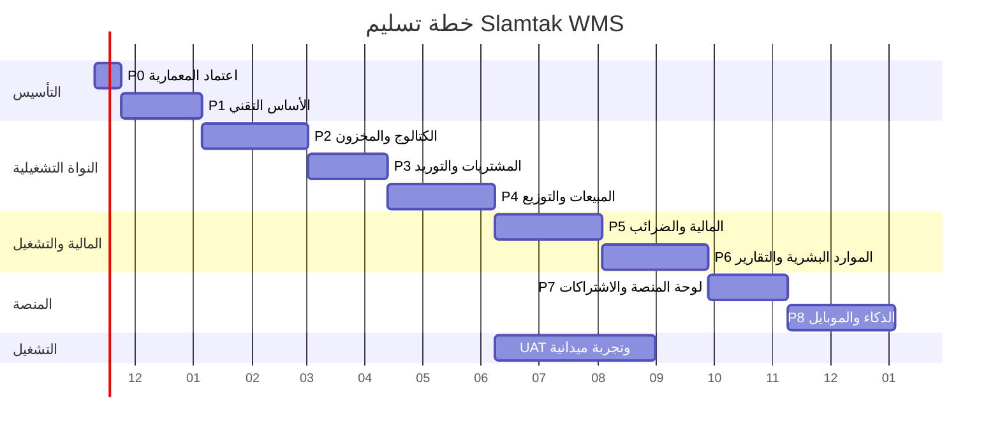

# 19 — Development Roadmap

## 1. المبادئ

| المبدأ | التطبيق |
|---|---|
| تسليم أفقي لا عمودي | كل مرحلة تُنتج طبقة كاملة (قاعدة + API + واجهة + اختبار) |
| قيمة قابلة للاستخدام مبكرًا | المخزن يعمل فعليًا من Phase 2، لا "ديمو" |
| لا ميزة على مسار غير آمن | كل جديد عبر الـ API فقط |
| بوابة خروج لكل مرحلة | لا انتقال بلا معايير مقاسة |
| النطاق قابل للتعديل | الأولويات تُراجع كل أسبوعين، والمعمارية لا تُمس |

**الفريق المفترض:** 1 Architect/Tech Lead، 2 Backend، 1.5 Frontend، 0.5 DevOps، 0.5 QA — (≈5.5 FTE).

---

## 2. الخط الزمني (12 شهرًا)

> المدد تقويمية وتفترض التوازي بين الواجهة والخادم. الاختبار القبولي (UAT) يبدأ بعد Phase 4 ويمتد بالتوازي.

---

## 3. المراحل ومعايير القبول

### Phase 0 — اعتماد المعمارية (أسبوعان)
| التسليم | معيار القبول |
|---|---|
| هذه الوثائق | توقيع Gate A من كل الأدوار |
| عقد API v1 | OpenAPI مبدئي معتمد |
| نموذج التهديد | مراجعة أمنية داخلية |
| قرارات مالك المنتج | الأسئلة الستة في `README` §6 محسومة |

**لا كود في هذه المرحلة.** أي كود = خرق للمنهج.

---

### Phase 1 — الأساس التقني (6 أسابيع)
| التسليم | معيار القبول |
|---|---|
| Monorepo + CI | بناء واختبار < 20 دقيقة، حماية `main` |
| Baseline DB + RLS | استعلام `pg_policies` يثبت التغطية 100% |
| المصادقة (Argon2id, MFA, جلسات) | E2E دخول + MFA + تدوير + إبطال |
| Tenancy (Tenants/Warehouses) | إنشاء حساب + مخزنه الوحيد + عضوية المالك في معاملة واحدة؛ رفض المخزن الثاني (ADR-025) |
| RBAC + كتالوج الصلاحيات | مصفوفة صلاحيات خضراء |
| Audit + Outbox + Idempotency | اختبار تكرار الطلب لا يضاعف الأثر |
| Web shell (RTL + تصميم) | LCP < 2.5s، إتاحة AA |
| النشر على staging | نشر + تراجع مُختبر |
| **مصفوفة العزل A1–A27** | **100% نجاح في CI** |

**بوابة الخروج:** يمكن إنشاء مستخدم ودخوله ورؤية لوحة فارغة معزولة تمامًا عن أي مخزن آخر.

---

### Phase 2 — الكتالوج والمخزون (8 أسابيع)
| التسليم | معيار القبول |
|---|---|
| الأصناف + الوحدات + الباركود + التصنيفات | استيراد 10k صنف ≤ 90 ثانية بتقرير أخطاء |
| قوائم الأسعار + تاريخ الأسعار | تعديل سعر يسجل إصدارًا ولا يمس التاريخ |
| التشغيلات + الأرصدة + الحركات | كل تغيير رصيد له حركة، صفر رصيد سالب |
| FEFO + حجب المنتهي/المحجوز | اختبار 20 سيناريو صرف |
| التحويلات + الجرد | فرق جرد لا يُعتمد بلا سبب |
| لوحة انتهاء الصلاحية | تنبيهات 30/60/90 يومًا |
| **تشغيل المخزن الأول فعليًا** | إدخال أرصدة افتتاحية ومطابقتها |

**بوابة الخروج:** جرد كامل لمخزن حقيقي يطابق 99.5% مع النظام.

---

### Phase 3 — المشتريات والتوريد (6 أسابيع)
| التسليم | معيار القبول |
|---|---|
| الموردون + الحسابات | كشف حساب مطابق |
| أوامر الشراء | منع استلام يتجاوز المتبقي |
| الاستلام بتشغيلات (GRN) | إدخال تشغيلة إجباري وتوليد رصيد |
| فواتير المورد + مطابقة ثلاثية | فرق يظهر كـ variance موثق |
| مرتجعات المورد | تؤثر على الرصيد والتكلفة بشكل صحيح |
| مدفوعات الموردين | رصيد المورد يتحدث ذريًا |

---

### Phase 4 — المبيعات والتوزيع (8 أسابيع)
| التسليم | معيار القبول |
|---|---|
| العملاء + التراخيص + حدود الائتمان | منع بيع يتجاوز الحد بلا تجاوز مسجل |
| فاتورة بيع سريعة (باركود) | 12 سطرًا في < 60 ثانية |
| عروض وخصومات | خصم بحدود الصلاحية + تدقيق |
| المرتجعات | مرتبطة بالفاتورة والتشغيلة الأصلية |
| المندوبون + التحصيل | كشف مندوب مطابق |
| التوصيل + إثبات التسليم | تسوية COD بفروق مسجلة |
| **UAT مع المخزن** | 2–3 أيام سيناريوهات حقيقية |

**بوابة الخروج:** يوم عمل كامل بلا ورق.

---

### Phase 5 — المالية والضرائب (8 أسابيع)
| التسليم | معيار القبول |
|---|---|
| شجرة حسابات + قيود | كل فاتورة لها قيد متوازن |
| خزائن وبنوك | رصيد لا يصبح سالبًا |
| فترات محاسبية | منع الترحيل لفترة مغلقة |
| تقارير ضريبية | مطابقة حساب مرجعي بفرق صفر |
| تكامل ETA | إرسال/استلام حالة + إعادة محاولة |
| قيود عكسية | لا حذف قيد معتمد |

---

### Phase 6 — الموارد البشرية والتشغيل (8 أسابيع)
| التسليم | معيار القبول |
|---|---|
| الموظفون والحضور | حساب ساعات دقيق |
| الرواتب | مسير معتمد غير قابل للتعديل |
| TeleSales | مندوب يرى عملاءه فقط |
| التقارير والإسقاطات | كل تقرير < 3 ثوانٍ |
| الأتمتة والإشعارات | قاعدة تُنفَّذ مرة واحدة |
| سجل التدقيق الكامل | تصدير لفترة زمنية |

---

### Phase 7 — منصة SaaS (6 أسابيع)
| التسليم | معيار القبول |
|---|---|
| لوحة المنصة | بلا وصول لبيانات تجارية (اختبار A26) |
| الخطط والاشتراكات | حدود مطبقة على الخادم |
| الفوترة | إيقاف تلقائي عند التعثر (بعد سماح) |
| دعم فني | تذاكر + كسر زجاج مُدقق |
| مقاييس المنصة | مجاميع فقط |
| إنشاء مخزن ذاتي | < 5 دقائق بلا نشر |

**بوابة الخروج:** تسجيل مخزن جديد ودفعه يعمل بلا تدخل بشري.

---

### Phase 8 — الذكاء والتوسع (8 أسابيع، مستمر)
| التسليم | معيار القبول |
|---|---|
| تنبؤ الطلب | دقة أفضل من المتوسط البسيط على بيانات تاريخية |
| مساعد ذكي | لا يجاوز صلاحيات السائل ولا يرى مخزنًا آخر |
| صوت عربي | تأكيد قبل أي تنفيذ |
| PWA متقدم | قراءة دون اتصال + مسح باركود |
| تطبيق موبايل | يستخدم نفس الـ API |

---

## 4. الانتقال بلا ترحيل بيانات (قرار المالك، ADR-026)

**لا يُرحَّل أي صف من النظام القديم.** لا سكربتات استخراج، ولا تحويل `warehouse_id`، ولا مطابقة صفوف. النظام الجديد يبدأ نظيفًا، والانتقال عملية تشغيلية محدودة:

| الخطوة | التفصيل | معيار القبول |
|---|---|---|
| 1. إعلان موعد | تجميد الإدخال في النظام القديم في نافذة ليلية | إعلان مسبق للمستخدمين |
| 2. إنشاء الحساب | حساب + مخزنه الوحيد + عضوية المالك (ADR-025) | `GET /warehouse` يعيد المخزن الوحيد |
| 3. المستخدمون | إنشاء من جديد بكلمات مرور جديدة وMFA — لا استيراد تجزئات | كل مستخدم نشطًا بعد أول دخول |
| 4. جرد افتتاحي | عدّ فعلي موقّع، ثم إدخاله كحركات `opening` موثقة لكل صنف/تشغيلة | `verify_ledger_consistency = 0` |
| 5. التشغيل | البدء الفعلي؛ النظام القديم يبقى للقراءة/الأرشيف | قبول المالك كتابيًا |
| 6. أرشفة | تصدير كامل من القديم يُخزَّن للرجوع، لا يُحمَّل | نسخة مقروءة ومؤرشفة |

**قاعدة:** الجرد الافتتاحي ليس ترحيلًا — هو إدخال بشري موقّع يبدأ منه الدفتر. لا يُسمح بأي «سكربت ترحيل» تحت أي مسمى.

---

## 5. ما لا نفعله في كل مرحلة

| المرحلة | ممنوع |
|---|---|
| P1 | أي ميزة أعمال قبل اكتمال العزل والمصادقة |
| P2 | تقارير معقدة قبل استقرار الأرصدة |
| P3 | تكامل ETA قبل استقرار الفواتير |
| P4 | تطبيق موبايل قبل ثبات عقد API |
| P5 | تشغيل مالي فعلي قبل مراجعة محاسب |
| P6 | AI قبل وجود بيانات نظيفة |
| P7 | بيع اشتراكات قبل اجتياز حمل 25 مخزنًا |
| P8 | أي ميزة تُضعف العزل مقابل سرعة |

---

## 6. المخاطر وتخفيفها

| المخاطرة | الأثر | التخفيف |
|---|---|---|
| تراكم دين تقني في P1 | تأخير كل ما بعده | بوابة خروج صارمة، لا استثناءات |
| تغيّر متطلبات المخزن | إعادة عمل | UAT مبكر من P4 + مراجعة أسبوعية |
| نقص خبير مخزن في الفريق | تصميم غير واقعي | مستشار صيدلي/مدير مخزن بدوام جزئي |
| خطأ في الجرد الافتتاحي | أرصدة بداية خاطئة | عدّ مزدوج + توقيع المالك + فحص اتساق قبل أول بيع |
| تأخر تكامل ETA (اعتمادات) | تأخير P5 | تصميم محوّل مستقل وتنفيذ لاحق |
| إجهاد الفريق | جودة | مراحل 6–8 أسابيع بحد أقصى، بلا "Crunch" |

---

## 7. مؤشرات نجاح كل مرحلة

| المؤشر | الهدف |
|---|---|
| تغطية الاختبار للوحدات الحرجة | ≥ 80% |
| الأخطاء المكتشفة بعد التسليم | ≤ 3 لكل مرحلة |
| زمن الدمج | ≤ 20 دقيقة |
| رضا المستخدم (UAT) | ≥ 4/5 |
| عيوب العزل | صفر |

---

## 8. معايير قبول هذه الوثيقة
- [ ] كل مرحلة لها تسليمات ومعايير خروج قابلة للقياس.
- [ ] الترتيب يمنع بناء ميزات على أساس غير آمن.
- [ ] الانتقال لا يتضمن أي ترحيل بيانات؛ يبدأ بجرد افتتاحي موقّع (ADR-026).
- [ ] الجدول الزمني واقعي لفريق 5–6 أشخاص.
- [ ] المخاطر لها مالك وتخفيف.
