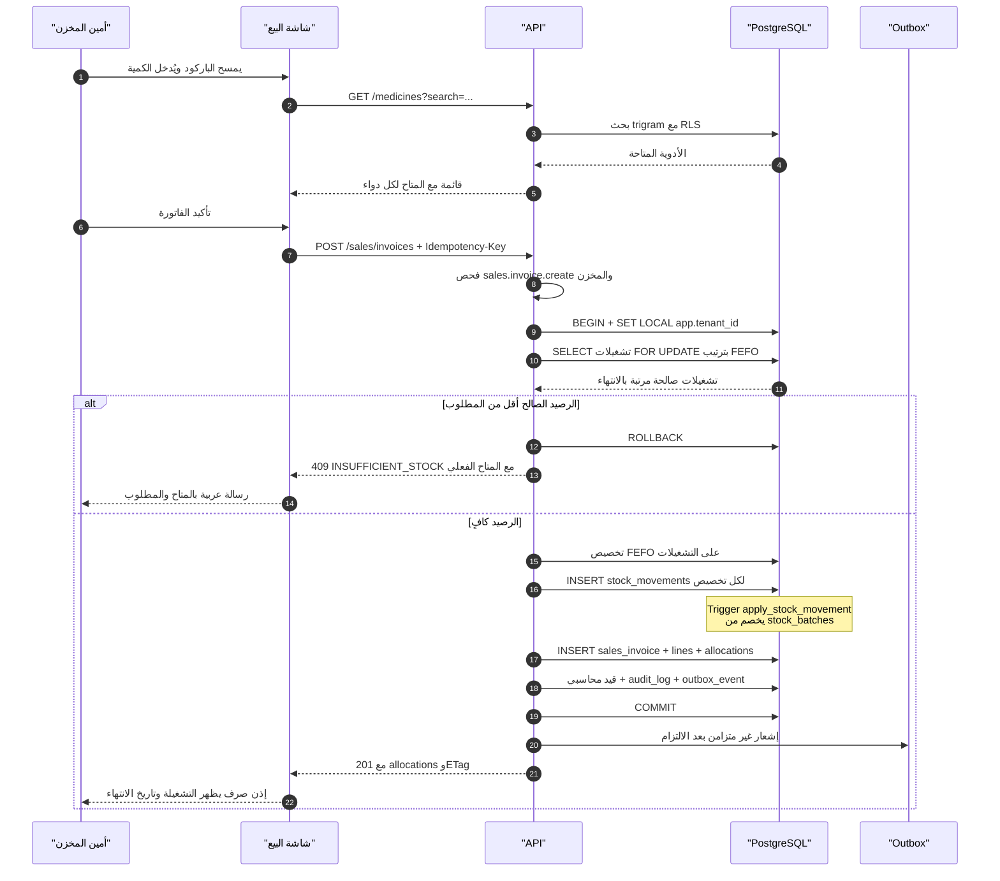
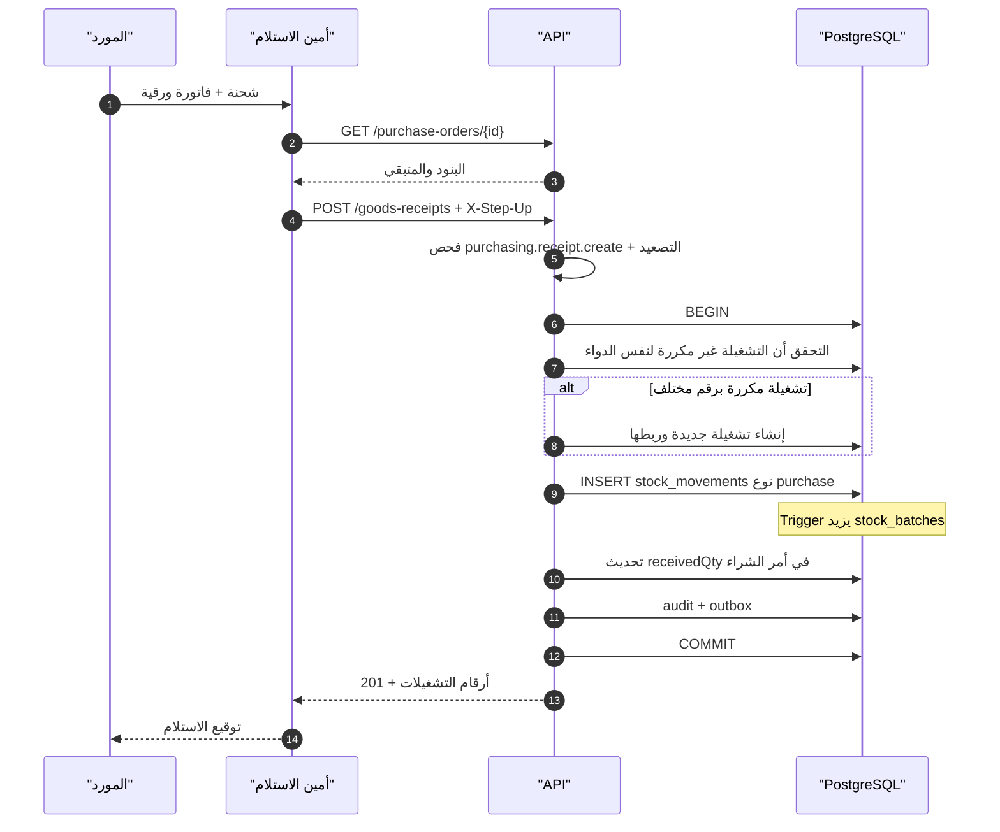
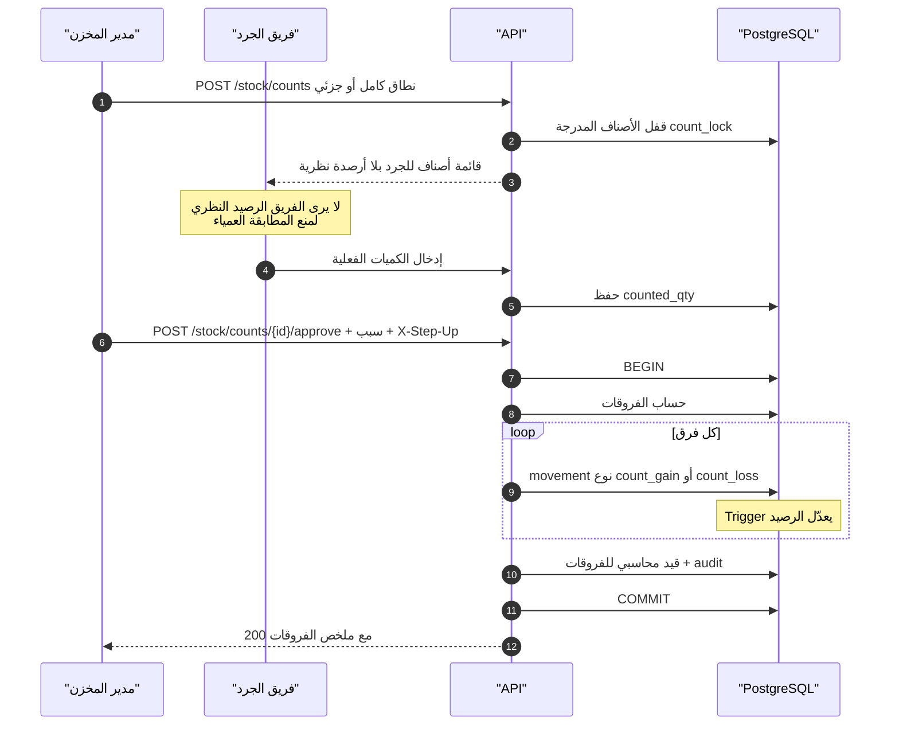
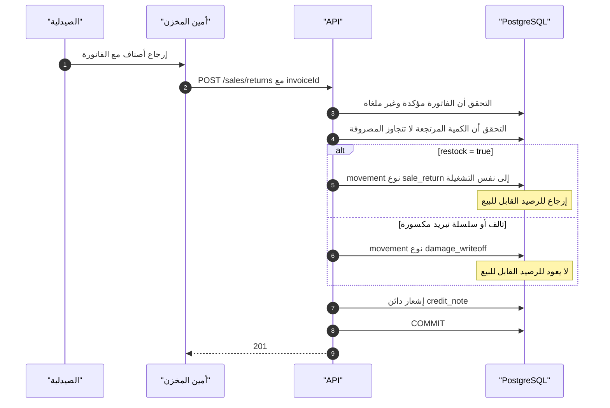
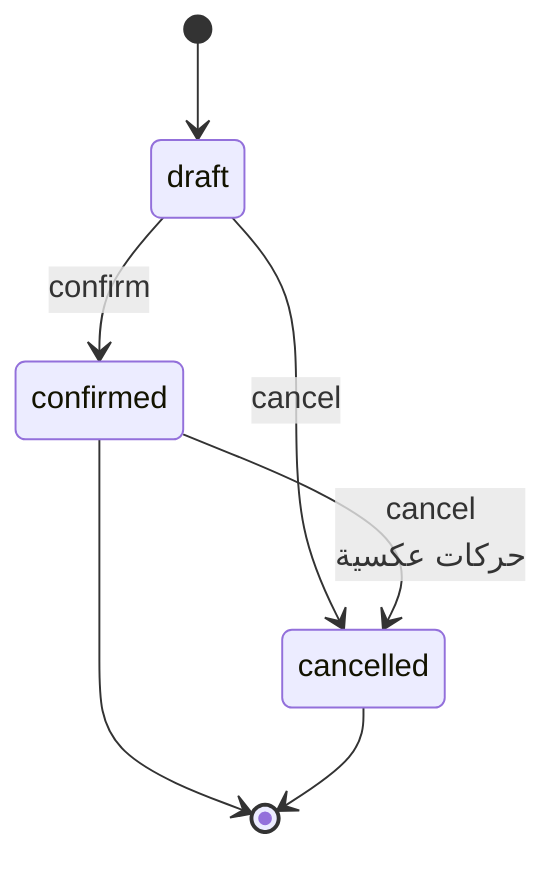

# 24 — مخططات التدفقات التشغيلية الأربعة

> **الحالة:** مكتمل — بند Gate B الثالث (جزء التدفقات).
> **الغرض:** تحويل قرارات `21` (المخطط) و`10` (الواجهة) إلى **تسلسل تنفيذي** يمكن اختباره خطوة بخطوة.
> **القاعدة:** كل خطوة في هذه المخططات تقابلها حركة مخزنية موثقة أو قيد محاسبي؛ لا خطوة «صامتة».

---

## 1. البيع (Sales) — تخصيص FEFO وترحيل الحركات

هذا التدفق هو **قلب النظام**: أي خطأ فيه يعني دواءً منتهيًا يُصرف، أو رصيدًا لا يطابق الواقع.

| الخطوة الحرجة | القاعدة المُلزمة | الاختبار المقابل |
|---|---|---|
| ترتيب التشغيلات | `ORDER BY expiry_date, created_at` (FEFO) | `T11` + اختبار وحدة `FEFO-1` |
| استبعاد المنتهي | `expiry_date > CURRENT_DATE` إلزامي | `FEFO-2` (منتهي لا يُخصص) |
| استبعاد المحجوب | `status = 'available'` فقط | `FEFO-3` |
| الرصيد السالب | `CHECK qty_on_hand >= 0` | `T6` |
| التزامن | `SELECT ... FOR UPDATE` على صفوف التشغيلات | `CONC-1` (فاتورتان متوازيتان) |
| التكرار | `Idempotency-Key` 24 ساعة | `IDEM-1` |

**لماذا `FOR UPDATE` وليس `ON CONFLICT`؟** لأن التخصيص يقرأ رصيدًا ثم يقرر؛ القراءة والكتابة يجب أن تكونا ذرّية. القفل على صف التشغيلة يمنع بيع نفس العلبة مرتين تحت التزامن. هذا بالضبط الخطأ الذي كشفه التشغيل الفعلي في `21` §9.1.

---

## 2. الاستلام من المورد (Goods Receipt)

| قاعدة | التفصيل |
|---|---|
| تاريخ الانتهاء إلزامي | لا استلام دواء بلا انتهاء — يمنع تلويث FEFO |
| رفض المنتهي عند الاستلام | `expiry_date > CURRENT_DATE + 30` افتراضيًا (قابل للضبط) |
| التكلفة تُحدَّث | `unit_cost` الجديدة تُستخدم في تقييم المخزون لاحقًا |
| المطابقة الثلاثية | فاتورة المورد تُقارن بأمر الشراء والاستلام → `varianceFlags` |

---

## 3. الجرد (Stock Count)

| ضابط | السبب |
|---|---|
| إخفاء الرصيد النظري عن الفريق | يمنع «الجرد المطابق» الذي يخفي الفقد |
| سبب إلزامي عند الاعتماد | مسؤولية موثقة |
| `X-Step-Up` | اعتماد الفروقات عملية عالية المخاطر |
| الفرق يُسجَّل كحركة لا كتعديل | يحفظ سلسلة التتبع الكاملة |

---

## 4. مرتجع البيع (Sales Return)

**حد أمني:** لا يمكن إرجاع كمية أكبر من المصروفة في نفس السطر؛ يُرفض بـ `422 VALIDATION_FAILED` مع تفصيل السطر. هذا يمنع تضخيم المخزون عبر مرتجعات وهمية — ثغرة شائعة في أنظمة المخازن.

---

## 5. آلة حالات المستندات (Document State Machines)

| الانتقال | من يملكه | أثر مخزني | أثر محاسبي |
|---|---|---|---|
| `draft → confirmed` | `sales.invoice.confirm` | خصم حركات | قيد إيراد |
| `confirmed → cancelled` | `sales.invoice.cancel` | حركات عكسية | قيد عكسي |

**لا يوجد انتقال `→ deleted`:** الحذف غير موجود في النظام. الإلغاء بحركات عكسية يحفظ التاريخ. هذا قرار معماري (ADR-011) وليس تفصيلًا.

---

## 6. ما يجعل هذه المخططات قابلة للاختبار

| الخاصية | كيف تُختبر |
|---|---|
| كل تدفق له مسار نجاح واحد واضح | اختبار تكامل واحد لكل مخطط |
| كل `alt` له اختبار | `INSUFFICIENT_STOCK`, `restock=false`, `expired rejected` |
| كل خطوة كتابة على `DB` داخل معاملة | فحص `BEGIN/COMMIT` في الكود + `T5` (بلا سياق = صفر صفوف) |
| كل حركة تُنشئ أثرًا يمكن تتبعه | `source_type` + `source_id` في `stock_movements` |
| التزامن مُختبر | فاتورتان متوازيتان على نفس التشغيلة (`CONC-1`) |

---

## 7. معايير قبول هذه الوثيقة

- [x] أربعة تدفقات تشغيلية موثقة بالتفصيل.
- [x] كل تدفق يوضح نقطة الفشل والاستجابة لها.
- [x] كل خطوة مرتبطة بصلاحية أو حركة موثقة.
- [x] آلة حالات للمستندات مع منع الحذف.
- [x] كل `alt` في المخططات له اختبار مسمى.
- [x] **محسوم بقرار المالك:** لا تحويلات بين مخازن — حساب واحد = مخزن واحد (ADR-025)؛ فلا سياسة «خصم عند الإرسال/الاستلام» ولا رصيد في الطريق.
