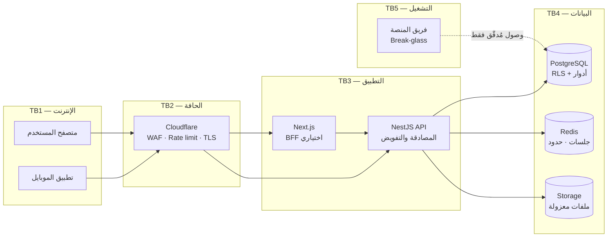
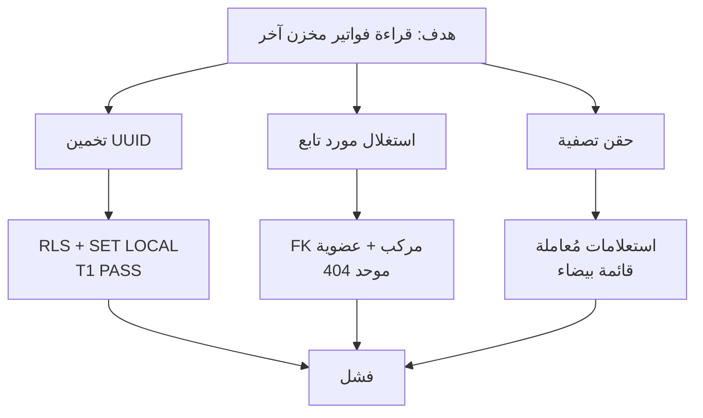
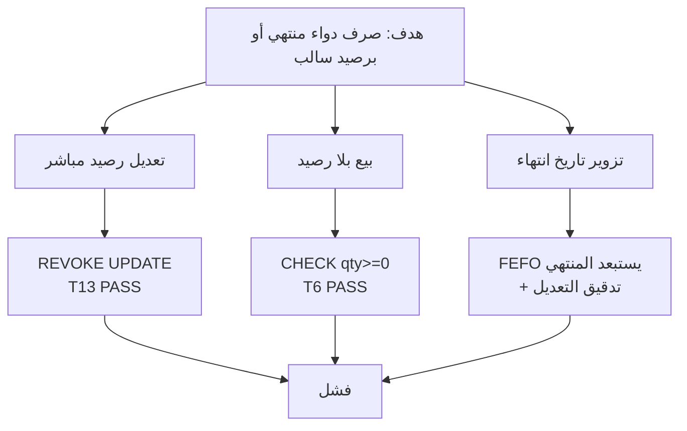
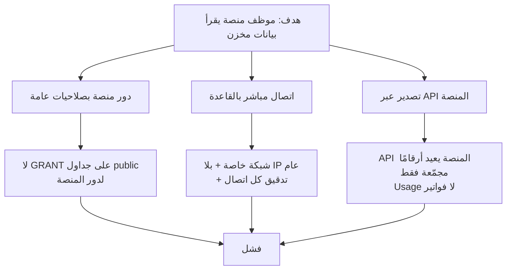

# 25 — نموذج التهديد (STRIDE) ومصفوفة الهجمات A1–A27
> **تحديث التنفيذ (2026-11-06):** الطبقة الخدمية لم تعد NestJS في حاوية — البوابة هي Supabase Edge Functions. التفاصيل والحدود الحسابية في [`28`](28-supabase-edge-runtime.md)؛ ما يلي يبقى صحيحًا في المنطق والعقد.

> **الحالة:** مكتمل — بند Gate B الثالث (الجزء الأمني).
> **يُغلق مرجعًا معلّقًا:** `13` §4 (A04) و`16` §3 يشيران إلى «مصفوفة A1–A27» التي لم تكن معرّفة في أي وثيقة. هذه الوثيقة هي تعريفها.
> **المنهجية:** STRIDE لكل حد ثقة + 26 حالة هجوم قابلة للاختبار + سجل مخاطر متبقية.
> **ما لم يُنفَّذ:** لا اختبار اختراق فعلي بعد؛ الحالات هنا مواصفات اختبار، والمنفَّذ منها مُعلَّم صراحة.

---

## 1. حدود الثقة (Trust Boundaries)

| الحد | العبور | الضابط الحاكم |
|---|---|---|
| TB1→TB2 | كل طلب عام | WAF، حدود معدل، TLS 1.2+ |
| TB2→TB3 | طلب مُصفّى | تحقق Origin/CSRF، حدود حجم |
| TB3→TB4 | استعلامات | RLS + `SECURITY DEFINER` محدود + `SET LOCAL app.tenant_id` |
| TB5→TB4 | وصول إداري | لا وصول افتراضي؛ Break-glass بموافقة + تدقيق |

**المبدأ:** لا يوجد حد ثقة «داخلي آمن». الخدمة نفسها قد تُخترق؛ لذلك القاعدة تفرض العزل بنفسها (`22`) ولا تعتمد على التطبيق وحده.

---

## 2. الأصول المصنّفة (Crown Jewels)

| # | الأصل | التصنيف | لو تسرّب/تلاعب |
|---|---|---|---|
| 1 | أرصدة المخزون والتشغيلات | سري — تشغيلي | صرف دواء منتهٍ، خسارة مالية، مسؤولية قانونية |
| 2 | أسعار التكلفة والأرباح | سري — تجاري | كشف هوامش المنافسين |
| 3 | بيانات العملاء (صيدليات/مستشفيات) | شخصي/تجاري | مخالفة قانون حماية البيانات |
| 4 | الرواتب والبيانات البنكية | شخصي حساس | ضرر مباشر على الأفراد |
| 5 | سجل الأدوية المخدرة | تنظيمي | غرامات وسحب ترخيص |
| 6 | سجل التدقيق | تنظيمي | فقدان القدرة على الإثبات |
| 7 | أسرار النظام (مفاتيح، شهادات) | سري — بنية | اختراق كامل |

---

## 3. STRIDE حسب المكوّن

| المكوّن | S | T | R | I | D | E |
|---|---|---|---|---|---|---|
| الحافة (Cloudflare) | انتحال نطاق | تعديل رؤوس | فقدان سجل الحافة | كشف IP | DDoS | تجاوز قواعد |
| API | سرقة جلسة | تعديل جسم الطلب | إنكار إجراء | IDOR عبر المخازن | استنزاف Argon2 | رفع صلاحية |
| قاعدة البيانات | انتحال دور | تعديل رصيد مباشر | حذف تدقيق | قراءة عبر RLS | استعلام ثقيل | الوصول لـ `platform` |
| الطوابير | حقن مهمة | تعديل حمولة | فقدان حدث | كشف بيانات في الطابور | إغراق طابور | تنفيذ مهمة بصلاحية أعلى |
| التخزين | رابط موقّع مسروق | استبدال ملف | إنكار رفع | مسار مشترك بين المخازن | تعبئة مساحة | ملف خبيث |
| المنصة | انتحال موظف | تعديل خطة/تعليق | إنكار وصول | **قراءة بيانات تجارية** | تعطيل مخزن | تجاوز الفصل |

**أخطر بند في الجدول:** «المنصة تقرأ بيانات تجارية». قرار `11` أن لوحة المنصة **بلا** صلاحية تلقائية لقراءة بيانات المخازن التجارية، وهذا مُتحقَّق جزئيًا في `T5` (لا `USAGE` على مخطط `platform` للتطبيق) — لكن العكس (المنصة تقرأ `public`) يُمنع بالامتياز والـ Break-glass لا بالـ RLS. تفصيله في A15.

---

## 4. مصفوفة الهجمات A1–A27

### 4.1 S — Spoofing

| # | السيناريو | الضابط | الاختبار | الحالة |
|---|---|---|---|---|
| **A1** | إعادة استخدام كوكي وصول مسروق | `HttpOnly; Secure; SameSite=Lax`، عمر 10 دقائق، ربط الجلسة ببصمة جهاز | `AUTH-1`: إعادة تشغيل كوكي بعد `logout` ⇒ 401 | ضابط مُوثَّق — اختبار Phase 1 |
| **A2** | إعادة استخدام `mfaToken` أو رمز TOTP نفسه | `mfaToken` أحادي الاستخدام، 5 دقائق، مرتبط بالمحاولة؛ نافذة TOTP ±30 ثانية بمنع إعادة | `AUTH-2`: استخدام نفس `mfaToken` مرتين ⇒ 401 | ضابط مُوثَّق |
| **A3** | Credential stuffing على `/auth/login` | Argon2id + حد 5/دقيقة و20/ساعة، قفل تدريجي، كشف تسريب بكشف مجهول | `AUTH-3`: 6 محاولات ⇒ 429 | ضابط مُوثَّق |
| **A4** | JWT مزوّر بخوارزمية ضعيفة (`alg: none` / HS256 بمفتاح عام) | تثبيت ES256، رفض كل `alg` آخر، `kid` من قائمة بيضاء، تدوير مفاتيح | `AUTH-4`: رمز HS256 ⇒ 401 | ضابط مُوثَّق |
| **A4ب** | استخدام توكن اشتراك Realtime على `/api` لتجاوز صلاحيات الجلسة | توكن منفصل `scope: realtime` بلا `roles`، والبوابة ترفض أي `scope` غير `api` | `AUTH-5`: توكن Realtime على `/api/v1/stock` ⇒ 401 | ضابط مُوثَّق (`28` §7.1) |

### 4.2 T — Tampering

| # | السيناريو | الضابط | الاختبار | الحالة |
|---|---|---|---|---|
| **A5** | إرسال `unitPrice` أو `total` في جسم الفاتورة | الحقل غير موجود في العقد (`additionalProperties: false`) + التسعير على الخادم | `SALES-1`: إرسال سعر ⇒ 422 `VALIDATION_FAILED` | مُتحقَّق في العقد (`23` §3.2) |
| **A6** | إرسال `tenantId` آخر في الجسم | لا حقل في أي مخطط؛ المخزن من العضوية؛ `TENANT_IMMUTABLE` في القاعدة | `T3` — **PASS** | ✅ مُتحقَّق |
| **A6ب** | الاشتراك في موضوع Realtime لمستأجر آخر لاستراق الأحداث | سياسة واحدة على `realtime.messages`: `topic = 'tenant:' || tenant_id` من التوكن، قنوات خاصة فقط، ولا `INSERT` للعملاء | `T18`: اشتراك B لا يستقبل حدث A | مطلوب عند التنفيذ |
| **A7** | إعادة إرسال نفس POST ⇒ فاتورتان | `Idempotency-Key` + قيد فريد، نفس الاستجابة 24 ساعة | `IDEM-1`: نفس المفتاح ⇒ فاتورة واحدة | ضابط مُوثَّق |
| **A8** | تعديل رصيد أو سجل حركة مباشرة بـ SQL | `REVOKE UPDATE, DELETE` على `stock_batches` و`stock_movements` + سياسات append-only + Trigger | `T13` — **PASS** (`42501`)، `T8` — **PASS** | ✅ مُتحقَّق |

### 4.3 R — Repudiation

| # | السيناريو | الضابط | الاختبار | الحالة |
|---|---|---|---|---|
| **A9** | موظف ينكر أنه صرف دواءً | `audit_logs` بالـ actor و`requestId` وقبل/بعد، داخل نفس المعاملة | `AUD-1`: كل فاتورة لها سجل تدقيق مرتبط | ضابط مُوثَّق |
| **A10** | محاولة تعديل أو حذف سجل التدقيق | `REVOKE UPDATE, DELETE` + سياسة append-only + Trigger `forbid_mutation` | `T8` — **PASS** | ✅ مُتحقَّق |
| **A11** | حقن سطر سجل مزيف (log injection) لتضليل التحقيق | سجلات JSON منظمة، لا تُبنى بالنص، `requestId` من الخادم لا من العميل | `LOG-1`: `\n` في مدخل لا يخلق سجلًا | ضابط مُوثَّق |

### 4.4 I — Information Disclosure

| # | السيناريو | الضابط | الاختبار | الحالة |
|---|---|---|---|---|
| **A12** | قراءة بيانات مخزن آخر بمعرّف UUID مُخمَّن | `RLS` على 38 جدولًا + مفاتيح مركبة + `SET LOCAL app.tenant_id` | `T1` — **PASS**، `T10` — **PASS** | ✅ مُتحقَّق |
| **A13** | تعداد الموارد عبر فرق 403/404 | `404` موحّد لكل مورد خارج النطاق | `ISO-1`: مورد مخزن آخر ⇒ 404 | ضابط مُوثَّق |
| **A14** | تخمين رابط تصدير | رابط موقّع 15 دقيقة + مفتاح `tenant/{id}/exports/...` | `EXP-1`: رابط مخزن آخر ⇒ 403 | ضابط مُوثَّق |
| **A15** | موظف منصة يقرأ فواتير مخزن | **لا صلاحية تلقائية**: دور المنصة لا يملك `SELECT` على جداول `public` التجارية؛ الوصول فقط عبر Break-glass بموافقة المالك + إشعار + تدقيق | `PLT-1`: دور المنصة ⇒ 42501 على `sales_invoices` | ضابط مُوثَّق — يحتاج اختبار Phase 1 |
| **A16** | كشف بيانات شخصية في السجلات | قائمة بيضاء للحقول المسموح تسجيلها؛ حجب `password`, `token`, `phone`, `email` | `LOG-2`: فحص آلي على عينات السجلات | ضابط مُوثَّق |

### 4.5 D — Denial of Service

| # | السيناريو | الضابط | الاختبار | الحالة |
|---|---|---|---|---|
| **A17** | إغراق تسجيل الدخول لاستنزاف CPU (Argon2id مكلف) | حد معدل على الحافة والـ API + معاملات Argon2 مضبوطة (64MB) + طابور منفصل | `DOS-1`: 100 طلب/دقيقة ⇒ 429 بلا تدهور | ضابط مُوثَّق |
| **A18** | استعلام بحث ببطاقة `%` أو حقل ترتيب ضخم | `search` ≥ 3 أحرف، `limit` ≤ 100، قائمة بيضاء للترتيب، `statement_timeout` | `DOS-2`: `sort=;(DROP` ⇒ 422 | ضابط مُوثَّق |
| **A19** | تصدير ضخم يُجمّد القاعدة | تصدير غير متزامن، حد 10/ساعة، سقف صفوف، معاملة قراءة فقط | `DOS-3`: تصدير 11 ⇒ 429 | ضابط مُوثَّق |

### 4.6 E — Elevation of Privilege

| # | السيناريو | الضابط | الاختبار | الحالة |
|---|---|---|---|---|
| **A20** | موظف يمنح نفسه دور مدير | منع منح صلاحية لا يملكها الطالب (`subset check`) + تدقيق + إشعار للمالك | `RBAC-1`: منح `users.permission.grant` بلا امتلاكه ⇒ 403 | ضابط مُوثَّق |
| **A21** | تمرير `warehouseId`/`tenantId` لمخزن آخر في الجسم أو الاستعلام | الحقل غير موجود في العقد، والسياق يُشتق من العضوية؛ محاولة تمريره ⇒ 400 `WAREHOUSE_CONTEXT_NOT_ACCEPTED`، ومورد حساب آخر ⇒ 404 | `RBAC-2`: `warehouseId` آخر ⇒ 400 | مُتحقَّق في العقد |
| **A27** | إنشاء مخزن ثانٍ لنفس الحساب لتوسيع النطاق أو تجاوز الترخيص | لا مسار لإنشاء مخزن؛ `UNIQUE (tenant_id)` يرفض 23505؛ مسؤول المنصة ينشئ حسابًا/مخزنًا واحدًا فقط | `TEN-1`: محاولة مخزن ثانٍ ⇒ 409/23505 | ✅ مُتحقَّق (T19) |
| **A22** | حقن SQL في التصفية أو الترتيب | استعلامات مُعاملة (Drizzle)، لا نص من المدخلات، قائمة بيضاء | `INJ-1`: `search=' OR 1=1--` ⇒ نتائج عادية لا تسريب | ضابط مُوثَّق |
| **A23** | الوصول لسطر فاتورة عبر `lineId` يعود لمخزن آخر | مفتاح خارجي مركّب مع `tenant_id` + تحقق عضوية + 404 | `IDOR-1`: سطر آخر ⇒ 404 | ضابط مُوثَّق |
| **A24** | CSRF على عملية تغيير حالة | `Origin`/`Referer` + Double-submit + `SameSite=Lax` | `CSRF-1`: أصل مختلف ⇒ 403 | ضابط مُوثَّق |
| **A25** | Mass assignment على حقل داخلي (`isSuperAdmin`, `tenantId`) | DTO بقائمة بيضاء + `additionalProperties: false` في العقد | `MASS-1`: حقل غير معروف ⇒ 422 | مُتحقَّق في العقد |
| **A26** | مستخدم معلّق يستمر بالكتابة من كاش صلاحيات (15 دقيقة) | `token_version` + حدث إبطال يُنظّف الكاش فورًا + فحص `sessions.revoked_at` لكل طلب كتابي | `AUTH-5`: تعليق ثم كتابة ⇒ 401 خلال ≤ 5 ثوانٍ | ضابط مُوثَّق |

---

## 5. أشجار هجوم لأعلى ثلاث مخاطر

### 5.1 تسريب بيانات مخزن (A12 + A13 + A23)

### 5.2 تصرف دواء منتهي أو غير موجود (A8 + T6 + FEFO)

### 5.3 وصول المنصة لبيانات تجارية (A15)

---

## 6. سجل المخاطر المتبقية

| # | الخطر المتبقي | لماذا مقبول الآن | ما يلزم لاحقًا | القرار |
|---|---|---|---|---|
| R1 | لا اختبار اختراق مستقل | المرحلة تصميمية بلا كود | Pentest خارجي قبل أول عميل مدفوع | **معلّق على المالك** |
| R2 | A15 غير مُختبر تنفيذيًا | يحتاج أدوار إنتاج | اختبار دور المنصة في staging | Phase 1 |
| R3 | كاش الصلاحيات 15 دقيقة (A26) | مقبول مع إبطال فوري بالحدث | اختبار زمن الإبطال ≤ 5 ثوانٍ | Phase 1 |
| R4 | لا WAF مخصص بعد | لم يُنشر شيء | قواعد OWASP مُدارة قبل الإنتاج | Phase 3 |
| R5 | `ReportRow` مرن قد يُسرّب حقولًا | لا تقارير منفذة بعد | مخطط لكل تقرير | Phase 2 |
| R6 | الاعتماد على `SECURITY DEFINER` في Trigger الرصيد | اختُبر فعليًا (T11, T13) | مراجعة أمنية للدوال قبل الإنتاج | Gate C |

---

## 7. ما تم التحقق منه فعليًا (لا ادعاء)

| الحالة | آلية التحقق | النتيجة |
|---|---|---|
| A6 | `T3` على PostgreSQL 17 | ✅ PASS |
| A8 | `T8` + `T13` | ✅ PASS (`42501`) |
| A10 | `T8` | ✅ PASS |
| A12 | `T1` + `T10` | ✅ PASS |
| A5, A25, A21 | فحص العقد آليًا (Redocly + تحليل الشجرة) | ✅ لا حقل سعر/`tenantId`/`warehouseId`/حقل داخلي |
| A27 | تنفيذ DDL واختبار T19 على PostgreSQL 17 | ✅ `23505` عند مخزن ثانٍ |
| أداة الكشف (دفتر/رصيد) | `T14` (كشف انحراف مُدخل) + `T15` (غير متاحة لدور التطبيق) + `T16`/`T17` (دور العمليات: ينفّذ ولا يقرأ) — [`22`](22-rls-and-isolation-tests.md) §6 | ✅ PASS |
| الباقي (20 حالة) | ضابط موثّق في `12`/`13` | ⏳ اختبار Phase 1 |

**لا أُدرج حالة كـ«مُتحقَّقة» إلا إذا نفّذتها أداة.** هذا هو الفرق بين نموذج تهديد ومقال.

---

## 8. عملية تحديث النموذج

| المحفّز | الإجراء | المسؤول |
|---|---|---|
| تعديل معماري (ADR جديد) | مراجعة STRIDE للمكوّن المتأثر + إضافة A جديدة إن لزم | Architect + Security |
| ميزة جديدة تلمس بيانات | تهديد واحد على الأقل + اختبار | Backend + QA |
| حادث أمني | Postmortem يضيف حالة A ويُحدّث الضابط | Security |
| كل ربع سنة | مراجعة كاملة + تحديث سجل المخاطر | Security |

---

## 9. معايير قبول هذه الوثيقة

- [x] حدود ثقة مرسومة ومربوطة بضوابط.
- [x] STRIDE لكل مكوّن (6 مكوّنات × 6 فئات).
- [x] تعريف صريح لـ A1–A27 (يُغلق مرجع `13`/`16` المعلّق).
- [x] كل حالة لها ضابط واختبار مسمّى.
- [x] تمييز صريح بين «مُتحقَّق» و«مُوثَّق».
- [x] سجل مخاطر متبقية مع قرار مالك.
- [x] عملية تحديث مجدولة.
- [ ] **معلّق على المالك:** اعتماد R1 (Pentest خارجي قبل أول عميل مدفوع) وتحديد ميزانيته. مسجَّل كقرار **#9** في [`README`](README.md) §6.
