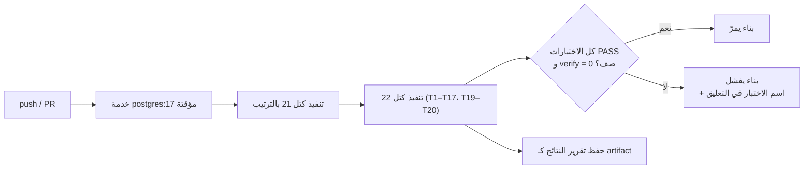
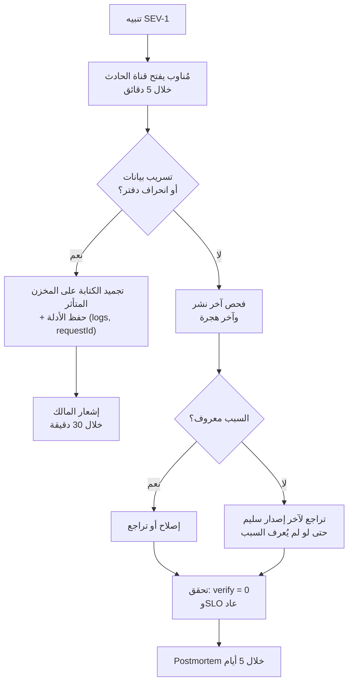

# 26 — جاهزية الإنتاج (Gate C)
> **تحديث التنفيذ (2026-11-06):** الطبقة الخدمية لم تعد NestJS في حاوية — البوابة هي Supabase Edge Functions. التفاصيل والحدود الحسابية في [`28`](28-supabase-edge-runtime.md)؛ ما يلي يبقى صحيحًا في المنطق والعقد.

> **الحالة:** مواصفة تنفيذية — البوابة الوحيدة المتبقية قبل أول عميل.
> **القاعدة الحاكمة:** Gate C **لا تُوقَّع بالوثائق**. بنودها الأربعة تتطلب تشغيلًا فعليًا على بيئة تشبه الإنتاج. هذه الوثيقة تُحدد *كيف* يُنفَّذ كل بند وكيف يُثبت نجاحه، ولا تدّعي أنها نُفِّذت.
> **ما يمنح التوقيع:** تقرير تمرين استعادة موقّع، سجل تشغيل CI أخضر على `main`، تقرير k6 مرفق بالإصدار، وقائمة تنبيهات مربوطة بمستلمين.

---

## 1. تمرين الاستعادة (Restore Drill)

### 1.1 الهدف والقيم

| البند | القيمة | المصدر |
|---|---|---|
| RPO (أقصى فقد بيانات) | **24 ساعة** (خطة مجانية — `27` §6) · ≤ 5 دقائق عند الترقية | `14` §7 · `27` |
| RTO (أقصى توقف) | ≤ 60 دقيقة | `14` §7 |
| التكرار | قبل أول عميل + كل ربع سنة | `13` §7 (فجوة P1: «لا تمرين استعادة») |
| البيئة | مشروع معزول، بلا وصول للمستخدمين | `15` §6 |

### 1.2 الإجراء (بالترتيب، بلا اختصار)

| # | الخطوة | الأمر / الفحص | معيار النجاح |
|---|---|---|---|
| 1 | أخذ نقطة الاستعادة | مسار مجاني: أحدث `pg_dump` مشفّر من R2 + بصمة SHA-256. مسار مدفوع: تسجيل `now()` وLSN | النسخة وبصمتها مسجلتان في التقرير |
| 2 | إنشاء قاعدة فارغة | `CREATE DATABASE slamtak_drill` | موجودة |
| 3 | استعادة النسخة | `pg_restore --clean --if-exists -d slamtak_drill ./backup.dump` | بلا أخطاء |
| 4 | الوصول إلى نقطة الاستعادة | مسار مجاني: التحقق من `pg_restore` كامل بلا WAL (فقدان ≤ 24 ساعة مُعلن). مسار مدفوع: `recovery_target_time` | الفارق الزمني مسجّل صراحة في التقرير |
| 5 | فحص عدد الجداول | `SELECT count(*) FROM pg_class ... nspname='public'` | **42** |
| 6 | فحص RLS | عدد الجداول بـ `FORCE RLS` | **41** |
| 7 | فحص السياسات | `SELECT count(*) FROM pg_policies` | **47** |
| 8 | فحص اتساق الدفتر | `SELECT count(*) FROM app.verify_ledger_consistency()` | **0** |
| 9 | فحص الأدوار | `slamtak_app` بلا `USAGE` على `platform` | `false` |
| 10 | فحص الملفات | استعادة ملف عشوائي من S3 ومقارنة `sha256` | مطابق |
| 11 | تسجيل الزمن الفعلي | من الخطوة 1 إلى 8 | ≤ 60 دقيقة |

> الخطوات 5–9 هي نفس أرقام `21` §9.4 و`22` §7. أي اختلاف يعني أن النسخة غير صالحة **حتى لو استُعيدت بنجاح**. استعادة بلا فحص اتساق ليست تمرينًا، بل إعادة تشغيل قاعدة قد تكون فاسدة.

### 1.3 معايير الفشل (تُبطل التمرين)

- `verify_ledger_consistency()` يعيد أي صف.
- عدد الجداول أو السياسات أقل من المرجع.
- زمن الاستعادة > 60 دقيقة دون سبب موثّق ومقبول.
- استعادة الملفات فشلت أو الهاش مختلف.
- أي خطوة نُفِّذت بصلاحية أعلى من اللازم (مثال: `postgres` بدل دور الاستعادة).

### 1.4 قالب التقرير

```
تاريخ التمرين:
المنفّذ / المراجع:
نقطة PITR:            الزمن الفعلي للاستعادة:
الجداول: 42 / 42      FORCE RLS: 41 / 41      السياسات: 47 / 47
verify_ledger_consistency: 0 صف
الملفات: N ملفًا، كل الهاشات مطابقة
الانحرافات: (لا شيء / وصف)
القرار: ناجح / فاشل — التوقيع:
```

---

## 2. بوابة العزل في CI

### 2.1 المبدأ

اختبار العزل ليس ملفًا يُشغَّل يدويًا عند الشك؛ هو **شرط بناء**. إذا تسرّب صف واحد بين مخزنين، يفشل الـ build ويمنع الدمج.

### 2.2 ما يُشغَّل

مصدر الاختبارات هو **نفس كتل SQL في `21` و`22`** — لا نسخة ثانية تتفرّع عنها. هذا يمنع الحالة الكلاسيكية: اختبار أخضر في CI ووثيقة تصف شيئًا آخر.



| البند | القيمة |
|---|---|
| الصورة | `postgres:17` (نفس إصدار المزوّد) |
| المهلة القصوى | 5 دقائق (`16` §5) |
| المخرج | تقرير `T1–T20` (19 اختبارًا؛ T18 عند بناء Realtime) + عدد الجداول/السياسات، محفوظ 90 يومًا |
| شرط الفشل | أي `FAIL`، أو عدد جداول ≠ 42، أو سياسات ≠ 47، أو `verify ≠ 0` |
| الحماية | الفرع `main` لا يُدمج فيه إلا بناء أخضر |

### 2.3 اختبارات إضافية إلزامية في نفس البوابة

| الفحص | الغرض | الفشل يعني |
|---|---|---|
| `redocly lint api/openapi.yaml` | العقد ما زال صالحًا | 0 خطأ و0 تحذير مطلوبان |
| تطابق المسارات | كل مسار في `10` موجود في العقد | مسار موثّق غير منفّذ |
| فحص أسرار (`gitleaks`) | لا مفتاح في التاريخ | تسريب مفتاح |
| فحص الهجرات | كل هجرة قابلة للتراجع | هجرة بلا Down |
| انحراف الامتيازات | `slamtak_ops` بلا أي جدول، و`slamtak_app` بلا `EXECUTE` على أدوات التحقق (`T15`–`T17`) | صلاحية زائدة تُفتح سهوًا وتُصبح تجاوزًا لـ RLS |
| `AUTH-5` | توكن اشتراك Realtime يُرفض على `/api` (401) | توسيع صلاحية الاشتراك إلى قراءة بيانات |
| `T18` | اشتراك مستأجر B لا يستقبل حدث مستأجر A | تسريب عبر قناة Realtime ([`28`](28-supabase-edge-runtime.md) §7.1) |

---

## 3. اختبار الحمل

### 3.1 السيناريوهات والعتبات

منقولة حرفيًا من `16` §6، لأن الرقم الذي لا يُقاس في `staging` ليس هدفًا:

| السيناريو | الحمل | العتبة | الفشل يعني |
|---|---|---|---|
| يوم عمل | 40 متزامنًا، 60 دقيقة | p95 قراءة < 300ms، كتابة < 800ms | فهارس ناقصة |
| ذروة فاتورة | 30 كاشير × 10 فواتير/دقيقة | صفر 5xx، صفر رصيد سالب | تعارض أقفال |
| بحث | 100 طلب/ثانية | p95 < 200ms | استعلام بلا فهرس |
| تقرير ثقيل | 10 متزامنة | ≤ 10 ثوانٍ، لا تعطيل للطلبات | MV مفقود |
| تصدير 50k | 5 متزامنة | ≤ 60 ثانية، بلا OOM | تصدير في الذاكرة |
| صمود | 2× الحمل، 30 دقيقة | لا تسريب ذاكرة | تسريب اتصالات |
| لحظية | 15 مشتركًا × 5 حسابات، 10 أحداث/دقيقة | p95 تسليم الحدث < 300ms، وصفر حدث مفقود عند إعادة الاتصال | موضوع خاطئ أو Replay معطّل ([`28`](28-supabase-edge-runtime.md) §7.1) |

### 3.2 شروط صحة القياس

- البيانات: **10×** بيانات المخزن الحقيقي، لا 100 صف.
- نفس إصدار القاعدة والوسيط، وTLS مُفعّل.
- القياس على p95/p99 لا المتوسط — المتوسط يخفي الذيل.
- **يُبطل القياس** إذا تغيّر الكود بعده؛ التقرير مرتبط بـ commit hash.

### 3.3 معيار القبول

صفر `5xx` في سيناريو الذروة، صفر انتهاك لقيود المخزون (`verify_ledger_consistency = 0` بعد الحمل)، وتقرير k6 مرفق بالإصدار. **الحمل لا يُثبت أنه أسرع؛ يُثبت أنه لا ينكسر.**

---

## 4. المراقبة والتنبيهات

### 4.1 مؤشرات الخدمة (SLI)

| المؤشر | الهدف | القياس |
|---|---|---|
| توفر الـ API | ≥ 99.5% شهريًا | نسبة الطلبات غير 5xx |
| زمن القراءة p95 | < 300ms | سجلات الدالة + قياس داخلي (بلا OTel مدفوع) |
| زمن الكتابة p95 | < 800ms | نفس المصدر |
| تسليم حدث Realtime p95 | < 300ms | فرق التوقيت بين `created_at` ووصول الحدث في العميل |
| اتصالات Realtime متزامنة | < 150 (من 200) | إعدادات المشروع |
| طابور Outbox متأخر | < 60 ثانية | عمر أقدم رسالة |
| فشل `app.jobs` | < 1% | عدّاد المحاولات في الجدول |
| `verify_ledger_consistency` | 0 صف دائمًا | مهمة ليلية بدور `slamtak_ops` |

### 4.2 التنبيهات الإلزامية

| التنبيه | العتبة | الشدة | الإجراء الفوري |
|---|---|---|---|
| API down | 3 فحوص فاشلة | SEV-1 | §5.2 |
| أخطاء 5xx | > 2% لمدة 5 دقائق | SEV-1 | فحص آخر نشر → تراجع |
| انحراف دفتر/رصيد | أي صف | SEV-1 | تجميد المخزن المتأثر + تحقيق |
| نسخة احتياطية متأخرة | > 26 ساعة (RPO = 24) | SEV-1 | فحص GitHub Actions وR2 — لا PITR على الخطة المجانية |
| استهلاك اتصالات القاعدة | > 80% | SEV-2 | فحص تسريب اتصالات |
| مهام متراكمة | > 1000 صف معلّق | SEV-2 | فحص `pg_cron` والمفوّض |
| رسائل Realtime | > 1.4 مليون/شهر (70%) | SEV-2 | مراجعة حجم الأحداث |
| فشل تسجيل دخول جماعي | > 50 فشل/5 دقائق | SEV-2 | فحص حد المعدل وهجوم |
| مساحة قرص | > 85% | SEV-3 | أرشفة آمنة |
| شهادة تنتهي | < 21 يومًا | SEV-3 | تجديد |

**قاعدة:** كل تنبيه له مستلم مسمّى، وقناة، وRunbook. تنبيه بلا مستلم = ضجيج يُدرّب الفريق على التجاهل.

### 4.3 شدة الحوادث

| الشدة | التعريف | زمن الاستجابة | أمثلة |
|---|---|---|---|
| SEV-1 | تعطّل كامل أو تسريب بيانات | 5 دقائق، 24/7 | API down، انحراف دفتر، تسريب بين مخازن |
| SEV-2 | تدهور كبير مع بديل | 15 دقيقة، ساعات العمل | طابور متراكم، تقارير معطّلة |
| SEV-3 | أثر محدود | يوم عمل | تنبيه قرص، شهادة قريبة الانتهاء |
| SEV-4 | تجميلي | أسبوع | خطأ إملائي، تنسيق |

---

## 5. Runbooks والحادث

### 5.1 فهرس الـ Runbooks

قائمة `14` §9 صارت ملزمة بأسماء مالكين:

| Runbook | المالك | الزمن المتوقع | معيار النجاح |
|---|---|---|---|
| نشر إصدار / تراجع | Backend Lead | 15 دقيقة | إصدار سابق يعمل |
| استعادة قاعدة | DBA/Ops | 60 دقيقة | §1.2 كامل |
| تعطيل / إعادة تفعيل Tenant | Backend | 10 دقائق | 401 لكل جلساته |
| تدوير مفتاح/سر | Security | 30 دقيقة | لا انقطاع، KV قديم مُبطَل |
| طابور متوقف | Backend | 20 دقيقة | عمر أقدم رسالة < 60 ثانية |
| حادث أمني | Security | فوري | احتواء + أدلة محفوظة |
| نفاد مساحة | Ops | 30 دقيقة | < 70% |
| شهادة منتهية | Ops | 15 دقيقة | TLS صالح |

كل Runbook يحتوي: **ما يجب عدم فعله** (مثال: لا `DELETE` على `stock_movements`، لا تعطيل RLS مؤقتًا).

### 5.2 أول 15 دقيقة في SEV-1



**قاعدة التراجع:** عند الشك، تراجع. التحقيق في السبب أثناء تعطّل الخدمة يضاعف الضرر.

### 5.3 Postmortem — بلا لوم

خلال 5 أيام من كل SEV-1، وثيقة تحتوي: الخط الزمني، الأثر بالأرقام، السبب الجذري (تقني وإجرائي)، ما نجح، ما فشل، إجراءات بمالك وتاريخ، وتهديد جديد في `25` إن كان الحادث أمنيًا.

---

## 6. قائمة الإطلاق (Go-Live Checklist)

لا يُفتح النظام لأول مخزن قبل اكتمال كل بند:

- [ ] تمرين استعادة ناجح وتقريره موقّع (§1).
- [ ] CI أخضر على `main` مع T1–T20 (§2).
- [ ] تقرير حمل k6 مطابق للعتبات (§3).
- [ ] كل تنبيه في §4.2 مربوط بمستلم ومُجرَّب بإشعار تجريبي.
- [ ] Runbooks الثمانية مكتوبة ومراجعة (§5.1).
- [ ] `slamtak_ops` موجود، ينفّذ أداة التحقق ويعجز عن قراءة جدول تجاري (`T16`, `T17`)، ودور التطبيق بلا `EXECUTE` (`T15`).
- [ ] نسخة احتياطية أولى مؤتمتة ومُراقَبة.
- [ ] MFA مفعّل لحساب المالك والمدير.
- [ ] مستخدم Break-glass واحد فقط، بكلمة مرور في خزنة، وبلا استخدام يومي.
- [ ] صفحة حالة (Status) أو قناة إشعار للعميل.
- [ ] عقد دعم: من يُتصل به، ومتى، وبأي رقم.

---

## 7. ما لا يمكن اعتماده قبل الكود

| البند | لماذا | ما يلزم |
|---|---|---|
| نتائج تمرين الاستعادة | لا قاعدة إنتاج بعد | تنفيذ §1.2 على staging حقيقي |
| بوابة CI | لا مستودع كود بعد | تنفيذ §2 على أول commit |
| نتائج الحمل | لا خدمة تعمل | تنفيذ §3 بعد Phase 1 |
| SLO فعلي | لا قياس | 30 يومًا بيانات قبل الالتزام بالرقم |
| Pentest | خارجي | `25` R1 |

**لا أوقّع Gate C بالنيابة عنك، ولا أدّعي أن بندًا منها نُفِّذ.** هذه الوثيقة تجعل التوقيع ممكنًا، لا حاصلًا.

---

## 8. معايير قبول هذه الوثيقة

- [x] كل بند من بنود Gate C له إجراء ومعيار نجاح رقمي.
- [x] تمرين الاستعادة مربوط بأرقام `21`/`22` لا بأرقام مستقلة.
- [x] بوابة CI تُشغّل نفس كتل SQL الموثقة (مصدر واحد للحقيقة).
- [x] عتبات الحمل مطابقة لـ `16` §6.
- [x] تصنيف شدّة الحوادث وأول 15 دقيقة محددان.
- [x] Go-Live Checklist قابلة للطباعة والتوقيع.
- [ ] **معلّق على المالك:** تحديد مُناوب (On-call) وقناة الحوادث قبل الإطلاق. مسجَّل كقرار **#10** في [`README`](README.md) §6.
