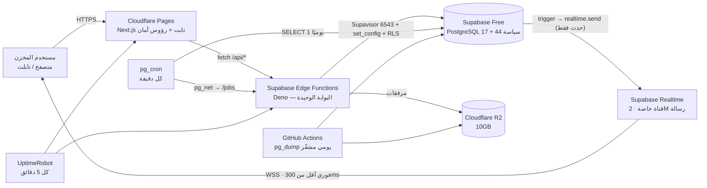

# 27 — معمارية التكلفة الصفرية: تقييم الخدمات وحدودها

> **قرار المالك (2026-11-06):** التكلفة في التطوير والتجربة والتشغيل الأولي = **صفر**، بلا بطاقة بنكية وبلا فوترة تلقائية وبلا API مدفوع.
> **القاعدة الحاكمة:** نُخفّض التكلفة، **ولا نُخفّض أمان بيانات المخزن أو سلامة الأرصدة**. كل بند أدناه يوضّح كيف نحافظ على الحد الأمني داخل خطة مجانية.
> **البديل المرفوض:** «مجاني الآن ثم نكتشف أننا نحتاج الدفع». لذلك يوجد قسم صريح لما **لا** يمكن تنفيذه مجانًا (§6).

---

## 1. كيف قيّمنا كل خدمة

لكل خدمة ستة أسئلة إلزامية قبل اعتمادها: الاسم، الرابط الرسمي، هل هي مجانية بالكامل أم بحدود، ما الحدود، ما البديل المجاني، وهل يمكن الاستمرار عليها مستقبلًا. وأضفنا عمودين عمليين: **استهلاكنا المتوقع** مقابل الحد، و**نقطة التنبيه** قبل الوصول إليه.

---

## 2. سجل الخدمات المعتمد

| # | الخدمة | الرابط الرسمي | مجانية بالكامل أم بحدود | الحدود الفعلية | استهلاكنا المتوقع | البديل المجاني | الاستمرار مستقبلًا |
|---|---|---|---|---|---|---|---|
| 1 | **Supabase Free** (PostgreSQL مُدار) | https://supabase.com/pricing | بحدود | 500 MB قاعدة، 5 GB خروج بيانات، 1 GB ملفات، مشروعان نشطان، 50k مستخدم شهريًا، **إيقاف تلقائي بعد 7 أيام خمول**، **لا نسخ احتياطي تلقائي**، لا PITR | 80–150 MB في السنة الأولى (§3) | PostgreSQL محلي في Docker للتطوير، ثم Oracle/Google always-free | **حتى ~5 مخازن** (المساحة تصبح الحد)؛ بعده Pro إجباري |
| 2 | **Cloudflare Pages** (الواجهة) | https://pages.cloudflare.com | بحدود سخية | 500 عملية بناء/شهر، بناء واحد متزامن، 20,000 ملف، طلبات ثابتة وعرض نطاق **غير محدودين**، 100 نطاق/مشروع | ~40 بناء شهريًا | GitHub Pages (لكن بلا دوال ولا رؤوس أمان مرنة) | نعم، ويُستخدام تجاريًا بلا قيد |
| 3 | **Supabase Edge Functions** (Deno — كل منطق الـ API) | https://supabase.com/docs/guides/functions/limits | بحدود | **500,000 استدعاء/شهر**، **2 ثانية CPU لكل طلب (حد صارم)**، 150 ثانية زمن حائط على المجاني، 100 دالة/مشروع، ذاكرة مشتركة ~0.5 GB | ~103,000 لمخزن واحد (`28` §3) | Oracle/Google always-free (§10.1) للمهام التي تتجاوز 2 ثانية | **4–5 مخازن؛ بعده Pro** |
| 3ب | **Supabase Realtime** (تحديث لحظي) | https://supabase.com/docs/guides/realtime/limits | مجانية مع المشروع | **200 اتصال متزامن**، 100 رسالة/ثانية، **2 مليون رسالة/شهر**، حمولة 256KB، احتفاظ 3 أيام | ~180 ألف رسالة/شهر لمخزن (15 مشتركًا) | SSE احتياطي بلا WebSocket | نعم حتى ~11 مخزنًا (الرسائل) |
| 4 | **Cloudflare R2** (نسخ احتياطي + مرفقات) | https://developers.cloudflare.com/r2/pricing | بحدود سخية | 10 GB-شهر تخزين، مليون عملية كتابة، 10 ملايين قراءة، **خروج البيانات مجاني** | 1–3 GB | GitHub Releases (غير مناسب لبيانات سرية)، تخزين محلي على جهاز المالك | نعم |
| 5 | **GitHub Free** (الكود + CI + Cron) | https://github.com/pricing | بحدود | مستودعات خاصة غير محدودة، **2,000 دقيقة Actions شهريًا**، 500 MB Artifacts، 10 GB Cache | ~600–900 دقيقة | GitLab Free (400 دقيقة) | نعم |
| 6 | ~~Render Free~~ | https://render.com/docs/free | — | **لم يعد مستخدمًا** بعد اختيار Edge Functions (2026-11-06): كان يحلّ محلّه، وقد ألغى قراره الحاجة إلى خادم دائم | صفر | — | لا |
| 7 | **pg_cron + pg_net** (طوابير Supabase) | https://supabase.com/docs/guides/cron | مجانية مع المشروع | جدولة بالدقيقة، تنفيذ داخل القاعدة، استدعاء HTTP عبر `pg_net` — **تشغل على نفس الـ Nano المشترك** | ~2,000 مهمة/يوم | pg-boss + خادم دائم (لم يعد له موضع) | نعم (تتغير إلى Pro مع النمو) |
| 8 | **Drizzle ORM** | https://orm.drizzle.team | مجانية بالكامل (Apache-2.0) | لا حدود | — | Prisma (Apache-2.0) | نعم |
| 9 | **Next.js / React / Tailwind / shadcn/ui** | https://nextjs.org | مجانية بالكامل (MIT) | لا حدود | — | Vite + React Router | نعم |
| 10 | **Argon2id (hash-wasm)** | https://github.com/Daninet/hash-wasm | مجانية بالكامل (MIT) | WASM يعمل داخل Deno بلا ربط أصلي — يستهلك CPU من ميزانية الـ2 ثانية | 120 تجزئة/يوم ≈ 1% من الميزانية | `@noble/hashes` (أبطأ) | نعم |
| 11 | **JWT ES256** (jose) | https://github.com/panva/jose | مجانية بالكامل (MIT) | لا حدود | — | node:crypto | نعم |
| 12 | **UptimeRobot Free** (مراقبة توفّر) | https://uptimerobot.com | مجانية بالكامل (مسموح تجاريًا) | 50 مراقبًا، فحص كل 5 دقائق، صفحات حالة | 4 مراقبات | Cloudflare Health Checks (مدفوع)، cron + بريد | نعم |
| 13 | **Sentry** (تتبع أخطاء) | https://sentry.io/pricing | بحدود | خطة مطوّر مجانية بحد شهري للحوادث — **يُثبت الرقم عند التسجيل** | < 2,000 حادث/شهر | GlitchTip (مفتوح، يستضيف نفسه)، سجلات JSONL + بريد | نعم (خطة أعلى عند النمو) |
| 14 | **GitHub Actions — نسخ احتياطي** | https://docs.github.com/actions | بحدود | ضمن الـ 2,000 دقيقة | ~150 دقيقة (5 دقائق/يوم) | cron على جهاز المالك | نعم |
| 15 | **Resend** (بريد المعاملات) | https://resend.com/pricing | بحدود | ~3,000 رسالة/شهر، 100/يوم — **يُثبت عند التسجيل**؛ لا استخدام تجاري واسع في الخطة المجانية بلا نطاق موثّق | ~300 رسالة | إشعارات داخل التطبيق فقط (بلا بريد) | مشروط |
| 16 | **ZAP / Trivy / Playwright / k6** (اختبار وأمان) | https://www.zaproxy.org · https://trivy.dev · https://playwright.dev · https://k6.io | مجانية بالكامل (Apache-2.0 / MIT / AGPL) | لا حدود — تعمل في CI | 10–15 دقيقة/تشغيل | — | نعم |
| 17 | **Let's Encrypt / شهادات Cloudflare** | https://letsencrypt.org | مجانية بالكامل | 90 يومًا، تجديد آلي | — | Cloudflare Universal SSL | نعم |

### ما استُبعد صراحةً

| الخدمة | السبب |
|---|---|
| **Vercel Hobby** | شروطها تحصر الخطة المجانية في الاستخدام **غير التجاري**؛ مخزن أدوية لنظام يُستخدم تجاريًا = مخالفة قد تُغلق الحساب بلا إشعار. رُفضت. |
| **Render Postgres المجاني** | ينتهي بعد 30 يومًا ولا يدعم نسخًا احتياطيًا. مرفوض تمامًا لبيانات مخزن. |
| **Redis مُدار مجاني (Upstash وغيره)** | حدود الأوامر الشهرية لا تتحمّل استقصاء BullMQ المستمر؛ استُبدل بـ pg-boss. |
| **Firebase / MongoDB Atlas Free** | تكرار غير مبرَّر؛ PostgreSQL مطلوب أصلًا للعلاقات وRLS. |

---

## 3. هل تكفي 500 MB فعلًا؟ (حساب لا وعد)

| المكوّن | الحجم التقديري |
|---|---|
| كتالوج 5,000 دواء + باركودات + أسعار | ~3 MB |
| 40 مستخدمًا + صلاحيات + تدقيق | ~5 MB |
| حركة مخزون واحدة (سطر + فهارس) | ~250 بايت |
| 1,500 حركة/يوم × 365 | ~137 MB/سنة |
| فهارس إضافية ×1.6 | ~220 MB/سنة |
| **الإجمالي بعد سنة** | **~230 MB** (46% من الحد) |

**النتيجة:** المساحة تكفي 18–24 شهرًا لمخزن واحد. الإجراء المُلزَم قبل الوصول إلى 70%: أرشفة الحركات الأقدم من 18 شهرًا إلى R2 كملفات NDJSON مضغوطة، وحذفها من الجدول بعد التحقق من مطابقة الرصيد بأداة `app.verify_ledger_consistency()` — الأداة موجودة أصلًا في `21` §9.3.

**مقابل ذلك:** 5 GB خروج بيانات شهريًا هو الحد الأضيق فعليًا، لا المساحة. لذلك §1 من `17` يفرض الترقيم على الخادم وتقليل الاستجابات — وهذا قرار معماري قائم لا جديد.

---

## 4. المعمارية المجانية بالكامل (المسار المعتمد)

**لا خادم دائم في هذا المسار.** لا Render ولا Oracle: كل شيء داخل حدود Supabase المجانية + Pages. هذا يلغي أهم خطرين كانا مكتوبين سابقًا (نوم Render، واستعادة Oracle للنسخ الخاملة)، ويُلغي الحاجة إلى بطاقة بنكية أصلًا.

**ثلاث دقائق تفصيلية تحمي المجانية من أن تنقلب إلى توقف:**

1. **منع إيقاف Supabase:** استعلام `SELECT 1` يوميًا عبر `pg_cron` أو GitHub Actions يمنع «7 أيام خمول». بدونه يتوقف النظام كله بلا أن يلاحظ أحد — وهذا أخطر بند في الخطة المجانية.
2. **منع «الاستدعاء الأول البطيء»:** Edge Functions تُقلع في ~100–400ms لكل عزل جديد؛ طلب خفيف كل 10 دقائق في ساعات العمل يبقي العزل ساخنًا.
3. **نسخ احتياطي بلا خدمة مدفوعة:** `pg_dump` يومي في GitHub Actions → تشفير `age`/GPG → R2، باحتفاظ 30 نسخة يومية + 12 شهرية. لا يمكن تشغيل `pg_dump` داخل Edge Function (لا وصول لثنائيات النظام) — لذلك يبقى مسارًا خارجيًا بالضرورة.

---

**ثلاث دقائق تفصيلية تحمي المجانية من أن تنقلب إلى توقف:**

1. **منع نوم Render:** مهمة GitHub Actions تُرسل طلبًا خفيفًا كل 10 دقائق (في ساعات العمل كل 5) — تبقي الخدمة مستيقظة وتستهلك ~700 ساعة من 750. النوم يبقى ممكنًا خارج ساعات العمل ويُقبل لأن الاستيقاظ ~دقيقة.
2. **منع إيقاف Supabase:** استعلام `SELECT 1` على جدول صغير يوميًا يمنع «7 أيام خمول». بدونه يتوقف النظام كله بلا أن يلاحظ أحد — وهذا أخطر بند في الخطة المجانية.
3. **نسخ احتياطي بلا خدمة مدفوعة:** `pg_dump` يومي → تشفير `age`/GPG → R2، باحتفاظ 30 نسخة يومية + 12 شهرية. يعوّض غياب النسخ التلقائي في الخطة المجانية (§7).

---

## 5. التعارضات مع القرارات السابقة وحلّها

| القرار السابق | التعارض مع التكلفة الصفرية | الحل المعتمد |
|---|---|---|
| VPS + Docker Compose (ADR-018) | 5–20 دولارًا شهريًا | استُبدل بـ Render Free للتجربة، وOracle Always Free عند الإنتاج الحقيقي (§6) |
| BullMQ + Redis (ADR-011) | لا Redis مجاني يتحمّل الاستقصاء | **pg-boss** على PostgreSQL نفسه — يلغي خدمة كاملة ويقلّل التعقيد |
| Argon2id (ADR-005) | لا يتعارض: يعمل على Node في Render بلا تكلفة | يبقى كما هو؛ **لا** ننتقل إلى Supabase Auth |
| نسخ احتياطي مُدار + PITR (`26` §1) | غير متاح في الخطة المجانية | RPO يتحول من دقائق إلى **24 ساعة** موثقة صراحة في `26` |
| ميزانية 60–120 دولارًا (README §6) | مناقضة | استُبدلت بـ «صفر حتى حدود الخطط» |

---

## 6. ما لا يمكن تنفيذه مجانًا — بصراحة

| الوظيفة | لماذا لا تُنجز مجانًا | البديل المجاني المقترح | الأثر |
|---|---|---|---|
| ~~تشغيل API في بيئة إنتاج موثوقة~~ **حُلّت** | كان Render/Vercel/Workers كلها غير صالحة للإنتاج المجاني | **Supabase Edge Functions** على الخطة المجانية نفسها: 500 ألف استدعاء شهريًا، وهذا كافٍ لأربعة أو خمسة مخازن (`28` §3) | **لم تبقَ مشكلة**: لا خادم دائم ولا بطاقة. يبقى قيد واحد حقيقي: **2 ثانية CPU لكل طلب** — تُدار بتقسيم المهام الثقيلة (`28` §7) |
| **نسخ احتياطي بنقطة زمنية (PITR)** | ميزة مدفوعة | `pg_dump` يومي مشفّر إلى R2 | فقدان أقصى 24 ساعة عمل |
| **اختبار اختراق خارجي (R1)** | خدمة بشرية مدفوعة | ZAP + Trivy + مراجعة داخلية | يبقى خطرًا معلنًا في `25`؛ لا يُدَّعى أنه مُغطى |
| **رسائل SMS / WhatsApp** | كل مزوّدي مصر بمقابل لكل رسالة | إشعار داخل التطبيق + بريد مجاني | لا إشعار فوري بلا إنترنت |
| **الفاتورة الإلكترونية (ETA)** | الـ API حكومي مجاني، لكن الشهادة والتوقيع الإلكتروني يحتاجان تعاقدًا | تأجيل للمرحلة 5 | خارج النسخة الأولى أصلًا |
| **نطاق مخصص (custom domain)** | ~10 دولارات سنويًا | `*.pages.dev` المجاني | رابط غير تجميلي |
| **تنبؤ الذكاء الاصطناعي** | كل API نماذج بمقابل | قواعد إحصائية بسيطة (متوسط استهلاك + انحراف معياري) محسوبة في القاعدة | تنبؤ أبسط لكنه مجاني تمامًا |
| **SLA / دعم بمستوى خدمة** | غير موجود في أي خطة مجانية | مراقبة + Runbooks + رد على الحوادث من الفريق | لا تعهّد زمن استجابة رسمي |

**الخلاصة التي يجب أن تُقرأ مرتين:** التكلفة صفر ممكنة **بشرطين**: (أ) قبول RPO = 24 ساعة، (ب) تشغيل الإنتاج على Oracle/Google Always Free ببطاقة تحقق فقط — أو الاكتفاء بـ Render للتجربة الداخلية بلا التزام تجاه عميل.

---

## 7. الأمان داخل القيود المجانية

| الخطر الذي تخلقه المجانية | الضابط |
|---|---|
| لا نسخ احتياطي تلقائي | `pg_dump` يومي مشفّر + **تمرين استعادة شهري** على قاعدة منفصلة؛ النسخة غير المُجرَّب استعادتها = غير موجودة |
| إيقاف المشروع بعد خمول | فحص يومي + مراقب UptimeRobot + تنبيه بريد عند فشل الفحص |
| CPU مشترك 500 MB RAM | RLS تُنفَّذ في القاعدة لا في التطبيق؛ لا اعتماد على ذاكرة الخادم لفرض العزل |
| نوم Render عند انقطاع الطلبات | الواجهة تُظهر حالة «جارٍ التشغيل» بدل خطأ غامض |
| أسرار في بيئة مجانية | لا أسرار في Git؛ متغيرات Render/R2 فقط؛ تدوير دوري موثّق |
| فقدان المشروع كليًا (حساب، إيقاف) | `pg_dump` + كود على GitHub + إمكانية إعادة البناء على أي مزوّد آخر — الخطة المجانية لا تحتجز بياناتك |

---

## 8. تنبيهات حدود الخطة المجانية

| المورد | الحد | التنبيه عند | كيف يُنبَّه (مجانًا) |
|---|---|---|---|
| حجم قاعدة Supabase | 500 MB | **70% (350 MB)** | استعلام شهري في CI + بريد |
| خروج بيانات Supabase | 5 GB/شهر | 70% | لوحة Supabase + مراجعة أسبوعية في Runbook |
| طلبات Workers (إن استُخدم) | 100k/يوم | 70% | عدّاد في Worker + بريد |
| تخزين R2 | 10 GB | 70% | مراجعة شهرية في نفس المهمة |
| دقائق Actions | 2,000/شهر | 70% | GitHub يوقف تلقائيًا عند النفاد — لا خصم بلا بطاقة |
| ساعات Render | 750/شهر | 90% | تنبيه بريدي من Render |
| تخزين Sentry | حد الخطة | 80% | بريد Sentry |

**قاعدة صارمة:** عند 70% من أي حد، يُفتح بند في Runbook: تقليل، أرشفة، أو إيقاف ميزة — **قبل** الوصول إلى الحد. لا ترقية مدفوعة تلقائية ولا استثناء.

---

## 9. ضوابط منع أي إنفاق

1. **لا بطاقة بنكية** في Supabase أو Cloudflare أو Render أو GitHub. الخدمات المذكورة تعمل بلا بطاقة.
2. **لا تفعيل فوترة تلقائية** في أي حساب؛ لا «ترقية تجريبية».
3. **لا مفتاح API مدفوع** في الكود: أي تكامل خارجي يحتاج مفتاحًا = يبقى خلف واجهة معطّلة حتى موافقتك المكتوبة.
4. **لم تبقَ حاجة إلى بطاقة بنكية إطلاقًا** بعد اختيار Edge Functions. تبقى بطاقة Oracle/Google اختيارًا حرًا لك إن أردنا لاحقًا خادمًا احتياطيًا للمهام الطويلة، لا شرطًا للتشغيل.
5. **مراجعة شهرية موثقة:** لقطة من حدود كل خدمة تُحفظ في المستودع، فتصير الزيادة مرئية لا مفاجئة.

---

## 10. القرار المطلوب منك الآن

| الخيار | التكلفة | الأمان | متى تختاره |
|---|---|---|---|
| **أ. تجربة مجانية بالكامل بلا بطاقة** | صفر | كافٍ للتجربة، لا يصلح لعميل يدفع (Render Free + Supabase Free) | إن أردت البدء الآن فورًا بلا أي بيانات دفع |
| **ب. إنتاج مجاني ببطاقة تحقق فقط** | صفر (بلا خصم) | يصلح لعميل حقيقي، مع RPO 24 ساعة | إن قبلت بطاقة للتحقق فقط — **الخيار الموصى به** |
| **ج. لاحقًا: خطة Pro عند أول عميل يدفع** | 25–40 دولارًا | نسخ تلقائي + PITR + لا إيقاف | عند تجاوز 500 MB أو أول التزام تعاقدي |

**التوصية:** ابدأ بـ (أ) فورًا، واعتمد (ب) قبل أول مخزن حقيقي، وضع (ج) كبند في العقد لا كنفقة الآن. بهذا الترتيب لا تدفع شيئًا اليوم، ولا تبيع وعدًا لا تستطيع الوفاء به غدًا.

---

### 10.1 القرار المعتمد: Oracle أساسي + Google احتياطي

**الحالة:** حُسم من المالك بتاريخ 2026-11-06 — الخيار **(ب)**: بطاقة «تحقق» فقط، بلا خصم وبلا ترقية آلية.

| البند | Oracle Cloud (الأساسي) | Google Cloud (الاحتياطي الجاهز) |
|---|---|---|
| الشكل المجاني | 2 × `VM.Standard.E2.1.Micro` (⅛ OCPU، 1 GB RAM) + ARM A1 بحصة **2 OCPU / 12 GB** | 1 × `e2-micro` في `us-central1` أو `us-west1` أو `us-east1` |
| القرص | 200 GB block إجمالًا (كل إقلاع 47 GB) | 30 GB standard persistent disk |
| الخروج | ~10 TB/شهر | **1 GB/شهر** من أمريكا الشمالية |
| الأقرب لمصر | **Jeddah** أو Frankfurt | لا شيء — أمريكا فقط |
| الخطر الخاص | **استعادة النسخ الخاملة** + تخفيض حصص بلا إشعار | ضيق الخروج، وزمن استجابة أعلى |

**قرارات ملزمة عند التسجيل (لا رجعة فيها بعد الإنشاء):**

1. **المنطقة الرئيسية (Home Region) لا تُغيَّر أبدًا** في Oracle. تُختار مرة واحدة: **Jeddah** إن توفّرت، وإلا **Frankfurt**. اختيار خطأ = تأخير دائم لكل طلب.
2. **لا تُرقِّ الحساب** إلى Pay As You Go ولا تفعّل فوترة إضافية؛ يبقى Always Free كما هو.
3. في Google: **تنبيه ميزانية بقيمة 0.01$** مع إشعار بريدي — فتصبح أي تكلفة غير مقصودة حادثةً مرئية لا فاتورة مفاجئة.
4. القاعدة تبقى **Supabase Free** — لا نُشغّل PostgreSQL على الخادم في الإنتاج، لئلا نصير مسؤولين عن نسخ وترقيات وإصدارات أمنية بأنفسنا.
5. الخادم يُبنى من المستودع عبر `cloud-init` + Docker Compose، لا يدويًا: هذا ما يجعل «إعادة البناء بعد استعادة النسخة» مسألة دقائق لا أيام.

**مخاطر هذا المسار — مكتوبة كما هي:**

| الخطر | الاحتمال | الأثر | التخفيف المعتمد |
|---|---|---|---|
| Oracle يستعيد نسخة خاملة (CPU 95th <20% وNetwork <20% على 7 أيام) | **مرتفع** لمخزن صغير | توقف كامل حتى إعادة البناء | `cloud-init` + صورة Docker في GHCR + نسخ يومية في R2 ⇒ إعادة بناء < 60 دقيقة؛ فحص شهري موثّق |
| تخفيض حصص مجانية بلا إشعار (حدث فعلًا في 2026 لحصة ARM) | متوسط | سعة أقل أو إيقاف | التصميم يستهدف micro بـ1 GB لا ARM؛ لا ميزة تعتمد على 12 GB |
| Google: تجاوز 1 GB خروج | متوسط عند تقارير ثقيلة | توقف الخدمة أو رسوم | ضغط `gzip`/`br`، ترقيم إجباري، تصدير التقارير الثقيلة عبر رابط من R2 لا عبر API |
| بطاقة «تحقق» تُخصم منها مبالغ | منخفض | مبلغ مؤقت صغير يُرد | لا اشتراك ولا تجديد؛ إشعارات بريدية فورية + تنبيه ميزانية |

**ما أطلبه منك عمليًا (خمس خطوات، مرة واحدة):**

1. إنشاء حساب Oracle Cloud واختيار المنطقة الرئيسية **Jeddah** (وإلا Frankfurt).
2. إتمام تحقق البطاقة دون ترقية الحساب.
3. إنشاء VM واحدة بـ`Ubuntu 24.04` وتسليمي بصمة SSH العامة فقط (لا كلمة سر ولا مفتاح خاص في المحادثة).
4. (اختياري الآن) حساب Google مع تنبيه ميزانية 0.01$ كاحتياطي.
5. تأكيد أن مفتاح `SSH` موضوع في مستودع الأسرار لا في الملفات.

**لا أُنشئ هذه الحسابات نيابةً عنك ولا أُدخل بيانات بطاقة في أي ملف أو أمر — بموجب ضوابط `§9`.**

## 11. أثر ذلك على الوثائق الأخرى

| الوثيقة | التغيير |
|---|---|
| `05-technology-stack.md` | Redis/BullMQ → pg-boss؛ VPS → Render/Oracle؛ R2 للتخزين |
| `14-infrastructure-architecture.md` | §2 و§8 (التكلفة) استُبدلا بهذه الوثيقة |
| `15-deployment-architecture.md` | النشر عبر GitHub Actions → Pages + `supabase functions deploy`؛ لا حاويات ولا خادم دائم ([`28`](28-supabase-edge-runtime.md)) |
| `17-scalability-plan.md` | عتبات القرار مرتبطة بحدود الخطط المجانية لا بالموارد المدفوعة |
| `26-production-readiness.md` | RPO 24 ساعة؛ النسخ الاحتياطي مسؤوليتنا لا المزوّد؛ Gate C لا تُوقَّع على خطة مجانية بلا تمرين استعادة |
| `README.md` | قرار المالك #2 (الميزانية) صار «صفر حتى حدود الخطط» |

**ما لم يتغيّر — وهذا مقصود:** العزل بـ RLS، ومنع تعديل الأرصدة بلا حركة، وFEFO، ومنع صرف المنتهي، وأربعة أدوار قاعدة بأقل امتياز. كلها قرارات تصميمية لا تكلفة لها، ولا يجوز المساس بها لتوفير دولارات.
