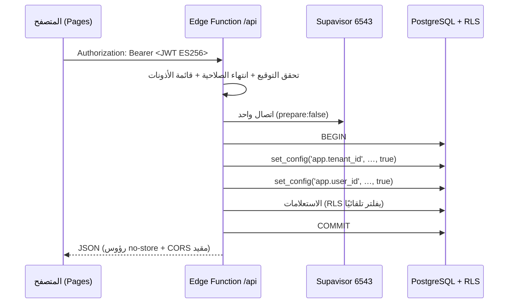
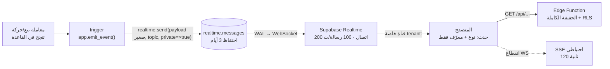

# 28 — معمارية التشغيل: Cloudflare Pages + Supabase Edge Functions

> **الحالة:** وثيقة حاكمة للتنفيذ — تحلّ محلّ الطبقة التي كانت NestJS في حاوية (`03`, `07`, `15`).
> **قرار المالك (2026-11-06):** الواجهة على **Cloudflare Pages**، القاعدة والعزل على **Supabase (Free)**، وكل المنطق البرمجي على **Supabase Edge Functions**.
> **ما لا يمسّه هذا القرار:** 39 جدولًا، و44 سياسة RLS، و38 جدولًا بـ`FORCE RLS`، ومشغّلات سلامة الأرصدة، و19 اختبار عزل، و65 مسارًا في العقد. كلها تبقى كما هي حرفيًا.

---

## 1. لماذا هذا القرار مقبول — وليس تنازلًا

الخطر الأول في أي انتقال إلى «serverless» هو أن يُفتح للمتصفح بابٌ مباشر إلى القاعدة عبر PostgREST، فيصير الأمان على المتصفح. **لن يحدث ذلك هنا:** لا صلاحيات لـ`anon` ولا لـ`authenticated` على مخطط `public` (فيصير PostgREST عديم النفع حتى لو بقي منشورًا)، والمتصفح لا يرى إلا `https://<project>.supabase.co/functions/v1/api`.

Edge Functions هنا ليست «طبقة منطق رقيقة فوق قاعدة مكشوفة»، بل هي **البوابة الوحيدة** — نفس دور NestJS في التصميم السابق، بنفس القاعدة: لا اتصال بالقاعدة إلا بدور محدود وبسياق مستأجر مضبوط داخل المعاملة.

**الثلاثية كما اعتمدتها:**

| الطبقة | التقنية | ما تفعله | ما لا تفعله أبدًا |
|---|---|---|---|
| الواجهة | Cloudflare Pages (Next.js ثابت) | عرض، حالة، استدعاء `/api/*` | لا تتصل بالقاعدة، ولا تحمل مفتاحًا سريًا |
| البوابة | Edge Functions (Deno) | مصادقة، تحقق، معاملات، RLS context | لا تستخدم `service_role` لبيانات المخازن |
| البيانات | Supabase PostgreSQL + RLS | مصدر الحقيقة، العزل، سلامة الأرصدة | لا تُقرأ من عميل مباشرة |

---

## 2. ما لا يتغيّر (وهذا أهم قسم في الوثيقة)

| العنصر | الحالة |
|---|---|
| 39 جدولًا في `public` + 4 في `platform` (`21`) | **بلا تغيير** |
| 38 جدولًا بـ`FORCE ROW LEVEL SECURITY` | **بلا تغيير** |
| 44 سياسة RLS مبنية على `app.current_tenant()` | **بلا تغيير** — لا تُعاد كتابتها لجلب الهوية من JWT |
| `REVOKE UPDATE, DELETE` على `stock_batches` و`stock_movements` | **بلا تغيير** |
| مشغّلات منع تعديل الرصيد بلا حركة، وFEFO، ومنع صرف المنتهي | **بلا تغيير** — كلها في القاعدة لا في التطبيق |
| 19 اختبار عزل (T1–T17، T19–T20) | **بلا تغيير** — تعمل على SQL مباشرة، لا تعرف من يستدعيها |
| 65 مسارًا و89 عملية في `openapi.yaml` | **بلا تغيير** — الواجهة ترى نفس العقد |
| سياسة واحدة جديدة على `realtime.messages` | إضافة معزولة — الـ44 سياسة على البيانات لا تُمس |
| أربعة أدوار قاعدة (`slamtak_owner` للهجرات، `slamtak_app`, `slamtak_platform`, `slamtak_ops`) | **بلا تغيير** — `slamtak_app` يصبح الدور الذي يتصل به Edge Function |

**السبب:** كل ما يهمّ أمان مخزن الأدوية موجود في القاعدة نفسها، لا في إطار العمل. تغيير إطار العمل من NestJS إلى Deno لا يغيّر سياسة واحدة. هذا ما يجعل هذا الانتقال رخيصًا فكريًا ومكلفًا تقنيًا فقط في الطبقة الرفيعة.

---

## 3. الحدود الحقيقية لـ Edge Functions (مأخوذة من المصادر)

| الحد | القيمة | معناه لنا |
|---|---|---|
| الاستدعاءات | **500,000/شهر** (Free) | ~103 ألفًا لمخزن واحد ⇒ تكفي **4–5 مخازن** |
| **CPU لكل طلب** | **2 ثانية (حد صارم)** | **القيد الحاكم**: لا تقارير ثقيلة في طلب واحد |
| الزمن الحائط | 150 ثانية (Free) / 400 (مدفوع) | انتظار I/O مسموح، لكن CPU هو السقف الفعلي |
| الذاكرة | ~0.5 GB مشتركة (Nano) | Argon2id 64MB يعمل، لكن لا تزامن عالٍ |
| عدد الدوال | 100/مشروع | لا نحتاج أكثر من 3 |
| الإقلاع البارد | ~100–400ms | يُخفَّف بطلب دافئ كل 10 دقائق |
| الاتصال بالقاعدة | Supavisor **وضع المعاملات، 6543** | لا `prepared statements`، ولا حالة جلسة دائمة |

**حساب الاستدعاءات لمخزن واحد — بعد جعل التحديث لحظيًا عبر Realtime (§7.1):**

الحساب على **أسوأ افتراض** في القرار #4: 40 مستخدمًا متزامنًا.

| البند | شهريًا |
|---|---|
| طلبات المستخدمين (40 × 60 طلبًا × 22 يومًا) | 52,800 |
| مهام `pg_cron` (1,440/يوم × 30) | 43,200 |
| تجديد توكن Realtime (320/يوم × 22) | 7,040 |
| **الإجمالي** | **≈ 103,000** |

⇒ **الخطة المجانية تتسع لـ4–5 مخازن** في أسوأ الأحوال، و**7** لو كان الاستخدام 15 متزامنًا كما في المخزن الأول. التخطيط الآمن: **5 مخازن**.

**لاحظ الاتجاه:** الانتقال من SSE إلى Realtime **قلّل** الاستدعاءات بدل أن يزيدها (79,200 دفق شهريًا اختفت)، لأن كل دفق SSE يُحسب استدعاءً جديدًا كل 120 ثانية، بينما اتصال WebSocket واحد يبقى مفتوحًا ساعات ويُحسب من حصة **الرسائل** لا الاستدعاءات. الفورية هنا ليست مقايضة ضد التكلفة — هي أرخص.

**والقاعدة التي ألتزم بها:** لا هندسة التفافية لإبقاء «صفر» بعد أن يصبح العميل يدفع. الـ«صفر» وُجد لمرحلة ما قبل أول عميل، لا ليصير قيدًا على عميل يدفع.

## 4. دورة حياة الطلب

**خمس قواعد غير قابلة للتفاوض في هذه الدورة:**

1. **`tenant_id` لا يأتي من جسم الطلب أبدًا.** يُشتق من الـJWT بعد التحقق، والـJWT لا يخرج من البوابة.
2. **`set_config(..., true)` أي داخل المعاملة.** الوضع الثالث `true` ضروري: يعيد الحالة عند `COMMIT`، فلا يتسرب سياق مستأجر إلى طلب آخر يستخدم نفس الاتصال المجمّع.
3. **`prepare: false`** في سائق `postgres` — Supavisor في وضع المعاملات لا يدعم العبارات المجهّزة.
4. **`statement_timeout` = 5 ثوان و`idle_in_transaction_session_timeout` = 10 ثوان** لكل معاملة، حتى لا يستهلك طلب بطيء اتصالات النانو.
5. **`service_role` ممنوع** في أي مسار يقرأ أو يكتب بيانات مخزن. يُستخدم في دالة `platform-admin` وحدها، بمفتاح منفصل وقائمة سماح صريحة، وبلا أي معامل `tenant_id` قادم من العميل.

---

## 5. تقسيم الدوال: ثلاث فقط

| الدالة | المسار العام | المسؤولية | لماذا منفصلة |
|---|---|---|---|
| `api` | `/functions/v1/api/*` | كل عمليات العقد الـ67 | تشارك نفس العزل والتسخين، وتُبقي عدد الدوال صغيرًا |
| `jobs` | `/functions/v1/jobs` | تنفيذ مهام `app.jobs` | تُستدعى من `pg_cron` بمفتاح داخلي، لا من المتصفح |
| `platform-admin` | `/functions/v1/platform-admin` | إدارة المنصة (بلا قراءة بيانات مخازن) | الوحيدة التي تلمس دور `slamtak_platform` |

**لماذا لا 27 دالة (وحدة لكل دالة)؟** كل دالة تحمل كلفة إقلاع بارد مستقلة وحزمة مستقلة؛ 27 دالة = 27 إقلاعًا باردًا واحتمال 27 نسخة من منطق المصادقة. البديل: **حزمة واحدة + توجيه داخلي**، مع بقاء الفصل المنطقي في الشيفرة (`modules/<name>/`) كما في `18`.

---

## 6. المصادقة داخل Deno — أين الخطر بالضبط

قرار المصادقة الذاتية (Argon2id + JWT ES256 + Refresh متداول + TOTP) يبقى كما هو في `12`، لكن تنفيذه ينتقل إلى Deno:

| المكوّن | التنفيذ في Deno | الملاحظة |
|---|---|---|
| Argon2id | `hash-wasm` (WASM) | لا ربط أصلي؛ المدى المتوقع 300–800ms عند `m=64MB, t=3, p=1` على نانو مشترك |
| توقيع JWT | `jose` + WebCrypto (ES256) | مدعوم أصلًا، بلا كلفة تُذكر |
| Refresh المتداول | جدول `auth.refresh_tokens` + تدوير ذرّي | نفس تصميم `12` |
| MFA TOTP | HMAC-SHA1 عبر WebCrypto | مدعوم |
| كلمات المرور في الذاكرة | تُمسح بعد الاستخدام | `Uint8Array.fill(0)` بعد التجزئة |

**بوابة قياس إلزامية قبل البناء:** يُقاس زمن Argon2id داخل الدالة الفعلية. **إن تجاوز p95 لدخول واحد 1.2 ثانية**، لا نخفّض المعاملات (تخفيضها تنازل أمني مرفوض) بل ننتقل إلى أحد خيارين: دالة `auth` منفصلة بحد أعلى، أو خادم صغير للمصادقة فقط. هذا بند يُثبت بالقياس لا بالوعد.

**حدّ المعدل:** لا خدمة Redis، فتُبنى عدادات في جدول `auth.rate_limits` (نافذة زمنية + مفتاح) داخل نفس المعاملة — كافية لـ«5 محاولات دخول/دقيقة/IP».

---

## 7. المهام الخلفية والحد الحاكم: 2 ثانية CPU

لا عملية طويلة العمر ⇒ **pg-boss بصيغته السابقة غير قابل للتنفيذ** (ADR-020 صار مُستبدَلًا جزئيًا بـADR-023). البديل المعتمد: جدول `app.jobs` + `pg_cron` كل دقيقة + `pg_net` يستدعي `/jobs`.

| نوع العمل | هل ينفَّذ في طلب واحد؟ | القاعدة |
|---|---|---|
| بيع/صرف/استلام/تحويل مخزني | ✅ | معاملة قصيرة، < 100ms CPU |
| فاتورة PDF واحدة | ✅ | `pdf-lib` ~100–300ms |
| تصدير 5,000 سطر CSV | ✅ | ضغط `gzip` سريع |
| تصدير > 5,000 سطر | ❌ | مهمة مقسّمة إلى دفعات، كل دفعة تكتب في R2 |
| استيراد كتالوج 20 ألف دواء | ❌ | دفعات من 500 سطر عبر `app.jobs` |
| تقرير شهري لكل المخازن | ❌ | مهمة لكل مستأجر، لا مهمة واحدة جامعة |
| `pg_dump` | ❌ **مستحيل** | GitHub Actions فقط (لا ثنائيات نظام في العزل) |
| إرسال بريد جماعي | ❌ | دفعات من 50 رسالة في المهمة |

### 7.1 التحديث اللحظي — Supabase Realtime

Edge Functions لا تفتح WebSocket، لكن **Supabase Realtime** يفعل — وهو داخل نفس المشروع والميزانية. والفورية ليست ترفًا في مخزن أدوية: محطتان تصرفان من نفس التشغيلة تحتاجان أن تريا رصيد الأخرى **قبل** البيع التالي، لا بعده بثلاث ثوان.

**المبدأ الحاكم بقي كما هو:** Realtime **لا ينقل بيانات**، ينقل «شيئًا تغيّر». الحمولة `{k:'sale.created', id:'…', v:42}` فقط — بلا كميات ولا أسعار ولا أسماء مرضى. الواجهة تستقبل الحدث ثم تجلب الحقيقة من `/api` حيث RLS والتحقق. لذلك حتى لو أُسيء تأمين القناة، لا تتسرب بيانات مخزن — أسوأ ما يحدث هو إشعار كاذب بمعرّف.

**المصادقة — نفس مفتاحنا، بلا Supabase Auth:**
1. البوابة تُصدر توكن ES256 قصير العمر (60 دقيقة) عبر `/api/auth/realtime-token`، بحمولة: `sub`, `role: authenticated`, `tenant_id`, `scope: realtime`.
2. المشروع يستورد **المفتاح العام** لمفتاحنا (JWT Signing Key مستورد، أو Third-Party Auth عبر OIDC issuer) — فيتحقق Realtime من توقيعنا بلا أن نستخدم GoTrue.
3. سياسة واحدة على `realtime.messages`: `SELECT` لـ`authenticated` حيث `realtime.topic() = 'tenant:' || (auth.jwt()->>'tenant_id')` و`auth.jwt()->>'scope' = 'realtime'`.
4. **لا سياسة `INSERT`** — العملاء لا ينشرون شيئًا؛ النشر من مشغّلات القاعدة فقط.
5. تفعيل **Private-only channels** في إعدادات Realtime، ورفض أي قناة عامة.

**الاستمرارية عند الانقطاع:** Broadcast Replay يسمح بطلب الرسائل الفائتة (`since` + `limit` حتى 25) عند إعادة الاتصال، فالمحطة التي أغلقت التابلت لا تفقد الأحداث — وإن فشل WebSocket أصلًا (شبكة تحجب)، يعمل SSE الاحتياطي بالدفق والتأخير 3 ثوان.

**الحدود المجانية:** 200 اتصال متزامن، 100 رسالة/ثانية، **2 مليون رسالة/شهر**، حمولة 256KB، احتفاظ الرسائل 3 أيام. حسابنا: 400 حدث/يوم × 15 مشتركًا = 6,000 رسالة/يوم ≈ **180 ألفًا شهريًا (9% من الحد)**، و15 اتصالًا من 200.

**لماذا هذا أفضل من كل بديل آخر:**

| البديل | التأخير | التكلفة | الحكم |
|---|---|---|---|
| استطلاع كل 30 ثانية | 30s | 432 ألف استدعاء | ❌ |
| SSE بدفق 120s | ≤3s | 79 ألف استدعاء | ✅ احتياطي |
| WebSocket خاص على Cloudflare DO | <1s | خدمة ومنطق إضافيان | ❌ تعقيد |
| **Supabase Realtime** | **<300ms** | **صفر استدعاءات** | ✅ **المعتمد** |

**آلية الأمان ضد التعليق:** `attempts`, `locked_at`, `run_after`, `last_error`. أي مهمة تتجاوز 15 دقيقة في حالة `running` تُنبَّه، وأي مهمة تتجاوز 5 محاولات تنتقل إلى `dead` مع إشعار. لا «إعادة محاولة صامتة» أبدًا — المهمة الميتة يجب أن تُرى.

**أثر جانبي يجب قوله:** `pg_cron` يعمل على نفس النانو المشترك مع الـAPI. مهمة ثقيلة تُبطئ البيع. لذلك كل المهام الليلية تُجدول بين 02:00 و05:00 بتوقيت القاهرة، ومهام النهار لا تتجاوز دفعة واحدة كل دقيقة.

---

## 8. ما ينكسر فعلًا — بصراحة

| ما كان | ما صار | الأثر |
|---|---|---|
| NestJS (DI، Guards، Interceptors، Pipes) | دالة واحدة + وسائط مركّبة (تحقق → مصادقة → تفويض → معاملة) | إعادة كتابة الطبقة الرفيعة (~1,500 سطر)، لا منطق الأعمال |
| `class-validator` / `class-transformer` | تعمل عبر Node-compat، أو `zod` (أخف وأنسب لـDeno) | لا فرق وظيفيًا |
| pg-boss | `app.jobs` + `pg_cron` + `pg_net` | ADR-023 |
| اتصال دائم بالقاعدة | اتصال لكل طلب عبر Supavisor | زمن إضافي ~5–15ms |
| نسخة واحدة من التطبيق | عزلات متعددة | لا حالة في الذاكرة: كل كاش/عدّاد يجب أن يكون في القاعدة |
| `pg_dump` من الخادم | GitHub Actions | مسار النسخ يبقى خارجيًا (وهو كذلك في `27` أصلًا) |
| مراقبة بـAPM وكيل | سجلات JSONL + Sentry SDK لـDeno | لا تتبع موزّع كاملًا؛ مقبول لمخزن واحد |
| WebSocket (Realtime Gateway) | Supabase Realtime (قنوات خاصة) + SSE احتياطي | فوري <300ms؛ يضيف مسارًا للـ**حدث** لا للبيانات، محكوم بسياسة RLS واحدة |

**البند الأخطر في الجدول هو «لا حالة في الذاكرة».** أي تصميم يعتمد على كاش داخل العملية (جلسات، عدّادات، أقفال) سينكسر بصمت لأن كل طلب قد يهبط على عزل مختلف. الحل: كل حالة في القاعدة، والأقفال عبر `pg_advisory_xact_lock`.

---

## 9. الأمان في هذا الشكل تحديدًا

1. **PostgREST وSupabase Auth بلا استخدام وبلا صلاحيات** — `REVOKE` على `anon` و`authenticated` في مخطط `public`، ويُثبت باختبار CI أن `/rest/v1/*` يرد 401/403؛ والمصادقة لدينا داخل `api`.
2. **لا مفتاح `service_role` في الواجهة ولا في المتصفح ولا في متغيرات بناء Pages.** يوجد فقط في أسرار مشروع Supabase، وتستخدمه `platform-admin` وحدها.
3. **كلمة مرور `slamtak_app` في أسرار Supabase (Edge Function Secrets)**، لا في المستودع ولا في Pages.
4. **CORS مُقيَّد بنطاق Pages** فقط، و`OPTIONS` لا يمرّ إلى القاعدة.
5. **كل استجابة تحمل `Cache-Control: no-store`** عدا الأصول الثابتة على Pages.
6. **17 اختبار العزل تُشغَّل في CI على كل تغيير في SQL أو في `api`** — لأن البوابة تغيّرت، لا الثقة.
7. **لا تُسجَّل أي حمولة تحتوي بيانات مريض أو دواء**؛ السجلات تحمل `request_id`, `tenant_id`, `route`, `status`, `ms` فقط.
8. **RLS يبقى خط الدفاع الأخير لا الأول:** التحقق في البوابة أولًا (صلاحية + نطاق)، ثم RLS يمنع الخطأ البشري.
9. **قنوات Realtime خاصة فقط** (`private: true` + Private-only في الإعدادات)، وموضوعها `tenant:<uuid>` مشتق من التوكن لا من اختيار العميل.
10. **لا سياسة `INSERT` على `realtime.messages`** — لا يستطيع أي عميل نشر رسالة، ولو كان موثّقًا.
11. **التوكن المستورد محدود النطاق:** `scope: realtime`، 60 دقيقة، ولا يُستخدم للـAPI العادي؛ وبما أن `anon`/`authenticated` بلا صلاحيات على مخطط `public`، فلا يفتح هذا الاستيراد بابًا للبيانات.

---

## 10. الأداء المتوقع (تقديرات، تُقاس في Phase 1)

| الحالة | الزمن المتوقع |
|---|---|
| طلب دافئ + استعلام بسيط | 40–80ms |
| طلب دافئ + معاملة بيع كاملة | 80–150ms |
| أول طلب بعد خمول | 250–600ms |
| دخول (Argon2id) | 400–900ms |

**الحكم:** مقبول لمخزن أدوية على تابلت داخل الشبكة المحلية. غير مقبول لتطبيق نقاط بيع عالية التردد بآلاف الطلبات في الدقيقة — وهذا خارج نطاقنا المعلن.

---

## 11. متى نتوقف عن هذا الشكل

| المؤشر | العتبة | القرار |
|---|---|---|
| الاستدعاءات الشهرية | 350 ألفًا (70%) | Pro قبل المخزن الخامس |
| مساحة القاعدة | 350 MB (70%) | أرشفة إلى R2 |
| أي طلب | > 1.5 ثانية CPU | تقسيم فوري |
| مخازن | 4–5 | Pro (25$/شهر) يصبح أرخص من الهندسة الالتفافية |
| رسائل Realtime | 1.4 مليون (70%) | مراجعة حجم الأحداث قبل Pro |
| اتصالات Realtime متزامنة | 150 | فحص الاشتراكات المعلّقة |
| مهمة ليلية | > 5 دقائق كليًا | خادم Oracle احتياطي (ADR-021) |

---

## 12. الاختبارات والبوابات

| البوابة | الأداة | ما تثبته |
|---|---|---|
| عزل المستأجرين | 17 اختبار SQL (بلا تغيير) + **T18 جديد**: اشتراك مستأجر B لا يستقبل حدث A | RLS يحمي حتى لو أخطأ التطبيق |
| العقد | Redocly + اختبارات تكامل على `/api` | 65 مسارًا كما هي |
| اختبار الدوال محليًا | `supabase start` + `deno test` | سلوك Deno لا Node |
| حمل | k6 على بيئة تجريبية | p95 < 300ms، وحد 2s CPU |
| أمان | ZAP baseline + Trivy للحزم | لا مسار مفتوح بلا مصادقة |
| صلاحية توكن الاشتراك | طلب آلي بتوكن `scope: realtime` على `/api/v1/stock` | **401** — التوكن لا يفتح بيانات، ولا يصلح إلا للإشتراك |

---

## 13. المخاطر

| الخطر | الأثر | التخفيف |
|---|---|---|
| تجاوز 2s CPU في مسار حقيقي | 546 + فشل بيع | قياس مسبق لكل مسار، وتقسيم، وحد أعلى على حجم السلة |
| Argon2id بطيء على النانو | دخول بطيء | بوابة قياس 1.2 ثانية؛ خطة بديلة موثقة |
| `service_role` يُستخدم بلا قصد في مراجعة كود | خرق عزل كامل | قاعدة ESLint مخصّصة + فحص CI يمنع المفتاح خارج `platform-admin` |
| انقطاع Supabase | توقف كامل | نسخ يومية في R2، و`pg_cron` ping، وصفحة حالة |
| Realtime يفتح مسارًا ثانيًا للمتصفح | تسريب إشعارات (لا بيانات) | حمولة بلا بيانات + قنوات خاصة فقط + لا `INSERT` للعملاء |
| انقطاع WebSocket في شبكة المخزن | تأخر التحديث | SSE احتياطي تلقائي، والعمل لا يتوقف |
| استيراد مفتاحنا يجعل توكناته مقبولة في PostgREST | سطح إضافي | `anon`/`authenticated` بلا صلاحيات على `public`، والتوكن `scope: realtime` فقط |
| اعتماد على Deno/Supabase | صعوبة النقل | حزم TS عادية للمنطق، والـDeno محوّل رفيع فقط |

---

## 14. أثر ذلك على الوثائق الأخرى

| الوثيقة | التغيير |
|---|---|
| `03`, `07` | NestJS ومكوّناته مُستبدَلة بهذه الوثيقة؛ منطق الأعمال نفسه |
| `12` | نفس التصميم، تنفيذ Deno (Argon2id عبر WASM) |
| `15` | النشر: Pages + `supabase functions deploy`؛ لا حاويات |
| `16` | المراقبة: سجلات Deno + Sentry، بلا وكيل APM |
| `18` | البنية: `supabase/functions/api/` بدل `apps/api` |
| `11` | سياسة `realtime.messages` تُضاف إلى مصفوفة العزل |
| `20` | ADR-022 و023 و024؛ ADR-020 و021 صارا مُستبدَلين جزئيًا |
| `27` | المسار المجاني لم يبقَ فيه خادم دائم، ولا بطاقة بنكية |
| `23` | بلا تغيير — العقد هو نفسه |
| `21`, `22` | بلا تغيير — القاعدة والاختبارات كما هي |

**ما لم أفعله عن قصد:** لم أكتب سطر كود واحد. هذا تصميم لا تنفيذ، وما زال «لا تبدأ التنفيذ قبل اعتماد التصميم» قائمًا.
